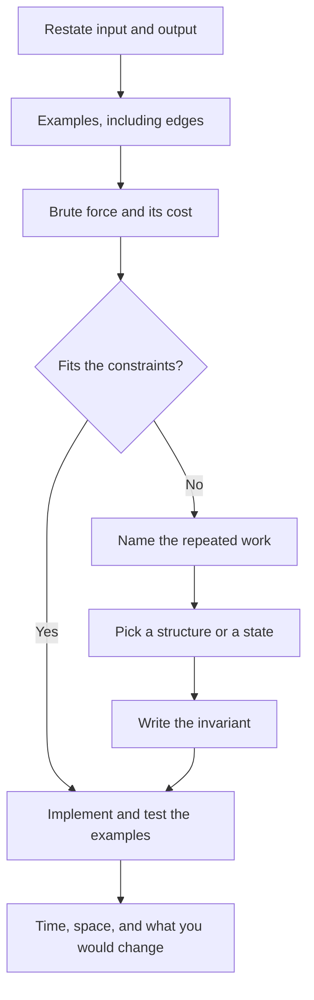

## Why this matters

Most interview failures at this level are not missing syntax. They are missing a repeatable way to turn a paragraph into an algorithm. Candidates who start typing freeze when the first idea is wrong. Candidates who narrate a process can recover, because the interviewer can steer a visible plan. This lesson is that process. The later modules teach the tools. This one teaches the order in which you pick a tool, how you test it on a small input before you claim it, and how you talk about complexity without stalling the design.

## Intuition

Treat the problem statement as a specification that is probably incomplete. Your job in the first few minutes is to make it precise enough to implement, then cheap enough to run. A good mechanical engineer does not start milling steel. They sketch, pick a load case, and decide which constraint is tight. You do the same with examples, a brute force, and a bottleneck. The optimal solution is usually the brute force with one expensive repeated question answered by a better structure: a hash map, a sort, a stack, a deque, a heap, a binary search, or a subproblem table.

## Core concept in depth

Use this sequence. It is long enough to be safe and short enough to finish in a 45-minute round.

Restate the problem in one sentence that names the input, the output, and the success condition. Ask about constraints: size of n, value ranges, whether the array is sorted, whether duplicates exist, whether you may modify the input, and whether any correct answer is acceptable or the problem wants a canonical one. Constraints are hints. n up to 10 to the 5th usually forbids an n-squared algorithm. n up to 20 often allows 2 to the n. A sorted input is an invitation to two pointers or binary search.

Create two or three examples by hand, including an empty or single-element case if the constraints allow it, a case with duplicates, and a case where the answer is impossible or a sentinel such as -1. Compute the outputs yourself. These examples are your tests. If you cannot compute them, you do not understand the statement yet.

State a brute force that is obviously correct. "Try every pair" or "try every subarray" or "try every subset" is a legitimate start. Give its complexity immediately. If it already fits the constraints, you may stop, but say that you are stopping because the bound fits, not because you ran out of ideas. If it does not fit, name the bottleneck in one sentence. The bottleneck is the repeated work: searching a list from scratch, recomputing a sum that only changed by one element, or exploring overlapping subproblems.

Choose a structure that removes that repeated work. A repeated membership test becomes a set. A repeated "best so far ending here" becomes a dynamic-programming state or Kadane's variables. A repeated "next greater element" becomes a monotonic stack. A repeated feasibility check that is monotone in a threshold becomes binary search on the answer. Write the invariant before the code. An invariant is a sentence that is true every time the loop condition is tested: "lo is the first index that might contain the target" or "the window contains each required character and no proper prefix of this window does."

Code the invariant, not a mood. Use names that match the sentence. After the code, walk one of your examples line by line and check that the invariant survives. Then state time and extra space, including recursion and the output. If the interviewer changes a constraint, decide which step of this process has to be redone. A new constraint usually changes the bottleneck, not the meaning of the output.

When you are stuck, do not go silent. Shrink the problem. Solve it for a sorted array, or for distinct numbers, or for k = 1, and then remove the assumption. Write the recurrence even if you compute it with recursion and an exponential tree. A correct exponential solution plus a memoization story is often one minute from the intended dynamic program. Look at the data type. Arrays of numbers suggest two pointers, prefixes, sorting, or heaps. Grids suggest BFS and DFS. Parentheses and "next greater" suggest stacks. Explicit "minimum number of ways" or "is it possible" with overlapping choices suggests dynamic programming. Dependencies suggest topological order. Intervals suggest sorting by start or by end.

Communicate trade-offs in the same breath as the algorithm. "I can do this in n log n time and constant extra memory by sorting, or in expected linear time and linear memory with a hash map. I'll take the hash map unless you need stability or a worst-case guarantee." That sentence is worth more than a silent clever trick.

## Diagram and dry run



Two Sum on the numbers 2, 7, 11, 15 with target 9, using a hash map from value to index.

| Step | Value | Need | Map before the step | Action |
| --- | --- | --- | --- | --- |
| 0 | 2 | 7 | empty | 7 is absent. Store 2 at index 0 |
| 1 | 7 | 2 | 2 maps to 0 | 2 is present. Return indexes 0 and 1 |

The brute force checks every pair and is Theta(n squared). The map answers "have I seen the complement?" in expected constant time, so the scan is expected linear and uses linear memory. The invariant: the map contains exactly the values at indexes before the current one. That is why you look before you insert, and why a value is not paired with itself unless it occurs twice.

## Runnable Python

Keep a tiny template in your fingers. First the brute pair loop, then the linear scan. The recursive version is not natural for Two Sum. The second function is the recursive shape you use when the brute force is "try both choices," here on Climbing Stairs, first naive and then with an explicit table so the overlapping subproblems disappear.

```python
def two_sum(nums: list[int], target: int) -> list[int]:
    seen: dict[int, int] = {}
    for index, value in enumerate(nums):
        need = target - value
        if need in seen:
            return [seen[need], index]
        seen[value] = index
    return []


def climb_recursive(n: int) -> int:
    def ways(k: int) -> int:
        if k <= 1:
            return 1
        return ways(k - 1) + ways(k - 2)
    return ways(n)


def climb_table(n: int) -> int:
    if n <= 1:
        return 1
    prev, cur = 1, 1
    for _ in range(2, n + 1):
        prev, cur = cur, prev + cur
    return cur
```

`climb_recursive` is correct and exponential, because it recomputes the same stair counts. `climb_table` keeps only the two previous answers and is Theta(n) time and Theta(1) extra memory. Saying that transition out loud is the approach guide applied to dynamic programming.

## Complexity and trade-offs

| Stage | What you say | Typical cost |
| --- | --- | --- |
| Brute pairs | Obviously correct | Theta(n squared) time, Theta(1) extra |
| Hash complement | Expected constant lookup | Theta(n) expected time, Theta(n) memory |
| Sort then two pointers | Worst-case bound, loses original indexes unless you sort pairs | Theta(n log n) time |
| Naive recursion of overlapping subproblems | Correct specification | Often exponential |
| Table or rolling variables | Same recurrence, each state once | Polynomial, often linear or n squared |

Do not skip the brute force in the conversation even if you never type it. It proves you understand the specification. Do not implement an exponential recursion as the final answer when n is 10 to the 5th. Do mention it as the specification you are tabulating.

## Tricks, tips, and patterns

Read constraints before you invent. If n is at most 1000, an n-squared solution with a small constant is often the intended one, and an n-cubed solution is not. If the problem asks for a count modulo a prime, the algorithm is probably dynamic programming or combinatorics, and you should reduce after every addition. If the problem says "any" answer, you may return the one your algorithm naturally finds, but your tests must accept that contract. If it says "the lexicographically smallest," the contract is unique and your examples must use that unique output. When several patterns fit, prefer the one whose invariant you can say in a sentence. A sentence you cannot say becomes a bug you cannot see.

## Common mistakes and edge cases

Coding during the restatement. You will solve the wrong problem fluently. Skipping the empty input and then crashing on it in the last five minutes. Inserting into a hash map before the lookup, so a single element pairs with itself. Using a set when you needed the index, or a map of counts when you needed positions. Quoting average-case hashing as worst-case. Mutating the input when the statement forbids it, or refusing to mutate when the statement allows an in-place algorithm and the interviewer asked for constant extra memory. Testing only the happy path. Forgetting that the recursive solution and the tabulated solution must agree on the base cases. The base case is part of the specification, not a detail.

## Interview notes

Talk in the order of the diagram. Two minutes of clarification, one example you compute yourself, one sentence of brute force and its cost, one sentence of the bottleneck, then the invariant, then the code. Pause after the invariant and ask whether the direction makes sense if the interviewer has been guiding you. If you discover a bug while dry-running, fix the invariant first and then the code. Interviewers trust candidates who catch their own counterexamples. If you finish early, add tests: duplicates, negatives, the minimum length, and the case where no answer exists. Do not spend the last ten minutes micro-optimizing a solution that already fits. Spend them proving it.

The mock strategy in the last module turns this checklist into a timed practice. Use it. A process you have not rehearsed will evaporate when the problem is unfamiliar. The patterns lesson is the catalog you match against the bottleneck. This lesson is the order of operations.

## Practice problems

Apply the full sequence, out loud, to each of these. Do not open the editorial until you have a bound that fits.

1. [Two Sum](/practice/two-sum) — the dry run above.
2. [Valid Parentheses](/practice/valid-parentheses) — brute force is repeated scanning. The structure is a stack.
3. [Number of Islands](/practice/number-of-islands) — the brute force is a search from every land cell. The fix is to mark a whole component when you first touch it.
4. [Coin Change](/practice/coin-change) — the brute force is recursion on the remaining amount. The table stores one answer per remaining amount.
5. [Course Schedule](/practice/course-schedule) — the bottleneck is "can I take this before its prerequisites?" The structure is a graph and a cycle check.

## Summary and cheat sheet

- Restate, constrain, and build examples before code.
- Brute force proves you understand the problem. Name its cost.
- The bottleneck is repeated work. Pick a structure that answers it.
- Write an invariant, then code the invariant.
- Dry-run one example. Then state time and space.
- Constraints tell you which costs are legal.
- When stuck, shrink the problem or write the overlapping recurrence.
- Hashing is expected linear. Sorting is worst-case n log n. Say which one you are choosing.

## Further reading

- [Wikipedia — Algorithmic problem solving is not one page; start with invariant](https://en.wikipedia.org/wiki/Loop_invariant)
- [Wikipedia — Hash table](https://en.wikipedia.org/wiki/Hash_table)
- [Python TimeComplexity wiki](https://wiki.python.org/moin/TimeComplexity)
- The patterns lesson in this course: [Interview patterns](/lessons/interview-patterns)
