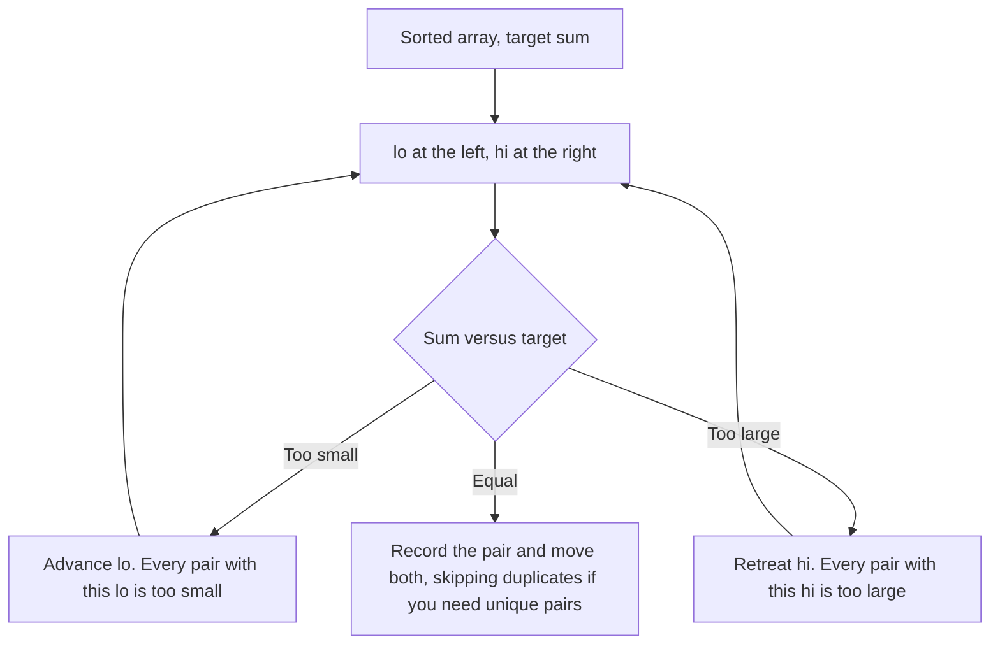

## Why this matters

A huge fraction of array and string interviews are a scan that keeps two indexes with a simple invariant. The naive version tries every pair or every slice and pays a quadratic cost. Two pointers turn that search into one pass when the array is sorted, or when moving one pointer only makes the answer more feasible. You will use the pattern for pair sums, partitions, palindromes, trapping water, merging, and the Dutch national flag. If you can state the invariant, the code is short. If you cannot, the code becomes a pile of special cases that fail on duplicates.

## Intuition

Think of two people walking on a number line. When the array is sorted and you want a pair that sums to a target, one person starts at the left and one at the right. If the sum is too small, the left person must move right, because every value to the left is even smaller. If the sum is too large, the right person must move left. Each move throws away a whole row or column of the pair matrix, not a single pair. That is why the algorithm is linear after the sort. The same "this side can never win" idea appears when you shrink a window, partition around a pivot, or move a read pointer and a write pointer through an array you are compacting.

## Core concept in depth

A two-pointer algorithm maintains indexes i and j, usually with i less than or equal to j, and a statement that is true at the start of every iteration. The body moves at least one index so the unsearched region shrinks. Termination is the moment the region is empty. Correctness is the invariant plus the fact that every discarded index was impossible.

Opposite-end pointers want a monotone property. On a sorted array, the pair sum increases when the left index increases and decreases when the right index decreases. Therefore a too-small sum cannot be fixed by moving the right index left, and you may discard the left index forever. Container With Most Water uses a different monotone argument. The area is width times the shorter line. If the left line is shorter, every container that keeps that left line and a nearer right line is weakly worse, because the width shrinks and the height cannot exceed the left line. So you advance the shorter side. This argument fails if you advance the taller side: you might skip the only wide container that used the short side against a still-tall partner.

Same-direction pointers compact or partition. The write pointer marks the end of the region that already satisfies the output property. The read pointer scans forward. Move Zeroes keeps the write pointer on the next slot that should hold a non-zero. Remove Duplicates from a sorted array keeps the write pointer on the last unique value kept so far. The read pointer runs to the end, so the algorithm is one pass and the extra memory is constant. The prefix of length write + 1 is the answer. You do not need a second array.

Three pointers show up in the Dutch national flag and in merging. Sort Colors uses lo, mid, and hi. Values before lo are 0, values after hi are 2, and values before mid have been classified. The mid pointer is the one that moves through unknown territory. A 0 swaps with lo and both lo and mid advance. A 2 swaps with hi and only hi retreats, because the swapped-in value has not been classified. A 1 just advances mid. That asymmetry is the whole algorithm. Merging two sorted lists uses one pointer into each list and writes the smaller head. It is the same idea as the opposite-end scan, except both pointers move only forward and the output grows.

Trapping rain water can be solved with opposite-end pointers too. The water above a position is limited by the taller of the shorter bounding walls. Maintain the best wall seen from the left and from the right. The side with the smaller best wall is the one whose next position has a known water level, because the opposite side promises at least that height. Add the difference, then advance that side. The prefix-max and suffix-max arrays are the memory-heavy version of the same fact. The two-pointer version stores only the two running maxima.

Palindromes use opposite ends on a string. Move inward while the characters match. Valid Palindrome II allows one skip. The moment they differ, you check the two possibilities "skip left" and "skip right" with an ordinary palindrome test that is allowed no further skips. That is still linear, because each skip branch is a single inward scan and you do it only once.

Not every pair problem is a two-pointer problem. Two Sum on an unsorted array does not have the monotone property until you sort, and sorting loses the original indexes unless you sort pairs of value and index. A hash map is the better trade when indexes matter and an expected linear bound is acceptable. Two pointers are the better trade when the data is already sorted or when you must use constant extra memory.

## Diagram and dry run



Sorted numbers 1, 2, 4, 6, 8, 11. Target 10.

| lo | hi | Values | Sum | Move | Why the discarded side is impossible |
| --- | --- | --- | --- | --- | --- |
| 0 | 5 | 1 and 11 | 12 | hi to 4 | Any pair with 11 is at least 12 |
| 0 | 4 | 1 and 8 | 9 | lo to 1 | Any pair with 1 is at most 9 |
| 1 | 4 | 2 and 8 | 10 | done | The invariant found the unique pair of values |

Each step deletes one index. At most n steps occur. The same table with duplicates, such as 1, 1, 1, 2, needs an extra rule if the problem wants unique pairs: after a hit, advance lo and retreat hi, and keep advancing while the value repeats. The invariant becomes "every unique pair that lives entirely inside the open middle has not been considered, and every unique pair that used a discarded index was already emitted or was impossible."

## Runnable Python

The iterative pair search is the one to memorize. The recursive form is the same invariant with the call stack holding lo and hi. Prefer the loop in an interview. The recursive version makes the shrink obvious when you are teaching the proof.

```python
def two_sum_sorted(nums: list[int], target: int) -> list[int]:
    lo, hi = 0, len(nums) - 1
    while lo < hi:
        total = nums[lo] + nums[hi]
        if total == target:
            return [lo, hi]
        if total < target:
            lo += 1
        else:
            hi -= 1
    return []


def two_sum_sorted_rec(nums: list[int], target: int, lo: int, hi: int) -> list[int]:
    if lo >= hi:
        return []
    total = nums[lo] + nums[hi]
    if total == target:
        return [lo, hi]
    if total < target:
        return two_sum_sorted_rec(nums, target, lo + 1, hi)
    return two_sum_sorted_rec(nums, target, lo, hi - 1)
```

On the dry-run array and target 10, both return indexes 1 and 4. If the problem asks for values, return the values. If several answers exist, the first one this scan finds is the pair with the smallest possible lo among pairs that sum to the target, because lo only increases after all larger partners have been rejected. Say that if the contract asks for any pair, and do not claim a specific pair if you did not prove which one you return.

## Complexity and trade-offs

| Problem shape | Method | Time | Extra space |
| --- | --- | --- | --- |
| Pair sum, already sorted | Opposite ends | Theta(n) | Theta(1) |
| Pair sum, unsorted, need indexes | Hash map | Theta(n) expected | Theta(n) |
| Pair sum, unsorted, constant memory, indexes not required | Sort, then pointers | Theta(n log n) | Theta(1) extra if you may reorder, otherwise Theta(n) |
| Partition into three classes | Dutch flag, three pointers | Theta(n) | Theta(1) |
| Compaction, such as move zeroes | Read and write | Theta(n) | Theta(1) |
| Water trapped | Two running maxima | Theta(n) | Theta(1) |

Sorting just to run two pointers is honest and often optimal when you need a worst-case bound. Hashing is faster on average and uses memory. State the choice. Recursive two pointers use Theta(n) stack in the worst case, which is a pointless cost for this pattern. Use the loop.

## Tricks, tips, and patterns

Write the discard sentence before the code. "If the sum is too small, the left value can never participate." If you cannot finish that sentence, you do not have a two-pointer algorithm yet. Skip duplicates only when the output must be unique. Do it on the side you just used, and do it after you record the answer, not before, or you will skip the only copy you needed. When three pointers partition, draw the regions on paper: processed zeros, processed ones, unknown, processed twos. The unknown region is what shrinks. For palindromes, strip or skip the characters the statement says to ignore before you compare, or skip them inside the scan with a nested move. Do not build a cleaned string unless the interviewer accepts the extra memory.

## Common mistakes and edge cases

Moving both pointers when only one side is guilty. That can skip the only answer. Using two pointers on an unsorted array and hoping. Infinite loops from failing to advance after a swap, especially in the Dutch flag when a 2 is swapped in and you advance mid anyway. Off-by-one on the compacted length: the write pointer is often one past the last kept element, or it is the last kept index. Pick one convention and test it on an array that is already valid and on an array that becomes empty. Integer overflow does not affect Python pair sums. The empty array and the single-element array must return the "not found" value without indexing off the end. For water trapping, a strictly decreasing skyline traps nothing. Test it.

## Interview notes

Start with the invariant, not with "I'll use two pointers." The interviewer wants the reason a pointer may move. Mention sorting cost if you sort. Mention that a hash map is the alternative when indexes matter. Dry-run a four-element example, including a case that forces both directions. If the problem is 3Sum, fix one index and run this pair scan on the suffix. That is n times a linear scan, which is n squared, the standard bound. Skipping duplicates inside both the outer index and the pair scan is part of the contract when unique triplets are required. Say so before you code the continues.

## Practice problems

1. [Two Sum II](/practice/two-sum-ii) — the sorted pair scan.
2. [3Sum](/practice/3sum) — fix one value, then two pointers, with duplicate skips.
3. [Container With Most Water](/practice/container-with-most-water) — advance the shorter line.
4. [Trapping Rain Water](/practice/trapping-rain-water) — running maxima from both ends.
5. [Move Zeroes](/practice/move-zeroes) — read and write pointers.
6. [Sort Colors](/practice/sort-colors) — three pointers. The Dutch flag has its own lesson too.
7. [Valid Palindrome](/practice/valid-palindrome) and [Valid Palindrome II](/practice/valid-palindrome-ii).

## Summary and cheat sheet

- Opposite ends need a monotone discard rule. Sorted pair sums and the water container are the templates.
- Same-direction read and write pointers compact an array in place.
- Three pointers partition into three regions. Do not advance the middle pointer after swapping in an unknown value.
- The invariant names which indexes are already impossible or already correct.
- Each iteration must shrink the unknown region.
- Hash maps beat pointers when the array is unsorted and you need original indexes.
- 3Sum is n outer choices plus this linear scan.

## Further reading

- [Wikipedia — Two pointers technique, discussed inside many articles; start with the Dutch national flag](https://en.wikipedia.org/wiki/Dutch_national_flag_problem)
- [Wikipedia — Two-sum is a standard exercise; see also the sorted-array pair problem in CLRS exercises](https://mitpress.mit.edu/9780262046305/introduction-to-algorithms/)
- [LeetCode explore cards are not a textbook; prefer the CLRS partitioning chapter](https://en.wikipedia.org/wiki/Quicksort)
