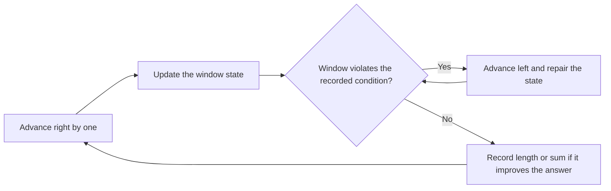

## Why this matters

A sliding window is a contiguous slice whose ends only move forward. It answers questions about subarrays and substrings: the longest substring without a repeated character, the smallest window that covers a pattern, the maximum sum of a fixed length, the number of subarrays whose product is less than a limit. The brute force rebuilds every slice from scratch. The window reuses the previous slice by adding the new right element and removing left elements that no longer belong. That reuse is the difference between quadratic and linear. At this interview level you are expected to know when the window is fixed and when it grows and shrinks, and you are expected to name the state you store so the shrink is fast.

## Intuition

Imagine reading a paragraph with a cardboard frame. You never move the frame backward over characters you have permanently rejected. You widen it to the right when the frame is still valid, and you narrow it from the left when the frame has become invalid or when you are hunting the smallest valid frame. Because both edges move only right, each character enters once and leaves once. Any work you do per entry and per exit, if that work is constant or amortized constant, makes the whole scan linear. The frame's contents are summarized by a counter, a sum, a bitmask, or a deque of candidates, not by the raw slice.

## Core concept in depth

Fixed windows have a constant length k. Compute the first window honestly. Then each step adds the element that enters on the right and subtracts the element that leaves on the left. Maximum sum of a subarray of length k is this update plus a running maximum. The state is a single integer. You need k to be at least 1 and at most n, and you should decide what to return on an empty array before you code.

Variable windows have a predicate that is monotone in the window size for a fixed right endpoint. "No repeated characters" becomes true when you shrink and stays true if you shrink more. "The window contains every required character" becomes false when you shrink past the last extra copy of some character. The canonical loop advances the right endpoint by one, updates the state, then advances the left endpoint while the window violates the condition you care about. For a longest-valid problem, you shrink while the window is invalid, then you record the length. For a shortest-valid problem, you shrink while the window stays valid, and you record the length before each shrink that would still leave it valid. Getting those two whiles backwards is the main bug.

Longest substring without a repeating character stores the last index of each character, or a frequency map. With last indexes, the left endpoint jumps to one past the previous occurrence of the character you just added, but never moves left. The "never move left" part matters when an older duplicate sits outside the current window. With frequencies, you add the right character, then while some frequency is 2 or more you decrement the left character and advance left. Both are linear. The last-index version uses constant extra memory if the alphabet is constant, and it makes the jump obvious.

Minimum window substring stores how many required characters are still missing, plus frequencies of the pattern and of the window. Advance right. When the missing count hits zero, the window is feasible. While it stays feasible, record the length if it is the best, then drop the left character and advance left. A character that appears more times than the pattern needs is slack. Dropping it does not increase the missing count. Dropping a critical character does. The invariant: missing is the number of pattern characters whose window count is still below the pattern count, and every index before left has been rejected as a left endpoint for this right endpoint.

At most k distinct characters, or at most k replacements so that the window becomes one character, uses the same expand-and-shrink loop. For replacements, the state is the frequency map and the count of the most frequent character in the window. The window is valid while its length minus that count is at most k, because those are the cells you must replace. You do not need to decrease the "most frequent" value when you shrink, if you only use it as a historical maximum, but the clean version recomputes or updates carefully. For interviews, a frequency map and a recount of the max when the window is small enough to scan is acceptable only if the alphabet is tiny. With a fixed alphabet of 26, you can recompute the max in constant time.

Sliding-window maximum is the point where a window needs a monotonic deque. The deque stores indexes in increasing position and decreasing value. Before you push the new index, pop the back while it is less than or equal to the new value, because a shorter, smaller candidate can never be the maximum of a future window. Pop the front while it has fallen out of the window. The front is the maximum. Each index is pushed once and popped once, so the whole pass is amortized linear. This structure returns in the stacks module as well, because the deque is a monotonic queue. The window view and the stack view are the same algorithm.

Prefix sums, covered next, answer a different question: the sum of any slice in constant time after a linear preprocess, including slices that are not discovered by a moving frame. If the predicate is not about a contiguous frame you can grow and shrink monotonically, do not force a window. Subarray sum equals k on arrays that may contain negatives is a prefix-and-hash problem, not a two-pointer shrink, because growing the right end can decrease the sum.

## Diagram and dry run



Longest substring without repeats on "abba". The map stores the last index.

| Right | Character | Last index seen | Left after the update | Window | Best |
| --- | --- | --- | --- | --- | --- |
| 0 | a | none | 0 | a | 1 |
| 1 | b | none | 0 | ab | 2 |
| 2 | b | 1, which is inside | 2 | b | 2 |
| 3 | a | 0, which is outside the new left | 2 | ba | 2 |

When the second b arrives, left jumps to 2, not to 0. The old a is already outside. The answer is 2. A frequency version would increment b to 2, then shrink from the left through a and the first b until b's frequency is 1. Same windows, more steps, same answer.

## Runnable Python

Both versions of the repeat-free substring are here. The loop is the one to type in an interview. The recursive function on the right endpoint shows the same transition, with the left edge and the map carried along. It uses linear stack space and is only a teaching copy.

```python
def longest_unique(s: str) -> int:
    last: dict[str, int] = {}
    left = 0
    best = 0
    for right, ch in enumerate(s):
        if ch in last and last[ch] >= left:
            left = last[ch] + 1
        last[ch] = right
        best = max(best, right - left + 1)
    return best


def longest_unique_rec(s: str) -> int:
    last: dict[str, int] = {}

    def go(right: int, left: int) -> int:
        if right == len(s):
            return 0
        ch = s[right]
        if ch in last and last[ch] >= left:
            left = last[ch] + 1
        last[ch] = right
        return max(right - left + 1, go(right + 1, left))

    return go(0, 0)
```

On "abba" both return 2. On an empty string both return 0. On a string of identical characters the answer is 1. On a string of distinct characters the answer is the length.

## Complexity and trade-offs

| Window | State | Time | Extra space |
| --- | --- | --- | --- |
| Fixed length sum | Running sum | Theta(n) | Theta(1) |
| No repeated characters | Last index or frequencies | Theta(n) | Theta(min of n and the alphabet) |
| Minimum window covering a pattern | Two frequency maps and a missing count | Theta(n) | Theta(alphabet) |
| At most k replacements | Frequencies and a max count | Theta(n) | Theta(alphabet) |
| Window maximum | Monotonic deque of indexes | Theta(n) amortized | Theta(k) |

If you rebuild the set of the window from scratch at every right endpoint, you are back to quadratic time. The state update must be constant or amortized constant. Hash maps give expected constant updates. The deque gives amortized constant updates. A balanced tree of the window's values gives a logarithmic window maximum with a worse constant, and it is the right fallback if the "pop smaller backs" argument does not apply because you need the full multiset.

## Tricks, tips, and patterns

Decide longest versus shortest before you write the while loop. Longest: shrink only while invalid, then measure. Shortest: once valid, shrink while you can and measure during the shrink. Left only moves forward. If your code assigns left to something smaller, the last-index formula is wrong. Counts of "still missing" are easier to update than rescanning the pattern. For fixed windows, special-case n less than k. For product windows that must stay under a limit, a zero in the array breaks the product. Restart the window after the zero, or the shrink will divide by zero and will also keep a zero inside a product that can never recover except by leaving it behind.

## Common mistakes and edge cases

Shrinking past a still-valid window in a longest problem, which makes the answer too short. Forgetting that left must not move backward when the previous duplicate is outside the window. Using a set instead of counts when the pattern has duplicate characters, so two a's in the pattern look satisfied by one a in the window. Off-by-one in the length formula right - left + 1. Clearing the whole map when one character repeats, which drops characters that were still unique. For the minimum window, returning 0 and returning an empty string are different contracts. Read the statement. A pattern longer than the text is impossible. A pattern that is empty is a special case you should ask about. It usually matches at index 0 with length 0, or it is excluded by the constraints.

## Interview notes

Say "both ends move only forward, so each index enters and leaves once" before you choose a map. Name the state in one sentence. Dry-run a string where a duplicate sits outside the window, because that is the case buggy last-index code fails. If the interviewer asks for the actual substring rather than the length, store the best left and best length, and slice once at the end. Slicing on every improvement can be quadratic in the cost of copying strings. Mention that negative numbers disqualify the shrink-while-sum-too-large trick, and switch to prefixes. Mention the deque when the window must report a maximum or a minimum, not just a sum or a count.

## Practice problems

1. [Longest Substring Without Repeating Characters](/practice/longest-substring-without-repeating-characters).
2. [Minimum Window Substring](/practice/minimum-window-substring).
3. [Longest Repeating Character Replacement](/practice/longest-repeating-character-replacement).
4. [Permutation in String](/practice/permutation-in-string) and [Find All Anagrams](/practice/find-all-anagrams-in-a-string) — fixed windows compared by counts.
5. [Sliding Window Maximum](/practice/sliding-window-maximum).
6. [Minimum Size Subarray Sum](/practice/minimum-size-subarray-sum) — shortest window with sum at least the target, for non-negative numbers.
7. [Fruit Into Baskets](/practice/fruit-into-baskets) and [Max Consecutive Ones III](/practice/max-consecutive-ones-iii).

## Summary and cheat sheet

- A window is a contiguous slice. Both ends move forward. Each index enters and leaves once.
- Fixed length: add the newcomer, remove the exile, update the answer.
- Variable longest: expand, shrink while invalid, then measure.
- Variable shortest: expand until valid, shrink while valid, measure during the shrink.
- State is a count, a sum, a last index, or a monotonic deque. Rebuilding the slice is quadratic.
- Negatives break sum-shrinking. Use a prefix map instead.
- Length is right - left + 1.

## Further reading

- [Wikipedia — Streaming algorithm, for the one-pass mindset](https://en.wikipedia.org/wiki/Streaming_algorithm)
- [Wikipedia — Double-ended queue](https://en.wikipedia.org/wiki/Double-ended_queue)
- [CP-Algorithms, two pointers](https://cp-algorithms.com/others/two-pointers.html)
