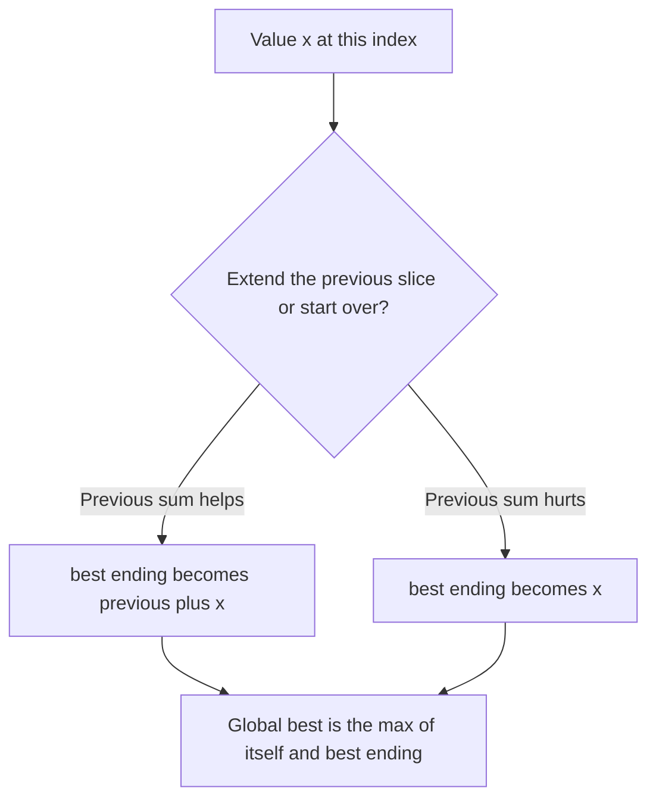

## Why this matters

Many subarray questions look quadratic because there are quadratically many slices, and then turn linear once you notice that adjacent slices share a sum. A prefix array stores those shared sums. A one-pass recurrence stores only the best slice that ends at the current index. Together they cover range-sum queries, subarray sum equals k, equilibrium indexes, circular maximum sums, and the classic maximum subarray. Interviewers use them as a filter. If you recompute every slice from scratch on an input of size 10 to the 5th, the solution does not fit. If you can point at the repeated addition and replace it with a prefix or with Kadane's variables, it does.

## Intuition

A prefix sum is a running total written down. The sum from index l through r is the total up to r minus the total before l. You paid linear time once, and every later question is a subtraction. Kadane's algorithm is what you do when you do not want every slice, only the best one. At each index the best slice that ends here either starts here, because everything before it was a burden, or it extends the best slice that ended on the previous index. There is no third option. That observation deletes the quadratic search.

## Core concept in depth

Define prefix[0] = 0 and prefix[i + 1] = prefix[i] + nums[i]. Then the sum of nums[l] + ... + nums[r] equals prefix[r + 1] - prefix[l]. The empty prefix makes the left boundary painless: a slice that starts at 0 subtracts zero. Building the prefix is Theta(n) time and Theta(n) memory. If you only need one range you do not need the array at all, but the array is the right tool when many ranges are asked, or when a later algorithm looks up earlier prefixes.

Subarray sum equals k, on arrays that may contain negative numbers, cannot shrink a window, because extending the right end can make the sum fall. Rewrite the condition. The slice from l to r sums to k exactly when prefix[r + 1] - prefix[l] = k, which means prefix[l] = prefix[r + 1] - k. Walk the array once, and keep a map from every prefix sum seen so far to the number of times it occurred. At the current prefix, add the count of prefix - k. Then record the current prefix. The order matters: you must count before you record, and the map starts with 0 seen once, so a slice from the beginning is visible. The same idea modulo m answers subarray sums divisible by m. Store prefix modulo m, and ask for the same residue. Negative numbers modulo m need a non-negative residue. In Python the remainder operator already does that for a positive modulus.

An equilibrium index, or pivot index, is the place where the sum strictly to the left equals the sum strictly to the right. The total sum makes this a constant-time check per index: left sum is the prefix before i, right sum is total - prefix[i + 1]. One pass computes the total, a second pass finds the index. You can also maintain the left sum as you go and derive the right sum from the total.

Kadane's algorithm finds the maximum sum of a non-empty contiguous subarray. Let best_end be the best sum of a slice that ends at the current index, and best the best sum seen anywhere. For each value, best_end becomes the maximum of value and best_end + value. Then best becomes the maximum of best and best_end. Initialize best_end to 0 only if an empty slice is allowed. For a non-empty slice, initialize best and best_end to the first element and start the loop at the second element, otherwise an all-negative array incorrectly returns 0. The proof is a short case split. Any optimal slice ends somewhere. Among slices that end at i, the best one is nums[i] alone or the best slice ending at i - 1 plus nums[i], because if the best slice ending at i - 1 had a negative sum you would have dropped it. Taking the maximum over ending positions finishes the proof.

The circular maximum subarray is the maximum of two candidates: the ordinary Kadane answer, and the total sum minus the minimum non-empty subarray, which represents wrapping around the ends. The minimum subarray is Kadane on the negated array, or the same recurrence with min instead of max. If the entire array is the minimum, wrapping would choose an empty middle and an empty answer. When every element is negative, or more carefully when the minimum subarray is the whole array, the wrap candidate is 0 or empty and you must keep the ordinary answer. The safe test is: if the wrap sum equals the total, ignore it.

Maximum product subarray needs two running values, because a negative number swaps the roles of min and max. Keep the maximum and minimum product ending here. A new value updates both from the set of candidates: the value itself, max_end times the value, and min_end times the value. Zeros reset both to the value 0, and the next element starts fresh because the recurrence takes the value alone.

These recurrences are dynamic programming on a line. The state is "best ending here," and the transition looks one step back. You do not need a table if the older states are never read again. That is why Kadane uses a handful of variables. The prefix array is the version you keep when later indexes must look up arbitrary earlier prefixes, not only the previous one.

## Diagram and dry run



Array -2, 1, -3, 4, -1, 2, 1, -5, 4. Non-empty Kadane.

| Index | Value | Best ending here | Global best | Slice that best ending represents |
| --- | --- | --- | --- | --- |
| 0 | -2 | -2 | -2 | just -2 |
| 1 | 1 | 1 | 1 | start over at 1 |
| 2 | -3 | -2 | 1 | 1 plus -3, still worse than 1 |
| 3 | 4 | 4 | 4 | start over at 4 |
| 4 | -1 | 3 | 4 | 4, -1 |
| 5 | 2 | 5 | 5 | 4, -1, 2 |
| 6 | 1 | 6 | 6 | 4, -1, 2, 1 |
| 7 | -5 | 1 | 6 | extended, but the global stays 6 |
| 8 | 4 | 5 | 6 | not better |

The answer is 6, the slice 4, -1, 2, 1. A prefix check for sum equals 3 would see prefix values 0, -2, -1, -4, 0, -1, 1, 2, -3, 1. The pair of prefixes that differ by 3 includes  -1 and -4, and also 1 and -2, among others.

## Runnable Python

The iterative Kadane is the interview version. The recursive function returns the pair "best ending at this suffix start, best anywhere in the suffix" and walks from the right. It is the same recurrence, with Theta(n) stack, useful as a proof and a poor implementation. Prefer the loop.

```python
def max_subarray(nums: list[int]) -> int:
    best = best_end = nums[0]
    for value in nums[1:]:
        best_end = max(value, best_end + value)
        best = max(best, best_end)
    return best


def range_sum(prefix: list[int], left: int, right: int) -> int:
    """prefix[i] is the sum of the first i elements. right is inclusive."""
    return prefix[right + 1] - prefix[left]


def max_subarray_rec(nums: list[int]) -> int:
    def go(i: int) -> tuple[int, int]:
        if i == len(nums) - 1:
            return nums[i], nums[i]
        end_after, best_after = go(i + 1)
        end_here = max(nums[i], nums[i] + end_after)
        return end_here, max(end_here, best_after)
    return go(0)[1]
```

`max_subarray` on the dry-run array returns 6. `range_sum` on a prefix built from 1, 2, 3, 4 answers the slice from index 1 through 3 as 9. Build that prefix with a running total pushed onto a list that starts with 0.

## Complexity and trade-offs

| Task | Method | Time | Extra space |
| --- | --- | --- | --- |
| One range sum | Direct loop | Theta(length) | Theta(1) |
| Many range sums | Prefix array | Theta(n + queries) | Theta(n) |
| Subarray sum equals k, negatives allowed | Prefix map | Theta(n) expected | Theta(n) |
| Subarray sum equals k, non-negative | Sliding window | Theta(n) | Theta(1) |
| Maximum subarray | Kadane | Theta(n) | Theta(1) |
| Maximum circular subarray | Kadane plus a minimum subarray | Theta(n) | Theta(1) |
| Maximum product | Two running products | Theta(n) | Theta(1) |

A segment tree or a Fenwick tree answers range sums with updates. The prefix array does not. If the interview adds "and then we change elements," say that the prefix would be rebuilt and offer a tree. That structure is taught with trees. Do not reach for it on a static array.

## Tricks, tips, and patterns

Start the prefix with 0. Count a complement before inserting the current prefix. For modulo, normalize the residue into 0 through m - 1. Initialize Kadane from the first element when the slice must be non-empty. For the circular case, reject the wrap that consumes the entire array. For products, a zero splits the array into independent segments, and the two-running-product recurrence handles that without an explicit split. If you need the slice itself and not only the sum, remember the start index. Reset it when you start over, and remember the best start and best end when the global best improves.

## Common mistakes and edge cases

Returning 0 for an all-negative array. Forgetting the initial 0 in the prefix map, so slices that start at index 0 are invisible. Inserting the prefix before counting, so a slice of length 0 looks like a hit when k is 0. Using a window shrink on negative numbers. Off-by-one between a prefix that stores n values and a prefix that stores n + 1 values. Mixing inclusive and exclusive ends in the subtraction. For the circular problem, double-counting the whole array. For the product problem, ignoring the sign and tracking only the maximum. Empty input: Kadane on an empty list should be rejected by the constraints or defined up front. Do not index nums[0] without checking.

## Interview notes

Say the identity "slice sum equals prefix right minus prefix left" before you write a map. Say "best ending here is either the element or the element plus best ending on the left" before you write Kadane. Dry-run an array that contains a negative number between two positive runs, because that is where "start over" happens. Mention expected linear time for the hash map. Mention that non-negative sums can stay in the sliding-window lesson and use constant memory. If the interviewer asks for the indexes, store them. The sum alone is a weaker answer than the one the statement requested.

## Practice problems

1. [Maximum Subarray](/practice/maximum-subarray) — Kadane.
2. [Maximum Sum Circular Subarray](/practice/maximum-sum-circular-subarray).
3. [Maximum Product Subarray](/practice/maximum-product-subarray).
4. [Subarray Sum Equals K](/practice/subarray-sum-equals-k).
5. [Continuous Subarray Sum](/practice/continuous-subarray-sum) and [Subarray Sums Divisible by K](/practice/subarray-sums-divisible-by-k).
6. [Find Pivot Index](/practice/find-pivot-index).
7. [Product of Array Except Self](/practice/product-of-array-except-self) — a prefix product and a suffix product, the same idea with multiplication.

## Summary and cheat sheet

- prefix[i] is the sum of the first i elements. A slice is a subtraction.
- Seed the prefix map with 0 seen once. Query prefix - k before you insert prefix.
- Modulo residues must be non-negative. The same residue means the slice between them is divisible.
- Kadane: best ending here is max of the value and the value plus the previous best ending.
- Initialize from the first element when the slice cannot be empty.
- Circular answer: max of the straight Kadane and total minus the minimum subarray, unless that minimum is everything.
- Products track both ends because a negative swaps them.

## Further reading

- [Wikipedia — Prefix sum](https://en.wikipedia.org/wiki/Prefix_sum)
- [Wikipedia — Maximum subarray problem](https://en.wikipedia.org/wiki/Maximum_subarray_problem)
- [CP-Algorithms, prefix sums](https://cp-algorithms.com/data_structures/prefix_sum.html)
