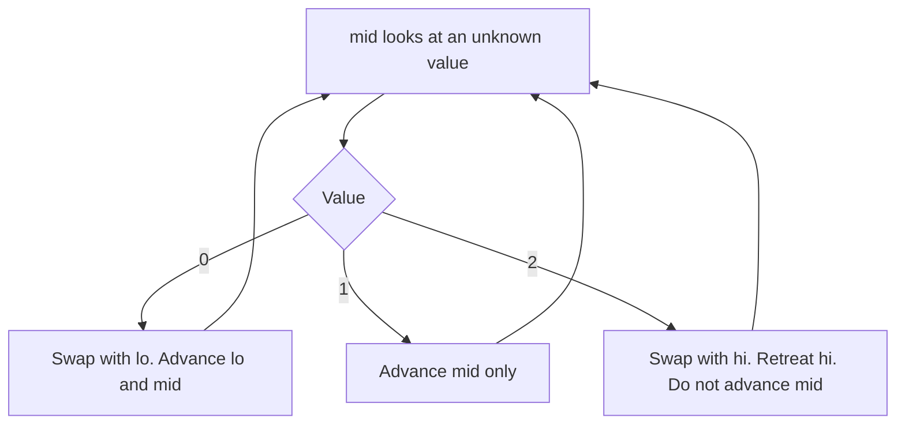

## Why this matters

Partitioning, majority votes, and interval scheduling look unrelated until you see that each one is a linear or linearithmic scan with a tiny state and a sharp invariant. The Dutch national flag partitions an array into three bands in one pass. Boyer-Moore finds a majority element with constant memory. Interval problems become greedy once you sort by the right endpoint or sweep a timeline. These show up constantly in onsite rounds because the code is short and the proof is the part candidates skip. This lesson is the proof.

## Intuition

The Dutch flag is three labeled bins and one unknown stretch. You only ever look at the left edge of the unknown stretch, and you push that element into the bin it belongs to. Boyer-Moore is a duel. Different values cancel. If one value occupies more than half the seats, it cannot be cancelled completely, so the survivor of the duel is the only possible majority. You still count it at the end if the problem does not promise that a majority exists. Intervals are a calendar. If you sort meetings by the time they finish, the meeting that frees the room first is the one that leaves the most room for whoever remains. That is the exchange argument behind the classic scheduling greedy.

## Core concept in depth

Sort Colors, the Dutch national flag, partitions values that are only 0, 1, or 2. Maintain three regions on the array: indexes below lo hold 0, indexes from lo up to but not including mid hold 1, indexes above hi hold 2, and the rest is unknown. Start with lo = 0, mid = 0, hi = n - 1. While mid is at most hi, look at nums[mid]. A 0 swaps with nums[lo], and both lo and mid advance, because the value swapped into mid came from the 0 region and is known. A 1 only advances mid. A 2 swaps with nums[hi] and hi retreats, and mid stays, because the value that arrived from hi is unknown. The loop ends when mid passes hi. Every element was examined, and no element was examined twice except a value swapped in from the right, which is then classified. The invariant implies the array is sorted.

Boyer-Moore majority vote maintains a candidate and a counter, both starting empty. For each value, if the counter is 0, adopt the value as the candidate and set the counter to 1. Otherwise increment when the value matches and decrement when it does not. Pairs of different values cancel. Suppose a majority value m occurs more than n/2 times. Every cancellation consumes at most one copy of m along with something else. The copies of m cannot all be consumed, so the final candidate is m. If the statement does not promise a majority, run a second linear count and accept the candidate only when its count exceeds n/2. Majority Element II asks for every value that occurs more than n/3 times. There are at most two such values. Keep two candidates and two counters. A new value that matches neither decrements both. The same cancellation argument applies, and a second pass verifies both survivors. Do not emit a candidate that fell to a count of 0 and was never replaced, and do not emit duplicates.

Merge Intervals sorts by start time. Sweep left to right, and keep the current merged segment. If the next interval starts after the current end, flush the current segment and start a new one. If it overlaps or touches, extend the current end to the maximum of the two ends. Touching endpoints merge when the problem treats intervals as closed. Ask. The sweep is correct because any interval that could have merged with an earlier flushed segment would start no later than that segment's end, and sorting by start makes that impossible. Insert Interval is the same sweep with one extra interval that you fold in when its start time comes due. You can also binary-search the insertion point and then merge only the local run. Both are fine. The linear merge after the sort or the insertion is the clear version.

Non-overlapping intervals, the minimum number of intervals to remove, sorts by end time. Take the interval that ends first. Remove every later interval that overlaps it, which means every later interval that starts before this end. Then repeat. Equivalently, keep a count of how many you are able to keep: if the next interval starts at or after the last kept end, keep it and move the end. The number removed is n minus the number kept. The exchange argument: some optimal solution keeps an interval that ends first among the remaining set, because if it kept a different one you could swap in the earlier-finishing interval without creating a new overlap. That is why sorting by end, not by start, is the right order for "how many can I keep." Sorting by start is the right order for "merge what overlaps."

Meeting Rooms asks whether any two overlap. Sort by start and compare each end with the next start. Meeting Rooms II asks for the number of rooms, which is the maximum number of meetings open at once. A sweep stores events: plus one at each start, minus one at each end. Sort events, and process ends before starts when times tie if a meeting that ends at t frees the room for a meeting that starts at t. A min-heap of end times does the same job. Push the first meeting. For each later meeting in start order, if the earliest ending meeting is done, pop it. Push the current end. The heap size is the number of rooms in use, and the maximum size is the answer.

Minimum arrows to burst balloons is the non-overlapping problem in costume. Sort by end, shoot at the end of the first balloon, and skip every balloon that contains that x-coordinate. Each shot is one arrow. Partition labels, the places a string must be cut so that each letter lives in one part, is an interval problem too. Each letter occupies an interval from its first index to its last. The cuts are the points where a sweep of those intervals returns to zero open intervals.

## Diagram and dry run



Dutch flag on 2, 0, 2, 1, 1, 0. Start lo = 0, mid = 0, hi = 5.

| Array | lo | mid | hi | Action |
| --- | --- | --- | --- | --- |
| 2 0 2 1 1 0 | 0 | 0 | 5 | See 2. Swap with hi. |
| 0 0 2 1 1 2 | 0 | 0 | 4 | See 0. Swap with lo. Advance both. |
| 0 0 2 1 1 2 | 1 | 1 | 4 | See 0. Swap with lo. Advance both. |
| 0 0 2 1 1 2 | 2 | 2 | 4 | See 2. Swap with hi. |
| 0 0 1 1 2 2 | 2 | 2 | 3 | See 1. Advance mid. |
| 0 0 1 1 2 2 | 2 | 3 | 3 | See 1. Advance mid. mid passes hi. |

Boyer-Moore on 2, 2, 1, 1, 1, 2, 2. The candidate finishes as 2, and a verification count confirms it. Cancel the trace on paper: 2 versus 1 cancels, another 2 versus 1 cancels, and the extra 2s remain.

## Runnable Python

The flag is iterative. A recursive partition would only hide the same swaps in the stack. Boyer-Moore is a loop plus a verification loop. Both are the versions to write from memory.

```python
def sort_colors(nums: list[int]) -> list[int]:
    lo = mid = 0
    hi = len(nums) - 1
    while mid <= hi:
        if nums[mid] == 0:
            nums[lo], nums[mid] = nums[mid], nums[lo]
            lo += 1
            mid += 1
        elif nums[mid] == 1:
            mid += 1
        else:
            nums[hi], nums[mid] = nums[mid], nums[hi]
            hi -= 1
    return nums


def majority(nums: list[int]) -> int:
    candidate = count = 0
    for value in nums:
        if count == 0:
            candidate = value
        count += 1 if value == candidate else -1
    if sum(value == candidate for value in nums) * 2 > len(nums):
        return candidate
    return -1
```

The flag returns the partitioned list. `majority` returns the majority value or -1 when the promise is absent. The comparison `* 2 > len` avoids a trick with integer division and states "more than half" directly.

## Complexity and trade-offs

| Algorithm | Time | Extra space | Needs a promise? |
| --- | --- | --- | --- |
| Dutch flag | Theta(n) | Theta(1) | Values are only 0, 1, 2 |
| Counting sort of three values | Theta(n) | Theta(1) | Same, and you may write a second pass from counts |
| Boyer-Moore plus verify | Theta(n) | Theta(1) | Verification required unless a majority is guaranteed |
| Hash counts | Theta(n) expected | Theta(n) | No |
| Merge intervals | Theta(n log n) | Theta(n) for the output | Closed versus open must be known |
| Keep non-overlapping, sort by end | Theta(n log n) | Theta(1) extra beyond the sort | The objective is the maximum number kept |
| Meeting rooms II, sweep | Theta(n log n) | Theta(n) | Tie-breaking of equal timestamps |

Counting sort is simpler than the flag when you may overwrite the array from three counters. The flag is the one to use when the interviewer asks for one pass and constant memory and wants the swaps. A heap for meeting rooms is Theta(n log n) as well. The sweep is usually less code once the tie break is clear.

## Tricks, tips, and patterns

Draw the regions before you write the flag. The unknown value that arrives from the right is not classified. Sort intervals by the key that matches the exchange argument: start time to merge, end time to schedule. Process ends before starts at the same timestamp when a room can be reused immediately. For Boyer-Moore, always know whether you must verify. For two candidates, write the second pass, and remember that a count of zero means "no candidate," not "the value zero," so keep a separate flag or use an optional candidate. Partition labels and burst balloons are the same sweep as non-overlapping intervals once you build the intervals.

## Common mistakes and edge cases

Advancing mid after a swap with hi. The invariant breaks and a 2 can hide in the middle. Using a strict less-than in the flag loop so the last unknown element is skipped. Treating a half-frequency element as a majority. Integer division of n/2 is the right threshold only when you compare the count to it carefully: more than n/2 means the count is at least floor(n/2) + 1. Forgetting to verify. Merging intervals that merely touch when the problem says overlap must be a positive-length intersection, or failing to merge them when touching counts. Sorting scheduling problems by start and then being unable to prove the greedy choice. Dropping the tie break in the room sweep so a meeting that ends at time t looks like it still occupies a room that a new meeting needs at t.

## Interview notes

For the flag, state the four regions, including the unknown one, and then code the three cases. Dry-run a single swap of a 2 from the front. For Boyer-Moore, explain cancellation before the loop, and say the second pass out loud even if you are sure a majority exists, so the interviewer knows you know the hypothesis. For intervals, say which endpoint you sort by and why, in one sentence, before you sort. If you cannot say why, you have a 50 percent chance of sorting by the wrong end. Offer the heap and the sweep as equivalent for meeting rooms, and pick the one you can implement cleanly.

## Practice problems

1. [Sort Colors](/practice/sort-colors).
2. [Majority Element](/practice/majority-element) and [Majority Element II](/practice/majority-element-ii).
3. [Merge Intervals](/practice/merge-intervals) and [Insert Interval](/practice/insert-interval).
4. [Non-overlapping Intervals](/practice/non-overlapping-intervals).
5. [Meeting Rooms](/practice/meeting-rooms) and [Meeting Rooms II](/practice/meeting-rooms-ii).
6. [Minimum Number of Arrows](/practice/minimum-number-of-arrows-to-burst-balloons) and [Partition Labels](/practice/partition-labels).

## Summary and cheat sheet

- Dutch flag regions: 0s, then 1s, then unknown, then 2s. Do not classify the value that arrives from the right until the next loop.
- Boyer-Moore cancels different values. The majority survives. Verify unless the problem promises.
- At most two values can exceed n/3. Keep two candidates and verify both.
- Merge: sort by start, extend the current end.
- Schedule: sort by end, keep a meeting when it starts after the last kept end.
- Rooms: sweep plus one and minus one, or a heap of end times. Ends free a room before starts reuse it at the same timestamp.

## Further reading

- [Wikipedia — Dutch national flag problem](https://en.wikipedia.org/wiki/Dutch_national_flag_problem)
- [Wikipedia — Boyer-Moore majority vote algorithm](https://en.wikipedia.org/wiki/Boyer%E2%80%93Moore_majority_vote_algorithm)
- [Wikipedia — Interval scheduling](https://en.wikipedia.org/wiki/Interval_scheduling)
- [CP-Algorithms, scheduling jobs](https://cp-algorithms.com/schedules/schedule-with-completion-duration.html)
