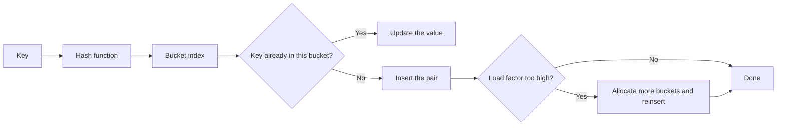

## Why this matters

A hash map turns a repeated linear search into an expected constant-time lookup. That single trade, linear memory for a faster question, is the difference between an accepted solution and a timeout on a large fraction of array and string problems. Two Sum, anagrams, subarray sums, longest consecutive runs, and the first unique character are the same idea wearing different masks: store what you have already seen, in a form that answers the next question immediately. You also need the honesty that comes with the structure. Expected constant time is not worst-case constant time. Interviewers listen for that word.

## Intuition

A hash function assigns each key a bucket, like a postal code. Keys that share a postal code sit together in a short list, or they probe for another slot. If the function scatters keys evenly and the table is not overcrowded, the list in a bucket is short, usually a handful of items, and finding a key does not depend on how many keys exist in total. The moment every key lands in one bucket, the structure is just a list and the lookup is linear. Good libraries rehash and resize to avoid that on ordinary data. Adversarial keys can still force collisions if the hash is predictable. Python randomizes its string hash per process for that reason.

## Core concept in depth

A hash table stores pairs of key and value. The hash code of the key selects a bucket index, typically by reducing an integer modulo the number of buckets. A collision is two keys that reduce to the same bucket. Chaining keeps a list or a tree in each bucket. Open addressing keeps one item per slot and searches a probe sequence, such as linear probing or double hashing, until it finds the key or an empty slot. Deletion under open addressing cannot simply empty a slot, or later probes will stop too early. It leaves a tombstone. Chaining deletes from the list and has no tombstone problem. Python's dict is a compact open-addressing table with a perturbation probe, and it remembers insertion order. For interviews you may treat dict and set operations as expected constant time, and you should say "expected."

The load factor is the number of keys divided by the number of buckets. When it passes a threshold, the table allocates a larger bucket array and reinserts every key. One insertion can therefore be linear. A sequence of n insertions, with geometric growth, is amortized linear, by the same credit argument as a doubling array. That is why building a map of n keys is expected linear overall, not expected quadratic. The worst case of one insertion remains linear. Mention both if the interviewer is pushing.

Equality and hashing must agree. If two keys compare equal, they must have the same hash. If you define equality on a custom object and forget the hash, the object is unusable as a key. Mutable keys are a bug: if the hash changes after insertion, the table looks in the wrong bucket. Use tuples, strings, numbers, or other immutable keys. A list is not a key. A tuple of the list's items is.

The interview patterns are small. A frequency map counts items. A set answers membership. An index map answers "where did I see this key?" Grouping anagrams uses the sorted tuple of characters, or a count tuple of length 26, as the key, and appends the original word to that bucket. Longest consecutive sequence inserts every value into a set, then starts a run only at a value whose predecessor is absent, and walks forward. Each value is the start of at most one run and is visited at most once inside a run, so the scan is linear even though there is a nested walk. Four Sum II counts pair sums of the first two arrays and asks, for every pair from the last two, how many stored sums hit the negation. That is the hash version of splitting a 4-sum.

Subarray sum equals k, from the prefix lesson, is a hash map from prefix sum to frequency. Isomorphic strings and word patterns are two maps, or one map and a set, enforcing a bijection: if a maps to b, a must not later map to c, and b must not be the image of a different letter. A single map is not enough, because two letters can collide on one image.

Hash sets do not store values, only keys. Use a set when the payload would only be true. Use a map when you need a count, an index, or a list. Iteration order of a set is not a contract you should depend on, even if a particular Python version looks stable. If the problem wants a sorted answer, sort at the end. If it wants the first index, store the index, do not hope that iteration order matches insertion in a set you rebuilt.

## Diagram and dry run



Group the words eat, tea, tan, ate, nat, bat by anagram. The key is the sorted spelling.

| Word | Key | Bucket after insertion |
| --- | --- | --- |
| eat | aet | aet holds eat |
| tea | aet | aet holds eat, tea |
| tan | ant | ant holds tan |
| ate | aet | aet holds eat, tea, ate |
| nat | ant | ant holds tan, nat |
| bat | abt | abt holds bat |

The values of the map, sorted by key if the contract wants a canonical order, are the groups. Building the keys is n times k log k for word length k, which dominates the hashing when words are long. A count tuple of 26 letters avoids the sort and costs n times k.

## Runnable Python

The anagram grouper is iterative. The recursive counter below is a teaching version of a frequency map over a list. It is not faster. It shows that a fold and a loop compute the same map.

```python
def group_anagrams(words: list[str]) -> list[list[str]]:
    buckets: dict[tuple[str, ...], list[str]] = {}
    for word in words:
        key = tuple(sorted(word))
        buckets.setdefault(key, []).append(word)
    return [sorted(group) for group in sorted(buckets.values(), key=lambda group: group[0])]


def frequencies(nums: list[int]) -> dict[int, int]:
    def go(i: int, acc: dict[int, int]) -> dict[int, int]:
        if i == len(nums):
            return acc
        acc[nums[i]] = acc.get(nums[i], 0) + 1
        return go(i + 1, acc)
    return go(0, {})
```

The recursive frequency function uses Theta(n) stack and mutates one dictionary. The loop version is the same body without the call. Prefer the loop. The anagram function returns groups in a deterministic order so tests can compare them. If the statement accepts any order, you can skip the sorts and say so.

## Complexity and trade-offs

| Operation | Expected time | Worst time | Notes |
| --- | --- | --- | --- |
| Lookup, insert, delete | Theta(1) | Theta(n) | Worst case is one long chain or one probe cluster |
| Build a map of n keys | Theta(n) | Theta(n squared) | Expected includes amortized resizing |
| Sort, then scan | Theta(n log n) worst case | Theta(n log n) | No hash, less memory traffic, worse asymptotic average |
| Balanced tree map | Theta(log n) | Theta(log n) | Use when you need order or a hard worst case |

Anagram grouping is Theta of total characters times log of the longest word if you sort each word, or linear in the total number of characters with a 26-count key. Longest consecutive sequence is expected linear. A sort-based consecutive scan is n log n and needs no hashing. Offer it when the interviewer wants a worst-case bound.

## Tricks, tips, and patterns

Store the answer to the question you are about to ask, not a vague "seen" flag, when the question needs an index or a count. Update the map after the query when the current element must not match itself. Use a tuple as a composite key. Normalize anagrams the same way for every word. For a fixed alphabet, a count tuple is a good key and does not require sorting. Remember that expected linear means a good hash and a controlled load factor. If you need keys in sorted order, use a balanced tree or sort the keys at the end. Do not sort on every insertion unless the interview is specifically about that cost.

## Common mistakes and edge cases

Using a list as a key. Forgetting that equal keys share a hash. Looking up a complement after inserting the current value, so one element pairs with itself. Counting an anagram key from the original word and then sorting the word in place, so later logic sees the sorted spelling. Assuming set iteration order is the order of first insertion. A worst-case story told as if it were expected, or the other way around. Integer keys are easy. For the divisible-subarray problem, the key is the prefix modulo m, and negative prefixes need a non-negative residue. Empty input returns an empty group list or a zero count. Duplicate words are separate elements if the statement says they are. Read it.

## Interview notes

Say "hash map, expected linear time, linear memory" as one phrase so you do not have to be corrected. Name the key in a sentence: "the key is the sorted word" or "the key is the complement." Dry-run three insertions and one collision in words even if you do not draw buckets. If the interviewer asks how a hash map works, give chaining, the load factor, and resizing. You do not need to reimplement Python's probe sequence. If they ask for a worst-case guarantee, switch to a balanced tree and accept the log factor, or sort. Do not pretend hashing has one.

## Practice problems

1. [Two Sum](/practice/two-sum) and [4Sum II](/practice/4sum-ii).
2. [Group Anagrams](/practice/group-anagrams) and [Valid Anagram](/practice/valid-anagram).
3. [Top K Frequent Elements](/practice/top-k-frequent-elements) — the map, then a heap or a bucket array.
4. [Longest Consecutive Sequence](/practice/longest-consecutive-sequence).
5. [Isomorphic Strings](/practice/isomorphic-strings) and [Word Pattern](/practice/word-pattern).
6. [Ransom Note](/practice/ransom-note) and [First Unique Character](/practice/first-unique-character).

## Summary and cheat sheet

- A hash table is buckets plus a hash function. Collisions are chaining or probing.
- Expected constant time per operation. Worst case linear. Resizing is amortized.
- Keys must be immutable, and equal keys must share a hash.
- Maps store payloads. Sets store membership. Do not rely on set order.
- The pattern is: choose the key that makes the next question a lookup.
- Query before insert when the current item must not see itself.
- A count tuple is a sort-free anagram key for a fixed alphabet.

## Further reading

- [Wikipedia — Hash table](https://en.wikipedia.org/wiki/Hash_table)
- [Wikipedia — Hash function](https://en.wikipedia.org/wiki/Hash_function)
- [Python TimeComplexity wiki](https://wiki.python.org/moin/TimeComplexity)
- [CPython dict implementation notes](https://github.com/python/cpython/blob/main/Objects/dictobject.c)
