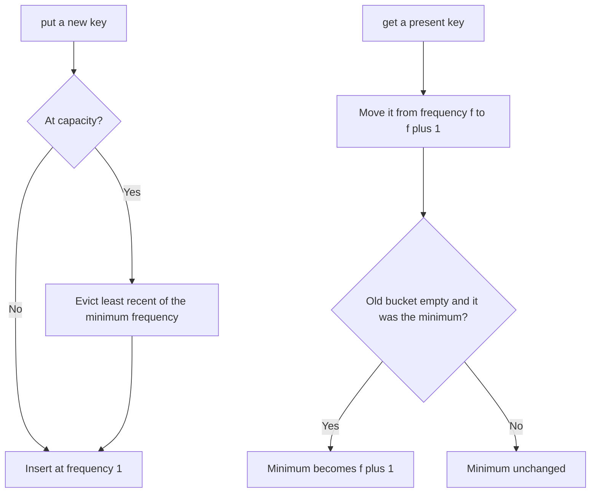

## Why this matters

Caches are the design question that sits on top of hashing. An LRU cache evicts the item that has been idle the longest. An LFU cache evicts the item that has been used the least, and breaks ties by recency. Both must answer get and put in constant time, which means a hash map for the key and a second structure that can move or delete an arbitrary item without scanning. The interview is not "import a cache." It is the two structures and the invariant that keeps them honest. Ordered dictionaries in Python make the LRU short. You should still be able to describe the doubly linked list, and you should be able to explain LFU's frequency buckets.

## Intuition

An LRU is a line of people at a counter. The person who just spoke moves to the front. When the room is full and someone new arrives, the person at the back leaves. Finding a person by name is the hash map. Moving them, without walking the line, requires that each person know their neighbors, which is a doubly linked list, or a structure such as OrderedDict that offers the same moves. An LFU is a set of such lines, one per frequency. Using an item moves it from the line for count f to the line for count f + 1. The person to evict is the back of the lowest non-empty line. You keep that lowest frequency in a variable so you do not scan the lines.

## Core concept in depth

LRU operations. get(key) returns -1 when the key is absent. When it is present, the node moves to the most-recent position and the value is returned. put(key, value) updates the value and moves the node to the most-recent position when the key exists. When the key is new and the cache is at capacity, it evicts the least-recent node, then inserts the new node as the most recent. Capacity zero stores nothing. A clean implementation uses sentinel head and tail nodes so the real list is never empty of sentinels. The most recent sits next to the head. The least recent sits next to the tail. Unlinking a node is four pointer assignments, or two if you write a helper that knows the neighbors. The map points from key to node, so the unlink does not search.

The invariant: the map's keys are exactly the nodes between the sentinels, the list order is most recent toward least recent, and the size equals the number of keys. Every get and put restores the invariant. Eviction deletes the node before the tail from both the list and the map. Because both deletions are constant time, get and put are constant time. There is no amortization hiding in the list operations themselves. If the map resizes, a particular put can be linear, and a sequence of puts is amortized constant in the map. For interviews, "constant time aside from hash-table resizing" is the precise sentence.

OrderedDict implements this policy. move_to_end(key) on access, and popitem(last=False) to evict the oldest. Python's OrderedDict is a dict plus a linked list, which is the design above. Using it is acceptable when the interviewer allows the standard library and still asks you to explain the complexity. If they say "do not use OrderedDict," draw the sentinels.

LFU adds frequencies. Each key stores its value and its frequency. Each frequency maps to an ordered dictionary or a linked list of keys with that frequency, in most-recent order. A variable min_freq is the smallest frequency that currently has at least one key. get on a hit increases the frequency by one: remove the key from the old bucket, insert it at the recent end of the new bucket, and if the old bucket was the minimum and is now empty, increment min_freq. The new frequency is exactly old plus one, so the minimum cannot jump further than that. put of an existing key updates the value and performs the same frequency bump. put of a new key, when full, evicts the least-recent key in the min_freq bucket, then inserts the new key at frequency 1. The new minimum is 1, because a brand-new key has been used once. Capacity zero rejects puts.

The LFU invariant: every key appears in the bucket of its stored frequency, buckets contain no empty holes that min_freq would point at, and within a bucket the order is recency. Eviction then takes the oldest key of the least frequently used bucket, which is exactly the statement of the policy. A wrong min_freq, off by one after a bump, evicts a frequent item or crashes on an empty bucket. That variable is the part to dry-run.

Neither cache is thread-safe in this design. A production cache also decides what to do with a single-flight miss, expiry, and memory measured in bytes rather than in entry count. Those are system-design follow-ups. The data-structure round ends when get and put are correct and constant time.

## Diagram and dry run



LRU capacity 2. Operations put(1, 1), put(2, 2), get(1), put(3, 3), get(2).

| Operation | Most recent to least recent | Return |
| --- | --- | --- |
| put 1 | 1 | null |
| put 2 | 2, 1 | null |
| get 1 | 1, 2 | 1 |
| put 3 | 3, 1 | null, and 2 is evicted |
| get 2 | 3, 1 | -1 |

LFU capacity 2 on the classic sequence put 1, put 2, get 1, put 3. After get 1, key 1 has frequency 2 and key 2 has frequency 1. The next put evicts 2, the only key at the minimum frequency. A later get(2) returns -1. If both keys had the same frequency, the least recently used of them would leave.

## Runnable Python

This LRU uses OrderedDict so the file stays short enough to type in a round, and the methods match the policy above. The LFU sketch in the comments of a real round should become frequency buckets. The second function is the operation runner you can test without a class wrapper. A recursive cache does not make sense. The iterative structure is the algorithm.

```python
from collections import OrderedDict


class LRUCache:
    def __init__(self, capacity: int) -> None:
        self.capacity = capacity
        self._data: OrderedDict[int, int] = OrderedDict()

    def get(self, key: int) -> int:
        if key not in self._data:
            return -1
        self._data.move_to_end(key)
        return self._data[key]

    def put(self, key: int, value: int) -> None:
        if self.capacity <= 0:
            return
        if key in self._data:
            self._data.move_to_end(key)
            self._data[key] = value
            return
        if len(self._data) >= self.capacity:
            self._data.popitem(last=False)
        self._data[key] = value


def lru_ops(capacity: int, ops: list[tuple[str, list[int]]]) -> list[int | None]:
    cache = LRUCache(capacity)
    out: list[int | None] = []
    for name, args in ops:
        if name == "get":
            out.append(cache.get(args[0]))
        else:
            cache.put(args[0], args[1])
            out.append(None)
    return out
```

The dry-run sequence, encoded as operations, returns null, null, 1, null, -1. If you implement the sentinel list instead, the same sequence is the test. Draw the four links of an unlink once so your hands remember them: the neighbor's next and prev, then the node's own pointers if you care about leaving it detached.

## Complexity and trade-offs

| Cache | get hit | get miss | put | Eviction choice |
| --- | --- | --- | --- | --- |
| LRU, list plus map | Theta(1) | Theta(1) | Theta(1) | Least recently used |
| LRU, scan a list | Theta(n) | Theta(n) | Theta(n) | Correct and too slow |
| LFU, buckets plus maps | Theta(1) | Theta(1) | Theta(1) | Least frequent, then least recent |
| LFU, scan frequencies | Theta(n) | Theta(1) | Theta(n) | Easier to write, fails the bound |

A heap of timestamps does not give constant time, because updating a key's timestamp is not a constant-time heap operation unless you also lazy-delete, and lazy deletion can leave the heap linear in the number of updates. The linked list or the ordered bucket is the right tool. Say that if someone proposes a heap.

## Tricks, tips, and patterns

Sentinels remove the empty-list special case. One helper to detach a node and one helper to insert it after the head are the whole list API. In LFU, a new key always lands at frequency 1, and that resets the minimum. A frequency bump moves a key by exactly one bucket. If the old bucket empties and it was the minimum, the new minimum is the new frequency, not an unknown larger number, because this key is now at old plus one and nothing else was at a frequency between them that this operation created. Other keys might still sit at the old frequency. Only the empty check increments the minimum. Test capacity 0, capacity 1, an update of an existing key while full, and a tie of frequencies.

## Common mistakes and edge cases

Evicting the most recent end because popitem was called with the default. Forgetting to move a key to the recent end on get, so a frequently read key still looks old. Updating a value without counting the update as a use. In LFU, evicting before checking that the key already exists, so an update of a present key at full capacity throws away some other key. Leaving min_freq on an empty bucket. Using a queue instead of a doubly linked structure and then being unable to delete a middle node on a get. Capacity zero. Negative capacity should be rejected or treated as zero. Keys that are equal must update, not duplicate. The return of put is null in the usual operation-list contract. get of a missing key is -1, not null, in the usual contract. Read the prompt. The two sentinels are not entries and must not be counted toward capacity.

## Interview notes

Draw the map and the list, label most recent and least recent, and then implement. Say the invariant once. For LFU, draw two buckets and the min_freq arrow, and dry-run the classic capacity-2 sequence before you write the general case. If time is short, implement LRU completely and describe LFU's buckets in sentences the interviewer can believe. Do not claim constant time for a solution that scans. Mention that resizing the hash map is amortized, if you want to be exact. Discuss thread safety only if the interviewer leaves the data-structure problem and asks about production. Otherwise finish the invariant.

## Practice problems

1. [LRU Cache](/practice/lru-cache) — implement the operation sequence.
2. [LFU Cache](/practice/lfu-cache) — frequency buckets and a recency tie break.
3. [Implement Trie](/practice/implement-trie) — another design that is a map of maps. The trie lesson goes deeper.

## Summary and cheat sheet

- LRU: hash map plus a recency list. Most recent at one end, evict the other end. Move on every use.
- Sentinels make insert and delete uniform.
- OrderedDict is that design in the standard library. Explain it if you use it.
- LFU: a list per frequency, plus the current minimum frequency.
- A hit moves a key from frequency f to f + 1. An empty minimum bucket increments the minimum.
- A new key evicts first when full, then enters at frequency 1, and the minimum becomes 1.
- get and put are constant time only if arbitrary nodes can be removed without a scan.

## Further reading

- [Wikipedia — Cache replacement policies](https://en.wikipedia.org/wiki/Cache_replacement_policies)
- [Wikipedia — Doubly linked list](https://en.wikipedia.org/wiki/Doubly_linked_list)
- [Python OrderedDict](https://docs.python.org/3/library/collections.html#collections.OrderedDict)
