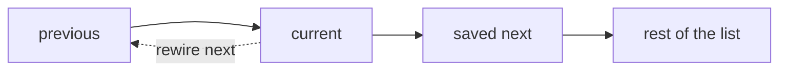

## Why this matters

Linked lists are where pointer manipulation stops being a metaphor. Arrays give you indexes and contiguous memory. A list gives you a node, a next reference, and no way to jump to the middle. Interviewers use that constraint to see whether you can rewire links without losing the rest of the chain, whether you remember a dummy head, and whether you can reverse a list both iteratively and recursively. The same node shape returns inside LRU caches, graph adjacency lists, and separate chaining. If the pointer code is shaky, those designs are shaky too.

## Intuition

A list is a treasure hunt. Each slip of paper holds a value and the location of the next slip. You cannot look ahead two slips without following the first. If you overwrite a location before you have saved it, the rest of the hunt is gone. Every correct list algorithm is a discipline about which references you save before you overwrite. A dummy node before the head is a fixed slip that you planted yourself, so the first real node can be inserted or deleted with the same code as any other node.

## Core concept in depth

A singly linked node stores a value and a next pointer. The next pointer of the last node is null. The head is the first node. A tail pointer, if you keep one, is the last node and makes append constant time. Without a tail, append is linear because you must walk. A doubly linked node also stores prev. That extra word lets you delete a node in constant time when you already hold it, which is why LRU caches use doubly linked lists. A circular list points the last node at the first. Traversal then needs an explicit stop, usually "back to the start," or it loops forever.

Traversal is a loop: start at the head, and while the node is not null, visit it and step to next. The recursive form visits the node and then calls itself on next, with null as the base case. Both are Theta(n) time. The loop uses constant extra memory. The recursion uses Theta(n) stack. Prefer the loop unless the recursive shape matches the problem, as it does for a reverse that processes the tail first.

Insertion after a known node is constant time: the new node's next becomes the known node's next, then the known node's next becomes the new node. The order of those two assignments matters. Doing them backwards loses the rest of the list. Deletion of the successor of a known node is also constant time: point the known node at its successor's successor. Deletion of a node given only that node, in a singly linked list, is not a true deletion. The usual trick copies the successor's value forward and deletes the successor, which fails on the last node and corrupts any external pointer to the successor. Say that limitation if the prompt asks for it.

A dummy head's next pointer is the real head. Algorithms that might delete or replace the first node write their answer into dummy.next and return that at the end. Merge, reverse-between, and remove-nth-from-end all get simpler with a dummy, because the head stops being a special case.

Iterative reverse uses three pointers: previous, current, and next. previous starts null. While current exists, save current.next, point current.next at previous, then step both previous and current forward. When current becomes null, previous is the new head. The invariant: previous is the head of the reversed prefix, current is the head of the untouched suffix, and those two chains are disjoint. Recursive reverse asks the tail to reverse itself and return the new head, then points the successor back at the current node and clears the current node's next so it becomes the new tail. The recursive call happens before the rewiring. The base case is a null or a single node, which is already reversed. The recursive version is elegant and uses linear stack. The iterative version is the one you want in production and the one you should write first in an interview.

Reversing only a sublist uses the same three-pointer loop for a fixed number of steps, after a dummy has walked you to the node before the sublist. You must reconnect the node before the sublist to the new sublist head, and reconnect the original sublist head, which is now the tail, to the node that followed the sublist. That is four links, and it is the entire problem.

Running time of a walk is proportional to the number of nodes you touch. Random access is linear, unlike an array. Extra memory is the storage of the nodes themselves, which is Theta(n), plus whatever pointers your algorithm adds. In problems in this course the public input is often an array of values, and the reference solution builds nodes so the rewiring is real. You should still talk about pointers, not about swapping values in an array, when the prompt says to reorder the list.

## Diagram and dry run



Reverse 1, 2, 3. previous starts null. current starts at 1.

| Step | previous | current | saved next | List shape after the rewire |
| --- | --- | --- | --- | --- |
| 1 | null | 1 | 2 | 1 points at null. 2 still points at 3 |
| 2 | 1 | 2 | 3 | 2 points at 1. 1 points at null |
| 3 | 2 | 3 | null | 3 points at 2. The chain is 3, 2, 1 |
| 4 | 3 | null |  | previous is the new head |

The recursive reverse on the same list reverses 2, 3 first into 3, 2, then points 2 back at 1 and clears 1's next. The new head, 3, is returned all the way up.

## Runnable Python

Both reverses are here. The iterative function is the interview default. The recursive function returns the new head and rewires on the way back. A tiny Node class makes the code runnable without a framework.

```python
class Node:
    def __init__(self, value: int, nxt: "Node | None" = None) -> None:
        self.value = value
        self.nxt = nxt


def reverse_iter(head: Node | None) -> Node | None:
    prev = None
    cur = head
    while cur is not None:
        nxt = cur.nxt
        cur.nxt = prev
        prev = cur
        cur = nxt
    return prev


def reverse_rec(head: Node | None) -> Node | None:
    if head is None or head.nxt is None:
        return head
    new_head = reverse_rec(head.nxt)
    head.nxt.nxt = head
    head.nxt = None
    return new_head
```

Build 1 to 2 to 3, reverse it either way, and walk the result. You should visit 3, then 2, then 1, and then null. If you see a cycle, the recursive version failed to clear head.nxt, or the iterative version pointed a node at itself.

## Complexity and trade-offs

| Operation | Singly linked, no extra index | Array |
| --- | --- | --- |
| Index the i-th element | Theta(i) | Theta(1) |
| Insert or delete after a known node | Theta(1) | Theta(n) to shift |
| Append with a tail pointer | Theta(1) | Amortized Theta(1) |
| Reverse | Theta(n) time, Theta(1) extra if iterative | Theta(n) time, Theta(1) extra |
| Recursive reverse stack | Theta(n) | not applicable |

Use a list when you have the node and you need splices, or when the problem forces you to. Use an array when you need random access or cache locality. A doubly linked list spends another pointer per node and gains constant-time deletion given the node. That trade is correct for an LRU and wasteful for a simple stack of numbers.

## Tricks, tips, and patterns

Save next before you overwrite it. Plant a dummy when the head might change. Draw three boxes and label previous, current, and next before you reverse. For a sublist reverse, identify the four endpoints by name: the node before the range, the original start, the original end, and the node after the range. After the inner reverse, the original start is the tail. Test a one-node list, a two-node list, and a reverse of the entire list. Those three catch most pointer bugs.

## Common mistakes and edge cases

Losing the rest of the list by overwriting next too early. Returning the old head after a reverse. Forgetting that a recursive reverse must set the original head's next to null, so the new tail does not point into the reversed chain and form a cycle. Off-by-one when reversing between positions that are 1-based in the statement and 0-based in your head. A dummy that you forget to skip when you return the answer. Null head. Single node. Deleting the last node with the "copy the successor" trick. Comparing nodes by value when the problem identity is the node itself, which matters for cycles and intersection.

## Interview notes

Talk in pointers. "I save next, point current at previous, and advance." Offer both the loop and the recursion, and say the stack cost of the recursion without being asked. If the input on the platform is an array, say "I will build nodes so the algorithm rewires next, then read the values back." Do not reverse by swapping values unless the prompt explicitly allows it. Dry-run three nodes. Mention the dummy for any problem that deletes the head.

## Practice problems

1. [Reverse Linked List](/practice/reverse-linked-list) — write both versions.
2. [Reverse Linked List II](/practice/reverse-linked-list-ii) — a bounded reverse.
3. [Remove Nth From End](/practice/remove-nth-node-from-end) — a dummy plus a gap of n.
4. [Middle of the Linked List](/practice/middle-of-the-linked-list) — the slow and fast pointers return in the next lesson.
5. [Merge Two Sorted Lists](/practice/merge-two-sorted-lists).

## Summary and cheat sheet

- A node is a value plus next. The last next is null. Doubly linked nodes also store prev.
- Save a pointer before you overwrite it.
- A dummy head removes the special case at the front.
- Iterative reverse uses previous, current, and a saved next. The new head is previous.
- Recursive reverse rewires on the way back and must clear the new tail's next.
- Random access is linear. Splices, given the node, are constant time.
- Recursive walks use linear stack. Loops do not.

## Further reading

- [Wikipedia — Linked list](https://en.wikipedia.org/wiki/Linked_list)
- [Wikipedia — Doubly linked list](https://en.wikipedia.org/wiki/Doubly_linked_list)
- [CLRS, elementary data structures](https://mitpress.mit.edu/9780262046305/introduction-to-algorithms/)
