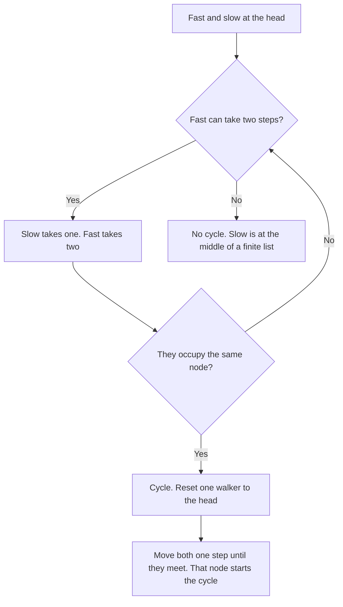

## Why this matters

Once you can reverse a list, the interview problems are compositions: find the middle, reverse one half, merge, detect a cycle, copy a node that has a second random pointer. Each composition has a famous pointer trick. Fast and slow pointers find the middle and detect cycles. A fixed gap between two pointers finds the nth node from the end. Merging is a dummy plus the smaller head. Copying a list with random pointers is either a hash map from old node to new node, or an interleaved weave that uses no extra map. You should be able to implement the linear ones and explain Floyd's meeting point without hand-waving.

## Intuition

Two walkers on a circular track, one moving twice as fast as the other, will meet if there is a loop and will never meet if the track is a straight line that ends. That is Floyd's cycle test. The same speed difference finds the middle of a straight list: when the fast walker falls off the end, the slow walker is about halfway. A gap of n between two walkers who then move in lockstep leaves the slow walker n steps from the end when the fast walker finishes. None of these need indexes. They need the discipline of moving the fast walker first, so it has somewhere to go, and of stopping when a next pointer is null.

## Core concept in depth

The middle of a list: slow and fast both start at the head. While fast and fast.next both exist, step slow once and fast twice. When the loop ends, slow is the middle. On an even-length list this version returns the second of the two middle nodes, because fast starts on the head and the loop continues while a pair of steps remains. Starting fast one node ahead returns the first middle. Know which one you need. Reorder List wants the start of the second half, which is the node after the first middle, so it uses the "fast starts ahead" split and then cuts the list.

Cycle detection: slow and fast start at the head. Move slow once and fast twice. If fast reaches null, there is no cycle. If slow and fast land on the same node, there is a cycle. Correctness: inside a cycle of length c, the fast walker gains one step per iteration on the slow walker, so it catches up. If there is no cycle, fast hits the end.

The start of the cycle is the subtle part. Let the head-to-cycle distance be a, and let the meeting point be b steps into the cycle. When the walkers meet, the fast walker has traveled twice as far as the slow walker, and the extra distance is a whole number of loops. A short derivation shows that a equals some number of full loops minus b, which means: if you put one walker back at the head and leave the other at the meeting point, and you move both one step at a time, they meet at the cycle entrance. Implement that second phase. It is the whole of Linked List Cycle II. The proof is worth re-deriving once so you are not reciting a ritual.

Remove nth from the end: plant a dummy. Move a fast pointer n steps ahead of the dummy. Then move fast and a slow pointer together until fast's next is null. Slow is the node before the one to delete. Point slow at slow.next.next. The dummy makes deleting the head ordinary. The gap is n plus the dummy's head start, which is why you count carefully on a two-node example.

Merge two sorted lists: dummy, and a tail that starts at the dummy. While both lists remain, append the smaller head to the tail and advance that list. Append whichever list remains. Return dummy.next. Merge k lists uses a heap of the current heads, keyed by value, or it merges them like merge sort in pairs. The heap is Theta(n log k) for n total nodes. The pairwise merge is the same bound. A linear scan of k heads per output node is Theta(n k) and loses.

Palindrome list: find the middle, reverse the second half, compare the two halves in lockstep, and optionally reverse the second half back so the list is unchanged. The comparison fails fast on a mismatch. The extra memory is constant. Copying the values into an array is correct and uses linear memory. Say which one you are doing.

Reorder list: split at the middle, reverse the second half, then weave one node from each half. The weave saves both next pointers before it rewires. Stop when the second half is exhausted. An odd-length list leaves the middle node at the end of the first half.

Copy with random pointers. The map version creates every clone, stores old-to-new, then assigns each clone's next and random by lookup. Two passes, linear extra memory. The weave version inserts each clone immediately after its original, assigns random by jumping original.random.next, which is the clone of the random target, then unweaves the two lists. Linear time, constant extra memory beyond the output. The weave is easy to get wrong at the unweave step. Test a random pointer that is null, one that points at the node itself, and one that points backward.

Add Two Numbers is a merge with a carry. Dummy, walk both lists, add the two digits and the carry, append the units digit, and keep the tens digit as the next carry. Do not stop while a carry remains even if both lists have ended.

Odd-even list rewires nodes so odd positions precede even positions, preserving relative order. Two tails, one for each parity, and a saved head of the even chain, are enough. Attach the even head after the odd tail at the end.

Swap in pairs is a reverse of every group of two. Reverse Nodes in k-Group is the general version: count k nodes, reverse that group with the iterative reverse, reconnect, and leave a short tail alone. A dummy makes the first group normal. The inner reverse must know the node after the group so the reversed tail stays connected.

## Diagram and dry run



Cycle example. Nodes 1 to 2 to 3 to 4, and 4 points at 2. The entrance is 2.

| Phase | Slow | Fast | Note |
| --- | --- | --- | --- |
| Start | 1 | 1 | |
| Move | 2 | 3 | |
| Move | 3 | 2 | 4 goes to 2 |
| Move | 4 | 4 | They meet at 4 |
| Reset | 1 | 4, the meeting node | Second phase, one step each |
| Move | 2 | 2 | They meet at the entrance |

A list with no cycle, 1 to 2 to 3, ends when fast cannot move, and slow sits on 2, the middle.

## Runnable Python

Floyd's second phase is the piece to implement carefully. The merge is the other workhorse. Both are iterative. A recursive merge exists and is a one-liner on the smaller head, with linear stack. It is included so you can compare.

```python
class Node:
    def __init__(self, value: int, nxt: "Node | None" = None) -> None:
        self.value = value
        self.nxt = nxt


def cycle_start(head: Node | None) -> Node | None:
    slow = fast = head
    while fast is not None and fast.nxt is not None:
        slow = slow.nxt
        fast = fast.nxt.nxt
        if slow is fast:
            slow = head
            while slow is not fast:
                slow = slow.nxt
                fast = fast.nxt
            return slow
    return None


def merge(a: Node | None, b: Node | None) -> Node | None:
    if a is None or b is None:
        return a or b
    if a.value <= b.value:
        a.nxt = merge(a.nxt, b)
        return a
    b.nxt = merge(a, b.nxt)
    return b
```

The recursive merge is correct and uses stack proportional to the total length. An interview can ask you to rewrite it with a dummy and a loop. Do that rewrite if they ask for constant extra memory. `cycle_start` returns the entrance node, or null when the walk reaches the end. Identity is `is`, not value equality. Two nodes can hold the same number and still be different objects.

## Complexity and trade-offs

| Pattern | Time | Extra space |
| --- | --- | --- |
| Middle, fast and slow | Theta(n) | Theta(1) |
| Cycle test and entrance | Theta(n) | Theta(1) |
| Nth from end | Theta(n) | Theta(1) |
| Merge two lists, iterative | Theta(n) | Theta(1) |
| Merge two lists, recursive | Theta(n) | Theta(n) stack |
| Merge k lists with a heap | Theta(n log k) | Theta(k) |
| Palindrome by reversing the half | Theta(n) | Theta(1) |
| Copy random, hash map | Theta(n) | Theta(n) |
| Copy random, weave | Theta(n) | Theta(1) extra |

The array-copy versions are easier and use linear memory. Offer the constant-space version when the prompt or the interviewer asks for it. Do not sacrifice correctness for the weave if you cannot finish the unweave. A correct map solution beats a broken clever one.

## Tricks, tips, and patterns

Move fast first in your mind: the loop condition must look at fast.next before you touch fast.next.next. For the entrance proof, remember the reset. One phase only tells you that a cycle exists. For k-group reverse, count k with a scout pointer before you reverse, and abort the reverse when the scout falls off, so a short tail stays put. For the weave copy, the clone of a node is node.next after the interleave, and the clone of node.random is node.random.next. Write those two sentences on the board. Restore a palindrome list if the caller still needs the original order. Say so.

## Common mistakes and edge cases

Comparing nodes by value inside a cycle test. Fast and slow meeting at the entrance by luck on one example and failing on another, because you skipped the reset phase. Off-by-one on the middle of an even list, which shifts the entire reorder. Losing a next pointer during the weave. A k-group that reverses a short tail. Forgetting the final carry in Add Two Numbers. A random pointer to self, which the weave handles only if you assign random after every clone has been inserted. Null head. A cycle that starts at the head, where a is 0, and the reset phase must still work. Two lists that merge, in the intersection problem, which is a different "meet" and is solved by equalizing lengths or by the cycle trick of connecting one tail to the other head. Do not confuse that problem with Floyd.

## Interview notes

Name the pattern, then the invariant, then the code. "Fast moves twice as fast, so the meeting point encodes the head distance. I reset one pointer to the head and walk in lockstep." Dry-run the four-node cycle above. It is short and it uses both phases. For merge, mention the dummy and the leftover list. For k lists, give the heap bound. If you only have time for one clever algorithm, make it Floyd, and do the ordinary merges with a dummy. Interviewers forgive a simple merge. They do not forgive a cycle test that loops forever.

## Practice problems

1. [Linked List Cycle](/practice/linked-list-cycle) and [Linked List Cycle II](/practice/linked-list-cycle-ii).
2. [Reorder List](/practice/reorder-list) and [Palindrome Linked List](/practice/palindrome-linked-list).
3. [Copy List with Random Pointer](/practice/copy-list-with-random-pointer).
4. [Swap Nodes in Pairs](/practice/swap-nodes-in-pairs) and [Reverse Nodes in k-Group](/practice/reverse-nodes-in-k-group).
5. [Odd Even Linked List](/practice/odd-even-linked-list) and [Add Two Numbers](/practice/add-two-numbers).
6. [Merge K Sorted Lists](/practice/merge-k-sorted-lists).

## Summary and cheat sheet

- Fast and slow find the middle and detect cycles. The entrance needs a second phase with one walker reset to the head.
- A gap of n finds the node before the nth from the end. Use a dummy if the head might disappear.
- Merge with a dummy. Merge k lists with a heap in n log k.
- Palindrome and reorder are split, reverse the second half, then compare or weave.
- Copy random pointers with a map, or weave clones and use original.random.next.
- k-group reverse counts k nodes before it reverses, and it leaves a short tail.
- Pointer identity is object identity, not value equality.

## Further reading

- [Wikipedia — Cycle detection](https://en.wikipedia.org/wiki/Cycle_detection)
- [Wikipedia — Floyd's tortoise and hare, inside cycle detection](https://en.wikipedia.org/wiki/Cycle_detection#Floyd's_tortoise_and_hare)
- [CLRS, elementary data structures](https://mitpress.mit.edu/9780262046305/introduction-to-algorithms/)
