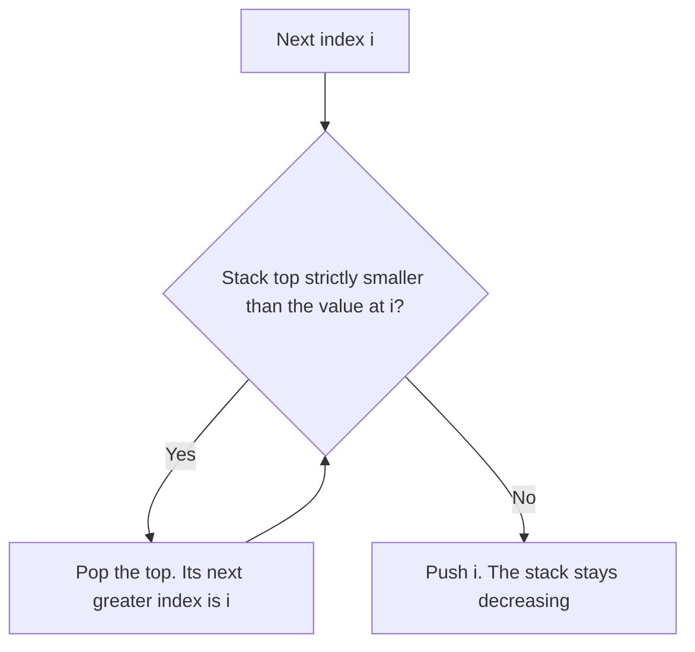

## Why this matters

A stack remembers unfinished work in the order you must finish it. Parentheses, undo, depth-first search, and function calls are all stacks. The monotonic variant is the interview workhorse for "the next greater element" and its cousins: daily temperatures, stock spans, the largest rectangle in a histogram, and the sliding-window maximum when the window is a deque. The naive answer scans backward from every index and is quadratic. The stack keeps only the candidates that are still possible, and each index is pushed once and popped once. That is the aggregate argument from the amortization lesson, applied to a shape you can draw.

## Intuition

Imagine people standing in a line, each holding a height. Someone new arrives who is taller than the people at the back. Those shorter people will never be the "next taller person" for anyone still waiting, because the newcomer stands closer and is at least as tall. They can leave, and as they leave you can tell each of them that the newcomer is their answer. The people who remain are in decreasing order of height, closest at the top. That decreasing order is the monotonic invariant. A deque does the same job from both ends when a window also expires old indexes.

## Core concept in depth

A plain stack is last-in first-out. Push, pop, and peek are constant time if the stack is a dynamic array or a linked list of nodes. A queue is first-in first-out. A ring buffer or a deque gives constant-time operations at both ends. Implementing a queue with two stacks is the amortized exercise from the foundations module: push to the inbox, and pour into the outbox only when the outbox is empty. Each element moves at most once.

Valid parentheses uses a plain stack of opening characters. An opening character pushes. A closing character pops and must match. The stack must be empty at the end. A mismatch or a pop from empty is a failure. Min Stack keeps a second stack of the minimum at every height. On push, the new minimum is the smaller of the value and the current minimum. On pop, both stacks pop. Top and getMin are then peeks. The parallel stack is simpler than storing pairs, and it is the same information.

A next-greater-element stack stores indexes, not only values, because the answer is often a distance or a later index. Walk left to right. While the stack is not empty and the value at the top index is strictly less than the current value, pop it and record the current index as its next greater element. Then push the current index. Indexes still on the stack at the end have no next greater element. The invariant: values at the stacked indexes are strictly decreasing from bottom to top, and each is waiting for a greater element to its right. Popping a smaller top preserves the invariant. Daily temperatures is this algorithm with the distance `current - popped` as the stored answer. The circular next greater element runs the same loop on a conceptual double array, or it runs twice, and it only assigns an answer that is still unset so a later wrap does not overwrite a nearer neighbor.

Stock span is the same pops with a running width. Pop while the top price is less than or equal to today's price, and add that day's span to today's span. Push today's price together with its span. Equal prices must be popped for the span definition, which counts previous days that were less than or equal. Next-greater usually uses a strict comparison. Read the inequality from the statement. Getting it backwards is a one-character bug with a wrong example.

Largest rectangle in a histogram treats each bar as the shortest bar of some rectangle. The width is the distance between the nearest strictly shorter bar on the left and the nearest strictly shorter bar on the right. A monotonic increasing stack of indexes computes both boundaries. When a bar is shorter than the top, the top's right boundary is the current index, and its left boundary is the new top after the pop, or the start of the array if the stack empties. Sentinel bars of height 0 at both ends remove the edge cases. The area is height times width. The maximum over all popped bars is the answer. Each index is pushed and popped once, so the algorithm is linear after you accept the sentinels.

Remove k digits uses a stack that wants the smallest number in order. While the top is greater than the next digit and you still have deletions left, pop. Digits only leave if a smaller digit soon to the right can take their place, and the stack stays non-decreasing. Strip leading zeros at the end. If deletions remain, they come off the tail, which is the largest remaining place values. This is a monotonic stack whose answer is the stack itself, not a side array of "next greater."

The sliding-window maximum is a monotonic deque of indexes, decreasing in value. Pop the back while it is smaller than the new value. Pop the front while it has left the window. The front is the maximum. It was derived in the window lesson. Here the point is that the deque is a double-ended monotonic stack. The aggregate argument is identical.

## Diagram and dry run



Next greater element to the right, on 2, 1, 2, 4, 3. Answers are indexed values. Unfilled answers stay -1.

| i | Value | Stack of indexes after the step | Newly solved |
| --- | --- | --- | --- |
| 0 | 2 | 0 | none |
| 1 | 1 | 0, 1 | none. 1 is smaller, so 2 is still waiting |
| 2 | 2 | 0, 2 | index 1 solved by value 2. Index 0 is not strictly smaller than 2? Wait, 2 is not strictly less than 2, so index 0 stays |
| 3 | 4 | 3 | indexes 0 and 2 solved by 4 |
| 4 | 3 | 3, 4 | none |

Correct the third row carefully. Values 2, 1, 2. The stack after index 1 is 0 then 1, values 2 then 1. Index 2 holds 2, which is greater than the top value 1, so pop index 1. The new top value is 2, which is not strictly less than 2, so stop. Push index 2. Solved: index 1. Then index 3 holds 4, which pops both remaining indexes. The answers, as next greater values, are 4, 2, 4, and none, and none. Distances for daily temperatures would be 3, 1, 1, and zeros.

Largest rectangle on heights 2, 1, 5, 6, 2, 3 is the standard example whose best area is 10, the rectangle of height 5 and 6 extended only as far as the bars that stay at least 5. Walk it with sentinels when you practice. The area 10 comes from the bar of height 5, spanning the 5 and the 6, or equivalently from those two bars. Do the arithmetic on paper rather than memorizing 10.

## Runnable Python

The next-greater loop is the template. The recursive version is unnatural, because the stack is already an explicit recursion. A recursive depth-first search of a parenthesis string is included instead, so you see a stack as a call stack. The iterative matcher is the one to ship.

```python
def next_greater(nums: list[int]) -> list[int]:
    answer = [-1] * len(nums)
    stack: list[int] = []
    for i, value in enumerate(nums):
        while stack and nums[stack[-1]] < value:
            answer[stack.pop()] = value
        stack.append(i)
    return answer


def valid_parens(s: str) -> bool:
    pairs = {")": "(", "]": "[", "}": "{"}
    stack: list[str] = []
    for ch in s:
        if ch in "([{":
            stack.append(ch)
        elif ch in pairs:
            if not stack or stack.pop() != pairs[ch]:
                return False
    return not stack
```

`next_greater` on 2, 1, 2, 4, 3 returns 4, 2, 4, -1, -1. `valid_parens` returns true on a string of three matched pairs and false on an opener followed by the wrong closer. The map from closing character to opening character is the whole matching rule. In speech, say "each closer must pop its own opener."

## Complexity and trade-offs

| Problem | Naive | Stack or deque | Extra space |
| --- | --- | --- | --- |
| Next greater element | Theta(n squared) | Theta(n), each index once | Theta(n) |
| Daily temperatures | Theta(n squared) | Theta(n) | Theta(n) |
| Stock span | Theta(n squared) | Theta(n) | Theta(n) |
| Largest rectangle | Theta(n squared) | Theta(n) | Theta(n) |
| Window maximum | Theta(n k) | Theta(n) amortized | Theta(k) |
| Valid parentheses | scans | Theta(n) | Theta(n) |
| Min stack operations | linear getMin if you scan | Theta(1) per call | Theta(n) |

A segment tree can also answer range-maximum queries inside a window in log time, which is worse than the deque by a log and more code. Use the deque. A heap does not delete an arbitrary expired index cheaply. Mention that dead end if you almost reach for one.

## Tricks, tips, and patterns

Store indexes when the answer is a distance or a later lookup. Choose the inequality from the statement: strictly greater, or greater-or-equal. Sentinels of a neutral height simplify the histogram. For digits, the stack is the answer and the monotonic direction is "increasing, so the number is small." Pop only while budget remains. For parentheses, the empty stack is a failure on a closer, and a non-empty stack at the end is a failure too. For the circular array, iterate twice and write an answer only if it is still empty. The second pass must not push indexes past the original length if that would duplicate work. Pushing only while the index is in the first copy, and only looking during both copies, is a clean variant.

## Common mistakes and edge cases

Using a non-strict comparison for next greater, so equal elements pop each other and the "next" is not greater. Using a strict comparison for stock span, so equal prices do not extend the span. Forgetting that the histogram width is right - left - 1 when both boundaries are exclusive. Off-by-one there is the entire bug. An empty histogram. A single bar. All bars equal, where the width is the whole array. A decreasing histogram, where every bar waits until the right sentinel. Leading zeros in remove-k-digits, including the case that every digit is removed and the answer is a single zero rather than an empty string. A min stack that forgets to push the previous minimum when the new value is larger. Parentheses with nothing but closers.

## Interview notes

Draw the decreasing stack and pop one example before you code. Say "each index is pushed once and popped once, so this is linear." For the histogram, state the exclusive boundaries and the width formula, then use sentinels. If you are unsure of the formula, compute one bar by hand from the nearest shorter neighbors and check the formula against that bar. For parentheses, test the empty string, a single pair, a mismatch, and an extra opener. Mention the two-stack queue only if the conversation is about implementing a queue. It is not the monotonic pattern.

## Practice problems

1. [Daily Temperatures](/practice/daily-temperatures) and [Next Greater Element I](/practice/next-greater-element-i).
2. [Next Greater Element II](/practice/next-greater-element-ii) — the circular version.
3. [Online Stock Span](/practice/online-stock-span).
4. [Largest Rectangle in Histogram](/practice/largest-rectangle-in-histogram).
5. [Sliding Window Maximum](/practice/sliding-window-maximum).
6. [Remove K Digits](/practice/remove-k-digits).
7. [Valid Parentheses](/practice/valid-parentheses) and [Min Stack](/practice/min-stack).

## Summary and cheat sheet

- A monotonic stack stores candidates that are still possible, in sorted order.
- Next greater: pop smaller tops, then push. Each index once. Linear.
- Distances and spans are arithmetic on the popped index. Match the inequality to the statement.
- Histogram: the bar is the shortest of a rectangle whose sides are the nearest shorter bars. Width is the gap between exclusive boundaries. Sentinels help.
- Remove k digits keeps an increasing stack and spends deletions on larger tops.
- A deque is a monotonic stack with expiration at the front.
- Parentheses and min stacks are ordinary stacks, not monotonic ones. Do not force the pattern.

## Further reading

- [Wikipedia — Stack (abstract data type)](https://en.wikipedia.org/wiki/Stack_(abstract_data_type))
- [Wikipedia — Double-ended queue](https://en.wikipedia.org/wiki/Double-ended_queue)
- [CP-Algorithms, stack applications are spread across; the histogram problem is a standard linear stack scan](https://cp-algorithms.com/)
