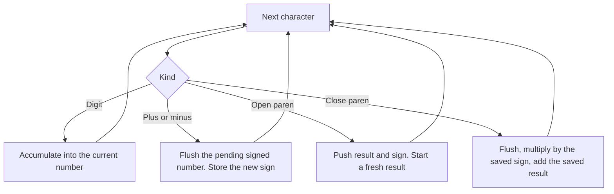

## Why this matters

Expression evaluation is the stack's original job. Compilers turn infix into postfix, then evaluate postfix with a value stack. Interview variants strip the compiler down: reverse Polish notation, a calculator with plus and minus and parentheses, a calculator with multiplication and division, and a decoder that repeats a bracketed substring. The bugs are precedence and the moment you flush a number. A recursive descent parser is the other legal implementation. You should be able to write the stack version and explain the recursive one as "the call stack holds the parenthesis frames."

## Intuition

Infix is how people write `3 + 4 * 2`. The multiplication happens before the addition even though it is written later. Postfix, or reverse Polish notation, writes `3 4 2 * +`. Operators come after their operands, so a left-to-right scan with a stack is enough: numbers push, and an operator pops two numbers, applies, and pushes the result. Parentheses in infix are a way to force order. A stack of operators, with a precedence rule, either applies an operator now or saves it until a higher-precedence neighbor is finished. That saving is the shunting yard.

## Core concept in depth

Reverse Polish notation. Split the tokens. If the token is a number, push it. If it is an operator, pop the right operand, then the left, apply the operator, and push the result. Subtraction and division are not commutative, so the pop order matters. At the end the stack holds one value. The algorithm is linear in the number of tokens and uses stack space proportional to the depth of the expression. It assumes the expression is valid, which interview prompts usually guarantee.

Basic calculator with plus, minus, and parentheses. Ignore spaces. Keep a running result, the number currently being parsed, and a sign that is about to apply to that number. A digit extends the number by ten times the old number plus the digit. An operator flushes `sign * number` into the result, clears the number, and stores the new sign. An opening parenthesis pushes the current result and the current sign, then resets the result and the sign, because the inside of the parentheses is a fresh expression. A closing parenthesis flushes the number, multiplies the inner result by the saved sign, and adds the saved outer result. After the string, flush the last number. Unary minus at the start, or after an opening parenthesis, is a flush of zero plus a negative sign, so the same code handles it if you treat the sign as pending rather than as a binary operator that demands two numbers already present.

Calculator II adds multiplication and division, and usually has no parentheses. One style keeps the last flushed term. Plus and minus push a signed number onto a stack of terms. Multiplication and division pop the last term, combine it with the new number, and push the combination, so precedence is applied immediately. The answer is the sum of the terms. Another style is full shunting yard: two stacks, or an output queue and an operator stack, with precedence of times and divide above plus and minus, and left associativity. Left associativity means an operator on the stack with greater or equal precedence is applied before the new operator is pushed. Equal precedence must be applied, not saved, or `8 / 4 / 2` becomes 4 instead of 1.

Shunting yard in full. Numbers go to the output. An operator pops operators of higher or equal precedence, then pushes. An opening parenthesis pushes. A closing parenthesis pops until the opening parenthesis, and discards the parenthesis. At the end, pop the remaining operators. Then evaluate the postfix. This is the algorithm to describe if the interviewer asks how a calculator really parses. The specialized loops above are what you code when the operator set is small.

Decode string reads `k[abc]` as the substring abc repeated k times. A stack of pairs, the string built so far and the repeat count, handles nesting. Digits accumulate into k. An opening bracket pushes the current string and the current k, then clears both. Characters append to the current string. A closing bracket pops the previous string and the count, and sets the current string to previous plus current repeated count times. Nested brackets work because the stack holds the outer frame while the inner frame runs. This is the same parenthesis frame as the calculator, with a string instead of an integer result.

Score of parentheses is a smaller cousin. A stack of scores starts with 0. An opening parenthesis pushes 0. A closing parenthesis pops the inner score. If it is 0, the pair was empty and worth 1. Otherwise the pair is worth twice the inner score. Add that value onto the new top, which sums adjacent groups. The final top is the score. The recursive reading is the specification: `()` is 1, concatenation adds, and a wrapper doubles.

Recursive descent is the recursive form of these parsers. A function `parse_expression` reads terms separated by plus and minus. A function `parse_term` reads factors separated by times and divide. A function `parse_factor` reads a number or a parenthesized expression, and a parenthesized expression calls `parse_expression`. The call stack is the parenthesis stack. This style extends more cleanly to a real language. The explicit stack is easier to debug in a 30-minute slot. Know which one you are writing.

## Diagram and dry run



Evaluate `1 + (4 - 2)`.

| Character | Number | Sign | Result | Stack | Action |
| --- | --- | --- | --- | --- | --- |
| 1 | 1 | +1 | 0 | empty | building a number |
| + | 0 | +1 | 1 | empty | flushed +1 |
| ( | 0 | +1 | 0 | 1, then +1 | saved the outer frame |
| 4 | 4 | +1 | 0 | saved | building |
| - | 0 | -1 | 4 | saved | flushed +4 |
| 2 | 2 | -1 | 4 | saved | building |
| ) | 0 | -1 | 2 | empty | inner result 4 + (-1)*2 = 2, times saved sign +1, plus saved result 1, equals 3 |

The value is 3. The same expression in postfix is `1 4 2 - +`. The value stack goes 1, then 1 4, then 1 4 2, then 1 2, then 3.

## Runnable Python

The postfix evaluator is the shortest correct calculator. The recursive descent alongside it handles infix plus and minus and parentheses, which is the recursive form of the stack calculator. Both assume a valid expression. The descent uses an index in a list so the recursive calls can advance it.

```python
def eval_rpn(tokens: list[str]) -> int:
    stack: list[int] = []
    for token in tokens:
        if token not in {"+", "-", "*", "/"}:
            stack.append(int(token))
            continue
        right = stack.pop()
        left = stack.pop()
        if token == "+":
            stack.append(left + right)
        elif token == "-":
            stack.append(left - right)
        elif token == "*":
            stack.append(left * right)
        else:
            stack.append(int(left / right))
    return stack[-1]


def eval_infix(s: str) -> int:
    tokens = [ch for ch in s if ch != " "]
    i = 0

    def parse() -> int:
        nonlocal i
        result = 0
        sign = 1
        while i < len(tokens):
            ch = tokens[i]
            if ch.isdigit():
                number = 0
                while i < len(tokens) and tokens[i].isdigit():
                    number = number * 10 + int(tokens[i])
                    i += 1
                result += sign * number
                continue
            if ch == "+":
                sign = 1
            elif ch == "-":
                sign = -1
            elif ch == "(":
                i += 1
                result += sign * parse()
                sign = 1
                continue
            elif ch == ")":
                i += 1
                return result
            i += 1
        return result

    return parse()
```

`eval_rpn` on the tokens 1, 4, 2, -, + returns 3. Integer division toward zero matches the usual calculator-II contract. Python's floor division would make `-3 / 2` equal -2, so the conversion through `int(left / right)` is deliberate. `eval_infix("1+(4-2)")` returns 3. Extend `parse` with a term function if multiplication arrives.

## Complexity and trade-offs

| Parser | Time | Extra space | Operators it likes |
| --- | --- | --- | --- |
| Postfix stack | Theta(n) | Theta(n) | Any, once the input is postfix |
| Infix plus and minus with parentheses | Theta(n) | Theta(depth) | The specialized result-and-sign stack |
| Terms for times and divide | Theta(n) | Theta(n) terms, or Theta(depth) | Precedence without a full grammar |
| Shunting yard | Theta(n) | Theta(n) | Arbitrary precedence and associativity |
| Recursive descent | Theta(n) | Theta(depth) call stack | A grammar you can write as functions |

Shunting yard is more code and more general. The specialized calculator is less code and easier to get wrong at the flush points. Pick the specialized loop for plus and minus, and the term-stack for times and divide. Describe shunting yard if the operator set is not fixed. Recursive descent wins when the grammar grows nested structures that are not only parentheses, such as the decode-string brackets with a number in front.

## Tricks, tips, and patterns

Flush at operators, at closing parentheses, and at the end. Forgetting the final flush drops the last number. Parse multi-digit numbers in an inner loop, not one digit at a time as separate numbers. Pop right before left. Decide the division rounding before you code, and test a negative numerator. For decode-string, the stack frame is the previous text plus the repeat count, and the current text starts empty after an opening bracket. For score of parentheses, an empty inner frame is the unit score 1, not 0, and a non-empty frame doubles. Left associativity means equal precedence applies the stacked operator first.

## Common mistakes and edge cases

Popping left before right, so subtraction flips. Floor division on negatives. A final number that is never flushed. Treating a space as a token. Unary minus coded as binary minus with a missing left operand. `8/4/2` associated to the right. A decode count of 10 parsed as 1 and 0 because the digit loop stopped early. Nested decode strings that append to the outer string too soon. An empty parenthesis pair in the score problem counted as 0. Stack underflow on an invalid expression. If the prompt guarantees validity, you still guard pops in your head so a bug does not become an exception you cannot explain. The empty expression is 0 if it can occur. A single number is itself.

## Interview notes

Start from postfix if you need a warm-up, then add precedence. Say when a number is flushed. Dry-run `1+(4-2)` or `3+4*2` depending on the operator set, and write the stack column. Mention integer-division rounding. If parentheses nest deeply, say the stack height is the depth. Offer recursive descent as the same frames in the call stack. For decode-string, dry-run a nested example `3[a2[c]]` which becomes `accaccacc`. That one example catches a frame bug.

## Practice problems

1. [Evaluate Reverse Polish Notation](/practice/evaluate-reverse-polish-notation).
2. [Basic Calculator](/practice/basic-calculator) — plus, minus, parentheses.
3. [Basic Calculator II](/practice/basic-calculator-ii) — times and divide, no parentheses.
4. [Decode String](/practice/decode-string).
5. [Score of Parentheses](/practice/score-of-parentheses).
6. [Exclusive Time of Functions](/practice/exclusive-time-of-functions) — a stack of call frames, the same idea on a log.

## Summary and cheat sheet

- Postfix: numbers push, operators pop right then left, push the result.
- Infix plus and minus: pending sign, flush on the next operator, parenthesis frames on a stack.
- Times and divide: combine with the last term immediately, or use precedence in shunting yard.
- Equal precedence is left-associative: apply the stacked operator.
- Division of negatives truncates toward zero in the usual problem. Do not use floor division blindly.
- Decode string and parenthesis scores are the same frames with a different payload.
- Recursive descent stores those frames in the call stack.

## Further reading

- [Wikipedia — Reverse Polish notation](https://en.wikipedia.org/wiki/Reverse_Polish_notation)
- [Wikipedia — Shunting yard algorithm](https://en.wikipedia.org/wiki/Shunting_yard_algorithm)
- [Wikipedia — Recursive descent parser](https://en.wikipedia.org/wiki/Recursive_descent_parser)
