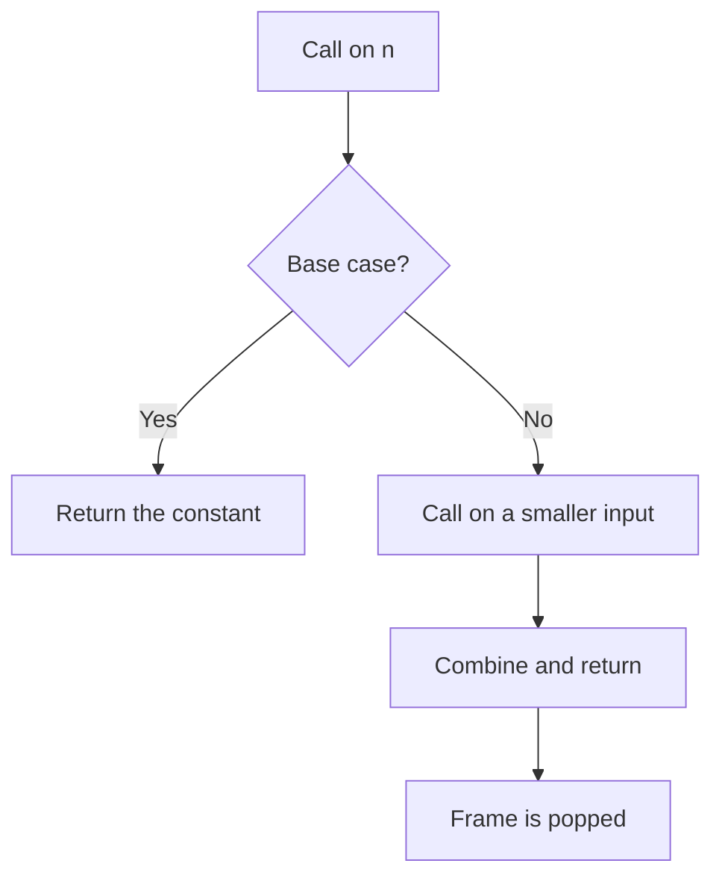

## Why this matters

Recursion is the way you state an algorithm in terms of a smaller copy of itself. Binary search, merge sort, tree walks, depth-first search, and dynamic programming all start as recurrences. An interviewer who asks for a recursive solution is asking whether you can name the base case, the smaller subproblem, and the work that combines them. An interviewer who then asks for the iterative solution is asking whether you know what the call stack was doing. You need both, and you need the cost of the tree you just defined, because a correct Fibonacci recursion is exponential and will not survive the constraints.

## Intuition

A recursive function is a worker who handles one layer and hands the rest to an identical worker. The base case is the worker who can finish without hiring anyone. If nobody is the base case, hiring continues forever. The call stack is the list of workers waiting for their hires to return. The top frame is the worker currently running. When a hire returns, the waiting worker combines the result and returns to their own boss. That picture is exactly depth-first search, and it is exactly the parenthesis frames from the expression lesson. Iteration stores the same waiting work in an explicit stack or in a handful of variables when the waiting work is simple enough.

## Core concept in depth

A recursive definition has three parts. The base case returns without a recursive call. The recursive case calls the same function on a strictly smaller input, where smaller is measured by a quantity that cannot decrease forever: n minus one, the length of a suffix, the height of a tree, the number of unset bits. The combine step uses the recursive result to build this call's result. If you cannot point at the quantity that shrinks, you do not have a proof of termination.

Linear recursion makes one recursive call. Factorial is the example: n! is 1 when n is 0, and n times (n - 1)! otherwise. The call stack reaches depth n, then unwinds, multiplying on the way back. Time is Theta(n). Stack space is Theta(n). An iterative product from 1 to n uses constant extra memory and the same multiplications. Tail recursion puts the recursive call in tail position, with the multiplication carried as an accumulator argument. Languages that optimize tail calls reuse the frame. CPython does not. A tail-recursive factorial in Python still uses linear stack. Rewrite it as a loop when the depth can be large.

Tree recursion makes more than one recursive call. Naive Fibonacci, F(n) = F(n - 1) + F(n - 2), with F(0) = 0 and F(1) = 1, is the warning label. The recursion tree has exponentially many leaves. A tight bound is Theta(phi to the n), where phi is the golden ratio, about 1.618. You can see the blow-up without the closed form: the tree of F(n) contains two copies of most subproblems. Memoization stores F(k) the first time it is computed. The recursive function with a memo array fills each k once and is Theta(n) time. The iterative version keeps only the previous two values and is Theta(n) time and Theta(1) extra memory. All three compute the same sequence. Only the last two fit a large n. This is the bridge to dynamic programming: tree recursion that overlaps is a specification, and the table is the implementation.

Binary search is linear recursion with a logarithmic depth. One call on half the range, constant work beside it. The Master theorem says Theta(log n) time. The iterative loop has the same comparisons and constant extra memory. Merge sort is tree recursion with a balanced split and a linear combine. The depth is logarithmic and the work per level is linear, so the time is Theta(n log n). The stack is logarithmic. The merge buffers are linear. Draw the tree before you quote the bound.

Mutual recursion is two functions that call each other. It is still recursion. Give both a base case and one shrinking measure that covers the pair. Indirect recursion through a callback is the same idea and the same risk of a cycle.

The recursion tree's time is proportional to the number of calls times the non-recursive work per call, unless memoization collapses duplicate calls. Space is the maximum depth, not the number of calls, because frames are freed on return. A depth-first traversal of a balanced binary tree uses logarithmic stack and linear time. The same traversal of a skewed tree uses linear stack. That distinction is an interview favorite on tree problems. An explicit stack in a loop has the same worst-case memory and avoids the language's recursion limit. Python's default limit is near one thousand frames. A recursive walk of a linked list of length 10 to the 5th will crash even though the algorithm is "linear." Mention the limit, and offer the loop.

Correctness is induction on the shrinking quantity. Assume the recursive call is correct on smaller inputs. Show that the combine step is correct, and show the base case. This is why a sloppy base case ruins the whole function: the induction has nothing to stand on. Off-by-one base cases are the usual bug in factorial, Fibonacci, and tree height.

## Diagram and dry run



Naive Fibonacci calls for n = 4. Count the calls of each argument.

| Argument | Number of calls |
| --- | --- |
| 4 | 1 |
| 3 | 1 |
| 2 | 2 |
| 1 | 3 |
| 0 | 2 |

Nine calls to get a number you can compute with a loop of length 4. Memoized Fibonacci calls each argument once: five calls, plus the constant-time lookups when a duplicate is requested. Iterative Fibonacci stores only F(2) and F(3) while it computes F(4) = 3. The sequence is 0, 1, 1, 2, 3.

Factorial of 4 unwinds as 4 times factorial of 3, which is 3 times factorial of 2, which is 2 times factorial of 1, which is 1 times factorial of 0, which is 1. The products on the way back are 1, 1, 2, 6, 24.

## Runnable Python

Three Fibonaccis: the exponential specification, the memoized recursion, and the loop. Factorial is shown as a loop and as a recursion so the stack difference is visible in the source.

```python
def fib_naive(n: int) -> int:
    if n < 2:
        return n
    return fib_naive(n - 1) + fib_naive(n - 2)


def fib_memo(n: int) -> int:
    memo = [-1] * (n + 1)

    def go(k: int) -> int:
        if k < 2:
            return k
        if memo[k] != -1:
            return memo[k]
        memo[k] = go(k - 1) + go(k - 2)
        return memo[k]

    return go(n)


def fib_loop(n: int) -> int:
    a, b = 0, 1
    for _ in range(n):
        a, b = b, a + b
    return a


def factorial_rec(n: int) -> int:
    if n == 0:
        return 1
    return n * factorial_rec(n - 1)
```

`fib_loop(10)` is 55. `fib_memo(10)` is 55. Do not call `fib_naive` on anything past the mid-thirties. `factorial_rec(5)` is 120. The loop form multiplies `answer *= k` from 1 through n and never nests frames.

## Complexity and trade-offs

| Algorithm | Time | Extra space |
| --- | --- | --- |
| Iterative factorial | Theta(n) | Theta(1) |
| Recursive factorial | Theta(n) | Theta(n) stack |
| Naive Fibonacci | Theta(phi to the n) | Theta(n) stack |
| Memoized Fibonacci | Theta(n) | Theta(n) |
| Iterative Fibonacci | Theta(n) | Theta(1) |
| Recursive binary search | Theta(log n) | Theta(log n) stack |
| Iterative binary search | Theta(log n) | Theta(1) |

Memoization trades memory for the removal of duplicate calls. It does not help a recursion tree that has no duplicates, such as generating every subset. That tree really does have 2 to the n leaves, and you must visit them if the output requires them. Do not memoize a function whose arguments include a mutable structure you also mutate, unless the key captures the state. That bug returns a stale answer.

## Tricks, tips, and patterns

Write the base case first. Name the quantity that shrinks. If you see two recursive calls on n - 1 and n - 2, or on overlapping subarrays, assume you will need a table. If the recursion is tail-shaped, write the loop. If the depth can exceed a few thousand, write the loop or an explicit stack. For trees, the base case is a null node. For arrays, the base case is an empty range or a one-element range. Induction is the proof. A dry run of n = 4 is the check that the base case lines up.

## Common mistakes and edge cases

No base case, or a base case that is not reached because the step goes from n to n without shrinking. Fibonacci that returns 1 for n = 0. Factorial of a negative number, which must be rejected. Integer overflow in languages with fixed-width integers. In Python the integer grows, and the time of the multiplication is no longer constant once the numbers have n bits. For interview factorial and Fibonacci on small n, you may treat arithmetic as constant and say so. Recursion past the interpreter limit. Memo arrays sized n instead of n + 1. Sharing a memo between tests without clearing it. Printing during the unwind and thinking the print order is the call order. The call order is the way down. The print-after-call order is the way up.

## Interview notes

State base case, subproblem, and combine, in that order. Then the complexity, including stack. If the tree overlaps, say you would memoize or iterate. Offer the loop when the stack is the only reason the recursive code is risky. Dry-run a small n and point at which calls are duplicates. Do not start coding naive Fibonacci as a final answer for "compute the nth Fibonacci number" when n can be large. It is the right first sentence and the wrong last one.

## Practice problems

1. [Fibonacci Number](/practice/fibonacci-number) — write the loop.
2. [Climbing Stairs](/practice/climbing-stairs) — the same recurrence with a different base.
3. [Pow(x, n)](/practice/powx-n) — halve the exponent. Write the recurrence and the Master-theorem case.
4. [Merge Two Sorted Lists](/practice/merge-two-sorted-lists) — the recursive combine is one call, not two.

## Summary and cheat sheet

- Base case, strictly smaller subproblem, combine step. That is the whole definition.
- Time follows the recursion tree. Space follows the depth, not the number of calls.
- Linear recursion of depth n is a loop in disguise. Tree recursion may be exponential.
- Overlapping subproblems get a memo or a table. That is dynamic programming.
- CPython does not optimize tail calls. Deep recursions should be loops.
- Prove correctness by induction on the shrinking quantity.

## Further reading

- [Wikipedia — Recursion (computer science)](https://en.wikipedia.org/wiki/Recursion_(computer_science))
- [Wikipedia — Call stack](https://en.wikipedia.org/wiki/Call_stack)
- [Wikipedia — Fibonacci sequence](https://en.wikipedia.org/wiki/Fibonacci_sequence)
- [Python's recursion limit is documented with sys.setrecursionlimit](https://docs.python.org/3/library/sys.html#sys.setrecursionlimit)
