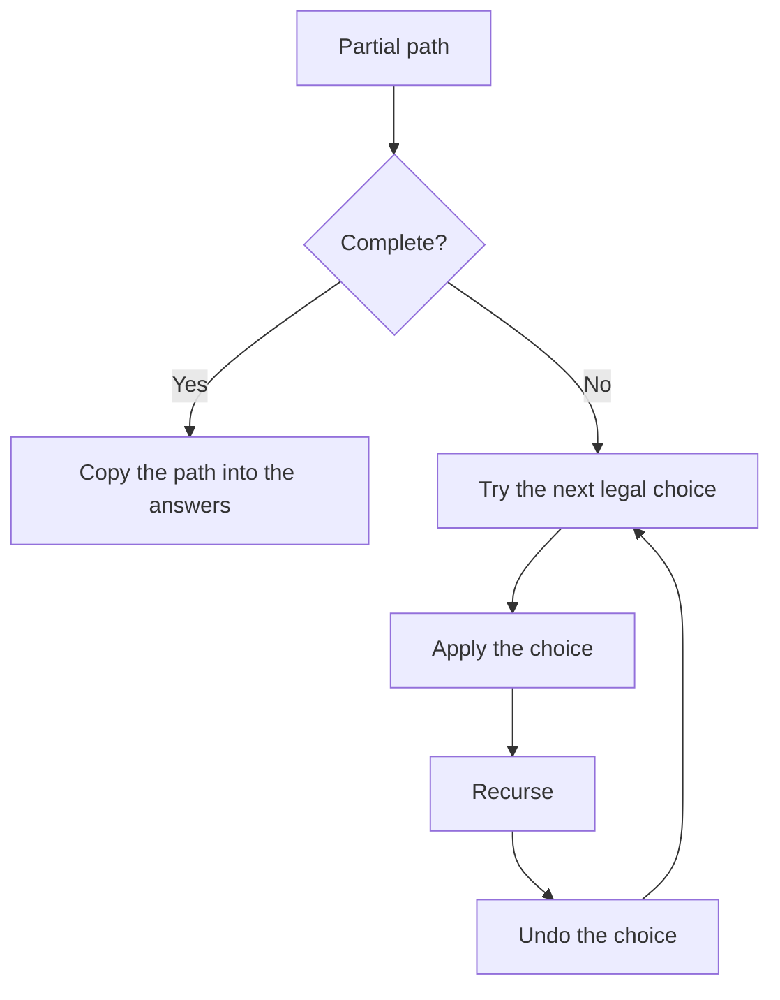

## Why this matters

Backtracking is depth-first search over a space of decisions, with the courage to undo a decision that did not work. Subsets, permutations, combination sums, parentheses, word search, and N-Queens are this algorithm with different choices and different prune rules. The template is short. The skill is choosing the state, knowing when to record an answer, and restoring the state exactly. Dynamic programming later replaces some of these trees with tables when the question is a count or a feasibility bit rather than the list of objects. If the question asks for the objects, you still walk the tree.

## Intuition

You are walking a maze and carrying a pencil. At each junction you pick a corridor, draw a mark, and go deeper. If the corridor is a dead end you erase the mark and try the next corridor. The mark is the partial solution. Erasing it is the undo. You never need a copy of the maze for each path if the undo is perfect, because the maze plus the current marks are the whole state. Forgetting to erase a mark makes a later path inherit a wall it did not build. That bug is the source of almost every wrong backtracking submission.

## Core concept in depth

The template has four parts. The state is the partial solution and whatever index or used-set the next choice needs. The base case records a copy of the partial solution when it is complete, or returns a boolean when the problem is a search for one success. The loop tries each legal choice. Making a choice updates the state, the recursive call explores, and the undo reverses the update. The undo must run on the way back, including when the recursive call found nothing. In Python, append and pop on a shared path list are the usual update and undo. If you pass `path + [choice]` you are copying instead of undoing. That is correct and spends extra time and memory. The in-place version is the one to analyze as Theta(depth) extra memory beyond the output.

Subsets of an array. The decision at index i is to skip nums[i] or to take it. The index moves forward either way, so each element is considered once and there is no duplicate work on the same subset. There are 2 to the n subsets. Building each costs time proportional to its length, so the total time is Theta(n times 2 to the n). If the array contains duplicates and the problem wants unique subsets, sort first and, in the take-or-skip loop over a range, skip a value that equals the previous value when the previous value was not taken at this level. That is the subsets-II prune. Combination sum, where each candidate may be reused, recurses on the same index after a take, and moves forward after a skip, or equivalently loops from a start index and recurses on i rather than i + 1. Combination sum II does not reuse, and it uses the duplicate skip.

Permutations. The choice is any unused element. A boolean array, or a set, marks what is used. You can also swap the current position with each later index, recurse, and swap back. The swap version uses no extra used-array. There are n! permutations. Generating them all is Theta(n times n!) because each permutation is written down. Duplicates in the input need a sort and a skip of identical unused values, or a frequency map, so you do not emit the same permutation twice.

Generate parentheses of n pairs. The state is the counts of open and close already used. You may write an open parenthesis when open is less than n. You may write a close parenthesis when close is less than open. That prune is also the proof that every string you emit is valid, and that you emit all of them. The number of such strings is the Catalan number. You do not need the formula to generate them.

Word search on a grid is backtracking with a board mutation. From a cell that matches the next character, mark the cell as used, try four neighbors, and unmark the cell. The mark can be a temporary character replacement so you do not need a parallel visited matrix. Forgetting the unmark lets one path consume a letter that another path needed. The time is exponential in the word length in the worst case, bounded by the branching factor 4, and the grids in interviews are small. Prune when the remaining suffix cannot be built, if you want a faster practical search. The worst-case bound does not become polynomial.

N-Queens places a queen per row. The choice is the column. Three sets prune: occupied columns, occupied diagonals of row - col, and occupied diagonals of row + col. A placement that hits a set is skipped. At row n you have a solution. Counting solutions is the same tree without storing the boards. The template does not change. Only the prune changes.

Letter case permutations and restore-IP-addresses are the same tree with different alphabets. IP addresses add a numerical prune: a segment has 1 to 3 digits, no leading zero except the number 0 itself, and a value at most 255. Prunes belong in the choice loop, before the recursive call, so you do not pay a call to discover them.

Iterative backtracking uses an explicit stack of frames, each frame holding the index of the next choice to try. It is how you remove recursion-depth risk. It is harder to read. Write the recursive form unless the depth can exceed the interpreter limit. Subsets of 20 elements have depth 20. N-Queens for n = 12 has depth 12. Word search depth is the word length. These fit.

When the problem asks for a count rather than the list, the same tree can often become dynamic programming. Count subsets with a given sum, for n around 20, is meet-in-the-middle or a knapsack table. For n around 40, the table may not fit and the split enumeration does. Backtracking is the right tool when you must list structures with constraints that do not collapse into a small state.

## Diagram and dry run



Subsets of 1, 2. The path is a list. Order is skip-then-take, or take-then-skip. Here the loop tries taking from the start index onward, which yields combinations in lexicographic order.

| Call | Start index | Path | Action |
| --- | --- | --- | --- |
| 1 | 0 | empty | record the empty subset, then try 1 and 2 |
| 2 | 1 | 1 | record 1, then try 2 |
| 3 | 2 | 1, 2 | record 1, 2, no further choices |
| 4 | 2 | 2 | record 2, after the undo of 1 |

The undo after call 3 pops 2 and then pops 1 before call 4 pushes 2. If you forget the pop, call 4 starts from 1, 2 and appends another 2. The answers are empty, then 1, then 1 2, then 2. Four subsets, which is 2 to the n.

Parentheses for n = 2. The legal strings are (()) and ()(). An open is allowed twice. A close is allowed only when it does not exceed the opens. The illegal prefix ) is never attempted.

## Runnable Python

The subset generator uses append and pop. The recursive structure is the algorithm. An iterative generator of subsets by bit masks is the non-recursive twin: each mask from 0 to 2^n - 1 selects the elements whose bits are set. Both are included.

```python
def subsets(nums: list[int]) -> list[list[int]]:
    out: list[list[int]] = []
    path: list[int] = []

    def dfs(start: int) -> None:
        out.append(path[:])
        for i in range(start, len(nums)):
            path.append(nums[i])
            dfs(i + 1)
            path.pop()

    dfs(0)
    return out


def subsets_bits(nums: list[int]) -> list[list[int]]:
    out: list[list[int]] = []
    n = len(nums)
    for mask in range(1 << n):
        out.append([nums[i] for i in range(n) if mask & (1 << i)])
    return out
```

On 1, 2 both return four subsets. The order differs. If the contract demands a sorted list of subsets, sort the output. The bit version is iterative and uses no call stack. It does not generalize to "permutations with pruning" as cleanly as the depth-first search does. Use bits when every subset is legal. Use backtracking when most branches die early.

## Complexity and trade-offs

| Search | Leaves | Time to list them | Extra space besides the output |
| --- | --- | --- | --- |
| Subsets | 2 to the n | Theta(n times 2 to the n) | Theta(n) path |
| Permutations | n! | Theta(n times n!) | Theta(n) |
| Combination sum, bounded | depends on the target | exponential in the target or in n | Theta(target) depth |
| Parentheses, n pairs | the Catalan number | proportional to the output | Theta(n) |
| Word search | up to 4 to the length | exponential in the word | Theta(length) |
| N-Queens | pruned, still exponential | fine for small n | Theta(n) |

Copying the path at the base case is required if the path list is reused. Appending the path object itself stores a pointer to a list you will mutate later, and every answer becomes the final path. That bug looks like "all answers are identical." Sort or unique only when the statement asks. Pruning duplicate choices is better than generating duplicates and stuffing them into a set, because the set hides an exponential amount of wasted work.

## Tricks, tips, and patterns

Pass a start index when order does not matter, so you generate combinations rather than permutations. Pass a used array when order matters. Undo immediately after the recursive call, in a finally-shaped pattern you do not actually need a finally for, as long as every return path undoes. In Python, do not return inside the loop before the pop unless you are searching for the first success and you are done with the path. If you return true up the stack, you may skip the undo. That is acceptable only when you will not use the board again. If the caller needs the board restored, undo on the success path too. For counts, return an integer sum of the recursive calls instead of storing lists. The tree stays the same and the memory drops.

## Common mistakes and edge cases

Forgetting to copy the path. Forgetting to pop. Skipping the start index and generating permutations of a combination problem, which times out or duplicates. Allowing a leading zero in an IP segment. Placing a close parenthesis before an open one. Marking a grid cell and not unmarking it. Sorting the input for duplicate-skipping but still using index equality wrong, so the first duplicate is skipped as well. An empty input has one subset, the empty subset, not zero subsets. Permutations of an empty list: one empty permutation. Combination sum with a target of 0: one empty combination, if the statement allows it. Usually the target is positive and the empty combination is not an answer. Read it. N-Queens for n = 1 is one solution. N = 2 and n = 3 are zero.

## Interview notes

Write the template on the side, then fill in the choice and the prune. Say "I append, recurse, and pop" so the undo is a commitment. Estimate the number of leaves before you claim the runtime. If the estimate is 2 to the 40, stop and look for dynamic programming or meet-in-the-middle. Dry-run subsets of two elements, including the pop. If the problem asks for a count, ask yourself whether the state can be compressed. If it asks for the listings, do not force a table. Mention the bit mask twin for subsets. It is a good sign you know the shape of the space.

## Practice problems

1. [Subsets](/practice/subsets) and [Subsets II](/practice/subsets-ii).
2. [Permutations](/practice/permutations) and [Permutations II](/practice/permutations-ii).
3. [Combination Sum](/practice/combination-sum) and [Combination Sum II](/practice/combination-sum-ii).
4. [Generate Parentheses](/practice/generate-parentheses).
5. [Word Search](/practice/word-search) and [N-Queens II](/practice/n-queens-ii).
6. [Letter Combinations of a Phone Number](/practice/letter-combinations-of-a-phone-number) and [Restore IP Addresses](/practice/restore-ip-addresses).
7. [Palindrome Partitioning](/practice/palindrome-partitioning).

## Summary and cheat sheet

- Backtracking is depth-first search that undoes. Apply, recurse, undo.
- Copy the path when you record it. Pop what you appended.
- Combinations use a start index. Permutations use a used-set or swaps.
- Prune duplicates after sorting, and prune illegal parentheses with counts.
- Grid search marks and unmarks. N-Queens tracks columns and both diagonals.
- Time follows the number of partial solutions you actually visit.
- Listing subsets is n times 2 to the n. If you only need a count with numeric structure, look for a table.

## Further reading

- [Wikipedia — Backtracking](https://en.wikipedia.org/wiki/Backtracking)
- [Wikipedia — Eight queens puzzle](https://en.wikipedia.org/wiki/Eight_queens_puzzle)
- [CP-Algorithms, permutations](https://cp-algorithms.com/combinatorics/permutations.html)
