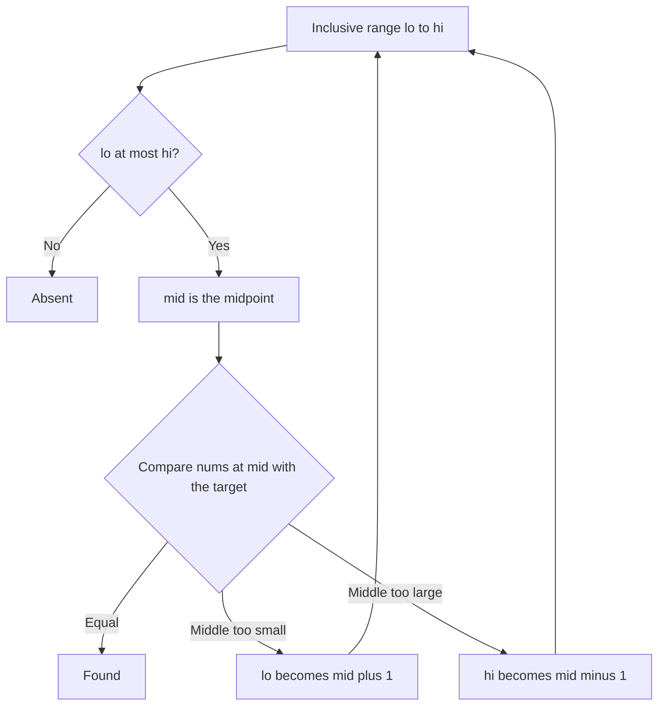

## Why this matters

Binary search is the algorithm people say they know and then write with an infinite loop. The idea is small. The boundary conditions are not. Once the loop is solid, a family of interview problems opens: first and last occurrence, search in a rotated array, peak finding, and binary search on the answer. The last of those is a pattern, not a library function. You binary-search a threshold when "can I achieve this limit?" is monotone. Koko eating bananas, shipping packages within D days, and splitting an array into k subarrays are the same function with a different feasibility test.

## Intuition

A sorted array is a dictionary. You open the middle. If the word is too far back in the alphabet, you throw away the right half, including the middle you just read when it is not the target. Each question halves the remaining pages, so a million pages costs about twenty questions. The same halving works on a numeric answer space. If a capacity is enough to ship every package on time, every larger capacity is enough. If it is not enough, every smaller capacity fails. You can discard half the capacities per test.

## Core concept in depth

The iterative search maintains an inclusive range lo, hi of indexes that might still hold the target. While lo is at most hi, the mid index is the average, rounded down. If nums[mid] is the target, return it. If the middle value is smaller, the target can only sit strictly to the right, so lo becomes mid + 1. Otherwise hi becomes mid - 1. When the loop ends, the range is empty and the target is absent. The invariant: every index outside lo through hi has been proved not to hold the target. Termination: the range shrinks, because mid is inside the range and is excluded. That is why `hi = mid` without excluding mid, on an inclusive range, can loop forever when lo and hi are neighbors. Pick one convention and stick to it. The half-open convention, lo inclusive and hi exclusive, uses `while lo < hi` and sets hi = mid when the middle is too large. Both conventions work. Mixing them does not.

Lower bound is the first index whose value is at least the target. Upper bound is the first index whose value is strictly greater. First and last occurrence of a target are the lower bound of the target, and the lower bound of the target plus one, minus one. If the lower bound falls off the array or the value there is not the target, the target is absent and the answer is the pair of sentinels. Implement lower bound once and call it twice. A single search that "finds any match and scans outward" is correct and linear in the size of the equal run, which can be the whole array.

A rotated sorted array is two sorted runs. At mid, one of the halves is sorted. If the left half is sorted and the target lies inside it, move left. Otherwise move right. The symmetric test handles a sorted right half. Duplicates break the "one half is sorted" test when nums[lo], nums[mid], and nums[hi] are equal. Then you can only shrink by one, and the worst case becomes linear. The problem without duplicates stays logarithmic. Finding the minimum in a rotated array is the same split: the minimum lies in the unsorted half, which is the half that contains the rotation.

A peak element is strictly greater than its neighbors, with the edges having one neighbor. On a line, if the middle is less than its right neighbor, a peak exists to the right, because the sequence eventually has to stop rising. Otherwise a peak exists at the middle or to the left. Any peak is acceptable in the usual statement, so you do not hunt for the global maximum. The binary search still works. Prove the existence claim. It is the whole correctness argument.

Binary search on the answer needs a monotone predicate feasible(x). Find the smallest x in a range where feasible is true, or the largest where it is true. The range must bracket the answer. For Koko, the low end is 1 and the high end is the largest pile, because eating at least one banana per hour is required and eating the largest pile in one hour always finishes. feasible(speed) computes the hours as the sum of ceil(pile / speed) and compares with the limit. For shipping, the low end is the heaviest package and the high end is the sum. feasible(capacity) is the greedy left-to-right packing. For splitting an array so the largest sum is minimized, the same packing test is the predicate. If feasible(mid) holds, try a smaller answer. Otherwise try a larger one. The loop ends on the boundary. Off-by-one here returns a capacity that is one short of feasible. Test the predicate on the returned value.

The recursive form passes lo and hi and returns the index. It uses logarithmic stack. The loop is preferred. Both must share the invariant. Integer midpoint in a language with fixed-width integers should be computed as lo + (hi - lo) // 2 to avoid overflow. Python integers do not overflow. The safer formula is still a good habit when you write Java or C++ later.

## Diagram and dry run



Search for 8 in 1, 3, 4, 8, 9, 12.

| lo | hi | mid | Value | Move |
| --- | --- | --- | --- | --- |
| 0 | 5 | 2 | 4 | too small, lo = 3 |
| 3 | 5 | 4 | 9 | too large, hi = 3 |
| 3 | 3 | 3 | 8 | found |

Lower bound of 8 is index 3. Lower bound of 5 is also index 3, the first value at least 5, which is 8. Lower bound of 13 is 6, one past the end, meaning every element is smaller.

Koko, piles 3, 6, 7, 11, limit 8 hours. Speed 4 takes ceil(3/4)+ceil(6/4)+ceil(7/4)+ceil(11/4) = 1+2+2+3 = 8, which is feasible. Speed 3 takes 1+2+3+4 = 10, which is not. The minimum feasible speed is 4.

## Runnable Python

Lower bound is the primitive. The answer-search wrapper takes a feasibility function. Both are iterative. The recursive classic search is the teaching twin.

```python
def lower_bound(nums: list[int], target: int) -> int:
    lo, hi = 0, len(nums)
    while lo < hi:
        mid = (lo + hi) // 2
        if nums[mid] < target:
            lo = mid + 1
        else:
            hi = mid
    return lo


def binary_search_rec(nums: list[int], target: int, lo: int, hi: int) -> int:
    if lo > hi:
        return -1
    mid = (lo + hi) // 2
    if nums[mid] == target:
        return mid
    if nums[mid] < target:
        return binary_search_rec(nums, target, mid + 1, hi)
    return binary_search_rec(nums, target, lo, mid - 1)


def smallest_feasible(lo: int, hi: int, feasible) -> int:
    while lo < hi:
        mid = (lo + hi) // 2
        if feasible(mid):
            hi = mid
        else:
            lo = mid + 1
    return lo
```

`lower_bound` on 1, 3, 4, 8, 9, 12 for target 8 returns 3. The half-open range starts with hi = n, not n - 1. `smallest_feasible` requires that once feasible becomes true it stays true, and that hi itself is feasible so the loop has an answer to land on.

## Complexity and trade-offs

| Search | Time | Extra space | Requirement |
| --- | --- | --- | --- |
| Classic, iterative | Theta(log n) | Theta(1) | Sorted, random access |
| Classic, recursive | Theta(log n) | Theta(log n) stack | Same |
| First and last position | Theta(log n) | Theta(1) | Two lower bounds |
| Rotated, distinct | Theta(log n) | Theta(1) | One half is sorted |
| Rotated, duplicates | O(n) worst | Theta(1) | Equal ends force a shrink by one |
| Answer search | Theta(log R times cost of feasible) | whatever feasible uses | Monotone predicate |

A hash set finds one element in expected constant time and does not find a lower bound, a predecessor, or a feasible threshold. A balanced tree does all of those in logarithmic time and supports inserts. Binary search on a static array is the lightest tool that fits. On a linked list, binary search is a bad idea: reaching the middle is already linear, and the total becomes linearithmic with a worse constant than a straight scan.

## Tricks, tips, and patterns

Write the invariant beside the loop. Decide inclusive or half-open before the first comparison. For answer search, write feasible() as its own function and test it on one value you computed by hand. The search is useless if feasible is wrong. When the predicate is "largest x that still works," flip the branch: if feasible, move lo up past mid, and be careful with the midpoint bias so the range still shrinks. A simple alternative is to search for the smallest value that fails and subtract one. Prefer that if it keeps the loop in the shape you trust.

## Common mistakes and edge cases

Infinite loop from not excluding mid. Returning mid when you wanted a lower bound and the middle merely equals some later duplicate. Empty array. Single element. Target smaller than every element, and larger than every element. Rotated array that is not actually rotated. Duplicates in a rotated array. Feasibility that is not monotone, so binary search returns nonsense. Using integer division for ceil(pile / speed) in a way that rounds the wrong direction. In Python, ceil of a positive division is `(pile + speed - 1) // speed`. A zero speed is excluded by starting lo at 1. Overflow of the answer range: the high end must be feasible. If you set it too low, the algorithm confidently returns an infeasible value.

## Interview notes

Say the invariant. Say which convention you use. Dry-run three steps, including a miss if you have time. For a rotated array, say "one side is sorted, and I test membership on that side." For answer search, say the monotone sentence before the loop, and name lo and hi in terms of the problem, not as magic indexes. Test feasible on the boundaries out loud. Mention that the cost is logarithmic in the answer range times a linear feasibility scan, which is n log R, and check it against the constraints.

## Practice problems

1. [Binary Search](/practice/binary-search) and [Search Insert Position](/practice/search-insert-position).
2. [Find First and Last Position](/practice/find-first-and-last-position).
3. [Search in Rotated Sorted Array](/practice/search-in-rotated-sorted-array) and [Find Minimum in Rotated Sorted Array](/practice/find-minimum-in-rotated-sorted-array).
4. [Find Peak Element](/practice/find-peak-element).
5. [Koko Eating Bananas](/practice/koko-eating-bananas), [Capacity to Ship Packages](/practice/capacity-to-ship-packages-within-d-days), and [Split Array Largest Sum](/practice/split-array-largest-sum).
6. [Sqrt(x)](/practice/sqrtx) — binary search the integer square root.

## Summary and cheat sheet

- Halve an inclusive range by excluding mid. Or use a half-open range and `while lo < hi`.
- Lower bound is the first index at least the target. Last occurrence is the lower bound of target + 1, minus one.
- In a rotated array, one half is sorted. Test the target against that half.
- A peak exists on the side that is still rising.
- Answer search needs a monotone feasible(x) and a bracket that contains a true value.
- The loop is Theta(log of the range). Multiply by the cost of one test.
- Linked lists do not give you random access. Do not binary-search them.

## Further reading

- [Wikipedia — Binary search algorithm](https://en.wikipedia.org/wiki/Binary_search_algorithm)
- [Wikipedia — Lower and upper bounds, the insertion-point view](https://en.wikipedia.org/wiki/Binary_search_algorithm#Procedure_for_finding_the_leftmost_element)
- [CP-Algorithms, binary search](https://cp-algorithms.com/num_methods/binary_search.html)
