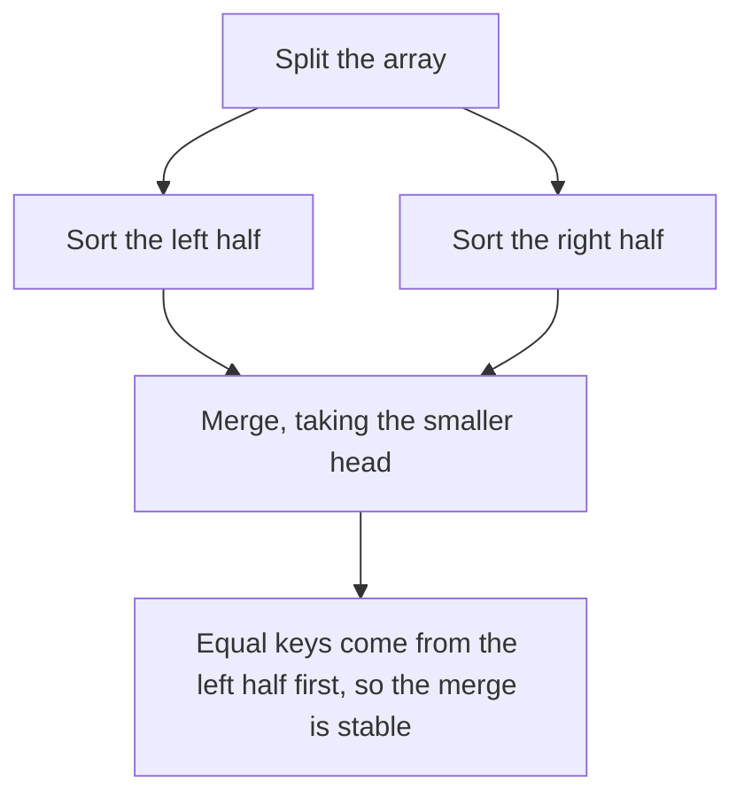

## Why this matters

Sorting is the reduction that makes later linear scans possible: two pointers, interval sweeps, binary search, and duplicate grouping. You are expected to know a quadratic sort well enough to explain why it is quadratic, a correct O(n log n) sort well enough to code under pressure, and the comparison lower bound that says you cannot comparison-sort arbitrary objects any faster than n log n in the worst case. Stability matters when the key is only part of the record. Timsort, in the next lesson, is what Python actually runs. This lesson is the family it was built from.

## Intuition

A comparison sort learns the order by asking "is this element less than that one?" Each answer has two outcomes, so k questions distinguish at most 2 to the k possible answers. There are n! possible orders. Therefore k must be at least log2 of n!, which Stirling's approximation puts at about n log n. Merge sort and heapsort meet that bound in the worst case. Quicksort meets it on average and can be made very likely to meet it with random pivots. Insertion sort does not meet it, and yet it is the fastest sort in the room when the array is already nearly sorted, because it only pays for the inversions that exist.

## Core concept in depth

Selection sort finds the minimum of the unsorted suffix and swaps it into place. It does about n squared / 2 comparisons whether the array is sorted or not. It is in-place and not stable unless you shift instead of swapping, which makes it slower. Bubble sort swaps adjacent inversions. Its best case can be linear if you stop when a pass swaps nothing. Its worst case is quadratic. Neither algorithm is a final answer on a large array. Both are the right answer to "what does quadratic look like?"

Insertion sort keeps a sorted prefix. It inserts the next element by shifting larger prefix elements one step right. The inner loop stops early when the prefix is already in order. On a sorted array the cost is Theta(n). On a reversed array it is Theta(n squared). The precise cost is Theta(n + I) where I is the number of inversions, pairs that are out of order. It is stable if you only shift strictly greater elements, so equal keys keep their original order. It is the sort you use for tiny n, and it is the base case of better sorts.

Merge sort splits, sorts both halves, and merges. The merge walks two sorted lists and writes the smaller head, and it is stable if you take from the left half when the keys are equal. The recurrence is T(n) = 2 T(n/2) + Theta(n), which is Theta(n log n) in every case, not only the average. The extra memory for the merge buffer is Theta(n). Linked-list merge sort needs no random access and can reuse nodes, which is why sorting a linked list is merge sort. Bottom-up merge sort iterates width 1, 2, 4, and so on, and removes the recursion. The same bound holds.

Quicksort picks a pivot, partitions the array into "less than the pivot" and "greater than the pivot," and sorts the sides. Partition is the Dutch-flag idea restricted to two bands, or three if you isolate equals. Lomuto's partition is simple and degrades on duplicates. Hoare's partition uses two pointers walking inward and does fewer swaps. The average time, with a decent pivot, is Theta(n log n). The worst case, always pivoting the extreme element, is Theta(n squared), and the recursion depth is linear. Randomized quicksort picks the pivot uniformly. Its expected time is Theta(n log n) for every input. The worst case is still possible and vanishingly unlikely. Introsort, used by several standard libraries, switches to heapsort when the depth gets too large, so the worst case becomes n log n. Quicksort is typically in-place and unstable.

Heapsort builds a max-heap and repeatedly extracts the maximum into the end of the array. It is Theta(n log n) worst case and in-place. It is not stable, and the constant factors and cache behavior are worse than quicksort and Timsort. The heap lesson builds the structure. Here you only need the bound and the in-place claim.

Counting sort is not a comparison sort. If keys are integers in a small range U, count frequencies and write the output from the counts. Stable counting sort writes backward into an output array so equal keys keep their order. Time is Theta(n + U). Radix sort applies a stable sort to digits from least significant to most significant. For fixed-width integers the time is linear in n times the number of digits. These sorts break the comparison lower bound by using the structure of the key. They do not sort arbitrary comparable objects.

Stability means that equal keys keep their input order. Merge sort and insertion sort are stable if implemented carefully. Quicksort and heapsort are not. A stable sort lets you sort by a secondary key first and a primary key second, and the secondary order survives. Python's sort is stable. Rely on it, and say that you rely on it.

## Diagram and dry run



Insertion sort on 4, 2, 4, 1. The two 4s are distinguished as 4a and 4b so stability is visible.

| Prefix considered | Array | What moved |
| --- | --- | --- |
| 4a | 4a, 2, 4b, 1 | already sorted |
| 4a, 2 | 2, 4a, 4b, 1 | 4a shifted right, 2 inserted. 4b untouched |
| 2, 4a, 4b | 2, 4a, 4b, 1 | 4b was already in place after 4a |
| full | 1, 2, 4a, 4b | 1 inserted at the front. The two 4s kept their order |

Merge of the sorted halves 2, 4a and 1, 4b. Compare 2 with 1, take 1. Compare 2 with 4b, take 2. Compare 4a with 4b, take 4a because ties prefer the left half. Then take 4b. Result 1, 2, 4a, 4b. A merge that preferred the right half on ties would emit 4b before 4a and would be unstable.

## Runnable Python

Insertion sort is the one to code when n is tiny or nearly sorted. Merge sort is the one to code when you need a worst-case guarantee and stability. Both are shown. The recursive merge sort is the natural form. The insertion sort is a loop.

```python
def insertion_sort(nums: list[int]) -> list[int]:
    a = nums[:]
    for i in range(1, len(a)):
        value = a[i]
        j = i - 1
        while j >= 0 and a[j] > value:
            a[j + 1] = a[j]
            j -= 1
        a[j + 1] = value
    return a


def merge_sort(nums: list[int]) -> list[int]:
    if len(nums) <= 1:
        return nums[:]
    mid = len(nums) // 2
    left = merge_sort(nums[:mid])
    right = merge_sort(nums[mid:])
    merged: list[int] = []
    i = j = 0
    while i < len(left) and j < len(right):
        if left[i] <= right[j]:
            merged.append(left[i])
            i += 1
        else:
            merged.append(right[j])
            j += 1
    merged.extend(left[i:])
    merged.extend(right[j:])
    return merged
```

The comparison `a[j] > value`, rather than `>=`, is what keeps insertion sort stable. The comparison `left[i] <= right[j]` is what keeps the merge stable. Change either one and equal keys can cross. `insertion_sort` on 4, 2, 4, 1 returns 1, 2, 4, 4 with the original 4s in their original relative order.

## Complexity and trade-offs

| Sort | Worst time | Average time | Extra space | Stable |
| --- | --- | --- | --- | --- |
| Selection | Theta(n squared) | Theta(n squared) | Theta(1) | no, if you swap |
| Bubble, early exit | Theta(n squared) | Theta(n squared) | Theta(1) | yes |
| Insertion | Theta(n squared) | Theta(n squared) | Theta(1) | yes |
| Merge sort | Theta(n log n) | Theta(n log n) | Theta(n) | yes |
| Quicksort, random pivot | Theta(n squared) | Theta(n log n) expected | Theta(log n) stack expected | no |
| Heapsort | Theta(n log n) | Theta(n log n) | Theta(1) | no |
| Counting sort | Theta(n + U) | Theta(n + U) | Theta(n + U) | yes, if written carefully |

Choose merge sort when you must be stable and worst-case linearithmic. Choose heapsort when you must be worst-case linearithmic and in-place and you can give up stability. Choose randomized quicksort when average speed and memory locality matter and stability does not. Choose insertion sort below a few dozen elements or on nearly sorted data. Choose counting or radix sort when the keys are integers in a modest range. In Python, call the built-in sort unless the point of the question is to implement one.

## Tricks, tips, and patterns

Know the lower bound so you do not promise a comparison sort faster than n log n. Know that counting sort is the escape hatch, and name the range. For quicksort, mention the worst case and the random pivot in the same sentence. For merge sort, mention the buffer. If you need to sort indexes by a key, sort pairs of key and index, and a stable sort will preserve index order among equal keys even if you did not include the index. Including the index makes any sort stable with respect to the original order. That trick rehabilitates quicksort when stability is required and you can afford to compare pairs.

## Common mistakes and edge cases

A merge that drops the leftover half. A partition that does not shrink the side containing the pivot, so quicksort recurses on the same array forever. Unstable tie handling described as stable. Using quicksort on equal keys with Lomuto and being surprised by quadratic time. Forgetting that the comparison lower bound does not apply to radix sort. Sorting a list of pairs when the problem wanted the original indexes, and not carrying the indexes along. An empty array and a one-element array must be base cases of merge sort. Integer keys that are negative break a naive counting sort that uses the key as an array index. Shift by the minimum first.

## Interview notes

If the prompt is "sort this," ask whether stability and worst-case time matter, then pick from the table. If the prompt is a search problem in disguise, sort and say the n log n cost. Code merge sort if they ask you to implement an n log n sort and you want a bound you can prove while you type. Code insertion sort if they ask for the nearly-sorted case. Do not code bubble sort as a final answer. State the lower bound in one sentence if someone asks for linear comparison sorting.

## Practice problems

1. [Sort List](/practice/sort-list) — merge sort on nodes.
2. [Count Inversions](/practice/count-inversions) — the merge counts split inversions.
3. [Merge Sorted Array](/practice/merge-sorted-array) — the merge, in place from the end.
4. [Sort Colors](/practice/sort-colors) — a three-way partition, the quicksort cousin.
5. [Kth Largest Element](/practice/kth-largest-element-in-an-array) — quickselect or a heap. Quickselect is partition without sorting both sides.

## Summary and cheat sheet

- Comparison sorting is Omega(n log n) in the worst case. n! orders, two-way questions.
- Insertion sort is Theta(n + inversions) and stable. Use it when the array is short or almost sorted.
- Merge sort is worst-case n log n, stable, and needs a linear buffer.
- Quicksort is expected n log n with a random pivot, unstable, and quadratic in the worst case.
- Heapsort is worst-case n log n and in-place and unstable.
- Counting and radix sorts are linear in n plus the key range or the number of digits. They are not comparison sorts.
- Stability is a property of the implementation of ties, not a vibe.

## Further reading

- [Wikipedia — Sorting algorithm](https://en.wikipedia.org/wiki/Sorting_algorithm)
- [Wikipedia — Quicksort](https://en.wikipedia.org/wiki/Quicksort)
- [Wikipedia — Merge sort](https://en.wikipedia.org/wiki/Merge_sort)
- [CP-Algorithms, merge sort](https://cp-algorithms.com/others/merge_sort.html)
