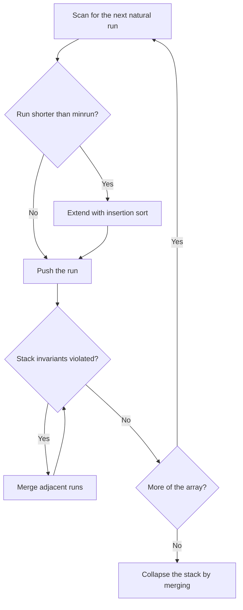

## Why this matters

When you call `sorted` or `list.sort` in Python, you are not calling quicksort. You are calling Timsort, a stable hybrid designed for arrays that contain ordered runs, which is what real data often looks like. Interviewers who hear "Python's sort is n log n" want the next sentence: it is stable, its worst case is n log n, and its best case on already-sorted data is linear. That sentence changes designs. You can sort by a secondary key and then a primary key. You can sort a nearly sorted log without paying the full linearithmic cost. You should not reimplement Timsort in a 45-minute round. You should know why the library is allowed to be as fast as it is, and when your own merge sort is the thing to code instead.

## Intuition

Insertion sort is wonderful on a run that is already sorted, and painful on a long random array. Merge sort is steady on a random array, and it wastes work rediscovering runs that were already sorted. Timsort finds the runs that already exist, extends short ones with insertion sort until they are worth merging, and then merges runs in an order that keeps the merge tree balanced. The already-sorted array is one big run and needs no merge. The random array becomes a sequence of short runs and falls back to something with the shape of merge sort.

## Core concept in depth

A run is a consecutive slice that is non-decreasing, or strictly decreasing. A strictly decreasing run can be reversed in place into an increasing run. The reversal is stable for our purposes only because the run is strictly decreasing, so there are no equal keys whose order would flip. If equals were included in the reversed region, stability would break. Timsort therefore reverses only strict descents.

If the natural run is shorter than a minimum run length, insertion sort extends it until it reaches that length or the array ends. The minimum is chosen based on n, often a power of two near 32 or 64, so later merges are aligned. Insertion sort on a slice of fixed length minrun is cheap: the quadratic term is constant with respect to n, and across n/minrun such slices the total insertion work is linear.

The stack of pending runs is the part with the real invariant. Timsort pushes runs onto a stack and merges adjacent runs to maintain two numerical rules, often called the balance invariants: the lengths of runs from the top decrease in a way that prevents a long run from sitting on two tiny ones, and no run length equals or exceeds the sum of the two above it in the dangerous direction. The exact inequalities have been adjusted over the years after bugs were found. The idea you should keep is the one merge sort already taught you. Merging similar sizes is efficient. Merging a huge run with a tiny run, over and over, can degenerate. The stack invariants force merges that keep the costs linearithmic.

Merging two runs uses a temporary buffer. Timsort includes a galloping mode. When one run wins many comparisons in a row, the algorithm switches to galloping: it searches ahead exponentially to find how far the winning run continues, then copies that span in one move, using a binary search to finish the location. On data with long pre-ordered pieces, galloping skips comparisons. On random data, galloping rarely triggers, and the merge looks like an ordinary merge. Galloping is an optimization, not the correctness argument. A student implementation that always does a straight merge is still a correct stable merge of the runs Timsort identified.

The worst case remains Theta(n log n). You cannot beat the comparison lower bound on arbitrary keys, and Timsort is a comparison sort. The best case is Theta(n): one natural run covers the array, insertion sort does not have to extend it, and no merge happens. Nearly sorted arrays, arrays with a few long runs, and arrays sorted in reverse (one strict descent, reversed once) are the cases where Timsort earns its reputation. The extra memory is O(n) in the worst case for merge buffers, often less because the buffer can be sized to the smaller run.

Stability is preserved at each step. Insertion sort on a run is stable. Reversal is only applied to strict descents. The merge takes from the left run on equal keys. Therefore the whole algorithm is stable. This is why the Python idiom "sort by secondary key, then sort by primary key" works. The second stable sort keeps the relative order of records that share a primary key, and that order is the secondary key you established first. A single sort with a tuple key `(primary, secondary)` does the same job in one call, because tuples compare lexicographically. Prefer the tuple when you control the key. Prefer two sorts when the secondary order is the current order of the list and you do not want to name it.

Timsort is not a radix sort and it does not exploit integer structure. Integers, strings, and custom objects all go through comparisons. A custom object's ordering must be a strict weak order: irreflexive, transitive on the "less than" relation in the usual way, and consistent with equality if you also define equality. A comparison that is not transitive produces undefined behavior that can surface as an exception or as a silently wrong order. Do not sort by a key that mutates.

CPython's list.sort is in-place Timsort. `sorted` copies and then sorts. Both are stable. The key function, if you pass one, is called once per element. That is the decorate-sort-undecorate pattern, also called Schwartzian transform: compute the keys up front so an expensive key is not recomputed on every comparison. You can rely on that. It is part of the documented contract, not an accident.

## Diagram and dry run



Array 1, 2, 3, 7, 6, 5, 4, 8, with a small minrun of 4, told as a simplified story rather than as a line-by-line CPython trace.

| Step | What is recognized | Resulting runs |
| --- | --- | --- |
| 1 | 1, 2, 3 is ascending and shorter than 4 | insertion sort pulls in 7. Run is 1, 2, 3, 7 |
| 2 | 6, 5, 4 is a strict descent | reverse it to 4, 5, 6, then insertion sort pulls in 8. Run is 4, 5, 6, 8 |
| 3 | two runs remain | merge them stably into 1, 2, 3, 4, 5, 6, 7, 8 |

The first run did not need a merge with itself. The descent was reversed before any equal-key worry, and there were no equals. A fully sorted array would stop after step 1 with a single run and no merge. That is the linear best case, up to the scan that verified the run.

## Runnable Python

You will call the library. The wrapper below sorts records by last name and then first name using a tuple key, and it sorts the same records in two stable passes so you can see the idiom. A tiny run detector shows the linear scan that starts Timsort, without claiming to be the full algorithm.

```python
def sort_people(people: list[tuple[str, str]]) -> list[tuple[str, str]]:
    """people are (first, last). Order by last name, then first name."""
    return sorted(people, key=lambda person: (person[1], person[0]))


def sort_people_two_passes(people: list[tuple[str, str]]) -> list[tuple[str, str]]:
    by_first = sorted(people, key=lambda person: person[0])
    return sorted(by_first, key=lambda person: person[1])


def natural_run_length(nums: list[int]) -> int:
    if not nums:
        return 0
    i = 1
    if i < len(nums) and nums[i] < nums[0]:
        while i < len(nums) and nums[i] < nums[i - 1]:
            i += 1
        return i
    while i < len(nums) and nums[i] >= nums[i - 1]:
        i += 1
    return i
```

On the people Ada Lovelace, Grace Hopper, and Ada Byron, both sorters emit Ada Byron, Grace Hopper, Ada Lovelace. `natural_run_length` on 1, 2, 3, 7, 6 returns 4. On 6, 5, 4, 8 it returns 3, the strict descent, leaving 8 for the next run. It does not reverse. It only measures.

## Complexity and trade-offs

| Input shape | Timsort time | Extra space | Stable |
| --- | --- | --- | --- |
| Arbitrary comparisons | Theta(n log n) worst case | O(n) | yes |
| Already sorted | Theta(n) | O(1) beyond a few words | yes |
| Reversed, distinct keys | Theta(n) | O(1) | yes |
| A constant number of long runs | Theta(n log R) with R runs, often close to linear | O(n) | yes |
| Your own merge sort | Theta(n log n) always | Theta(n) | yes if ties prefer the left |

Implementing full Timsort in an interview is a poor use of time. Implementing merge sort is the right substitute when the question is "write a stable n log n sort." Saying "I would call the built-in stable sort" is the right answer when the question is a scheduling or anagram problem that needs ordering as a step. Do not write a quadratic sort and then sort the output of a library by accident twice without accounting for it. Two stable library sorts are still n log n.

## Tricks, tips, and patterns

Pass a tuple key when the order is lexicographic. Use two stable passes when the secondary key is "whatever order I have now." Remember that `list.sort` mutates and returns None. `sorted` returns a new list. The key function runs once per element. For a descending numeric key, negate the number or pass `reverse=True`, and think about how reverse interacts with stability: reversing the comparison keeps stability with respect to the reversed order, which is what you want if you asked for it. Do not mutate the list inside the key function.

## Common mistakes and edge cases

Claiming quicksort is what Python uses. Claiming the best case is n log n. Reversing a non-strict descending run and scrambling equal keys. Forgetting that minrun insertion sort is why tiny arrays are fast. Using an unstable mental model and sorting by the primary key first, which destroys the secondary order you have not established yet. The order of two passes is: secondary first, primary second. A comparison key that returns inconsistent answers. Sorting a list of lists by a key that is itself a list you later mutate. Empty input. One element. All keys equal, which must keep the original order because the sort is stable. That last case is the test you should run when you implement your own merge.

## Interview notes

The expected sentence is: "Python's sort is Timsort, stable, worst case n log n, linear on sorted input." If they ask why it is faster on real data, say natural runs plus insertion sort on short runs plus balanced merges. If they ask you to implement the sort, implement merge sort and mention that Timsort is merge sort that starts from natural runs. Do not recite galloping offsets from memory. Do mention stability and the two-pass idiom, because that is the part you will use on the next problem.

## Practice problems

1. [Merge Intervals](/practice/merge-intervals) — library sort by start, then a linear sweep.
2. [Group Anagrams](/practice/group-anagrams) — sorting each word is a key. The words are short, so the n log n of Timsort is on the word length.
3. [Queue Reconstruction by Height](/practice/queue-reconstruction-by-height) — sort by height, then insert. The sort is the stable or tuple-key step.
4. [Count Inversions](/practice/count-inversions) — implement the merge yourself, because the library sort will not count inversions for you.
5. [Sort List](/practice/sort-list) — merge sort on nodes, where Timsort's random-access run scan does not apply directly.

## Summary and cheat sheet

- Timsort finds natural runs, extends short ones with insertion sort, and merges under stack invariants.
- It is stable. Equal keys keep their order. Two-pass sorting works.
- Worst case Theta(n log n). Best case Theta(n) on one run.
- Galloping speeds up lopsided merges. Correctness comes from the stable merge, not from galloping.
- `sorted` copies. `list.sort` mutates and returns None. Key functions run once per element.
- In an interview, call the library when sorting is a step, and code merge sort when the sort itself is the question.

## Further reading

- [Wikipedia — Timsort](https://en.wikipedia.org/wiki/Timsort)
- [Python list.sort documentation](https://docs.python.org/3/library/stdtypes.html#list.sort)
- [Tim Peters, the original Timsort description, linked from the Python source](https://github.com/python/cpython/blob/main/Objects/listsort.txt)
