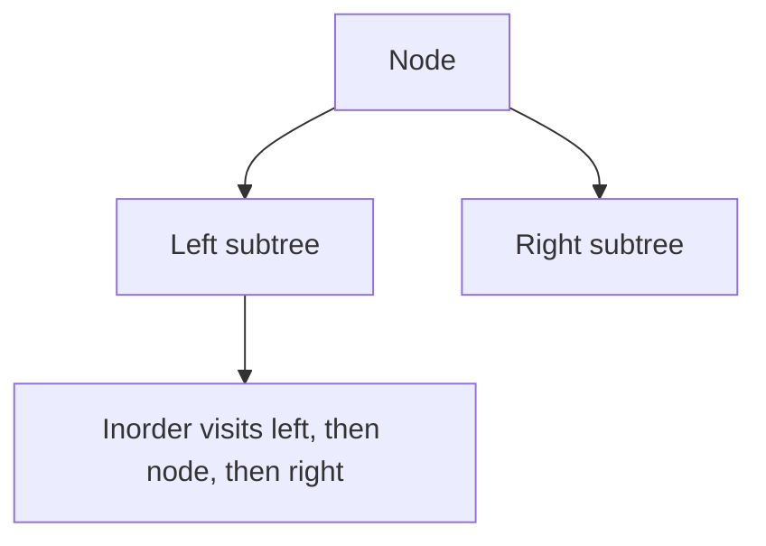

## Why this matters

Trees are the first structure where the shape of the recursion is the shape of the data. Directory listings, expression trees, the DOM, and compiler ASTs are all trees. Interview problems on binary trees ask you to walk every node with a stated order, to compute a value that depends on both children, and to do it without wasting space. The recursive walks are the specification. The explicit-stack walks are how you dodge the recursion limit. Morris traversal is the specialist answer when the interviewer asks for constant extra memory and will let you temporarily rewrite pointers. You should know all three, and you should know which one you are offering.

## Intuition

A binary tree is a node with a left child, a right child, or neither. There is one root and no cycles. Preorder visits a node before its children, which is "say the name, then explore." Inorder visits the left subtree, then the node, then the right subtree, which on a binary search tree yields sorted order. Postorder visits the children before the node, which is "finish the pieces, then combine." Level order visits row by row, which is a queue rather than a stack. Morris is inorder without a stack: you thread a pointer from the predecessor back to the node, so you can return to it after the left subtree, and then you erase the thread.

## Core concept in depth

The recursive preorder is: if the node is null, return; visit; recurse left; recurse right. Inorder swaps the visit to the middle. Postorder visits after both calls. The base case is the null node, not the leaf. Treating a leaf as the base case and then forgetting null children is how you crash. Time is Theta(n) because each node is visited once. The extra space is the recursion depth, Theta(h), where h is the height. A balanced tree has logarithmic height. A chain has linear height. State both.

The iterative preorder uses an explicit stack. Push the root. While the stack is not empty, pop, visit, and push the right child then the left child, so the left is popped first. The iterative inorder walks left as far as possible, pushing nodes, then pops and visits, then steps to the right. The iterative postorder is the awkward one. Two common versions: visit in preorder but node-right-left and reverse the output at the end, or keep a pointer to the previously visited node so you know whether you are returning from the left or the right child. The reverse trick is shorter. Say that the output list is reversed, so the extra memory is still linear in the output, which you needed anyway if the caller wants the list.

Level order uses a queue. Push the root. While the queue is not empty, record the size, and pop exactly that many nodes, enqueueing their children. Each iteration of the size loop is one level. Right-side view is the last node of each level. Zigzag is the same walk with alternating append directions, or a reverse of every other level. The queue holds at most one level. On a balanced tree that is about n/2 nodes. Time is Theta(n). Do not recurse per level unless you also pass the depth and fill buckets. That recursive version is a depth-first search that happens to group by depth, and its stack is the height, not the width.

Morris inorder uses the predecessor, the rightmost node of the left subtree. If there is no left child, visit the node and go right. If there is a left child, find the predecessor. If its right pointer is null, thread it to the current node and go left. If its right pointer is already the current node, you have finished the left subtree: erase the thread, visit the current node, and go right. Every edge is followed a constant number of times, so the time is Theta(n). The extra memory is Theta(1) besides the output, because the stack is gone and the threads occupy existing pointers. The tree is restored when the algorithm ends. It is temporarily mutated. Do not use Morris on a shared tree unless you can prove no other reader observes the threads. It also does not generalize as cleanly to postorder, though a Morris postorder exists and is harder to get right. For interviews, Morris inorder is the one to know.

Diameter is the longest path between any two nodes, measured in edges or in nodes. The statement must say which. The standard node-count version is computed with a postorder: the height of a null child is 0, the height of a node is 1 plus the taller child, and the best path through this node is the left height plus the right height. The answer is the maximum of that sum over all nodes. You return the height and carry the best in a closure or a return pair. This is postorder because you need both children before you can score the node.

A tree is height-balanced when every node's subtrees differ in height by at most one. The same postorder returns the height, or a failure flag if a subtree is already unbalanced or the heights differ by more than one. Short-circuiting avoids extra work. Maximum depth is the height walk without the balance check. Same tree and symmetric tree are simultaneous walks. Symmetric compares the left of one side with the right of the other.

Path sum asks whether a root-to-leaf path adds to a target. Subtract as you go, and succeed only at a leaf. Maximum path sum allows a path that does not pass through the root and does not need to be root-to-leaf. At each node the best path that can be extended upward is the node plus at most one child contribution, and only if that contribution is positive. The best path that bends through the node, using both children, is a candidate for the global answer and is not returned upward, because a parent cannot use both. Negative children are dropped. This is the tree version of Kadane.

## Diagram and dry run



Tree with root 1, left child 2, right child 3, and 2's left child 4.

| Order | Visit sequence | Why |
| --- | --- | --- |
| Preorder | 1, 2, 4, 3 | node before children |
| Inorder | 4, 2, 1, 3 | left, node, right |
| Postorder | 4, 2, 3, 1 | children before node |
| Level order | 1, then 2 3, then 4 | queue, one width at a time |

Morris on this tree threads 4's right pointer, which is null, up to 2, then later to 1 when 2 is the predecessor of 1. After visiting 1 the thread is removed. The visit order is still 4, 2, 1, 3. Heights: 4 has height 1, 2 has height 2, 3 has height 1, 1 has height 3. The diameter through 1 is 2 + 1 = 3 nodes if you count nodes on the path 4-2-1-3, which is 3 edges. Say the unit before you quote a number.

## Runnable Python

Recursive and iterative inorder are the pair to memorize. Diameter is the postorder pattern. Node objects are small on purpose.

```python
class Node:
    def __init__(self, value: int, left: "Node | None" = None, right: "Node | None" = None) -> None:
        self.value = value
        self.left = left
        self.right = right


def inorder(root: Node | None) -> list[int]:
    if root is None:
        return []
    return inorder(root.left) + [root.value] + inorder(root.right)


def inorder_iter(root: Node | None) -> list[int]:
    out: list[int] = []
    stack: list[Node] = []
    cur = root
    while cur is not None or stack:
        while cur is not None:
            stack.append(cur)
            cur = cur.left
        cur = stack.pop()
        out.append(cur.value)
        cur = cur.right
    return out


def diameter(root: Node | None) -> int:
    best = 0

    def height(node: Node | None) -> int:
        nonlocal best
        if node is None:
            return 0
        left = height(node.left)
        right = height(node.right)
        best = max(best, left + right)
        return 1 + max(left, right)

    height(root)
    return best
```

The recursive inorder builds lists on the way back. That is correct and spends extra linear work on concatenations in a skewed tree, which can become quadratic. The iterative version, or a recursive helper that appends into one shared list, is Theta(n). Use the shared list in an interview. `diameter` on the example returns 3, counting edges, because left + right at the root is 2 + 1 = 3. Check that number against the statement's unit.

## Complexity and trade-offs

| Walk | Time | Extra space |
| --- | --- | --- |
| Recursive preorder, inorder, postorder | Theta(n) | Theta(h) stack |
| Iterative with an explicit stack | Theta(n) | Theta(h) |
| Level order | Theta(n) | Theta(width) |
| Morris inorder | Theta(n) | Theta(1) extra, mutates temporarily |
| Recursive inorder that concatenates new lists | Theta(n) to Theta(n squared) | Theta(n) output plus intermediates |

Morris is the constant-space answer. It is harder to debug and it writes to the tree. The explicit stack is the practical answer. Level order is mandatory when the problem talks about depth, rows, or the rightmost node. Do not simulate a queue with recursion.

## Tricks, tips, and patterns

Null is the base case. Return a pair when one walk must compute two things, such as height and diameter, or height and balance. For maximum path sum, clamp child contributions at zero. For level order, snapshot the queue length. For Morris, the predecessor is the rightmost node of the left subtree, stopping if you meet a thread that already points at the current node. Restore every thread. If you need parent pointers or a previous-node pointer, say so, because a plain binary tree does not have them and you must not pretend it does.

## Common mistakes and edge cases

Concatenating lists and timing out on a chain. Forgetting to push right before left in iterative preorder, which swaps the children. Morris threads left in place, so a later algorithm sees a cycle. Diameter counted in nodes when the tests count edges, or the reverse. A null root: diameter 0, traversals empty, height 0. A single node: diameter 0 edges. Path sum on a non-leaf that happens to equal the target is not a success in the root-to-leaf problem. Maximum path sum with all negative nodes must return the largest node, not zero. Balance that only checks the root and not every subtree. Symmetric tree that compares left with left.

## Interview notes

Say the order and the base case, then code the recursive form. Offer the iterative form if they ask about stack limits. Mention Morris only when they ask for constant extra space, and say that it temporarily rewrites pointers. For diameter and path sum, say "postorder, I need both children." Dry-run the four-node example. Agree on edges versus nodes before you compute a number.

## Practice problems

1. [Binary Tree Level Order Traversal](/practice/binary-tree-level-order-traversal) and [Binary Tree Right Side View](/practice/binary-tree-right-side-view).
2. [Maximum Depth of Binary Tree](/practice/maximum-depth-of-binary-tree) and [Balanced Binary Tree](/practice/balanced-binary-tree).
3. [Diameter of Binary Tree](/practice/diameter-of-binary-tree).
4. [Path Sum](/practice/path-sum) and [Binary Tree Maximum Path Sum](/practice/binary-tree-maximum-path-sum).
5. [Same Tree](/practice/same-tree) and [Symmetric Tree](/practice/symmetric-tree).
6. [Invert Binary Tree](/practice/invert-binary-tree) — swap children, preorder or postorder.

## Summary and cheat sheet

- Preorder: node, left, right. Inorder: left, node, right. Postorder: left, right, node.
- Null is the base case. Time is linear. Stack space is the height.
- Level order is a queue. Snapshot the size to separate rows.
- Morris inorder threads the predecessor, visits, then unthreads. Constant extra space, temporary mutation.
- Diameter and balance and maximum path sum are postorder reductions.
- A path extended to a parent uses at most one child. A path that bends is only a global candidate.
- Do not concatenate fresh lists on every return if n can be large.

## Further reading

- [Wikipedia — Tree traversal](https://en.wikipedia.org/wiki/Tree_traversal)
- [Wikipedia — Binary tree](https://en.wikipedia.org/wiki/Binary_tree)
- [CP-Algorithms, depth-first search is the graph form of the same walk](https://cp-algorithms.com/graph/depth-first-search.html)
