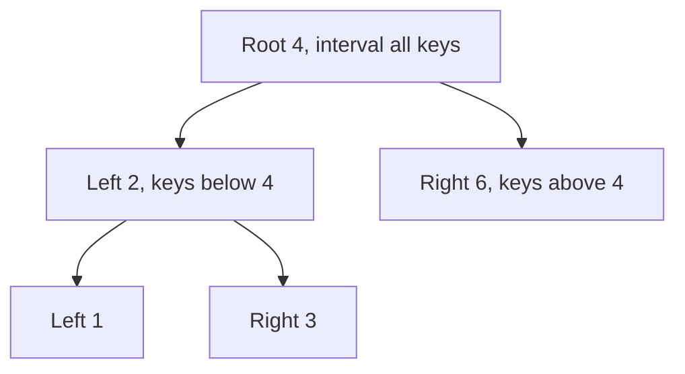

## Why this matters

A binary search tree stores keys so that an inorder walk is sorted and a search is a walk down one path. That property is the source of successor queries, kth-smallest, and a cheapest lowest common ancestor. It is also a trap. A tree that merely looks balanced in a drawing can be a chain, and then every "logarithmic" operation is linear. Validation, serialization, and the lowest common ancestor of a general binary tree are the problems that check whether you used the property you were allowed to use, and no property you were not given.

## Intuition

Every node splits the key space. Keys less than the node belong to the left. Keys greater belong to the right. Search is binary search on a tree instead of an array: you throw away a subtree instead of a half-array. The lowest common ancestor in a BST is the first node where the two targets fall on different sides, or the node that is one of the targets. In a general binary tree you do not have sides. You have "did I find the target in this subtree?" and the ancestor is the first node for which the answer is yes on both sides, or the node that is itself a target and found the other target below it.

## Core concept in depth

The search-tree property must hold for the whole subtree, not only for the parent link. A node can be greater than its parent and still smaller than some node in the parent's left subtree, which violates the property even though each edge looks locally fine. The correct validation carries a valid open interval. The root may hold any key. The left child must lie strictly inside (low, node), and the right child strictly inside (node, high). Pass the interval down. An inorder walk that checks for a strictly increasing sequence is an equivalent test and uses the same time. The interval version makes the allowed range obvious. Duplicates: decide whether they go left, right, or are forbidden. The interval test uses strict inequalities when duplicates are forbidden. Match the problem.

Search and insert follow one path. Search returns null when it falls off. Insert attaches the new key at the null where search ended. Both are Theta(h). Delete has three cases: a leaf is removed, a node with one child is replaced by that child, and a node with two children is replaced by its inorder successor or predecessor, which is then deleted from the subtree. The successor is the leftmost node of the right subtree. Deletion is the operation most candidates fumble. Practice it on a node with two children.

Kth smallest is inorder until you have visited k nodes. If the tree is large and you query often, augment each node with the size of its subtree. Then the walk decides in constant time per level whether the kth key is the current node, in the left subtree, or in the right subtree at rank k - size(left) - 1. The augmented search is Theta(h). The augmentation must be maintained on insert and delete. Say that cost if you propose it.

Lowest common ancestor of a binary search tree: if both keys are smaller, go left. If both are larger, go right. Otherwise the current node is the split, and it is the ancestor. This assumes both keys exist. If they might not, search for both first or continue carefully. Lowest common ancestor of a general binary tree: a postorder returns a node if this subtree contains p or q. If the left recursion and the right recursion both return non-null, this node is the ancestor. If one side returns non-null, pass that result up. A node that is p or q returns itself. The first formulation that "returns this node when both sides hit" misses the case where the node itself is p and q is in one subtree. Returning itself immediately, and still combining children only when the node is neither target, is the clean version: if the node is p or q, you can still look at children if you need to know whether the other exists, but the usual problem guarantees both exist, so returning the node when you see a target is correct. The standard code that checks children first also works when both exist: a target returns itself after its children return null. Dry-run a case where the ancestor is one of the targets.

Serialization turns a tree into a string or a list that can be rebuilt. Level-order serialization writes values row by row and writes an explicit null for missing children, then drops trailing nulls if the format allows. Deserialization uses a queue: the front node receives the next two values as children, and non-null children join the queue. Preorder serialization writes the node, then the left subtree, then the right, with null markers. Deserialization is a recursive read that consumes the marker and returns null, or builds a node and reads its left and right from the same cursor. Both formats need the null markers. Without them the shape is ambiguous. Inorder alone is never enough. Inorder plus preorder is enough for a unique binary tree when keys are unique: the preorder root splits the inorder array into the left and right index ranges. That reconstruction is a classic problem. Duplicate keys make it ambiguous unless the statement adds a rule.

A balanced search tree keeps h logarithmic. AVL and red-black trees, in the next lesson, are the usual guarantees. A plain BST does not promise balance. If the interview gives you a static set of keys and you may preprocess, sorting and building the tree from the middle key yields a balanced tree in linear time after the sort. If the keys arrive online, you need rotations or a skip list or a hash table.

## Diagram and dry run



Validate 4 with left 2 and right 6, and 2 with children 1 and 3. Every node sits inside its inherited interval. Change 3 to 5 and the interval for the right child of 2 is (2, 4). 5 is outside it, so the tree is illegal even though 5 is greater than 2.

LCA of 1 and 3 in this BST. Both are less than 4, so go left to 2. Then 1 and 3 fall on different sides of 2, so 2 is the ancestor. LCA of 1 and 6: they fall on different sides of 4, so 4 is the ancestor. LCA of 2 and 3: 2 is itself a target, and 3 is in its subtree, so 2 is the ancestor.

Serialize the same tree in preorder with null markers: 4, 2, 1, null, null, 3, null, null, 6, null, null. The recursive reader consumes that stream left to right and rebuilds the edges.

## Runnable Python

Validation carries the interval. The BST lowest ancestor is a walk with no extra memory. The general-tree ancestor is a postorder. All three are recursive. The interval walk has an iterative form with an explicit stack of triples, which you can write if the tree may be a chain of 10 to the 5th nodes.

```python
class Node:
    def __init__(self, value: int, left: "Node | None" = None, right: "Node | None" = None) -> None:
        self.value = value
        self.left = left
        self.right = right


def is_bst(root: Node | None, low: float = float("-inf"), high: float = float("inf")) -> bool:
    if root is None:
        return True
    if not (low < root.value < high):
        return False
    return is_bst(root.left, low, root.value) and is_bst(root.right, root.value, high)


def lca_bst(root: Node | None, p: int, q: int) -> Node | None:
    cur = root
    while cur is not None:
        if p < cur.value and q < cur.value:
            cur = cur.left
        elif p > cur.value and q > cur.value:
            cur = cur.right
        else:
            return cur
    return None


def lca_tree(root: Node | None, p: Node, q: Node) -> Node | None:
    if root is None or root is p or root is q:
        return root
    left = lca_tree(root.left, p, q)
    right = lca_tree(root.right, p, q)
    if left is not None and right is not None:
        return root
    return left or right
```

`is_bst` rejects a node that sits on the boundary when duplicates are forbidden, because the inequalities are strict. `lca_bst` is iterative and uses constant extra memory. `lca_tree` compares node identity, not value, so duplicate values remain unambiguous. On the example, `lca_bst` of 1 and 3 returns the node 2.

## Complexity and trade-offs

| Operation | Balanced height | Chain | Extra space |
| --- | --- | --- | --- |
| Search, insert | Theta(log n) | Theta(n) | Theta(1) iterative, Theta(h) recursive |
| Delete | Theta(log n) | Theta(n) | Theta(h) to find the successor |
| Validate | Theta(n) | Theta(n) | Theta(h) |
| Kth smallest, plain inorder | Theta(h + k) | Theta(k) | Theta(h) |
| Kth smallest, subtree sizes | Theta(h) | Theta(n) | Theta(1) extra on top of the sizes |
| LCA, BST | Theta(h) | Theta(n) | Theta(1) |
| LCA, general tree | Theta(n) | Theta(n) | Theta(h) |
| Serialize and rebuild | Theta(n) | Theta(n) | Theta(n) for the output |

A hash table is expected constant time for exact membership and does not give you successor, rank, or range queries. A sorted array gives you binary search and rank, and it is expensive to update. A balanced BST is the structure that does all of those in logarithmic time. If the problem is static, sorting once is enough and simpler.

## Tricks, tips, and patterns

Carry an interval, do not only compare with the parent. For BST LCA, the first split is the answer. For general LCA, identity and a postorder. For serialization, null markers are mandatory in a single traversal. For reconstruction from preorder and inorder, the root is the first preorder value and it splits the inorder range. Build a map from value to inorder index so each split is constant time. The total is then linear. For kth smallest without augmentation, iterate the inorder and stop at k. Do not materialize the whole list if k is small and n is large, unless the height is the bigger problem.

## Common mistakes and edge cases

A local parent check that accepts an illegal tree. Duplicates with a strict validator. LCA coded with values on a general tree that contains duplicates. Returning the first target you see in a general tree without looking at the other side, which fails when the two targets are in different branches... actually returning a target immediately is correct if both exist. The bug is returning a target and also requiring both children. Read the code you wrote against the case "ancestor is one of the nodes." Serialization without nulls. Forgetting to enqueue only non-null children while still consuming null markers from the list. An empty tree serializes to an empty list. A single null child must not shift the next level. Successor deletion that fails to copy the successor's key and then deletes the wrong node. Integer keys equal to your sentinel low or high, if you used a real integer instead of infinity. Use a None bound or a real infinity.

## Interview notes

Ask whether the tree is a BST and whether it is balanced. Those two answers change the complexity you are allowed to claim. For validation, describe the interval. For LCA, say which algorithm matches the tree you were given. Do not run the BST split on a general tree. Dry-run the ancestor-is-the-node case. For serialization, include one null in the dry run so the queue indexes stay honest. Mention balance only as a hypothesis unless the problem guarantees it.

## Practice problems

1. [Validate Binary Search Tree](/practice/validate-binary-search-tree).
2. [Kth Smallest Element in a BST](/practice/kth-smallest-element-in-a-bst).
3. [Lowest Common Ancestor of a BST](/practice/lowest-common-ancestor-of-a-bst) and [Lowest Common Ancestor of a Binary Tree](/practice/lowest-common-ancestor-of-a-binary-tree).
4. [Invert Binary Tree](/practice/invert-binary-tree) and [Symmetric Tree](/practice/symmetric-tree).
5. Build the preorder-with-nulls serializer on a whiteboard even though the platform problems here use level-order arrays as input.

## Summary and cheat sheet

- BST: every key in the left subtree is smaller, every key in the right subtree is larger. Validate with an interval.
- Search, insert, and BST LCA are one path, Theta(height).
- General LCA is a postorder on identities. The split node, or a target that contains the other target, is the answer.
- Kth smallest is inorder, or a subtree-size augmentation.
- Serialization needs null markers. Preorder plus inorder rebuilds a unique tree when keys are unique.
- A plain BST can be a chain. Logarithmic claims need balance or a random-insert assumption you must state.

## Further reading

- [Wikipedia — Binary search tree](https://en.wikipedia.org/wiki/Binary_search_tree)
- [Wikipedia — Lowest common ancestor](https://en.wikipedia.org/wiki/Lowest_common_ancestor)
- [CLRS, binary search trees](https://mitpress.mit.edu/9780262046305/introduction-to-algorithms/)
