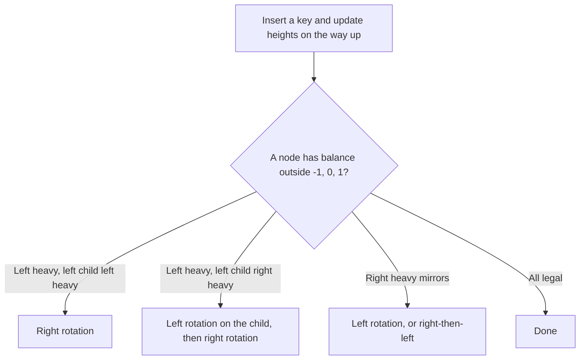

## Why this matters

A binary search tree that is a chain is an expensive linked list. Balanced trees promise that the height stays logarithmic after every insert and delete, so search, insert, delete, successor, and rank stay logarithmic in the worst case. AVL trees keep that promise with a height rule you can check by hand. Red-black trees keep a looser promise that is cheaper to maintain, which is why they show up in library maps such as C++ `std::map` and Java's `TreeMap`. Interviewers at this level rarely ask you to code a full red-black insertion from a blank page. They do ask what "balanced" means, what a rotation is, and why the height bound holds. Those answers are this lesson.

## Intuition

A rotation is a way to pull a node up and push its parent down without changing the inorder sequence. The keys stay in the same sorted order. Only the shape changes, the way you can rehang a mobile so it sits level. AVL trees rehang as soon as some node's two subtrees differ in height by more than one. Red-black trees paint nodes red or black and rehang, or recolor, when a red node sits next to another red node or when the black-height of the paths would disagree. Both schemes stop a chain from forming. AVL stays shorter. Red-black does fewer rotations on an insert.

## Core concept in depth

The height of a null tree is -1 or 0, depending on the convention. Pick one and keep it. This lesson uses height of a null child as 0 and height of a leaf as 1, which matches the binary-tree lesson. The balance factor of a node is the height of the left subtree minus the height of the right subtree. An AVL tree requires every balance factor to be -1, 0, or 1. That local rule implies a global height bound. The shortest AVL tree of height h is built from the shortest trees of height h - 1 and h - 2, which is a Fibonacci recurrence. The height is therefore at most about 1.44 log2(n), a constant times log n. Search is O(log n) in the worst case, with a smaller leading constant than a red-black tree.

A rotation repairs a local imbalance. A right rotation on node y, whose left child is x, makes x the parent. y becomes x's right child. x's old right subtree becomes y's left subtree. A left rotation is the mirror. The inorder sequence is unchanged because the subtree that moves stays between x and y in sorted order. There are four imbalance shapes, named by the side of the heavy child and the heavy grandchild. Left-left means the left child is taller and its left child is taller still: one right rotation at the node. Right-right is one left rotation. Left-right means the left child is taller but its right child is the heavy one: left-rotate the left child, then right-rotate the node. Right-left is the mirror. After the rotation, recompute heights on the way up. Insert walks down, attaches the leaf, and rotates at most once on the way back, at the deepest unbalanced node. Delete may rotate at every level on the way back, still O(log n) rotations.

Red-black trees use color. Every node is red or black. The root is black. Null children are black. A red node has only black children, so there is no red-red edge. Every path from a node to a null descendant contains the same number of black nodes. That last rule is the black-height. It implies the bound. The shortest path is all black. The longest path alternates and is at most twice the black-height. The black-height is at most log2(n + 1). Therefore the height is at most 2 log2(n + 1). Search is O(log n). The tree is less rigidly balanced than AVL, which is the point: insert fixup is a small case analysis of recoloring and at most two rotations.

Insert a red node, which preserves black-height and may create a red-red edge with the parent. If the uncle is red, recolor the parent and uncle black and the grandparent red, and continue at the grandparent. If the uncle is black and the node is an inner grandchild, rotate it to become an outer grandchild. If the uncle is black and the node is an outer grandchild, rotate the grandparent and recolor so the new parent is black and the old parent is red. Delete is the longer case analysis, built from a "double black" deficit that walks up the tree. You should be able to describe insert. You should be able to say that delete exists, restores the same invariants, and is still O(log n). Coding delete from memory under time pressure is how candidates lose the round. Describe it, and code AVL rotations if they want code.

Neither structure replaces a hash table for exact-key expected constant time. They win when you need ordered iteration, successor, predecessor, or rank. A treap uses a random priority and heap order on the priority, with BST order on the key. Rotations restore the heap property. With random priorities the expected height is logarithmic. Skip lists are another randomized ordered map. Mention them as the "expected balance without a painful delete." The advanced module returns to randomized structures briefly.

## Diagram and dry run



Keys arrive 3, 2, 1 into an empty AVL tree. Insert 3. Insert 2 as the left child. Balance factors are fine. Insert 1 as the left child of 2. Node 3 has balance factor 2. The heavy side is left, and the left child 2 is left-heavy. One right rotation on 3 makes 2 the root, with left child 1 and right child 3. Heights are 2, 1, and 1. Every balance factor is 0 or 1. The inorder sequence is still 1, 2, 3.

A left-right case: keys 3, 1, 2. 2 is the right child of 1, and 3 is left-heavy. Left-rotate 1 first, so 2 becomes the left child of 3 and 1 becomes the left child of 2. Then right-rotate 3. The root is 2. Same sorted order, height two instead of a chain of three.

## Runnable Python

Rotations are the code to have in your fingers. The AVL insert below handles the left-heavy cases and mirrors them for the right-heavy cases. Heights are stored on the node. This is iterative in spirit at each node and recursive along the path, which is the natural shape. A fully iterative AVL insert exists and is harder to read.

```python
class Node:
    def __init__(self, key: int) -> None:
        self.key = key
        self.left: Node | None = None
        self.right: Node | None = None
        self.height = 1


def height(node: Node | None) -> int:
    return 0 if node is None else node.height


def refresh(node: Node) -> None:
    node.height = 1 + max(height(node.left), height(node.right))


def rotate_right(y: Node) -> Node:
    x = y.left
    assert x is not None
    y.left = x.right
    x.right = y
    refresh(y)
    refresh(x)
    return x


def rotate_left(x: Node) -> Node:
    y = x.right
    assert y is not None
    x.right = y.left
    y.left = x
    refresh(x)
    refresh(y)
    return y


def insert(node: Node | None, key: int) -> Node:
    if node is None:
        return Node(key)
    if key < node.key:
        node.left = insert(node.left, key)
    else:
        node.right = insert(node.right, key)
    refresh(node)
    balance = height(node.left) - height(node.right)
    if balance > 1 and key < node.left.key:
        return rotate_right(node)
    if balance > 1 and key > node.left.key:
        node.left = rotate_left(node.left)
        return rotate_right(node)
    if balance < -1 and key > node.right.key:
        return rotate_left(node)
    if balance < -1 and key < node.right.key:
        node.right = rotate_right(node.right)
        return rotate_left(node)
    return node
```

Inserting 3, then 2, then 1 returns a tree whose root key is 2. Inserting 3, then 1, then 2 also returns root 2. The comparisons against `node.left.key` assume the child exists, which it does when the balance factor says that side is heavy. Duplicates are sent right. If your problem forbids duplicates, return the node unchanged when the key is present.

## Complexity and trade-offs

| Structure | Height | Insert rotations | Ordered iteration | Exact lookup |
| --- | --- | --- | --- | --- |
| Plain BST | n in the worst case | none | Theta(n) | Theta(height) |
| AVL | at most about 1.44 log2 n | at most one on insert | Theta(n) | Theta(log n) worst case |
| Red-black | at most 2 log2(n + 1) | O(1) rotations, O(log n) recolors | Theta(n) | Theta(log n) worst case |
| Hash table | not a tree | none | no useful order | Theta(1) expected |
| Treap | expected log n | expected O(log n) | Theta(n) | expected Theta(log n) |

Choose AVL when lookups dominate and you want the tighter height. Choose red-black when inserts and deletes dominate library use and a slightly taller tree is acceptable. Choose a hash table when there is no order. Say the height constant if someone claims all balanced trees are identical.

## Tricks, tips, and patterns

Draw the four shapes before you memorize letters. Left-left is one rotation. Left-right is two. The first rotation turns left-right into left-left. Recompute height at the nodes you moved, bottom first. For red-black, remember "red uncle means recolor, black uncle means rotate." Nulls are black, so a missing uncle is a black uncle. Never claim a plain BST is logarithmic without a balance argument or a random-insertion assumption.

## Common mistakes and edge cases

Forgetting to refresh heights after a rotation, so the next balance factor is stale. Rotating the wrong node. Updating the parent's child pointer and dropping the new subtree root, which is why insert must return the new root of the subtree. Allowing a red-red edge and calling the tree red-black. Forgetting that nulls count as black, and then computing a black-height that ignores leaves. Duplicate keys that bounce between left and right and never settle. An empty tree. A single node, which is a balanced black root. Deleting from an AVL tree and only rotating once, when the deficit can propagate. If you did not study delete, say so and talk about the propagation instead of inventing a rotation.

## Interview notes

Define the balance factor. State the Fibonacci height bound in words: the smallest AVL tree grows like Fibonacci, so the height is logarithmic. Draw a right rotation and name the subtree that changes parent. For red-black, list the four invariants and the 2 log n height. Sketch the red-uncle and black-uncle insert cases. Do not volunteer to code red-black delete. Do code a rotation if asked. Compare with hashing in one sentence so the interviewer knows you would not reach for a tree to solve Two Sum.

## Practice problems

1. [Validate Binary Search Tree](/practice/validate-binary-search-tree) — the property rotations must preserve.
2. [Balanced Binary Tree](/practice/balanced-binary-tree) — the AVL predicate on a plain binary tree, checked once rather than maintained.
3. [Kth Smallest Element in a BST](/practice/kth-smallest-element-in-a-bst) — logarithmic only if the height is logarithmic or you stop early.

## Summary and cheat sheet

- AVL: every balance factor is -1, 0, or 1. Height is under about 1.44 log2 n.
- Left-left: rotate right. Left-right: rotate left on the child, then right on the node. Mirrors for the right side.
- A rotation changes shape and preserves inorder.
- Red-black: root black, nulls black, no red-red edge, equal black-height. Height at most 2 log2(n + 1).
- Insert fixup: red uncle recolors, black uncle rotates.
- Both give worst-case logarithmic search. Hashing is faster for exact keys and gives no order.

## Further reading

- [Wikipedia — AVL tree](https://en.wikipedia.org/wiki/AVL_tree)
- [Wikipedia — Red-black tree](https://en.wikipedia.org/wiki/Red%E2%80%93black_tree)
- [Wikipedia — Tree rotation](https://en.wikipedia.org/wiki/Tree_rotation)
- [CLRS, chapters on AVL and red-black trees](https://mitpress.mit.edu/9780262046305/introduction-to-algorithms/)
