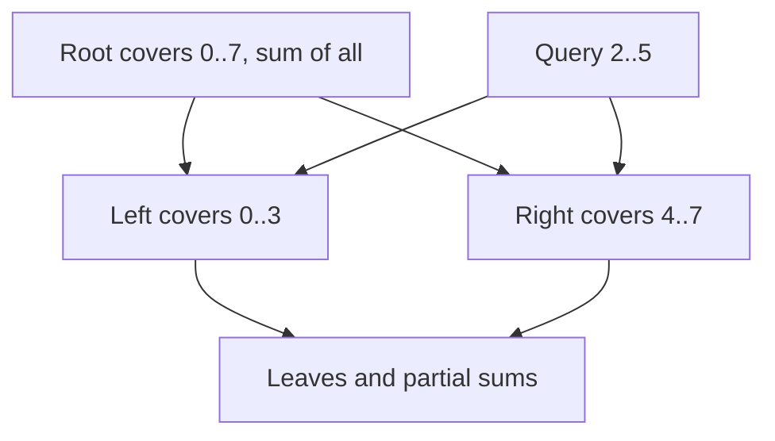

## Why this matters

Prefix sums answer static range sums. They do not survive updates. A segment tree and a Fenwick tree, also called a binary indexed tree, answer point updates and range sums in logarithmic time. A trie, or prefix tree, stores strings so that a prefix query is proportional to the prefix length rather than to the number of words. These three structures cover a different interview tier than binary search trees: the segment tree and the Fenwick tree are about ranges of an array, and the trie is about shared prefixes. You should be able to implement a Fenwick tree from memory, derive a segment tree from the "split the range in half" idea, and implement trie insert and search without notes.

## Intuition

A segment tree is a tournament bracket. Each internal node stores the winner, or the sum, of a range. The root stores the whole array. The leaves store single elements. A query that covers a node completely takes that node's answer. A query that covers only part of a node asks both children and combines. An update changes a leaf and walks back to the root, recomputing O(log n) nodes. A Fenwick tree stores the same idea in the binary representation of the index. The lowest set bit of an index tells you how far that slot's responsibility extends. There is no explicit tree, only an array and two while-loops. A trie is a tree of characters. Words that share a prefix share the nodes. Lookup fails as soon as a character is missing.

## Core concept in depth

Build a segment tree on a range that you pad to a power of two if that makes the indexing easier, or keep the length general and pass left and right bounds into recursive functions. The recursive build on a segment `[L, R]` creates a leaf when L equals R, and otherwise splits at mid, builds both children, and stores the sum of the children. Query(qL, qR) on a node that covers `[L, R]` returns 0 when the ranges miss, returns the stored sum when the node is completely inside the query, and otherwise returns the sum of the two recursive queries. Update changes the leaf and adds the delta, or sets the leaf and recomputes, on the way back. Each query and update visits O(log n) nodes because the range splits in half and a query touches at most two nodes per level. Memory is about 4n nodes in the recursive layout, or 2n on a padded power of two. Store the tree in an array: the children of index i are 2i and 2i + 1 if you use 1-based indexing.

The same shape stores other associative combinations. Minimum, maximum, gcd, and sum all work, because combining two halves does not depend on order of combination beyond associativity. Assignment updates and range-add updates need lazy propagation: a node remembers a pending update for its whole range and pushes that pending update to its children only when a query or a later update needs to go deeper. Lazy propagation is the technique that makes range-update plus range-query logarithmic. Without it, a range update is a loop of point updates and can be linearithmic or worse. For the first interview, point update and range query are enough. Mention lazy as the next step.

A Fenwick tree keeps an array bit[1..n], 1-based. The responsibility of index i is the range ending at i whose length is the lowest set bit of i. Adding at i walks upward: add the lowest set bit to i, and add the delta to each slot, until i passes n. A prefix sum through i walks downward: add bit[i], then clear the lowest set bit, until i is 0. The lowest set bit of i is `i & -i` in two's complement. A range sum from l to r is prefix(r) - prefix(l - 1). Point update and prefix query are both O(log n). The tree uses n words and a tighter constant than a segment tree, and it is harder to adapt to minimum queries because minimum does not invert: you cannot subtract prefixes. Sum is the Fenwick tree's home. If you need minimum, use a segment tree.

Build a Fenwick tree from an existing array by calling add for each element, which is O(n log n), or by a linear specialized build that you do not need to memorize. The operation problem in this course starts from zeros and applies adds, which matches the loops above.

A trie node is a map from character to child, plus a boolean that says a word ends here. Insert walks the word, creating missing children, and marks the last node. Search walks the word and requires the end mark, so a proper prefix of an inserted word is not a false hit. Starts-with walks the prefix and ignores the end mark. Time is proportional to the word length, with a factor for the map lookup. An array of 26 children makes the lookup a true constant and spends memory on absent letters. A hash map spends memory only on letters that occur. Delete is optional and must not remove nodes that other words still need. Count words through a node if you need delete to be correct, or simply unmark the end bit if leaving dead branches is acceptable.

Word search II is a board backtracking guided by a trie of the dictionary. You prune a path when the trie has no child for the next letter. Without the trie you search the board once per word. With the trie you search the board once for the whole dictionary. The trie lesson and the backtracking lesson meet there.

Bitwise trie of integers, with a child for bit 0 and bit 1, answers maximum XOR pair questions by walking the opposite bit when it exists. It is the same prefix tree on a fixed alphabet of size 2. Mention it as an application, and implement the character trie first.

## Diagram and dry run



Array 1, 3, 5, 7. Build pair sums. Leaves 1, 3, 5, 7. Parents 4 and 12. Root 16. Query from index 1 through 2 is the leaf 3 plus the leaf 5, total 8. The root is not fully covered, the left parent covers indexes 0 and 1 and is not fully covered, the right parent is not fully covered. The query touches both relevant leaves. Update index 2 by adding 10. The leaf 5 becomes 15, its parent becomes 22, the root becomes 26. Two or three nodes change, not the whole array.

Fenwick on the same values, 1-based adds of 1 at index 1, 3 at index 2, 5 at index 3, 7 at index 4. Prefix through 3 is 1 + 3 + 5 = 9. The downward walk uses the lowest set bit rather than visiting every leaf. Check the implementation against this prefix before you trust it.

Trie insert of "cat" and "car". The root grows a child c, then a, then t with an end mark. Inserting "car" reuses c and a, and adds r with an end mark. Search "ca" fails because a is not an end. Starts-with "ca" succeeds. Search "cat" succeeds.

## Runnable Python

The Fenwick tree is the one to reproduce under pressure. The trie insert and search are the other. The segment tree is recursive and clear. All three are iterative at the operation level except the segment tree, whose recursion is the range split and is logarithmic so the stack is safe.

```python
class Fenwick:
    def __init__(self, n: int) -> None:
        self.n = n
        self.bit = [0] * (n + 1)

    def add(self, index: int, delta: int) -> None:
        index += 1
        while index <= self.n:
            self.bit[index] += delta
            index += index & -index

    def prefix(self, index: int) -> int:
        index += 1
        total = 0
        while index > 0:
            total += self.bit[index]
            index -= index & -index
        return total

    def range_sum(self, left: int, right: int) -> int:
        return self.prefix(right) - (self.prefix(left - 1) if left else 0)


class Trie:
    def __init__(self) -> None:
        self.children: dict[str, Trie] = {}
        self.end = False

    def insert(self, word: str) -> None:
        node = self
        for ch in word:
            if ch not in node.children:
                node.children[ch] = Trie()
            node = node.children[ch]
        node.end = True

    def search(self, word: str) -> bool:
        node = self
        for ch in word:
            if ch not in node.children:
                return False
            node = node.children[ch]
        return node.end

    def starts_with(self, prefix: str) -> bool:
        node = self
        for ch in prefix:
            if ch not in node.children:
                return False
            node = node.children[ch]
        return True
```

Mark `end` only after the loop. If you mark it on every character, a proper prefix looks like a stored word. After `insert("cat")`, `search("ca")` is false and `search("cat")` is true. Fenwick `add(0, 1)`, `add(1, 3)`, `add(2, 5)` makes `range_sum(0, 2)` equal 9.

## Complexity and trade-offs

| Structure | Point update | Range sum | Memory | Best at |
| --- | --- | --- | --- | --- |
| Prefix array | Theta(n) rebuild | Theta(1) | Theta(n) | Static arrays |
| Fenwick | Theta(log n) | Theta(log n) | Theta(n) | Sums |
| Segment tree | Theta(log n) | Theta(log n) | Theta(n) | Sum, min, max, lazy range updates |
| Trie | insert Theta(length) | prefix Theta(length) | proportional to the number of distinct prefixes | Strings and bit prefixes |

A segment tree can do what a Fenwick tree can do for sums, with more code and more memory. A Fenwick tree cannot do lazy range assignment cleanly without extra technique. Start with Fenwick for sums. Move to a segment tree when the combine is not an invertible sum or when updates cover a range. A hash set of the inserted words answers search and does not answer "is this prefix a prefix of any word?" without scanning. That scan is why the trie exists.

## Tricks, tips, and patterns

Fenwick indexes in the loops are 1-based even if the problem is 0-based. Convert at the boundary. `i & -i` is the lowest set bit. Range sum subtracts the prefix before the left endpoint. Segment-tree queries return early on a total miss and a total cover. Do not walk to the leaves when the node is fully inside the query. Trie end marks belong on the last character only. Share nodes across words. For a board search, unmark visited cells and also decide whether a word may be used twice. Store a set of found words so a word is emitted once.

## Common mistakes and edge cases

The broken end-mark bug above. Off-by-one in Fenwick conversion so index 0 updates bit slot 0, which the downward loop never reads, and the update vanishes. Using `index &= index - 1` and `index += index & -index` on a mix of languages where negative numbers are not two's complement. Python's negative integers still satisfy `i & -i` for the lowest set bit of a positive i. Do not call it on 0. Query ranges where left is 0 must not call prefix(-1). The code above special-cases that. Segment trees that forget the "completely outside" case and add a child's sum anyway. Lazy flags that are pushed twice or never pushed before a read. Empty trie search of the empty string: define it. Usually the empty string is stored only if it was inserted, and the root's end mark says so. A single-element Fenwick. Updates that set a value rather than add a delta: set is "add the difference from the old value," so you must remember the old value.

## Interview notes

For sums with updates, say Fenwick and write the two loops. Explain the lowest set bit in one sentence even if you do not prove the coverage. For minima or for range updates, say segment tree, draw one split, and write the query's three cases: miss, cover, partial. For strings, draw "cat" and "car" sharing two nodes and mark the ends. Mention the false end-mark bug as something you are careful about. If the problem is Word Search II, say the trie prunes the board search. Give complexities in log n or in word length, not in a vague "tree so log."

## Practice problems

1. [Fenwick Range Sum](/practice/fenwick-range-sum) — the two loops, tested against a plain array.
2. [Implement Trie](/practice/implement-trie) — insert, search, and prefix.
3. [Word Search](/practice/word-search) — the board half of the trie search. The dictionary half is the trie.
4. [Subarray Sum Equals K](/practice/subarray-sum-equals-k) — the static cousin, a prefix hash, so you can say why you did not build a tree.

## Summary and cheat sheet

- Segment tree: each node is a range. Query uses miss, full cover, or both children. Update recomputes a path of length log n.
- Lazy propagation pushes pending range updates down. Use it when updates are ranges.
- Fenwick: add walks up by the lowest set bit, prefix walks down by clearing it. Range sum is a difference of prefixes. Sums, not minima.
- Trie: one node per character, shared prefixes, an end mark only on the last character.
- Insert and search cost the word length. Prefix tests do not require the end mark.
- Prefix arrays win when the array is static. Hash sets win when the question is exact membership of a whole word.

## Further reading

- [Wikipedia — Segment tree](https://en.wikipedia.org/wiki/Segment_tree)
- [Wikipedia — Fenwick tree](https://en.wikipedia.org/wiki/Fenwick_tree)
- [Wikipedia — Trie](https://en.wikipedia.org/wiki/Trie)
- [CP-Algorithms, Fenwick tree](https://cp-algorithms.com/data_structures/fenwick.html)
- [CP-Algorithms, segment tree](https://cp-algorithms.com/data_structures/segment_tree.html)
