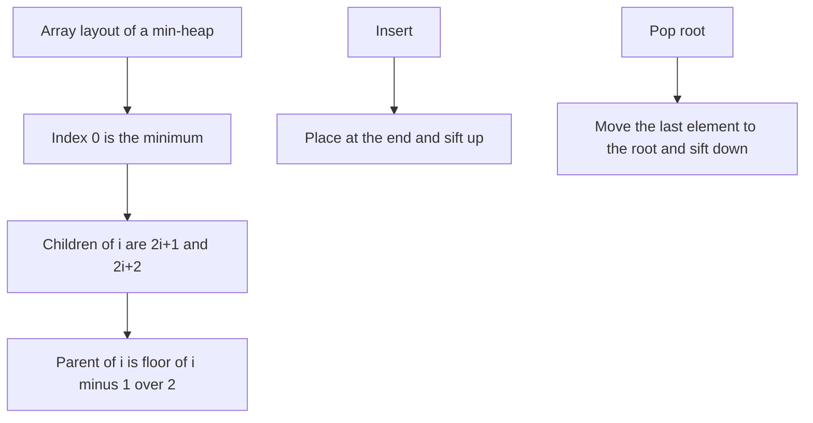

## Why this matters

A heap is a priority queue with a shape guarantee. The minimum, or the maximum, sits at the root, and you can remove it or insert a new key in logarithmic time. That is the right cost when you repeatedly need the current extreme and you do not need the fully sorted list. Dijkstra's algorithm, merge-k sorted lists, the kth largest element, top-k frequent items, and a running median are all "give me the extreme, then change the set." Sorting the whole set every time is correct and wasteful. A heap does the part you actually use.

## Intuition

Think of a company hierarchy where every manager is at least as senior as the people they manage, and the tree is packed as far left as possible on the last rank. Seniority bubbles up. If a new hire outranks their manager, they swap upward until the rule holds. If a manager leaves and the most junior person is dropped into that office, they swap downward with their more senior child until the rule holds. Because the tree is complete, it can live in an array. The children of index i are at 2i + 1 and 2i + 2. No pointers required.

## Core concept in depth

A binary heap is a complete binary tree, filled level by level from the left, that obeys the heap property. In a min-heap, every parent is less than or equal to its children, so the minimum is at index 0. A max-heap reverses the inequality. The height is floor of log2 n, because the tree is complete. That height is the worst-case length of a sift.

Sift-up inserts. Place the new key at the next open index, which preserves completeness. While the key is smaller than its parent, swap them. The parent of index i is (i - 1) // 2. The loop ends at the root or when the parent is smaller or equal. At most log n swaps. Sift-down removes the root. Move the last element into index 0, shrink the length, and while the node is larger than one of its children, swap it with the smaller child. Choosing the smaller child preserves the min-heap property. A missing right child is ignored. This is also at most log n swaps.

Heapify builds a heap from an arbitrary array in linear time, not n log n. The leaves are already heaps. Starting at the last parent, which is index n // 2 - 1, sift each node down. The cost of sift-down at height h is O(h), and most nodes have small height. The sum over the tree is O(n). Remember the result even if you do not re-sum the series in the interview: building a heap is linear, and each of the n extract operations in heapsort is logarithmic, so heapsort is n log n. Heapsort swaps the root with the end, shrinks the heap, and sifts down, repeating until the array is sorted. It is in-place and not stable. A max-heap produces an ascending array because the largest remaining key is written at the end.

Python's `heapq` is a min-heap of lists. `heappush` and `heappop` are logarithmic. `heapify` is linear. There is no decrease-key. Dijkstra implementations in interviews often push a new pair instead of decreasing the old one, and they ignore stale pairs when they are popped. That is correct and can leave the heap with extra entries, still O((n + m) log n) with a larger constant. A max-heap of numbers is a min-heap of negated numbers, as long as negation cannot overflow. In Python it cannot. For custom objects, push a tuple whose first element is the priority. Tuples compare lexicographically, so a tie breaks on the later fields. Do not push objects that are not ordered.

The patterns share one sentence: keep the heap the size of the answer you still care about, or keep the frontier of a search.

Kth largest in an unsorted array. A min-heap of size k stores the k largest values seen so far. The root is the smallest of those, which is the kth largest if the heap is full. Scan the array. If the heap has fewer than k elements, push. If the value is larger than the root, pop and push. Time is n log k, which beats n log n sorting when k is much smaller than n. A max-heap of all elements followed by k pops is n plus k log n after a linear heapify, which is better when k is large. Quickselect is average linear and worst-case quadratic unless you use a good pivot strategy. Mention it as the alternative when you need the element and not the heap of candidates.

Merge k sorted lists. A min-heap holds one current node from each list, ordered by value. Pop the smallest, append it to the output, and push its successor. Each of the n nodes is pushed and popped once, and the heap holds at most k nodes, so the time is n log k. The pairwise merge from the sorting lesson has the same bound. The heap version streams and needs no intermediate full lists.

Top-k frequent elements. Count in a hash map, then keep a min-heap of size k ordered by frequency. The same n log k scan applies, with n the number of distinct keys. Bucket sort by frequency is linear in the array length when frequencies are at most n, and it is the better bound. Offer the heap first if you want a uniform pattern, and the buckets if the interviewer asks for linear time.

Running median. A max-heap holds the smaller half and a min-heap holds the larger half. The tops are the middle. Insert into the appropriate half, then rebalance so the sizes differ by at most one. The median is the top of the larger half, or the average of the two tops when the sizes match and the problem wants an average. Each insertion is logarithmic. A sorted list would be linear per insertion.

Task scheduler and reorganize string can use a max-heap of frequencies plus a cooldown queue. They also have greedy formulas. Use the heap when the cooldown story is easier to simulate than to prove, and check n. A heap of n tasks is n log n and fine for the usual constraints.

K closest points pushes (distance, point) and keeps size k. Squared distance avoids a square root and preserves order. Dijkstra, in the graph module, is a min-heap of (distance, node). The heap lesson is the data structure. The graph lesson is the invariant that the first time you pop a node, its distance is final when edge weights are non-negative.

## Diagram and dry run



Insert 5, 3, 8, 1 into an empty min-heap.

| Operation | Array afterward | Why |
| --- | --- | --- |
| push 5 | 5 | single node |
| push 3 | 3, 5 | 3 sifts above 5 |
| push 8 | 3, 5, 8 | 8 is greater than its parent 3, so it stays |
| push 1 | 1, 3, 8, 5 | 1 swaps with 5, then with 3, and becomes the root |

Pop. The last element 5 moves to the root, the array is 5, 3, 8, and sift-down swaps 5 with the smaller child 3. The heap is 3, 5, 8. The popped minimum was 1.

Kth largest with k = 2 on the values 5, 3, 8, 1. The size-2 min-heap evolves as 5; then 3, 5; then 5, 8 after 8 replaces 3; then 5, 8 when 1 is ignored. The root 5 is the 2nd largest. The largest, 8, is also in the heap. You do not know the order below the root without more pops.

## Runnable Python

Sift-up and sift-down are written out so the index arithmetic is visible. The kth-largest helper uses the library heap, which is the version you should call in a contest unless the question is the implementation. Both are iterative. A recursive sift-down exists and uses logarithmic stack. The loop is easier to bound.

```python
def sift_up(heap: list[int], i: int) -> None:
    while i > 0:
        parent = (i - 1) // 2
        if heap[parent] <= heap[i]:
            return
        heap[parent], heap[i] = heap[i], heap[parent]
        i = parent


def sift_down(heap: list[int], i: int, size: int) -> None:
    while True:
        smallest = i
        left, right = 2 * i + 1, 2 * i + 2
        if left < size and heap[left] < heap[smallest]:
            smallest = left
        if right < size and heap[right] < heap[smallest]:
            smallest = right
        if smallest == i:
            return
        heap[i], heap[smallest] = heap[smallest], heap[i]
        i = smallest


def kth_largest(nums: list[int], k: int) -> int:
    import heapq
    heap = nums[:k]
    heapq.heapify(heap)
    for value in nums[k:]:
        if value > heap[0]:
            heapq.heapreplace(heap, value)
    return heap[0]
```

After pushing 5, 3, 8, 1 with sift-up into a list, the root is 1. `kth_largest` on that array with k = 2 returns 5. `heapreplace` pops the root and pushes in one arrangement of the underlying sifts. Use it when the heap is non-empty, which it is after the first k elements. If k can exceed the length, guard it. The problem constraints usually promise otherwise.

## Complexity and trade-offs

| Operation | Time | Extra space |
| --- | --- | --- |
| Peek | Theta(1) | none |
| Push, pop | Theta(log n) | Theta(1) besides the array |
| Heapify | Theta(n) | Theta(1) |
| Heapsort | Theta(n log n) | Theta(1) |
| Kth largest with a size-k heap | Theta(n log k) | Theta(k) |
| Merge k lists | Theta(n log k) | Theta(k) |
| Running median insert | Theta(log n) | Theta(n) |
| Full sort, then index | Theta(n log n) | Theta(n) or in-place |

A balanced BST also gives you the minimum in log time and gives you ordered iteration and decrease-key more naturally. It uses more memory and more code. A sorted array gives you the kth element instantly after n log n preprocessing and hates updates. Choose the heap when the set changes at the extreme only. Choose the sort when you need the entire order anyway.

## Tricks, tips, and patterns

Parent and child indexes: write them down before the loop. Sift-down compares both children. Sift-up compares one parent. Heapify starts at the last parent, not at the root and not at 0 going upward. For max-heaps in Python, negate, and remember to negate again when you pop. For tuples, the priority comes first, and a unique tie break comes second so equal priorities do not compare objects that cannot be ordered. For Dijkstra, push duplicates instead of decrease-key, and skip a popped node whose distance is worse than the best known. For medians, rebalance by moving the top across, not by rebuilding.

## Common mistakes and edge cases

Off-by-one children, using 2i and 2i + 1 in a 0-based array, which skips a child and collides. Sift-down that swaps with the larger child in a min-heap. Heapify that sifts up and becomes n log n, which is harmless and not the bound you claimed. A size-k heap that keeps the k smallest when you wanted the k largest, because you used a max-heap by accident. Empty pop. k equal to 0. Equal keys, which the heap property allows. Unstable order among equals. Heapsort is not stable. Using a heap to get the global minimum once: a linear scan is enough. Forgetting that `heapq` is a min-heap and then being surprised that the first pop is the smallest. Stale Dijkstra entries that you process instead of skipping, which can mark a node finished too early only if you also decrease wrong. If you only skip worse distances, stale entries are safe.

## Interview notes

Say "complete tree, parent dominates, array indexes, log n sifts, linear heapify." Then match the pattern: size k for top-k, one head per list for merge-k, two halves for the median, frontier for Dijkstra. Give n log k when k is the heap size. Mention quickselect if they want expected linear kth-largest and you are comfortable coding a partition. Dry-run the four insertions above. It is short and it forces a sift-up that climbs two levels. If they ask for decrease-key and you are in Python, explain the stale-entry trick rather than pretending `heapq` supports it.

## Practice problems

1. [Kth Largest Element](/practice/kth-largest-element-in-an-array) — size-k min-heap.
2. [Top K Frequent Elements](/practice/top-k-frequent-elements) and [Top K Frequent Words](/practice/top-k-frequent-words).
3. [Merge K Sorted Lists](/practice/merge-k-sorted-lists).
4. [K Closest Points to Origin](/practice/k-closest-points-to-origin).
5. [Last Stone Weight](/practice/last-stone-weight) — a max-heap simulation.
6. [Task Scheduler](/practice/task-scheduler) — frequencies, with a heap simulation or a formula.
7. [Network Delay Time](/practice/network-delay-time) — Dijkstra's frontier, taught with graphs.

## Summary and cheat sheet

- A binary heap is a complete tree. The root is the extreme. Children of i are 2i + 1 and 2i + 2.
- Sift-up on insert. Sift-down on pop. Both are logarithmic.
- Heapify from the last parent downward is linear.
- Heapsort is n log n, in-place, and unstable.
- Top-k is a heap of size k, time n log k.
- Merge k lists is n log k. Two heaps maintain a running median.
- Python's heapq is a min-heap. Negate for a max-heap. Push fresh Dijkstra states instead of decrease-key.

## Further reading

- [Wikipedia — Binary heap](https://en.wikipedia.org/wiki/Binary_heap)
- [Wikipedia — Heapsort](https://en.wikipedia.org/wiki/Heapsort)
- [Python heapq documentation](https://docs.python.org/3/library/heapq.html)
- [CP-Algorithms, binary heap](https://cp-algorithms.com/data_structures/binary_heap.html)
