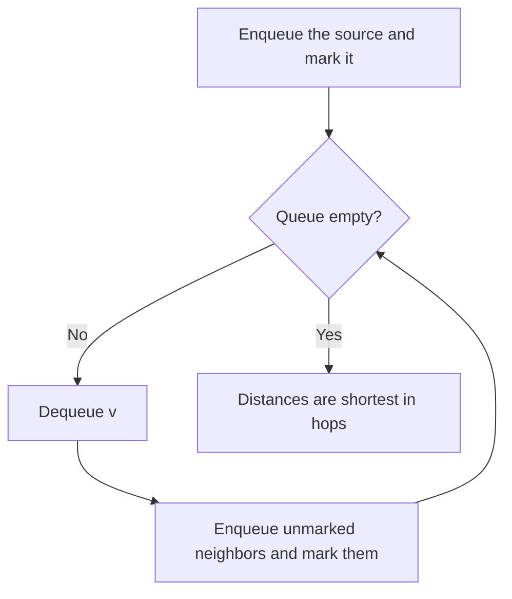

## Why this matters

Graphs are how you model anything whose parts touch: cities and roads, courses and prerequisites, pixels and their neighbors, accounts and shared emails. Depth-first search and breadth-first search are the two walks that every later algorithm specializes. BFS finds shortest paths when every edge has the same cost. DFS finds connectivity, cycles, and finishing times. On a grid, the "graph" is implicit: a cell has up to four neighbors and you must not allocate an adjacency list unless you want to. Island counts, flood fill, rotting oranges, and walls-and-gates are BFS or DFS with a visited mark. If the mark is missing, the search never ends.

## Intuition

DFS is a person in a maze who walks as far as possible down one corridor before backtracking. The call stack, or an explicit stack, remembers the corridors not yet taken. BFS is a ripple. Everyone who is one step away is processed before anyone who is two steps away. A queue enforces that order. On an unweighted graph the ripple reaches a node by a shortest path, because a shorter path would have been a smaller ripple that arrived earlier. On a weighted graph that argument dies, and you need Dijkstra or Bellman-Ford.

## Core concept in depth

Represent a graph as an adjacency list: a vector of vectors, or a dictionary from node to neighbors. An undirected edge is stored twice. A directed edge is stored once. A grid does not need that list. The neighbors of a cell are the four, or eight, coordinate offsets that stay inside the board.

DFS from a start node marks the node visited, then explores each unvisited neighbor. The recursive version is the specification. The iterative version pushes the start, and when it pops a node it pushes the unvisited neighbors. Marking on push avoids putting the same node on the stack many times. Marking on pop matches the recursive timing more closely and can still explode the stack with duplicates if you are not careful. Prefer mark-on-push for iterative DFS. Time is Theta(n + m) for n nodes and m edges, because each node is expanded once and each edge is looked at once. Space is Theta(n) for the visited set and the stack. In a recursion, the call stack can be depth n. Python will hit the recursion limit on a long chain. Use the explicit stack when the problem constraints allow a chain of 10 to the 5th nodes.

BFS pushes the start with distance 0 and marks it visited immediately, not when it is dequeued. That mark-on-enqueue rule is the difference between linear time and a queue that contains the same node once per path. While the queue is not empty, pop the front, and enqueue each unvisited neighbor with distance plus one, marking it as you enqueue. The first time a node is enqueued is the shortest unweighted distance. Multi-source BFS puts every source in the queue at distance 0 before the loop. Rotting oranges is multi-source: every rotten orange is a source, and the answer is the maximum distance at which a fresh orange becomes rotten, or a failure if a fresh orange was never reached. 0-1 BFS is the variant where edges cost 0 or 1. Use a deque. A 0-cost edge pushes to the front and a 1-cost edge pushes to the back. The first time you pop a node, its distance is final. It is a special case of Dijkstra that does not need a heap.

Connected components in an undirected graph are the nodes reached by one DFS or BFS. Loop over every node, and start a search when it is unvisited. The number of starts is the number of components. On a grid, an island is a component of land cells. Count the starts, and let the search mark the whole island so it is not counted again. Flood fill is the same search that writes a new color instead of only marking. Max area is the same search that returns a size. Surrounded regions and enclaves are a search that starts from the border, marks everything that can escape, and then treats the unmarked land as trapped.

Bipartite checking is a BFS or DFS that colors a node 0 and its neighbors 1, and fails when a neighbor is already the same color. A graph is bipartite exactly when it has no odd cycle. Disconnected graphs need a start from every unvisited node. A single node is bipartite.

Cycle detection differs by directed and undirected. Undirected: DFS with a parent. A visited neighbor that is not the parent is a back edge to an ancestor or a cross edge inside the component, and in an undirected graph that means a cycle. Directed: three colors. White is unseen, gray is on the current recursion stack, black is finished. A gray neighbor is a back edge and a cycle. A black neighbor is a cross edge or a forward edge and is not, by itself, a cycle. Forgetting the parent in the undirected case reports every edge as a cycle, because the search walks back to the node it just came from.

Iterative and recursive DFS compute the same reachability. They do not always visit neighbors in the same order, and an iterative version that pushes neighbors left to right will pop them right to left. If the problem wants a specific order, sort the neighbors or use recursion and document the order. BFS order is fixed once the neighbor order is fixed: increasing distance, and within a distance the enqueue order.

## Diagram and dry run



Undirected graph. Nodes 0, 1, 2, 3. Edges 0-1, 0-2, 1-3. BFS from 0.

| Dequeue | Queue after enqueueing new nodes | Distances |
| --- | --- | --- |
| start | 0 | 0 is 0 |
| 0 | 1, 2 | 1 is 1, 2 is 1 |
| 1 | 2, 3 | 3 is 2 |
| 2 | 3 | no new node |
| 3 | empty | done |

The shortest path from 0 to 3 has length 2. DFS from 0 might visit 0, 1, 3, 2 if it walks the 1 edge first. Both see the whole component. Only BFS reports the hop distance.

A grid island example. Three land cells in a corner and one isolated land cell. The first land cell you meet starts a search that marks three cells. The isolated cell starts a second search. The answer is 2. If you forget to mark, the first search oscillates between two adjacent land cells forever.

## Runnable Python

Recursive DFS and iterative BFS are the pair to keep. The grid island counter uses BFS so the recursion limit is irrelevant. Neighbors are four-directional.

```python
def dfs(graph: list[list[int]], start: int) -> list[int]:
    seen = [False] * len(graph)
    order: list[int] = []

    def visit(node: int) -> None:
        seen[node] = True
        order.append(node)
        for nxt in graph[node]:
            if not seen[nxt]:
                visit(nxt)

    visit(start)
    return order


def bfs(graph: list[list[int]], start: int) -> list[int]:
    from collections import deque
    seen = [False] * len(graph)
    seen[start] = True
    queue = deque([start])
    dist = [-1] * len(graph)
    dist[start] = 0
    while queue:
        node = queue.popleft()
        for nxt in graph[node]:
            if not seen[nxt]:
                seen[nxt] = True
                dist[nxt] = dist[node] + 1
                queue.append(nxt)
    return dist


def num_islands(grid: list[list[str]]) -> int:
    if not grid:
        return 0
    rows, cols = len(grid), len(grid[0])
    seen = [[False] * cols for _ in range(rows)]

    def flood(r: int, c: int) -> None:
        stack = [(r, c)]
        seen[r][c] = True
        while stack:
            x, y = stack.pop()
            for dx, dy in ((1, 0), (-1, 0), (0, 1), (0, -1)):
                nx, ny = x + dx, y + dy
                if 0 <= nx < rows and 0 <= ny < cols and not seen[nx][ny] and grid[nx][ny] == "1":
                    seen[nx][ny] = True
                    stack.append((nx, ny))

    count = 0
    for r in range(rows):
        for c in range(cols):
            if grid[r][c] == "1" and not seen[r][c]:
                flood(r, c)
                count += 1
    return count
```

`bfs` returns hop distances, with -1 for unreachable nodes. `num_islands` treats the character 1 as land. Marking when you push, including the start, is what keeps the stack linear in the size of the island rather than exponential in the number of paths.

## Complexity and trade-offs

| Search | Time | Extra space | Shortest paths |
| --- | --- | --- | --- |
| Recursive DFS | Theta(n + m) | Theta(n) stack in the worst case | no |
| Iterative DFS | Theta(n + m) | Theta(n) | no |
| BFS | Theta(n + m) | Theta(n) queue | yes, unweighted |
| 0-1 BFS | Theta(n + m) | Theta(n) | yes, weights 0 and 1 |
| Multi-source BFS | Theta(n + m) | Theta(n) | yes, distance to the nearest source |

DFS uses less memory than BFS on a long thin path if you count only the recursion depth against a wide BFS frontier, and the opposite on a balanced graph where the frontier is wide and the depth is small. For correctness of shortest paths, use BFS. For topological finishing times and directed cycles, use DFS colors. For grids, either search is fine for connectivity. BFS is required when the answer is a distance.

## Tricks, tips, and patterns

Mark on the way in, not on the way out. For BFS, mark when you enqueue. For undirected cycles, remember the parent. For directed cycles, gray means on the stack. For grids, check bounds before you read the cell. For multi-source problems, enqueue every source first. For "minimum steps to a target" on an unweighted implicit graph, BFS and stop when you dequeue the target. The open-the-lock puzzle is that graph: 10000 nodes, eight edges each, and deadends removed. Do not build the adjacency list in advance. Generate neighbors from the current state.

## Common mistakes and edge cases

Forgetting the parent and reporting a cycle on every undirected edge. Marking a grid cell only after exploring it, so two paths enqueue it twice and the distance is still correct but the time is not linear. Using DFS distances as shortest paths. Using BFS on weighted edges. Eight-directional versus four-directional neighbors. A grid of all water has zero islands. A one-cell island counts. Disconnected graphs: a search from node 0 does not cover node 5. Loop over all starts. Directed reachability is not symmetric. A self-loop is a cycle. An empty graph has zero components or one component per the problem's definition of n. Read n. Python recursion on a snake-shaped island of length 10 to the 5th. Use a stack.

## Interview notes

Say which search and why in one sentence. "Unweighted distance, so BFS, mark on enqueue." Or "connectivity, DFS, and I will use a stack because the island can be long." Name the graph. For a grid, say the nodes are cells and the edges are the four steps. Dry-run a four-node graph or a 2 by 2 grid. Mention the n + m bound. If the interviewer adds weights, stop and switch algorithms. Do not quietly keep the BFS.

## Practice problems

1. [Number of Islands](/practice/number-of-islands), [Max Area of Island](/practice/max-area-of-island), and [Flood Fill](/practice/flood-fill).
2. [Rotting Oranges](/practice/rotting-oranges) — multi-source BFS.
3. [01 Matrix](/practice/01-matrix) and [Shortest Path in a Binary Matrix](/practice/shortest-path-in-binary-matrix).
4. [Number of Enclaves](/practice/number-of-enclaves) and [Pacific Atlantic Water Flow](/practice/pacific-atlantic-water-flow) — searches from the border.
5. [Is Graph Bipartite](/practice/is-graph-bipartite) and [Keys and Rooms](/practice/keys-and-rooms).
6. [Open the Lock](/practice/open-the-lock) — BFS on an implicit graph.

## Summary and cheat sheet

- DFS goes deep. BFS goes level by level. Both are linear in nodes plus edges.
- BFS gives shortest paths only when every edge has the same positive cost, usually 1.
- Mark when you push. In BFS that is when you enqueue.
- Undirected cycles: a visited neighbor that is not the parent. Directed cycles: a gray node.
- Grids are implicit graphs. Check bounds. Choose four or eight neighbors on purpose.
- Multi-source BFS enqueues every source at distance 0.
- 0-1 BFS uses a deque. Real weights need Dijkstra.

## Further reading

- [Wikipedia — Breadth-first search](https://en.wikipedia.org/wiki/Breadth-first_search)
- [Wikipedia — Depth-first search](https://en.wikipedia.org/wiki/Depth-first_search)
- [CP-Algorithms, BFS](https://cp-algorithms.com/graph/breadth-first-search.html)
- [CP-Algorithms, DFS](https://cp-algorithms.com/graph/depth-first-search.html)
