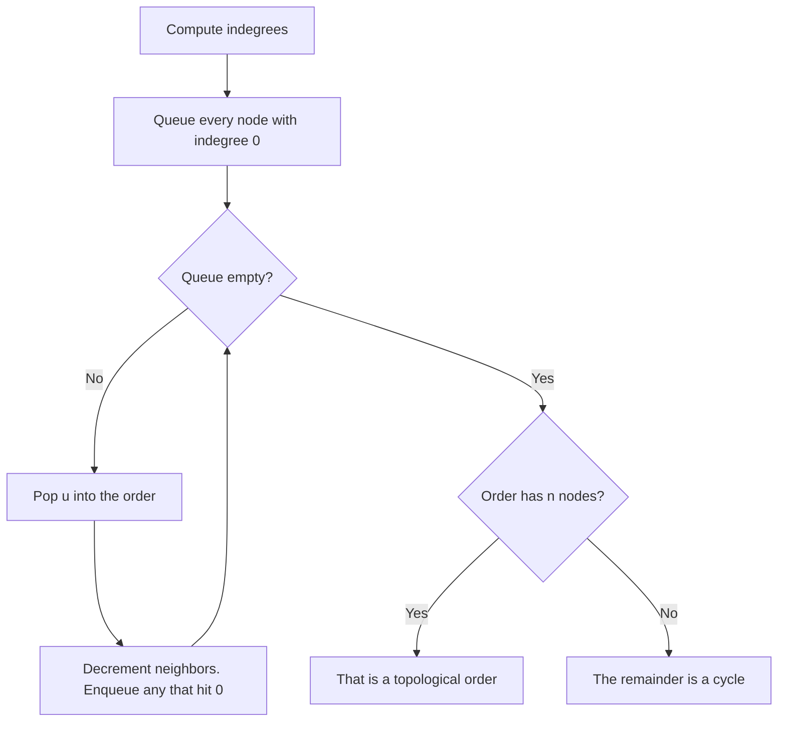

## Why this matters

Some graphs are schedules. An edge u to v means u must happen before v: a course before its follow-up, a build step before the binary that links it, a spreadsheet cell before the cell that reads it. A topological order is a linear order that respects every edge. It exists exactly when the directed graph has no cycle. Kahn's algorithm finds one with a queue of indegree-zero nodes, or proves a cycle by failing to output every node. DFS finds one by reversing the finishing times, and the same search's gray edges prove a cycle. Course Schedule is the decision version. Course Schedule II is the order. Eventual safe nodes and alien dictionary are the same idea in a costume.

## Intuition

A node that nobody depends on, or that has no prerequisites left, can go next. Taking it removes its outgoing edges and may free other nodes. If you can keep doing that until the graph is empty, you have a valid order. If you get stuck while nodes remain, those nodes all have a prerequisite still in the stuck set, which means a cycle. DFS says the same thing from the other end. A node finishes when everything it points at is already finished. Listing nodes in reverse finishing order puts dependencies first.

## Core concept in depth

A directed acyclic graph, a DAG, is a directed graph with no directed cycle. A topological order is a permutation of the nodes such that for every edge u to v, u appears before v. A DAG always has at least one. A graph with a directed cycle has none, because the cycle's nodes cannot all precede each other.

Kahn's algorithm computes indegrees. Every node with indegree 0 enters a queue. While the queue is not empty, pop a node, append it to the order, and decrement the indegree of each neighbor. A neighbor that falls to 0 enters the queue. If the order contains n nodes, it is a topological order. If not, the remaining nodes form a cycle. The queue can be a stack or a priority queue. A plain queue gives the order of discovery. A min-heap gives the lexicographically smallest order among topological orders, because you always take the smallest ready node. Time is Theta(n + m). Space is Theta(n) for indegrees and the queue.

DFS topological sort uses the three colors from the cycle lesson. A recursive visit marks the node gray, visits unvisited neighbors, and on the way out marks it black and pushes it onto a finishing stack. If a neighbor is gray, there is a cycle and you abort. After every node has been started, the finishing stack from top to bottom is a topological order: a node is pushed after its descendants, so popping reverses that. Iterative DFS can compute the same finishing times if you record a node when all its edges have been explored, which means the stack frame must remember the next edge index. The recursive form is shorter when the depth is safe. For n up to 10 to the 5th, an explicit stack or Kahn's algorithm is safer in Python.

Both algorithms detect cycles. Kahn's detection is "I could not schedule everyone." DFS detection is "I saw a gray node." Use Kahn when you want the order and the cycle test together with simple code. Use DFS when you are already coloring the graph for another reason, such as strongly connected components. Tarjan's and Kosaraju's algorithms for strongly connected components are the directed-graph refinement of this coloring. A condensation of a directed graph, one node per strongly connected component, is always a DAG, and the topological order of the condensation is the order of components. You do not need to code Tarjan's SCC for a first course-schedule problem. You should know the term if the interviewer asks what remains after you contract cycles.

Course Schedule builds the graph from prerequisite pairs. Be careful which way the edge points. If the pair means "to take a you need b," the edge is b to a, and b has to appear first. Reversing every edge reverses the order and still works if you reverse your reading of the output. Inconsistent direction is a silent wrong answer. Course Schedule II returns any valid order, or a specified one. If any order is accepted, Kahn's queue order is fine. If the smallest lexicographic order is required, use a min-heap of ready nodes.

Eventual safe nodes are nodes from which every path ends at a terminal node, which means no path reaches a cycle. That is a topological question on the reverse graph, or a DFS color: a node is safe when every neighbor is safe. A gray neighbor means this node reaches a cycle and is unsafe. Memoize the answer so each node is decided once.

A graph that is a tree, in the undirected sense, has n - 1 edges and is connected, which you can test with DFS or with a union-find structure. The union-find version belongs with the MST lesson. Topological order is a directed notion. Do not topologically sort an undirected graph. The undirected analogue of "no cycle and connected" is a tree, not a topological order.

## Diagram and dry run



Edges 0 to 1, 0 to 2, 1 to 3, 2 to 3. Indegrees: 0 is 0, 1 is 1, 2 is 1, 3 is 2.

| Pop | Order | Indegrees of 1, 2, 3 after the pops so far | Queue |
| --- | --- | --- | --- |
| start | empty | 1, 1, 2 | 0 |
| 0 | 0 | 0, 0, 2 | 1, 2 |
| 1 | 0, 1 | 0, 0, 1 | 2 |
| 2 | 0, 1, 2 | 0, 0, 0 | 3 |
| 3 | 0, 1, 2, 3 |  | empty |

The order 0, 1, 2, 3 respects every edge. The order 0, 2, 1, 3 is the other topological order, and it appears if the queue pops 2 before 1. Both are correct when the problem accepts any order.

Add an edge 3 to 1. Indegrees change and the queue never frees the cycle 1, 3. The output length is less than 4. Report a cycle.

## Runnable Python

Kahn's algorithm below returns an empty list when there is a cycle, and one valid order otherwise. The DFS version returns the same kind of answer and uses a color array. Prefer Kahn in Python at large n. The DFS version is the one whose finishing-time story you should be able to tell.

```python
def topo_kahn(graph: list[list[int]]) -> list[int]:
    from collections import deque
    n = len(graph)
    indegree = [0] * n
    for node in range(n):
        for nxt in graph[node]:
            indegree[nxt] += 1
    queue = deque(node for node in range(n) if indegree[node] == 0)
    order: list[int] = []
    while queue:
        node = queue.popleft()
        order.append(node)
        for nxt in graph[node]:
            indegree[nxt] -= 1
            if indegree[nxt] == 0:
                queue.append(nxt)
    return order if len(order) == n else []


def topo_dfs(graph: list[list[int]]) -> list[int]:
    n = len(graph)
    color = [0] * n
    order: list[int] = []

    def visit(node: int) -> bool:
        color[node] = 1
        for nxt in graph[node]:
            if color[nxt] == 1:
                return False
            if color[nxt] == 0 and not visit(nxt):
                return False
        color[node] = 2
        order.append(node)
        return True

    for node in range(n):
        if color[node] == 0 and not visit(node):
            return []
    order.reverse()
    return order
```

On the four-node example, `topo_kahn` returns 0, 1, 2, 3 if neighbor lists are in increasing order and the initial queue is filled from low indexes to high. `topo_dfs` returns a possibly different valid order, reversed from finishing times. Compare either output against the edges, not against one golden permutation, unless the problem demands the lexicographically smallest one.

## Complexity and trade-offs

| Method | Time | Extra space | Cycle test | Which order |
| --- | --- | --- | --- | --- |
| Kahn, queue | Theta(n + m) | Theta(n) | output shorter than n | depends on queue ties |
| Kahn, min-heap | Theta((n + m) log n) | Theta(n) | same | lexicographically smallest |
| DFS finishing times | Theta(n + m) | Theta(n) | gray neighbor | reverse postorder |

A dynamic-programming longest path in a DAG is topological order plus a relaxation, and it is linear. The same problem on a general graph is hard. The moment someone promises a DAG, topological order becomes the iteration order for one-pass DP. Course schedules with an extra "longest chain of prerequisites" are that DP.

## Tricks, tips, and patterns

Build the edge direction from a sentence you write down: "edge from prerequisite to course." Count indegrees in a separate pass so you do not miss nodes that appear only as neighbors. Nodes that are isolated have indegree 0 and belong in the initial queue. If the problem numbers nodes from 1, allocate n + 1 and ignore 0, or translate. For the smallest lexicographic order, push ready nodes into a heap. For alien dictionary, consecutive words of different lengths define edges between the first differing characters, and a longer word that is a prefix of a shorter next word is an immediate impossibility. Then topological-sort the character graph.

## Common mistakes and edge cases

Edges pointing the wrong way, so the order is reversed and still looks plausible on a chain. Treating an undirected edge as a prerequisite. Forgetting isolated nodes. Reporting a cycle when the queue still has nodes but you stopped early. DFS that uses a visited boolean instead of three colors and misses a back edge into the stack, or that treats a finished node as a cycle. Outputting the finishing list without reversing it. A graph with n = 0. A graph with a self-loop, which is a cycle: indegree never falls, or DFS sees gray immediately. Multiple edges that double-count indegree if you naively add them twice and the neighbor list has duplicates. Deduplicate or accept the double count consistently in both the build and the decrement. An empty neighbor list is not a missing node.

## Interview notes

Say "topological order exists if and only if the directed graph is acyclic." Then pick Kahn and explain indegree zero. Mention DFS finishing times as the other construction. Dry-run the four-node graph, and then add the back edge and show the short output. Confirm the edge direction with the interviewer before you build the list. If they want the lexicographically smallest order, say you will replace the queue with a min-heap and accept the extra log. Do not start coding union-find for a directed prerequisite cycle. Union-find is for undirected connectivity.

## Practice problems

1. [Course Schedule](/practice/course-schedule) and [Course Schedule II](/practice/course-schedule-ii).
2. [Find Eventual Safe States](/practice/find-eventual-safe-states).
3. [Graph Valid Tree](/practice/graph-valid-tree) — undirected, so this is a component check plus an edge count, not a topological sort.
4. [Alien dictionary is the same Kahn skeleton on characters. Practice the edge direction on paper if you have not implemented it.](/practice/course-schedule-ii)

## Summary and cheat sheet

- A topological order puts every edge's tail before its head. It exists exactly on DAGs.
- Kahn: queue of indegree 0, decrement neighbors, fail if you cannot place everyone.
- A min-heap instead of a queue yields the lexicographically smallest order.
- DFS: gray means on the stack and proves a cycle. Reverse the finishing order to get the schedule.
- Edge direction is part of the problem statement. Write it down before you build lists.
- Longest paths on DAGs are one relaxation in topological order.

## Further reading

- [Wikipedia — Topological sorting](https://en.wikipedia.org/wiki/Topological_sorting)
- [Wikipedia — Directed acyclic graph](https://en.wikipedia.org/wiki/Directed_acyclic_graph)
- [CP-Algorithms, topological sort](https://cp-algorithms.com/graph/topological-sort.html)
