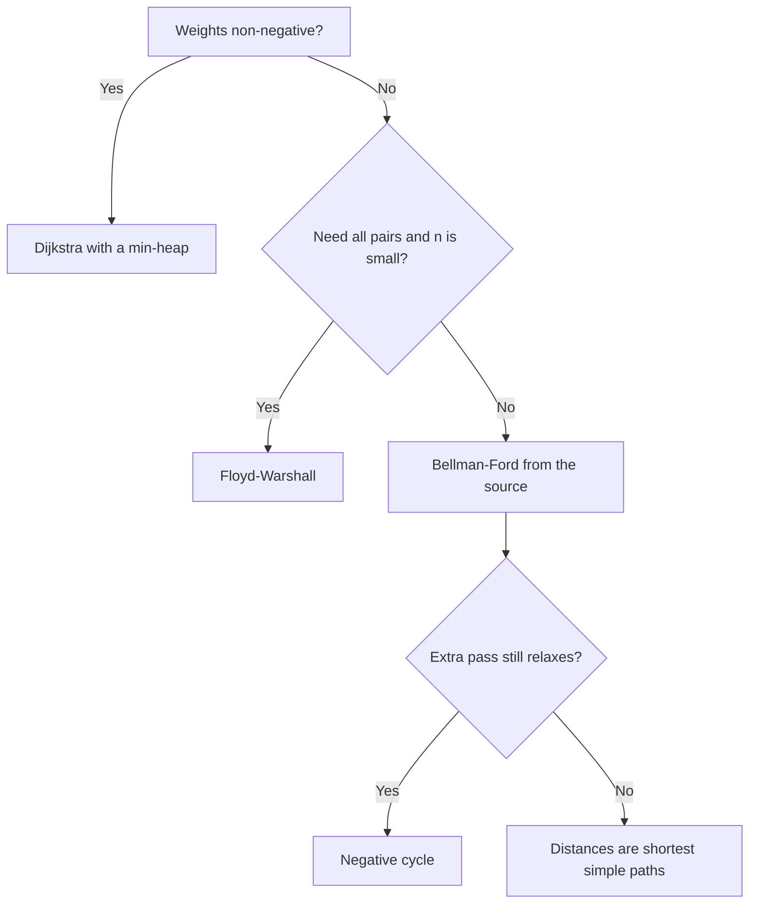

## Why this matters

BFS dies as soon as edges have different costs. The shortest path is no longer the one with the fewest edges. Dijkstra's algorithm repairs that for non-negative weights by growing a settled region. Bellman-Ford allows negative weights and detects negative cycles, at a slower cost. Floyd-Warshall computes every pair on a dense graph with a tiny piece of code and a cubic cost. Network delay, cheapest flights with a hop limit, and "is there a negative cycle" are these three algorithms. Using the wrong one is not a style issue. Dijkstra is incorrect on negative edges, and Bellman-Ford is too slow when the graph is large and the weights are safe.

## Intuition

Dijkstra is BFS with a priority queue. You always expand the unsettled node whose current distance is smallest. With non-negative weights, the first time you pop a node you can never find a cheaper path later, because any path that leaves the settled region has to pay a non-negative toll. Bellman-Ford does not trust that argument. It relaxes every edge, and it repeats that pass enough times for a simple path to have been considered, which is n - 1 passes. A cheaper update on pass n means a negative cycle. Floyd-Warshall asks, for each possible waypoint k, whether going via k improves the best path between i and j. Adding waypoints one at a time is dynamic programming on the set of allowed intermediate nodes.

## Core concept in depth

A relaxation of an edge u to v with weight w asks whether dist[v] is greater than dist[u] + w. If it is, write the smaller value and remember u as the predecessor. Every shortest-path algorithm in this lesson is a schedule for relaxations, plus a reason the schedule is enough.

Dijkstra. Set the source distance to 0 and every other distance to infinity. Push (0, source) into a min-heap. While the heap is not empty, pop the smallest distance. If it is worse than the stored distance, it is a stale copy and you skip it. Otherwise the node is settled. Relax each outgoing edge and push the neighbor with the new distance. The first time a node is settled, its distance is final, provided every weight is non-negative. Time with a binary heap is Theta((n + m) log n) when you allow duplicate entries. A Fibonacci heap is Theta(m + n log n) and is not worth coding here. If you need the path, follow predecessors back to the source and reverse them.

Negative weights break the settlement argument. A later edge could pay you to enter a node you already popped. Do not run Dijkstra. Bellman-Ford initializes distances the same way and then loops n - 1 times over all edges, relaxing each. After that, every simple-path distance is correct if no negative cycle is reachable. One more pass that still relaxes an edge proves a negative cycle reachable from the source. To detect a cycle anywhere, add a dummy source with a zero-cost edge to every node, or start the extra pass from a distance array of zeros if the problem asks "does this graph have a negative cycle" rather than "reachable from s." Time is Theta(n m). On a dense graph that is Theta(n cubed), the same order as Floyd-Warshall, with a worse constant for all-pairs.

Cheapest flights within k stops is Bellman-Ford limited to k + 1 relaxations, and you must relax from a copy of the previous pass. If you relax in place, a single pass can chain many hops and violate the stop limit. That bug is the whole problem.

Floyd-Warshall uses a matrix. dist[i][i] = 0. dist[i][j] is the edge weight or infinity. For k from 0 to n - 1, for every pair i, j, relax dist[i][j] with dist[i][k] + dist[k][j]. The k loop is outside. Swapping it inside is wrong, because you would use waypoints you have not finished computing in the right order. The algorithm handles negative weights and can detect a negative cycle when some dist[i][i] becomes negative. Time is Theta(n cubed). Space is Theta(n squared). Use it when n is a few hundred and you need every pair. Use Dijkstra from each source when the graph is sparse and weights are non-negative: that is n times (n + m) log n, which wins on sparse graphs.

Path reconstruction for Floyd stores next[i][j], the first hop, updated whenever the relaxation improves. For Dijkstra and Bellman-Ford, store the parent. A distance without a parent is enough when the problem asks only for the cost.

Unweighted graphs should stay on BFS. A heap makes them slower. 0-1 weights can use the deque version from the BFS lesson. Non-negative arbitrary weights use Dijkstra. Negative weights use Bellman-Ford or Floyd. A negative cycle on the path makes the shortest-path question undefined, because looping decreases the cost forever. Return the problem's failure value.

## Diagram and dry run



Directed edges: 0 to 1 weight 4, 0 to 2 weight 1, 2 to 1 weight 2, 1 to 3 weight 1. Dijkstra from 0.

| Pop | Settled distance | Heap idea | Distances of 0, 1, 2, 3 |
| --- | --- | --- | --- |
| start |  | (0, 0) | 0, inf, inf, inf |
| 0 | 0 | (4, 1), (1, 2) | 0, 4, 1, inf |
| 2 | 1 | (3, 1), (4, 1) | 0, 3, 1, inf |
| 1 | 3 | (4, 3) and a stale (4, 1) | 0, 3, 1, 4 |
| 3 | 4 |  | 0, 3, 1, 4 |

The stale pair for node 1 with distance 4 is ignored because 3 is already stored. The shortest path to 1 is 0, 2, 1 with cost 3, not the direct edge.

Change the edge 2 to 1 into weight -5. Dijkstra might settle 1 too early at 4 and never repair it. Bellman-Ford will. If you also add a cycle that returns to 2 with total negative weight, the extra pass reports it and the distance to nodes on that cycle is undefined.

## Runnable Python

Dijkstra with stale entries, and one Bellman-Ford that returns null on a negative cycle reachable from the source. Both are iterative. Floyd is a triple loop you can write from the recurrence without a helper.

```python
def dijkstra(graph: list[list[tuple[int, int]]], source: int) -> list[float]:
    import heapq
    n = len(graph)
    dist = [float("inf")] * n
    dist[source] = 0.0
    heap = [(0.0, source)]
    while heap:
        cost, node = heapq.heappop(heap)
        if cost != dist[node]:
            continue
        for nxt, weight in graph[node]:
            cand = cost + weight
            if cand < dist[nxt]:
                dist[nxt] = cand
                heapq.heappush(heap, (cand, nxt))
    return dist


def bellman_ford(n: int, edges: list[tuple[int, int, int]], source: int) -> list[int] | None:
    dist = [10**18] * n
    dist[source] = 0
    for _ in range(n - 1):
        updated = False
        for u, v, w in edges:
            if dist[u] + w < dist[v]:
                dist[v] = dist[u] + w
                updated = True
        if not updated:
            break
    for u, v, w in edges:
        if dist[u] + w < dist[v]:
            return None
    return dist
```

On the non-negative example, `dijkstra` reports 0, 3, 1, 4. `bellman_ford` on the same edges does too. If a negative cycle is reachable, `bellman_ford` returns null. Compare floats only when you stored floats. Prefer integers for integer weights so the stale check `cost != dist[node]` is exact. The code above uses floats because infinity is convenient. An integer sentinel works if you guard the addition against overflow of the sentinel.

## Complexity and trade-offs

| Algorithm | Weights | Time | Space | Returns |
| --- | --- | --- | --- | --- |
| BFS | unit | Theta(n + m) | Theta(n) | one source |
| Dijkstra, binary heap | non-negative | Theta((n + m) log n) | Theta(n + m) | one source |
| Bellman-Ford | any, detects negative cycles | Theta(n m) | Theta(n) | one source |
| Floyd-Warshall | any, detects negative cycles on the diagonal | Theta(n cubed) | Theta(n squared) | all pairs |
| DAG relaxation in topological order | any, no cycles by promise | Theta(n + m) | Theta(n) | one source |

On a DAG, even with negative weights, one relaxation in topological order is enough and there is no negative cycle to worry about unless the promise is false. That is the fastest shortest path you will ever get. Use it when the graph is known to be acyclic.

## Tricks, tips, and patterns

Skip stale heap entries. Copy the distance array between Bellman-Ford passes when a hop limit exists. Keep the k loop outermost in Floyd-Warshall. Initialize the source to 0 and everything else to a real infinity, not to 0. A 0 initialization makes every node look reachable at cost 0. Store parents if the path is required. For "impossible," the problem usually wants -1 when the distance stays infinite. Translate that at the end, not inside the relaxations, or you will treat -1 as a tiny weight.

## Common mistakes and edge cases

Dijkstra on a negative edge. In-place Bellman-Ford when hops are limited. Floyd with the loops nested in the wrong order. Overflow when infinity plus a weight wraps in a fixed-width integer. Using a visited set in Dijkstra that refuses to update a node before it is settled, which is actually correct only if you mark settled on pop, not on push. Marking on push is the BFS habit and it is wrong for Dijkstra, because the first push may not be the best distance. The stale-entry style marks settled on pop by the equality check. A disconnected node stays infinite. A source with a negative self-loop is a negative cycle. An empty edge list leaves only the source at 0. k = 0 in the flight problem means no flight, so only the source is reachable unless you define zero-hop carefully. Read the stop count.

## Interview notes

Ask about signs of weights and about whether you need one source or all pairs. Then name the algorithm and its bound before you code. Say the settlement sentence for Dijkstra: "non-negative weights, so the first pop is final." Say the extra pass for Bellman-Ford. Dry-run the four-node example, including the stale pair, so the interviewer sees why you do not use a visited-on-push set. If the graph is a DAG, say you will relax in topological order in linear time.

## Practice problems

1. [Network Delay Time](/practice/network-delay-time) — Dijkstra. The answer is the maximum finite distance, or the failure value if some node is unreachable.
2. [Cheapest Flights Within K Stops](/practice/cheapest-flights-within-k-stops) — Bellman-Ford with a pass limit and a copied distance array.
3. [Path With Minimum Effort and similar threshold searches can be Dijkstra or binary search plus BFS. Network delay is the clean Dijkstra drill.](/practice/network-delay-time)

## Summary and cheat sheet

- Relaxation: if dist[u] + w is smaller, update dist[v].
- Dijkstra: min-heap, non-negative weights, first pop is final, skip stale pairs. Time (n + m) log n.
- Bellman-Ford: n - 1 full passes. A successful nth pass means a negative cycle. Time n m.
- Hop limits require relaxing from the previous pass only.
- Floyd-Warshall: k outside, then i, j. Time n cubed. Negative diagonal means a negative cycle.
- DAGs: one pass in topological order, even if weights are negative.
- Unit weights: go back to BFS.

## Further reading

- [Wikipedia — Dijkstra's algorithm](https://en.wikipedia.org/wiki/Dijkstra%27s_algorithm)
- [Wikipedia — Bellman-Ford algorithm](https://en.wikipedia.org/wiki/Bellman%E2%80%93Ford_algorithm)
- [Wikipedia — Floyd-Warshall algorithm](https://en.wikipedia.org/wiki/Floyd%E2%80%93Warshall_algorithm)
- [CP-Algorithms, Dijkstra](https://cp-algorithms.com/graph/dijkstra.html)
