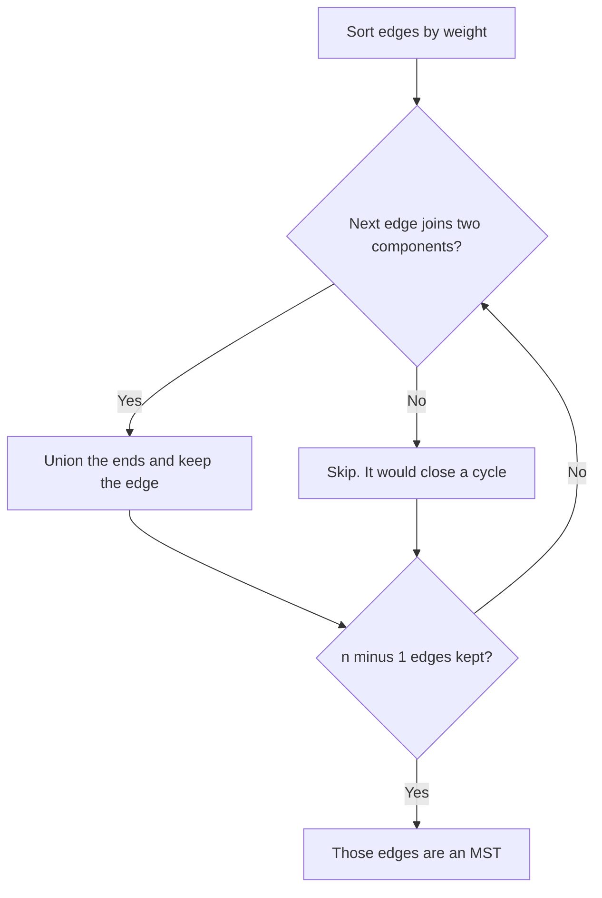

## Why this matters

A minimum spanning tree connects every node at the smallest total edge weight, without cycles. Network design, clustering, and "cheapest way to link these points" are that problem. Kruskal's algorithm sorts edges and adds one when it joins different components. Prim's algorithm grows one component by the cheapest edge that leaves it. Both need a reason to believe the greedy choice is safe, and Kruskal needs a union-find structure to recognize components in nearly constant time. The same union-find answers redundant connections and whether an undirected graph is a tree. Bridges, the edges whose removal disconnects the graph, are a different question: Tarjan's depth-first search computes them in linear time. Critical connections are that algorithm.

## Intuition

Kruskal looks at the globally cheapest edge that does not close a cycle, and trusts that some optimal tree can include it. The exchange argument says: if an optimal tree avoided that edge, adding it would create a cycle, and deleting the heaviest edge on that cycle cannot increase the cost, so you can force the cheap edge in. Prim trusts the cheapest edge leaving the grown set, for the same exchange reason: an optimal tree must cross the cut somewhere, and you can swap in the cheapest crossing edge. Union-find is the accountant. Each node starts in its own family. Find walks to the family representative. Union marries two families. A proposed edge is a cycle exactly when its ends already share a representative.

## Core concept in depth

A spanning tree of a connected undirected graph is a subset of n - 1 edges that connects every node. It is acyclic by the edge count plus connectivity, or by construction. A minimum spanning tree minimizes the sum of edge weights. If weights are distinct, the MST is unique. If not, several trees can share the minimum sum.

Union-find, or disjoint set union, stores a parent pointer. Find follows parents to the root. Path compression points every node on that walk directly at the root, or at least halfway up. Union by rank or by size attaches the shorter tree under the taller one, so the trees stay shallow. Together, any sequence of m operations on n elements costs nearly O(m + n), more precisely O(m alpha(n)) where alpha is the inverse Ackermann function, which is at most 4 for any n you will ever store. In interviews you may say "effectively constant per operation." Without compression and without rank, a union-find can degenerate into a list and become linear per find.

Kruskal sorts the edges by weight, lightest first. For each edge, if find of the two ends differs, union them and keep the edge. Stop at n - 1 edges, or scan them all if you also want to know whether the graph was disconnected. If you finish with fewer than n - 1 unions, no spanning tree exists. Time is the sort, Theta(m log m), plus the nearly linear union-find. Correctness is the cut or the exchange argument above, applied to the lightest edge that still joins two components.

Prim grows a set S, starting from any node. A min-heap stores the cheapest known edge that enters each node outside S. When you pop a node, if it is already in S you skip it. Otherwise you add it and relax its edges, decreasing the best entry cost of its neighbors. This is Dijkstra with a different relaxation: the priority is the edge weight into the node, not the path sum from the root. Time is Theta((n + m) log n) with a binary heap. On a dense graph, an array scan for the next minimum is Theta(n squared) and can be faster. Prim needs the graph to be connected or it grows only one component. Loop from unvisited starts if you need a minimum spanning forest.

A graph is a tree when it has n - 1 edges and is connected, which union-find checks: every edge unions two different roots, and you perform exactly n - 1 unions. An extra edge that joins the same root is a cycle. Redundant connection asks for that extra edge, often the last one in the input order. Run the unions in order and return the first edge whose ends share a root.

Bridges are edges that are not on any cycle. Tarjan's bridge algorithm is a DFS that records discovery time and low-link value. low[v] is the smallest discovery time reachable from v by tree edges downward and at most one back edge. When you return from a child v to a parent u, if low[v] is strictly greater than disc[u], the tree edge u-v is a bridge: the child cannot climb back to u or above u. Back edges update low with the neighbor's discovery time, and you must ignore the edge to the parent so you do not treat the tree edge as a back edge. The algorithm is linear. Articulation points, nodes whose removal disconnects the graph, use a similar low-link test: a non-root node is an articulation point when some child cannot climb to an ancestor of the node, and the root is one when it has two or more DFS children. Critical connections asks for the bridges, not the articulation points. Return them in the order the statement demands, usually sorted endpoints.

These structures assume an undirected graph for MSTs and bridges. A directed "minimum spanning tree" is a branching and is a different algorithm. Do not run Kruskal on directed edges and call it an arborescence.

## Diagram and dry run



Nodes 0, 1, 2, 3. Edges 0-1 weight 1, 1-2 weight 2, 0-2 weight 3, 2-3 weight 4.

| Edge | Roots before | Decision |
| --- | --- | --- |
| 0-1 weight 1 | all separate | keep. Union 0 and 1 |
| 1-2 weight 2 | 2 is alone | keep. Union into the 0-1 component |
| 0-2 weight 3 | same component | skip |
| 2-3 weight 4 | 3 is alone | keep |

The tree weight is 1 + 2 + 4 = 7. The edge of weight 3 is the one that would cycle.

A bridge example. A triangle 0-1-2 plus a pendant 1-3. DFS from 0 discovers the triangle and can climb back via a back edge, so none of the triangle edges is a bridge. The child 3 has low-link equal to its own discovery time, which is greater than the discovery time of 1, so 1-3 is a bridge.

## Runnable Python

Union-find with path compression and union by rank, plus Kruskal. The bridge finder is the other routine to have nearby when the question is critical connections. Both are iterative at the operation level. The bridge search is recursive DFS. Convert it to an explicit stack if the component can be deeper than the interpreter allows.

```python
class DSU:
    def __init__(self, n: int) -> None:
        self.parent = list(range(n))
        self.rank = [0] * n

    def find(self, x: int) -> int:
        while self.parent[x] != x:
            self.parent[x] = self.parent[self.parent[x]]
            x = self.parent[x]
        return x

    def union(self, a: int, b: int) -> bool:
        ra, rb = self.find(a), self.find(b)
        if ra == rb:
            return False
        if self.rank[ra] < self.rank[rb]:
            ra, rb = rb, ra
        self.parent[rb] = ra
        if self.rank[ra] == self.rank[rb]:
            self.rank[ra] += 1
        return True


def kruskal(n: int, edges: list[tuple[int, int, int]]) -> list[tuple[int, int, int]]:
    dsu = DSU(n)
    chosen: list[tuple[int, int, int]] = []
    for weight, u, v in sorted((w, u, v) for u, v, w in edges):
        if dsu.union(u, v):
            chosen.append((u, v, weight))
            if len(chosen) == n - 1:
                break
    return chosen
```

On the four-node example, `kruskal` returns the three edges of weights 1, 2, and 4. `union` returns false on the weight-3 edge. Path compression is the inner assignment `parent[x] = parent[parent[x]]`. Full compression, pointing every node at the root in one pass, is also fine. Rank stops a long chain when compression has not yet run.

## Complexity and trade-offs

| Algorithm | Time | Space | Needs |
| --- | --- | --- | --- |
| Kruskal | Theta(m log m) | Theta(n) | undirected, union-find |
| Prim, binary heap | Theta((n + m) log n) | Theta(n + m) | undirected, connected for one tree |
| DSU, m operations | Theta(m alpha(n)) | Theta(n) | the accountant, not a tree by itself |
| Tarjan bridges | Theta(n + m) | Theta(n) | undirected DFS |
| Redundant connection | Theta(n alpha(n)) | Theta(n) | exactly one extra edge in the usual problem |

Kruskal is simpler when the edges are already a list. Prim is natural when the graph is an adjacency list and you think in cuts. On points in the plane, Prim or Kruskal on the complete graph is quadratic in the number of points, which the constraints sometimes allow. A Delaunay triangulation would thin the edges. You will not build that in an interview. Say the complete graph is m = n squared.

## Tricks, tips, and patterns

Sort a copy of the edges so you do not surprise the caller. Union returns a boolean so Kruskal and redundant-connection share code. Stop Kruskal at n - 1 edges. For bridges, write disc and low, and skip the parent. Discovery time increases by one per visited node. Compare low of the child with disc of the parent, strictly greater. Equal means a back edge climbed exactly to the parent, so the edge is not a bridge. For articulation points, do not use the bridge test unchanged. A node can be an articulation point without any bridge, in a figure-eight of two cycles sharing a vertex.

## Common mistakes and edge cases

Running MST algorithms on directed graphs. Forgetting the reverse edge when you built an undirected adjacency list, so Prim never sees the way back. Union without compression and rank, then calling it nearly constant. Kruskal that adds an edge before checking find, creating a cycle in the "tree." A disconnected graph: Kruskal returns too few edges, and you must not pretend the sum of a forest is a spanning tree unless the problem asked for a forest. Self-loops. Duplicate edges: the lighter one is considered first and the heavier one is skipped if the ends are already joined. Bridges on a disconnected graph: run DFS from every unvisited node. The parent of a root is a sentinel, and the root's missing parent must not look like a back edge. Integer weights can be zero or negative. MSTs still make sense. "Minimum" with negative weights prefers the negative edges, and Kruskal handles that because it sorts.

## Interview notes

Say "lightest edge that does not cycle" for Kruskal and "lightest edge across the cut" for Prim, then give the exchange sentence in plain language. Mention union-find's two optimizations by name. If the question is only "does this edge close a cycle," you may not need a full MST. For bridges, say low-link and the strict inequality, and offer to dry-run the pendant edge. Confirm undirected. Confirm whether the graph is connected. Return the problem's failure value when a spanning tree does not exist.

## Practice problems

1. [Min Cost to Connect All Points](/practice/min-cost-to-connect-all-points) — Prim or Kruskal on a complete graph of points. The weight is the Manhattan distance.
2. [Redundant Connection](/practice/redundant-connection) — the first edge that union refuses.
3. [Graph Valid Tree](/practice/graph-valid-tree) — n - 1 successful unions.
4. [Critical Connections](/practice/critical-connections) — Tarjan bridges.
5. [Accounts Merge](/practice/accounts-merge) — union-find on emails, not on an MST.
6. [Number of Provinces](/practice/number-of-provinces) — components, by DFS or by union-find.

## Summary and cheat sheet

- An MST is n - 1 edges, connected, minimum total weight.
- Kruskal sorts edges and unions ends that lie in different components.
- Prim grows one component by the cheapest outgoing edge. The priority is the edge, not a path sum.
- Union-find: path compression and union by rank. Effectively constant time. find tells you the component.
- A tree check is n - 1 successful unions, or n - 1 edges plus one connected component.
- A bridge is a DFS tree edge whose child cannot climb to the parent or above: low[child] greater than disc[parent].
- These algorithms are for undirected graphs.

## Further reading

- [Wikipedia — Minimum spanning tree](https://en.wikipedia.org/wiki/Minimum_spanning_tree)
- [Wikipedia — Disjoint-set data structure](https://en.wikipedia.org/wiki/Disjoint-set_data_structure)
- [Wikipedia — Bridge (graph theory)](https://en.wikipedia.org/wiki/Bridge_(graph_theory))
- [CP-Algorithms, Kruskal and bridges](https://cp-algorithms.com/graph/bridge-searching.html)
