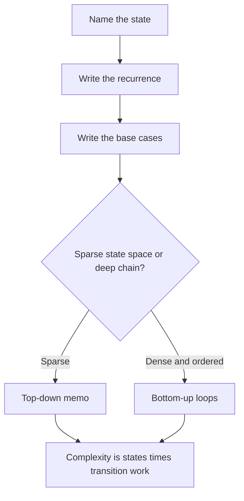

## Why this matters

Dynamic programming is what you do after you have written a correct recursion and noticed that it solves the same subproblem many times. The recursion is the specification. The table, or the memo, is the implementation that makes the specification fast enough. Climbing stairs, house robber, coin change, and edit distance are not four unrelated tricks. They are four states. Interviewers listen for the state in a sentence, the transition in a second sentence, and the complexity that follows from the size of the table. If you cannot say the state, you are guessing indices.

## Intuition

A city grid of tolls, where the toll to reach an intersection depends only on how you entered it and not on the whole history of the trip, can forget the history. The cheapest way to be at this intersection is the cheapest way to be at a legal previous intersection, plus the last step. That is optimal substructure: an optimal solution contains optimal solutions of subproblems. Overlapping subproblems means those smaller intersections are reused by many routes. If the routes never share intersections, you have divide and conquer, not dynamic programming. If the best route depends on the entire history, the state is too small and the answers will be wrong.

## Core concept in depth

Design the state first. A state is the smallest bundle of facts that lets you make the next decision. For climbing stairs, the fact is the stair index you are standing on. For house robber, it is the house index and whether you are still allowed to rob, which collapses to "the best profit from this house onward" because the adjacency rule is local. For a knapsack, it is the item index and the remaining capacity. If two histories leave you with the same bundle, they are the same state and you store one answer.

Write the transition as a recurrence. Climbing stairs: ways(n) = ways(n - 1) + ways(n - 2), with ways(0) = 1 and ways(1) = 1, or the equivalent base cases you choose and then test. House robber: rob(i) = max(value[i] + rob(i + 2), rob(i + 1)). Coin change: the minimum coins for amount a is one plus the minimum over coins c of the answer for a - c, when c is at most a. The recurrence is the algorithm. Everything else is an evaluation order.

Top-down evaluation is the recursive function plus a memo table keyed by the state. Check the memo before you recur. Store the answer before you return. This evaluates only the states you reach. It uses stack depth equal to the longest chain of dependencies. Bottom-up evaluation orders the states so that when you compute one, its dependencies are already stored. Climbing stairs fills an array from 2 to n. Knapsack fills items one by one and capacities from high to low if you are rolling the array. Bottom-up uses no recursion and makes the loops the proof of order. Prefer it when the dependency order is obvious and the stack might be deep. Prefer top-down when the state space is large but sparse, or when the recurrence is easier to trust than the loop bounds.

The time is the number of states times the work inside one transition. Climbing stairs is n states and O(1) work, so Theta(n). A 0/1 knapsack is n times capacity states and O(1) work per state, so Theta(n W). If the transition tries every coin, multiply by the number of coins. Space is the table, unless you notice that each layer reads only the previous layer or the previous two cells. Climbing stairs keeps two integers. House robber keeps two integers. A knapsack that processes items one at a time can keep one array of size W, iterating the capacity downward so a cell is not reused inside the same item. Iterating upward on that array turns 0/1 into unbounded, which is a real algorithm for the other problem and a bug for this one.

Base cases are part of the specification. ways(0) = 1 means there is one way to stand still. The minimum coins for amount 0 is 0. The minimum coins for an unreachable amount must be an infinity you recognize, not a 0 that looks like success. Off-by-one base cases are the bugs that survive a single example and fail the empty input.

Reconstruction, when the problem asks for the choices and not only the value, stores a predecessor or replays the recurrence from the stored answers. Do not store every full subset in the cell. Store the decision, and walk it at the end. That keeps the space equal to the number of states rather than the number of states times the solution size.

A problem is not dynamic programming just because it has a maximum in it. Greedy problems have a local choice you can prove without trying all of them. DP is what remains when several choices could be optimal and only the subproblem answers can tell them apart. If the constraints show n up to 10 to the 5th and your state is n squared, the state is too big. Look for a greedy, a heap, or a tighter state.

## Diagram and dry run



Climbing stairs, n = 5. ways(0) = 1, ways(1) = 1.

| Stair | Recurrence | Value |
| --- | --- | --- |
| 2 | 1 + 1 | 2 |
| 3 | 2 + 1 | 3 |
| 4 | 3 + 2 | 5 |
| 5 | 5 + 3 | 8 |

House robber on values 2, 7, 9, 3, 1. Let best_skip be the best answer not using the current house's predecessor, and best_take the best that did. Walking left to right, the answer at each house is the max of skipping it (previous answer) and taking it (value plus the answer from two houses ago). The numbers are 2, then max(2, 7) = 7, then max(7, 9 + 2) = 11, then max(11, 3 + 7) = 11, then max(11, 1 + 11) = 12. The optimal robbery is 2, 9, 1 or 7 and 3 and... 7 + 3 + 1 = 11, and 2 + 9 + 1 = 12. The table found 12.

## Runnable Python

The memoized recursion and the rolling loop for climbing stairs are the same recurrence. House robber is the loop you should generalize. Both bottom-up versions are iterative. The memoized version is the recursive form.

```python
def climb_memo(n: int) -> int:
    memo = [-1] * (n + 1)

    def ways(k: int) -> int:
        if k <= 1:
            return 1
        if memo[k] == -1:
            memo[k] = ways(k - 1) + ways(k - 2)
        return memo[k]

    return ways(n)


def climb_loop(n: int) -> int:
    if n <= 1:
        return 1
    prev, cur = 1, 1
    for _ in range(2, n + 1):
        prev, cur = cur, prev + cur
    return cur


def rob(nums: list[int]) -> int:
    prev, cur = 0, 0
    for value in nums:
        prev, cur = cur, max(cur, prev + value)
    return cur
```

`climb_loop(5)` is 8. `rob` on 2, 7, 9, 3, 1 is 12. The robber's `prev` is the best up to but not including the previous house, which is exactly "two houses ago" after the rotation in the assignment. Write the assignment as a tuple swap so you do not overwrite cur before prev reads it.

## Complexity and trade-offs

| Problem | States | Transition | Time | Space |
| --- | --- | --- | --- | --- |
| Climbing stairs, rolling | n | O(1) | Theta(n) | Theta(1) |
| Climbing stairs, naive recursion | n, recomputed | two calls | Theta(phi to the n) | Theta(n) stack |
| House robber | n | O(1) | Theta(n) | Theta(1) |
| 0/1 knapsack | n times W | O(1) | Theta(n W) | Theta(W) rolled |
| Coin change, amount A, c coins | A | O(c) | Theta(A c) | Theta(A) |

Top-down and bottom-up share the state complexity. They differ in constants, in stack risk, and in whether unused states are allocated. A hash map memo saves memory on sparse states and costs more per lookup than an array. Use an array when the state is a dense integer range.

## Tricks, tips, and patterns

Say the state out loud before you declare an array. If you cannot finish the sentence "the answer for this state is the min or max of ...", you do not have a recurrence. Match the loop direction to the dependency. Upward loops for prefixes. Downward loops for a rolling 0/1 knapsack. Initialize unreachable states to infinity for minima and to a neutral 0 or negative infinity for maxima, and do not let infinity plus a number overflow. Test n = 0, n = 1, and a case where the optimal choice skips a tempting early value.

## Common mistakes and edge cases

A memo that is checked after the recursive calls, which does nothing. An array of size n indexed at n. Base case ways(0) = 0, so every answer collapses. Using the rolling knapsack in the wrong direction and counting an item twice. Storing the full path in every cell. Calling a greedy coin choice "DP" when the coin system is not canonical. Forgetting that house robber on a circle is two linear problems, not one, because the first and last houses conflict. That variant is in the next lesson. Integer answers that exceed 32 bits in other languages. In Python they do not. Empty input returns the base case, usually 0.

## Interview notes

Use four sentences. State: "best from this index onward." Transition: "take it and skip the next, or skip it." Base: "past the end is 0." Complexity: "n states, constant work, linear time, constant space with two variables." Then code the loop. If you get stuck, write the naive recursion, point at a duplicated call on a small n, and add a memo. That path is slower to type and easier to justify. Dry-run the robber array above. It is the example where taking the first house wins, so a greedy "always take the larger neighbor" story fails.

## Practice problems

1. [Climbing Stairs](/practice/climbing-stairs) and [Fibonacci Number](/practice/fibonacci-number).
2. [House Robber](/practice/house-robber) and [House Robber II](/practice/house-robber-ii).
3. [Min Cost Climbing Stairs](/practice/min-cost-climbing-stairs).
4. [Coin Change](/practice/coin-change) — the minimum-coins recurrence.

## Summary and cheat sheet

- State, transition, base case, evaluation order. That is the whole method.
- Overlapping subproblems plus optimal substructure. No overlap means you should not memoize for speed.
- Time is states times transition work. Space is the table, or the layers you actually reread.
- Top-down is recursion plus memo. Bottom-up is loops in dependency order.
- Roll the array when a layer only needs the previous layer. Reverse the loop when a layer must not reuse a cell.
- Naive Fibonacci-style recursion is the specification, not the answer, when n is large.

## Further reading

- [Wikipedia — Dynamic programming](https://en.wikipedia.org/wiki/Dynamic_programming)
- [Wikipedia — Memoization](https://en.wikipedia.org/wiki/Memoization)
- [CP-Algorithms, introduction to DP](https://cp-algorithms.com/dynamic_programming/intro-to-dp.html)
