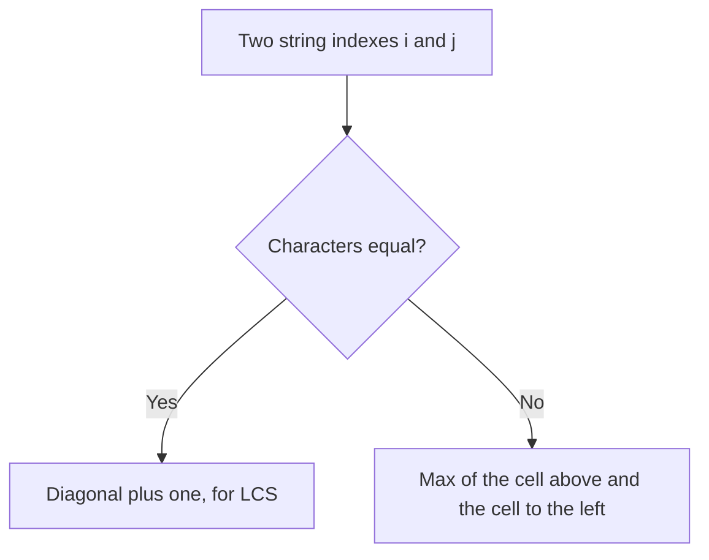

## Why this matters

After the framework, the interviews repeat a handful of families. Knapsack and coins are decisions on a capacity. Longest common subsequence and edit distance are decisions on two strings. Longest increasing subsequence is a decision on a sequence, with a patient sorting trick that improves the bound. Grid paths are knapsacks on two indexes. Interval DP, including burst balloons, decides a last cut inside a span. If you can name the family, you can usually write the state. If you invent a new state for each title, you will run out of time.

## Intuition

A knapsack packs items into a weight budget, each item used once or many times. A string DP walks two cursors and pays for a match, a skip, or a substitution. A grid DP walks only right and down, so each cell has two predecessors. An interval DP says: I do not know the first cut, but I know the last action inside this span, and the two sides of that action are smaller intervals. The families are different shapes of the same sentence. The last decision reduces the state to something already solved.

## Core concept in depth

0/1 knapsack. Items have weight and value. State dp[i][w] is the best value using the first i items with capacity w. Transition: skip the item, or take it when the weight fits, adding its value to dp[i - 1][w - weight]. The rolled array iterates items forward and capacity backward. Unbounded knapsack, where each item may be used any number of times, iterates capacity forward so the same item can be picked again inside the layer. Coin change for the minimum number of coins is an unbounded knapsack on the amount, with value replaced by one coin of cost. Coin change II, the number of combinations, is the same loop with sums instead of minima, and the loop order decides whether you count combinations or permutations. Iterating coins outside and amount inside counts combinations. Iterating amount outside counts permutations, because order of coins becomes distinct. Read the problem. Combinations and permutations are different numbers.

Longest common subsequence. dp[i][j] is the LCS length of the first i characters of s and the first j of t. If the characters match, the answer is 1 plus dp[i - 1][j - 1]. Otherwise it is the max of dropping a character from either string. Time and space are Theta of the product of the lengths. A rolling row drops the space to Theta of the shorter length if you only need the length. Reconstruction walks from the end and emits a character when the match transition was used.

Edit distance allows insert, delete, and replace, each of cost 1. The match case costs 0 plus the diagonal. Insert and delete are the two neighbors. Replace is the diagonal plus 1. The base cases are the first row and column: turning a string into empty takes a deletion per character. This is the Levenshtein distance. The state is the same shape as LCS. Do not mix their transitions.

Longest increasing subsequence. The quadratic DP sets dp[i] to the longest increasing subsequence that ends at i, which is 1 plus the maximum dp[j] for j less than i and nums[j] less than nums[i]. The n log n method maintains the smallest possible tail of all increasing subsequences of each length. For each value, binary-search the leftmost tail that is at least the value and replace it, or append if the value extends every tail. The array length is the answer. The array is not the subsequence. Reconstruction needs extra parent pointers. Patience sorting is this algorithm. Use the quadratic DP when n is a few thousand. Use the tails when n is 10 to the 5th.

Grid paths. Unique paths on a grid moving only right and down: dp[r][c] = dp[r - 1][c] + dp[r][c - 1], with the first row and column equal to 1 if those cells are open. Obstacles zero a cell and block the sum. Minimum path sum replaces the sum with a min and adds the cell cost. The space rolls to one row. A grid that also allows up and left is not acyclic, and this DP is invalid. That problem is a graph search.

Interval DP. Burst balloons and matrix-chain multiplication share a span. Let dp[l][r] be the best score for bursting every balloon strictly between l and r, with l and r already the boundaries. The last balloon k you burst between them scores nums[l] times nums[k] times nums[r], plus the two subspans. Try every k. Fill by increasing span length so the subspans are ready. Time is Theta(n cubed). The same loop multiplies matrices: the last multiplication splits the chain. If you see "last cut of an interval" or "burst this one last," write this state. A recursion on the first burst is correct and much harder to memoize, because the neighbors change.

House robber II is a circle: run the linear robber on the range that excludes the first house, and on the range that excludes the last, and take the max. The empty and single-house cases are the overlap of those ranges. Do not double-count a one-house village.

## Diagram and dry run



LCS of "ace" and "abcde". Rows are ace, columns are abcde. The match of a, then no match on b, match of c against c, match of e against e. The length is 3, and one subsequence is a, c, e.

Coin change. Coins 1 and 3, amount 4. Combinations, coins outer.

| Amount | After coin 1 | After coin 3 |
| --- | --- | --- |
| 0 | 1 way, take nothing | 1 |
| 1 | 1 | 1 |
| 2 | 1 | 1 |
| 3 | 1 | 2, namely 1+1+1 and 3 |
| 4 | 1 | 2, namely four 1s, and 3+1 |

If the loops were swapped you would also count 1+3 as different from 3+1. Minimum coins for 4 is 2, using 1 and 3, from the other recurrence.

## Runnable Python

Unbounded coin change for the minimum count, and the quadratic LIS. The coin function is iterative. LIS is iterative. A recursive memo of LIS is natural and risks a deep stack. The loops are the interview versions.

```python
def coin_change(coins: list[int], amount: int) -> int:
    inf = amount + 1
    dp = [0] + [inf] * amount
    for a in range(1, amount + 1):
        for coin in coins:
            if coin <= a:
                dp[a] = min(dp[a], dp[a - coin] + 1)
    return dp[amount] if dp[amount] <= amount else -1


def lis_length(nums: list[int]) -> int:
    tails: list[int] = []
    for value in nums:
        lo, hi = 0, len(tails)
        while lo < hi:
            mid = (lo + hi) // 2
            if tails[mid] < value:
                lo = mid + 1
            else:
                hi = mid
        if lo == len(tails):
            tails.append(value)
        else:
            tails[lo] = value
    return len(tails)
```

`coin_change` on coins 1, 3 and amount 4 returns 2. An amount that cannot be made, such as coins 2 and 4 with amount 3, returns -1 because the cell stays above the amount. `lis_length` on 10, 9, 2, 5, 3, 7, 101, 18 returns 4. The tails array is not the subsequence 2, 3, 7, 18. It is a sequence of best tails. Do not print it as the answer unless you stored parents.

## Complexity and trade-offs

| Family | Time | Space | Watch |
| --- | --- | --- | --- |
| 0/1 knapsack | Theta(n W) | Theta(W) | loop capacity downward |
| Unbounded coins, minimum | Theta(amount times coins) | Theta(amount) | infinity for impossible |
| Combinations of coins | same | same | coin loop outside |
| LCS or edit distance | Theta(n m) | Theta(min(n, m)) rolled | different transitions |
| LIS quadratic | Theta(n squared) | Theta(n) | easy to reconstruct |
| LIS tails | Theta(n log n) | Theta(n) | the array is not the subsequence |
| Interval DP | Theta(n cubed) | Theta(n squared) | fill by span length |

If W is 10 to the 9th, the knapsack table does not fit. Look for a meet-in-the-middle split, a greedy exchange, or a feasibility binary search. If both strings have length 10 to the 5th, the LCS table does not fit either. The interview constraints are part of the family choice.

## Tricks, tips, and patterns

Draw the LCS cell and its three neighbors before you fill anything. For knapsacks, write "0/1 means backward, unbounded means forward" on the paper. For LIS tails, the binary search is a lower bound. For interval DP, include the sentinel boundaries, the way burst balloons adds balloons of value 1 at both ends, so the formula has neighbors. For a circular house row, solve two linear ranges. For grid DP, set the obstacle cell to 0 before the neighbors add into it.

## Common mistakes and edge cases

Counting permutations when the problem asks for combinations. A coin of value 0, which loops forever if you are not careful. It should be excluded. Edit distance that charges 1 for a match. LIS that uses a non-strict comparison when the sequence must be strictly increasing. Interval DP that indexes the last burst outside the open interval and double-counts the boundary. House robber II that runs one linear pass and also allows both ends. Empty coins, amount 0, which is 0 coins. Empty string LCS, which is 0. A grid with an obstacle on the start cell, which has 0 paths.

## Interview notes

Name the family, then the state, then the loop direction. For coins, ask "combinations or permutations?" if the statement is ambiguous, and point at the loop order as your interpretation. For LIS, give the quadratic answer first if n is small, and mention n log n if n is large. For edit distance, write the three operations in the cell diagram. Dry-run a 3 by 5 LCS or a four-dollar coin change. Those fit on a corner of the board. Interval DP is the one to bring up only when the problem says last burst, last cut, or matrix chain. Do not force it onto a linear house robber.

## Practice problems

1. [Coin Change](/practice/coin-change) and [Coin Change II](/practice/coin-change-ii).
2. [Knapsack](/practice/knapsack) and [Partition Equal Subset Sum](/practice/partition-equal-subset-sum).
3. [Longest Common Subsequence](/practice/longest-common-subsequence) and [Edit Distance](/practice/edit-distance).
4. [Longest Increasing Subsequence](/practice/longest-increasing-subsequence).
5. [Unique Paths](/practice/unique-paths) and [Minimum Path Sum](/practice/minimum-path-sum).
6. [Burst Balloons](/practice/burst-balloons) and [Rod Cutting](/practice/rod-cutting).

## Summary and cheat sheet

- 0/1 knapsack loops capacity downward. Unbounded loops forward. Coin combinations keep the coin loop outside.
- LCS match is the diagonal plus one. Otherwise the max of dropping either side.
- Edit distance adds insert, delete, and replace to that picture, and a match is free.
- LIS is n squared with an end-at-i state, or n log n with binary search on tails.
- Grid DP needs an acyclic move set. Right and down is the usual one.
- Interval DP tries the last cut and fills short spans first. Time is n cubed.
- A circle is two linear subproblems when the first and last choices conflict.

## Further reading

- [Wikipedia — Knapsack problem](https://en.wikipedia.org/wiki/Knapsack_problem)
- [Wikipedia — Longest common subsequence](https://en.wikipedia.org/wiki/Longest_common_subsequence)
- [Wikipedia — Levenshtein distance](https://en.wikipedia.org/wiki/Levenshtein_distance)
- [CP-Algorithms, longest increasing subsequence](https://cp-algorithms.com/sequences/longest_increasing_subsequence.html)
