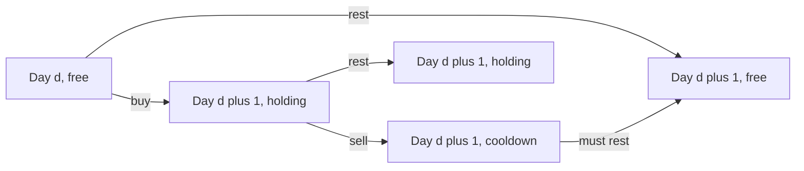

## Why this matters

Some states are not a single index. A traveling salesman on 15 cities can afford a state that is a subset of visited cities plus the current city, because 2 to the 15 times 15 is half a million. A digit DP walks a number one digit at a time and remembers whether it is still tight against the upper bound. A tree DP roots the tree anywhere and combines children. A stock state machine remembers whether you hold a share and whether you are cooling down. These are the same framework with a richer key. Interviewers use them to see whether "DP" for you means one memorized table or a way to invent a state.

## Intuition

If the future depends on a set, put the set in the state, and hope the set is small enough to bitmask. If the future depends on a prefix of a number and on whether you have already chosen a smaller digit, put that boolean in the state. If the future depends on a subtree, compute the subtree first, which is postorder, and pass a summary to the parent. If the future depends on a mode, such as holding or not holding, the mode is one dimension of the state and the day is the other. You are not learning four algorithms. You are packing the memory of the process into the smallest key that still determines the optimum.

## Core concept in depth

Bitmask DP. Label the objects 0 through n - 1 with n at most about 20. A mask is an integer whose bits say which objects are in the subset. The traveling salesman state is (mask, j): the minimum cost of a path that has visited exactly the cities in the mask and ends at j. The transition comes from a previous city i that is also in the mask: dp[mask][j] is the min of dp[mask without j][i] plus the edge i to j. The start is dp[1 shifted left by the start city][start] = 0. The answer is the min over j of dp[full mask][j] plus the edge back, if the tour must return. Time is Theta(2 to the n times n squared) if every pair is tried, because each state looks at n previous cities. Space is Theta(2 to the n times n). For n = 20 that is about 20 million states, which is the edge of what a tight implementation can do and more than a casual Python loop should promise. For n = 15 it is comfortable. Subset sums of a small set can also be masks. When n is 40, masks do not fit, and meet-in-the-middle splits the set in half. That technique is in the advanced-techniques lesson.

Digit DP counts numbers up to R whose digits satisfy a property, such as "the digit sum is 10" or "no repeated digit." The state is the position in the decimal representation, the running property, and a tight flag. tight is true when every digit chosen so far matches the prefix of R, which means the next digit cannot exceed R's digit at this position. Once you place a smaller digit, tight becomes false and later digits may be anything from 0 to 9. A leading-zero flag is the other boolean people forget, because leading zeros should not count as digits in a "no repeat" constraint. The recurrence tries each legal next digit and calls the next position. Memoize on (position, property, tight, leading). The number of positions is the number of digits, about 18 for a 64-bit integer, so the table is small even when the property is a digit sum up to a few hundred. Count one side of a range by f(R) - f(L - 1), and define f(negative) as 0. This is the standard way to answer "how many integers in a range" without looping over the range.

Tree DP. Root the tree at any node if it is unrooted. A postorder computes a vector of answers for each subtree. House robber III is the example you already trust: each subtree returns two numbers, the best if this node is robbed and the best if it is not. If it is robbed, the children must not be robbed, so you add their "not robbed" answers. If it is not robbed, each child contributes the max of its two answers. The root returns the max of its two numbers. Time is linear. Any tree problem whose choice is local to a node and whose children are independent given that choice is this shape. Diameter was a tree DP that returned a height and updated a global best. You have been doing tree DP since the traversal lesson.

State-machine DP. A stock problem with cooldown has three modes: holding a share, not holding and free to buy, and cooling down after a sale. Each day, holding can stay holding or sell into cooldown. Free can stay free or buy into holding. Cooldown must become free. The transitions are a constant number, so one day is O(1) and n days are linear. You can roll the three variables. Best time to buy and sell with cooldown is exactly this machine. Unlimited transactions without cooldown are a simpler machine with two modes, and there is also a greedy reading: add every upward difference. The greedy is right for that special case and wrong as soon as a fee or a cooldown appears. When the constraints add a fee, subtract it on the sell transition. When they add a limit of k transactions, add k to the state, and the time becomes n times k.

Bitmask and digit and tree and machine states compose. A tree DP can return a bitmask summary when the subtree alphabet is tiny. A digit DP can track a small mask of used digits. Do not compose them until the separate versions are correct. Write one new bit of state, check the base case, then the transition.

## Diagram and dry run



Prices 1, 2, 3, 0, 2, with a one-day cooldown after each sale. One optimal policy buys at 1, sells at 3, waits out the cooldown on the 0, and buys... the 0 is the cooldown day if you sold on the 3, so you cannot buy the 0. You can buy the 2, but selling it needs a later day you do not have. The profit of buy 1 and sell 3 is 2. Buying at 0 is impossible under that schedule and unnecessary: buy 1, sell 2, cooldown on 3, buy 0, sell 2. Profit is (2 - 1) + (2 - 0) = 3, and the cooldown day is the 3, which you correctly skipped. The state machine finds 3. A greedy "sell every rise" would try to sell 1 to 2 and 2 to 3 without a cooldown and would be illegal.

Traveling salesman on three cities in a triangle with costs 1, 1, and 3. Starting at 0, the mask that has visited everyone and ends at 1 or 2, plus the return edge, picks the tour that uses the two cheap edges and one expensive edge. The cost is 1 + 1 + 3 = 5, the only Hamiltonian tour up to direction. The DP still tries both directions. On three cities that is the whole table.

## Runnable Python

The stock cooldown machine uses three rolling variables. House robber III is the tree DP. Both are the forms to adapt. The salesman is a bottom-up mask loop for a complete graph given as a matrix. Keep n tiny in tests.

```python
def max_profit_cooldown(prices: list[int]) -> int:
    free = 0
    held = float("-inf")
    cool = 0
    for price in prices:
        free, held, cool = max(free, cool), max(held, free - price), held + price
    return max(free, cool)


class Node:
    def __init__(self, value: int, left: "Node | None" = None, right: "Node | None" = None) -> None:
        self.value = value
        self.left = left
        self.right = right


def rob_tree(root: Node | None) -> int:
    def dfs(node: Node | None) -> tuple[int, int]:
        if node is None:
            return 0, 0
        left, right = dfs(node.left), dfs(node.right)
        robbed = node.value + left[1] + right[1]
        skipped = max(left) + max(right)
        return robbed, skipped

    return max(dfs(root))
```

The tuple assignment in `max_profit_cooldown` reads the old free, held, and cool on the right-hand side, so the transitions do not see the new values too early. `held` starts at negative infinity because holding nothing and pretending you hold a share would allow a fake sale. After prices 1, 2, 3, 0, 2 the function returns 3. `rob_tree` on a single node returns the node value. On a null root it returns 0.

## Complexity and trade-offs

| Kind | State size | Time | When it fits |
| --- | --- | --- | --- |
| Bitmask TSP | 2 to the n times n | times another n | n up to about 15 in Python, 20 in a tight language |
| Digit DP | digits times property times 2 | times 10 | ranges up to 10 to the 18 |
| Tree DP | n nodes times a small vector | Theta(n) times combine cost | any tree you can traverse |
| Stock machine | n times modes times k | Theta(n k) | k small, or roll the day |
| Plain index DP | n or n squared | the family bound | the previous lesson |

A bitmask on n = 40 is impossible. Say so and switch to meet-in-the-middle or an approximation. A digit DP that loops over the numeric range instead of the digits has abandoned the point. A tree DP that also passes the entire path as a state becomes exponential. Pass a summary.

## Tricks, tips, and patterns

Enumerate submasks, when you need them, by `sub = mask; while sub: ...; sub = (sub - 1) & mask`. That walks submasks in time proportional to the number of submasks, not to 2 to the n per mask, across all masks the total is 3 to the n. You need this for some subset DP, not for the basic salesman. For digit DP, write the tight transition on paper for the number 20, so you see the digit 2 freeze the first position. For stocks, draw the modes and the legal edges before the variables. For trees, return a tuple, not a single number, when the parent needs to know how the subtree optimum was achieved.

## Common mistakes and edge cases

Updating a bitmask state from a mask that has not been computed, because the loop over masks was not increasing. The salesman must iterate masks in increasing order of popcount, or simply in integer order, which already respects "submask before mask" if you only look at masks with the bit removed and that mask is numerically smaller. It is, because clearing a bit decreases the integer. Rely on that. Digit DP off-by-one on the last position, counting the number itself twice or not at all. Forgetting leading zeros. Stock transitions that buy and sell on the same day when the statement forbids it. Cooldown machines that allow a buy on the cooldown day. Tree DP that robs a node and also adds the robbed child value. Negative infinity that leaks into a max with a real profit and wins because you compared wrong. In Python, `max(0, float("-inf"))` is 0, which is what you want for "do nothing." An empty price list returns 0.

## Interview notes

When the constraint on n is 15 or 20 and the problem says visit every city or assign every mask, say bitmask. When the problem says numbers from L to R with a digit property, say digit DP and name the tight flag. When the input is a tree and the choice is rob or not, return two numbers per subtree. When the problem is stocks with a cooldown or a fee, draw three modes. Give the state size as a product you computed from the constraints, so the interviewer sees that the table fits. Do not say "DP" without the key.

## Practice problems

1. [House Robber III](/practice/house-robber-iii) — the tree pair.
2. [Best Time to Buy and Sell Stock with Cooldown](/practice/best-time-to-buy-and-sell-stock-with-cooldown).
3. [Best Time to Buy and Sell Stock II](/practice/best-time-to-buy-and-sell-stock-ii) — the two-mode machine, also solvable by summing rises.
4. [Target Sum](/practice/target-sum) — a knapsack in disguise, or a small mask when the array is tiny.
5. [Partition Equal Subset Sum](/practice/partition-equal-subset-sum).

## Summary and cheat sheet

- Put into the state exactly the memory the future needs.
- Bitmasks fit when n is about 20 or less. TSP is (mask, last city).
- Digit DP walks digits, with a tight flag and usually a leading-zero flag. Answer range queries by subtraction.
- Tree DP is a postorder summary. House robber III returns robbed and skipped.
- Stock problems are small state machines. Cooldown adds a mode. A fee is a cost on the sell edge.
- Time is still states times transition work. If that product does not fit, the state is wrong or the problem is not this DP.

## Further reading

- [Wikipedia — Travelling salesman problem, the Held-Karp section](https://en.wikipedia.org/wiki/Held%E2%80%93Karp_algorithm)
- [Wikipedia — Dynamic programming](https://en.wikipedia.org/wiki/Dynamic_programming)
- [CP-Algorithms, digit DP](https://cp-algorithms.com/dynamic_programming/digit-dp.html)
