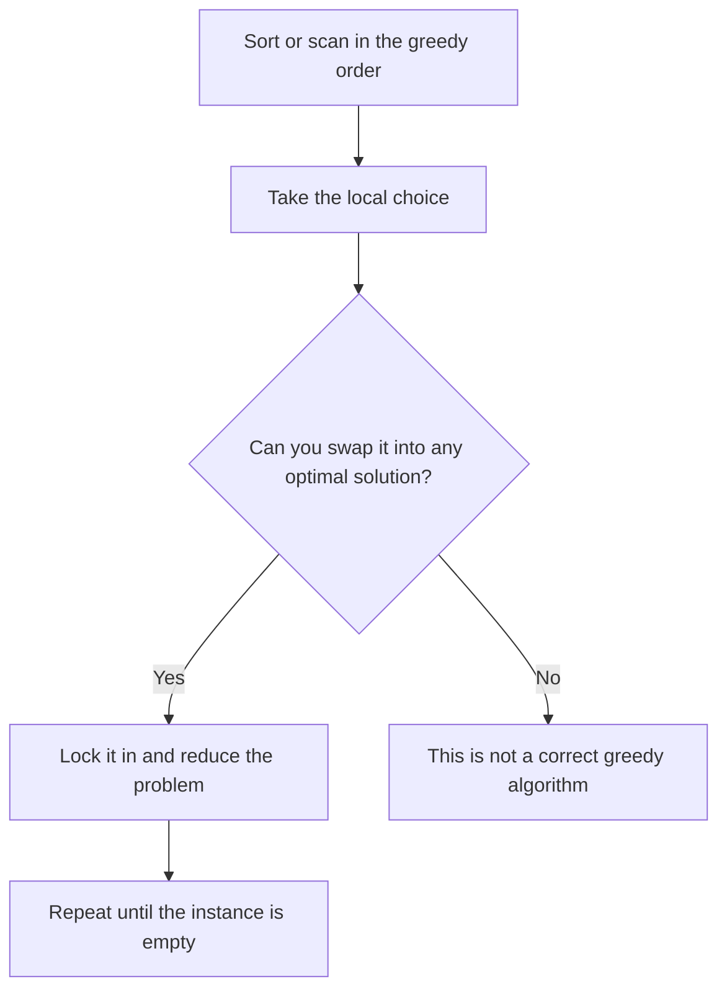

## Why this matters

A greedy algorithm locks in a choice and never reconsiders it. When the choice is safe, the algorithm is short and fast. When it is not, the algorithm is a confident wrong answer. The skill is the proof, not the loop. Interval scheduling, jump game, gas stations, and Huffman coding are safe. Coin systems that are not canonical are not. Interviewers ask "why is this safe?" because they have seen the coin bug. You should answer with an exchange argument or a stay-ahead argument, in words, before you code.

## Intuition

An exchange argument says: take any optimal solution that disagrees with your first choice. Swap your choice in and something else out, and show the result is still optimal. Then there exists an optimal solution that agrees with you, and you repeat. A stay-ahead argument says: after each step, your partial solution is at least as good as any other partial solution, under a measure you name. If you cannot finish either argument, try dynamic programming or admit the choice is a heuristic.

## Core concept in depth

Activity selection, also the non-overlapping interval problem, sorts by finishing time and keeps an activity when it starts after the last kept finish. The exchange argument: among the activities that fit in the remaining suffix, the one that finishes first leaves the largest possible suffix. Any optimal solution that picked something else can swap in the early finisher without losing feasibility or count. Sorting by start time does not have this argument. A counterexample is a long activity that starts first and blocks three short ones.

Jump game asks whether you can reach the last index, where nums[i] is the farthest jump from i. Walk left to right and track the furthest index you can reach. If your scan index ever passes that furthest index, you are stuck. If the furthest index reaches the end, you can. This is greedy because extending the frontier never requires revisiting an earlier jump: any path that reached a later index already implies the frontier is at least that far. Jump game II asks for the minimum number of jumps. The same frontier, counted in layers like a BFS on the implicit jump graph, is linear. A DP of "minimum jumps to i" is correct and quadratic. The layer scan is the one that fits large n.

Gas station gives gas[i] and cost[i] for a circular route. The total gas must be at least the total cost, or the trip is impossible. If it is possible, the start is the index just after the lowest prefix of gas minus cost, equivalently the station after the longest stretch where the running tank would have gone negative. One pass computes the total and the candidate start: whenever the tank goes negative, the next station becomes the new candidate and the tank resets. The proof: if a start fails at some station, every station in between fails too, because they began with no more fuel than the failed start had when it passed them. So you never need to retry the skipped region.

Huffman coding builds an optimal prefix code by repeatedly merging the two lightest nodes. A prefix code means no codeword is a prefix of another, so the encoded bitstream is unambiguous. The exchange argument is that the two least frequent symbols can sit as siblings at the deepest level. A heap implements the merges in n log n. Interviewers may only want the argument and the tree shape, not a full bit-encoder.

When greedy fails. The coin system 1, 3, 4 and the amount 6: greedy takes 4 and then two 1s, three coins, while two 3s use two coins. Canonical coin systems, including standard US denominations, happen to make the greedy choice optimal. A general coin system needs the unbounded knapsack DP. If you cannot prove the exchange, do not ship the greedy code as a correct algorithm. You may still use it as a heuristic and say so.

Other safe patterns you have already met. Dijkstra is greedy on non-negative weights, with the settlement proof instead of a scheduling proof. Kruskal and Prim are greedy on cuts. A stack that removes a larger digit when a smaller digit follows, in remove-k-digits, is greedy with an exchange argument about the leftmost place where the number can be smaller. Task scheduler with cooldown has a formula based on the most frequent task, and a heap simulation. The formula is greedy: you must separate the most frequent tasks by the cooldown, and the idle slots are filled by other tasks or left empty.

Matroids are the textbook setting where greedy is optimal for a weight function. You do not need the axioms in a coding interview. You need one exchange argument per problem. If the interviewer says "prove it," give the swap. If you cannot, switch families.

## Diagram and dry run



Activities as half-open intervals of finish-then-start. Activities (1, 4), (3, 5), (0, 6), (5, 7), (8, 9), (5, 9). Sorted by finish: (1, 4), (3, 5), (0, 6), (5, 7), (8, 9), (5, 9).

| Considered | Last finish | Decision |
| --- | --- | --- |
| 1 to 4 | none | keep. Finish becomes 4 |
| 3 to 5 | 4 | starts before 4, skip |
| 0 to 6 | 4 | skip |
| 5 to 7 | 4 | keep. Finish becomes 7 |
| 8 to 9 | 7 | keep |
| 5 to 9 | 9 | skip |

Three activities. The long one from 0 to 6 was the trap for a start-time sort.

Gas 1, 2, 3, 4, 5 and cost 3, 4, 5, 1, 2. Differences -2, -2, -2, 3, 3. The tank goes negative through the first three stations. The candidate becomes index 3. The total of differences is 0, so a trip exists, and index 3 works: the surplus at the end of the array covers the deficit at the beginning.

## Runnable Python

Jump reachability and the gas-station start are both one pass. The recursive formulation of jump, "try every jump," is the exponential specification. It is included only as the thing the greedy replaces. Do not ship it for large n.

```python
def can_jump(nums: list[int]) -> bool:
    reach = 0
    for i, jump in enumerate(nums):
        if i > reach:
            return False
        reach = max(reach, i + jump)
    return True


def can_complete_circuit(gas: list[int], cost: list[int]) -> int:
    total = tank = 0
    start = 0
    for i, (g, c) in enumerate(zip(gas, cost)):
        total += g - c
        tank += g - c
        if tank < 0:
            start = i + 1
            tank = 0
    return start if total >= 0 else -1
```

`can_jump` on 2, 3, 1, 1, 4 returns true. On 3, 2, 1, 0, 4 it returns false because index 3 is a zero and the reach dies there before the last index. `can_complete_circuit` on the gas example returns 3. If every difference is negative in total, it returns -1 even if a local tank looked fine.

## Complexity and trade-offs

| Problem | Greedy | If you refuse to prove it |
| --- | --- | --- |
| Activity selection | Theta(n log n) sort, then linear | interval DP is slower |
| Jump I and II | Theta(n) | quadratic DP |
| Gas station | Theta(n) | try every start, quadratic |
| Huffman | Theta(n log n) | exponential code search |
| General coins | not greedy | unbounded knapsack |
| Non-negative shortest paths | Dijkstra | Bellman-Ford still correct, slower |

Greedy is not a complexity class. It is a proof style. A linear greedy and a linear DP can solve different problems. Compare proofs, not slogans.

## Tricks, tips, and patterns

Sort by the endpoint the exchange argument names. Finish time for scheduling. End coordinate for bursting balloons. Leftmost digit for the smallest number after deletions. Track a frontier for jumps. Track a tank and a candidate start for gas. If the total resource is insufficient, fail before you trust the candidate. When a counterexample exists, switch to DP and keep the greedy as a comment about what does not work.

## Common mistakes and edge cases

Sorting activities by start. Jump game that returns true because the first jump is large, without scanning the hole in the middle. Gas station that returns 0 whenever the total is enough, even if station 0 cannot complete. An off-by-one that starts at `start` equal to n, which is index 0 on a circle only if you modulo. If the total is enough, the algorithm's start is at most n - 1, because the last reset still leaves a non-negative suffix and the total covers the prefix. Huffman that merges the two heaviest symbols. Greedy coins on a non-canonical system. A single activity. An empty schedule. A jump array of one element, which is already at the end, reach 0, and the loop index 0 is not past reach.

## Interview notes

State the choice and the exchange in two sentences, then code. If the interviewer asks "are you sure?", walk the swap on their example rather than repeating "it's greedy." For jumps, say "the furthest reach is a BFS layer boundary." For gas, say "a failed start condemns every index it passed." Mention the coin counterexample if they ask whether greedy always works. It does not.

## Practice problems

1. [Jump Game](/practice/jump-game) and [Jump Game II](/practice/jump-game-ii).
2. [Gas Station](/practice/gas-station).
3. [Non-overlapping Intervals](/practice/non-overlapping-intervals) and [Minimum Number of Arrows](/practice/minimum-number-of-arrows-to-burst-balloons).
4. [Partition Labels](/practice/partition-labels).
5. [Task Scheduler](/practice/task-scheduler).

## Summary and cheat sheet

- Greedy locks a choice. Prove it with an exchange or a stay-ahead argument.
- Schedule by earliest finish. Jumps track the furthest reach. Gas tracks the tank and resets the start after a deficit.
- A sufficient total plus the reset start solves the circular gas station in one pass.
- Huffman merges the two lightest nodes.
- Non-canonical coins break greedy. Use DP.
- Dijkstra, Kruskal, and Prim are greedy algorithms whose proofs you already have.

## Further reading

- [Wikipedia — Greedy algorithm](https://en.wikipedia.org/wiki/Greedy_algorithm)
- [Wikipedia — Activity selection problem](https://en.wikipedia.org/wiki/Activity_selection_problem)
- [Wikipedia — Huffman coding](https://en.wikipedia.org/wiki/Huffman_coding)
