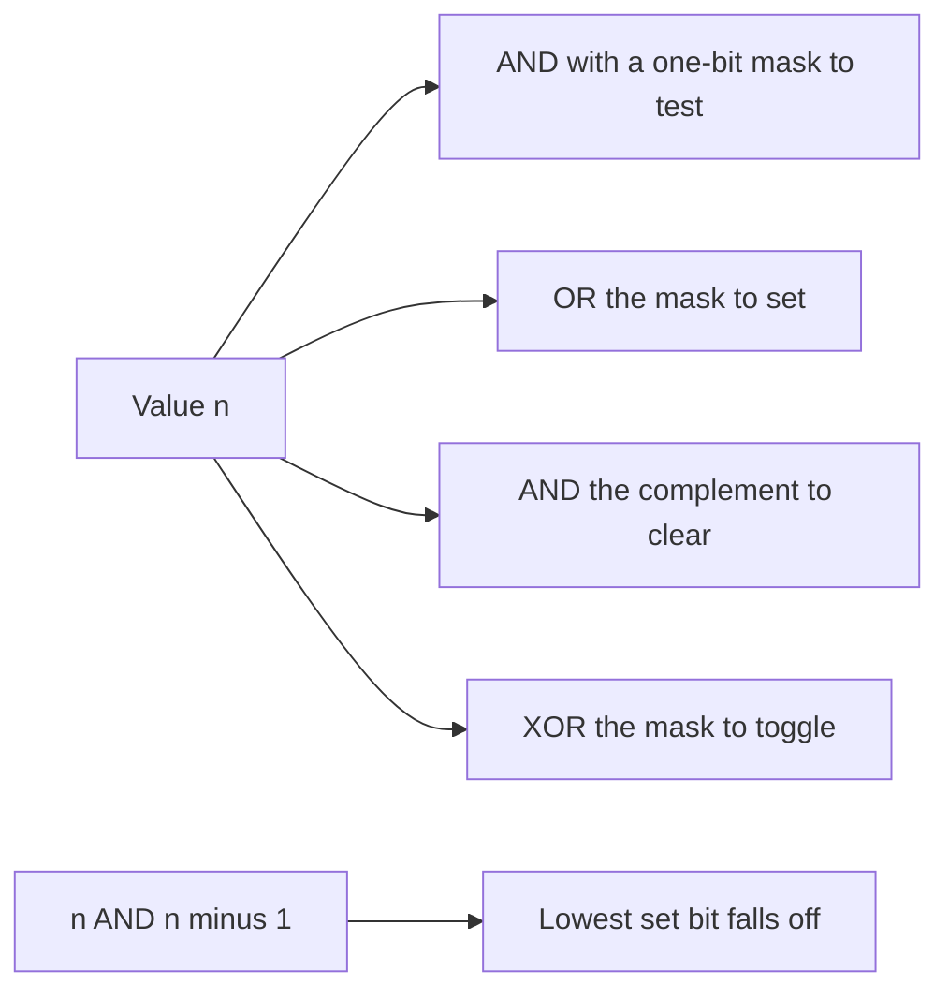

## Why this matters

Bit tricks show up as their own problems and as the inner loop of masks, hashes, and Fenwick indexes. You are expected to set, clear, toggle, and test a bit without a sermon, to use XOR as a toggle that cancels pairs, and to know why `n & (n - 1)` drops the lowest set bit. Single number, missing number, power of two, and the count of set bits are the drills. The advanced DP lesson uses the same masks as state. This lesson is the arithmetic.

## Intuition

A non-negative integer is a row of switches. AND keeps a switch on only if both inputs have it on. OR turns a switch on if either input has it on. XOR turns it on if the inputs disagree. Shifting left is multiplying by a power of two. Shifting right is dividing by a power of two, toward zero or with sign extension depending on the operator and the language. A mask is an integer you build so that AND isolates the switches you care about. XOR of a value with itself is zero, and XOR of a value with zero is the value. Those two identities are why pairs disappear.

## Core concept in depth

Number the bits from the right, starting at 0. Bit k has weight 2 to the k. The mask with only that bit set is `1 << k`. Test with `n & (1 << k)`. Set with `n | (1 << k)`. Clear with `n & ~(1 << k)`. Toggle with `n ^ (1 << k)`. In Python, integers are unbounded and `~n` is the bitwise complement in an infinite two's-complement sense, equal to `-n - 1`. Clearing a bit with `~` still works. Printing `~n` surprises people who expected a 32-bit pattern. If the problem wants a 32-bit answer, mask with `0xFFFFFFFF` at the end.

XOR properties you will use. XOR is associative and commutative. `a ^ a` is 0. `a ^ 0` is a. Therefore the XOR of an array in which every value appears twice except one is the single value. The pairs cancel. If every value appears three times except one, XOR is not enough, because three copies do not cancel in a two-state toggle. Count each bit modulo 3, or use the two-variable state machine from the single-number-II problem: ones and twos track the count of each bit modulo 3. Sum of two integers without `+` is XOR for the sum bits and a left-shifted AND for the carry, repeated until the carry is 0. That is the adder.

`n & (n - 1)` clears the lowest set bit. Loop until n is 0 and count the iterations to get the popcount. That is Brian Kernighan's trick, and it runs in time proportional to the number of set bits, not to the word width. A power of two has exactly one set bit, so `n > 0 and n & (n - 1) == 0`. Zero is not a power of two. `n & -n` isolates the lowest set bit. Fenwick trees use that. Python's negative numbers are two's complement in the bitwise operators, so `n & -n` works for positive n. Do not call it on zero.

Missing number, given 0 through n with one missing, is the XOR of all indices and all values, or the formula `n(n+1)/2` minus the sum. XOR avoids overflow in languages with fixed-width integers. The formula is clearer. Both are linear. Reverse bits of a 32-bit word swaps bit k with bit 31 - k. Do it with a loop, or with the well-known parallel swap of bit fields. A loop is the right interview code. Bitwise AND of numbers in a range has a closed form: the AND of a range is the common binary prefix of the endpoints. Shift both numbers right until they are equal, counting the shifts, then shift the common value back. The differing suffix becomes zeros.

Shifts. `n << k` multiplies by 2 to the k. `n >> k` in Python is a floor division by 2 to the k for positive n, and it sign-extends for negative n because there is no unsigned type. A logical right shift of a 32-bit pattern is `(n & 0xFFFFFFFF) >> k`. Know which one the problem wants.

Masks as sets. The empty set is 0. Add element i with OR. Remove it with AND of the complement of the bit. Membership is AND. Iterate the set bits by repeatedly isolating the lowest bit and clearing it. Submasks of a mask iterate by `sub = (sub - 1) & mask`. That loop is the bridge to bitmask DP. You do not need it for the single-number problems.

## Diagram and dry run



Array 4, 1, 2, 1, 2. XOR running total:

| Value | Running XOR |
| --- | --- |
| 4 | 4 |
| 1 | 5, which is 4 xor 1 |
| 2 | 7 |
| 1 | 6, the second 1 cancels |
| 2 | 4, the second 2 cancels |

The survivor is 4.

Number 12 is 1100 in binary. 12 AND 11 is 1100 AND 1011, which is 1000, clearing the lowest set bit. One more step yields 0. Two set bits. 8 AND 7 is 0, and 8 is positive, so 8 is a power of two. 6 AND 5 is 4, not 0, so 6 is not.

## Runnable Python

The pair-cancel XOR, the popcount loop, and the carry adder. All three are iterative. The recursive popcount is the same idea with a call per set bit, included so the recurrence `pop(n) = 1 + pop(n & (n - 1))` is visible. Prefer the loop.

```python
def single_number(nums: list[int]) -> int:
    acc = 0
    for value in nums:
        acc ^= value
    return acc


def popcount(n: int) -> int:
    count = 0
    while n:
        n &= n - 1
        count += 1
    return count


def popcount_rec(n: int) -> int:
    if n == 0:
        return 0
    return 1 + popcount_rec(n & (n - 1))


def add_without_plus(a: int, b: int) -> int:
    while b:
        a, b = a ^ b, (a & b) << 1
    return a
```

`single_number` on 4, 1, 2, 1, 2 returns 4. `popcount(12)` is 2. `add_without_plus(5, 7)` is 12. The adder as written is for non-negative integers. A fixed-width signed adder masks every step and interprets the sign bit at the end. Say that if the interviewer asks about negatives.

## Complexity and trade-offs

| Operation | Time | Notes |
| --- | --- | --- |
| Test, set, clear, toggle one bit | Theta(1) | a shift and a boolean op |
| XOR of an array | Theta(n) | constant space |
| Popcount by Kernighan | Theta(number of set bits) | better than 32 when the word is sparse |
| Popcount by scanning the width | Theta(word size) | simpler, fine for 32 or 64 |
| Range AND by common prefix | Theta(word size) | shifts until the endpoints match |
| Bitmask DP transition | depends on the mask | the arithmetic is still constant per edge |

A hash set also finds the single number and uses linear memory. XOR uses constant memory and needs the pair promise. If the promise is false, XOR returns some mixture and you will not notice. State the promise.

## Tricks, tips, and patterns

Write the four operations once on the whiteboard at the start of a bit round. Remember `n & (n - 1)` and `n & -n`. XOR cancels pairs. Modulo-3 counts need bits or the ones/twos machine, not a single XOR. Mask to 32 bits when the problem says 32-bit and you are in Python. For subsets, integer order enumerates masks, and clearing a bit yields a smaller integer, which is why a DP loop from 0 to `1 << n` sees submasks first if the transition clears bits.

## Common mistakes and edge cases

Using `~` and expecting a positive 32-bit mask. Treating 0 as a power of two. Sign issues in `>>` on negative numbers. XOR for triples. Off-by-one in the shift amount, so you set bit k + 1. A missing number problem whose array contains 0, which is a legal value and must not be used as an "empty" sentinel in the same way as a null. Overflow of `1 << 31` in 32-bit signed languages. In Python `1 << k` is fine for large k and then becomes a slow bigint. The adder that does not terminate if you mask incorrectly and the carry walks off into an infinite Python integer... with non-negative inputs and no mask, the carry walks left and ends. Do not OR the carry back into a confused sign bit.

## Interview notes

Start from the identity you need, not from a list of operators. "Pairs cancel under XOR, so one pass is the answer." "A power of two has one bit, so AND with n - 1 is zero." Dry-run 12 and 11, or the array 4, 1, 2, 1, 2. Mention Kernighan if they ask for popcount. Mention the 32-bit mask if the language is Python and the output is a bit pattern. Connect masks to the DP lesson only if the problem is a subset state. Otherwise solve the bit problem and stop.

## Practice problems

1. [Single Number](/practice/single-number) and [Single Number II](/practice/single-number-ii).
2. [Missing Number](/practice/missing-number) and [Number of 1 Bits](/practice/number-of-1-bits).
3. [Power of Two](/practice/power-of-two) and [Counting Bits](/practice/counting-bits).
4. [Sum of Two Integers](/practice/sum-of-two-integers) and [Reverse Bits](/practice/reverse-bits).
5. [Bitwise AND of Numbers Range](/practice/bitwise-and-of-numbers-range).

## Summary and cheat sheet

- Test, set, clear, toggle: AND, OR, AND-complement, XOR, each with `1 << k`.
- `a ^ a` is 0 and `a ^ 0` is a. Pairs cancel. Triples do not.
- `n & (n - 1)` clears the lowest set bit. `n & -n` isolates it.
- A positive n is a power of two when `n & (n - 1)` is 0.
- Addition is XOR plus a shifted AND carry, repeated.
- In Python, mask to 32 bits when the problem's universe is 32 bits.
- Range AND is the common prefix of the two endpoints.

## Further reading

- [Wikipedia — Bitwise operation](https://en.wikipedia.org/wiki/Bitwise_operation)
- [Wikipedia — Two's complement](https://en.wikipedia.org/wiki/Two%27s_complement)
- [Python bitwise operators](https://docs.python.org/3/reference/expressions.html#binary-bitwise-operations)
