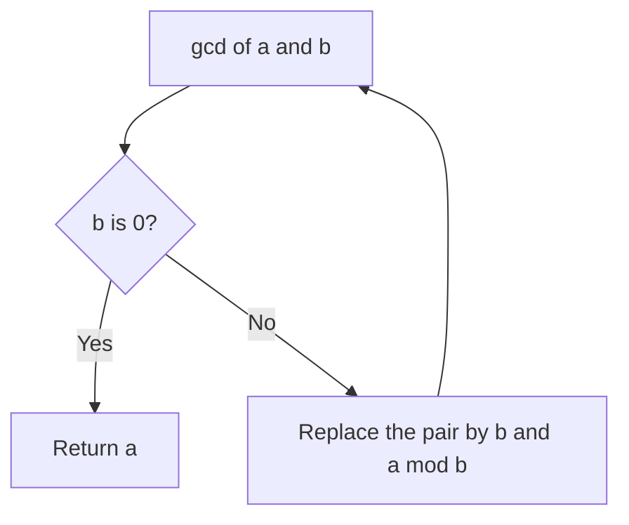

## Why this matters

A slice of interview problems is number theory in work clothes: gcd, primes, modular exponentiation, trailing zeros of a factorial, and combinatorics under a modulus. The algorithms are old and short. The bugs are overflow, the wrong modulus identity, and sieves that start marking at the wrong multiple. You should be able to write Euclid's algorithm both ways, the Sieve of Eratosthenes, and fast exponentiation, and you should know why `n!` has as many trailing zeros as the number of times 5 divides it.

## Intuition

The greatest common divisor of a and b also divides any integer combination of them, in particular a - b and, more usefully, a mod b. That is Euclid: gcd(a, b) = gcd(b, a mod b), and gcd(a, 0) = a. The primes up to n are what remain after you cross out multiples. Fast exponentiation squares the base and halves the exponent, so a power that looks linear in the exponent becomes logarithmic. Trailing zeros are factors of 10, and 10 is 2 times 5, and there are always extra 2s, so you count 5s.

## Core concept in depth

Euclid's algorithm. Assume a and b are non-negative and a is at least b. If b is 0, return a. Otherwise return gcd(b, a mod b). The recursive form is the proof. The iterative form replaces the pair until b is 0. The number of steps is logarithmic in the larger input. Worst cases track the Fibonacci numbers, which is why the bound is tight up to a constant and still logarithmic. The least common multiple is a times b divided by the gcd, computed as `a // gcd * b` so you divide before you multiply and reduce overflow in fixed-width languages. In Python the order is about clarity. GCD of more than two numbers folds the two-argument function. Extended Euclid also returns integers x and y with a x + b y = gcd. You need it for modular inverses when the modulus is not prime. For a prime modulus, Fermat's little theorem gives the inverse of a as a to the power p - 2 modulo p, via fast exponentiation.

The Sieve of Eratosthenes. A boolean array from 0 to n, initially "maybe prime," with 0 and 1 set to not prime. For each i from 2 up to sqrt(n), if i is still prime, mark multiples from i times i up to n, stepping by i. Multiples below i times i were marked by smaller primes. Time is O(n log log n). Space is O(n). The smallest prime factor sieve is the upgrade that also factorizes every number up to n in similar time: when you mark a multiple, store i as its smallest prime factor if it does not have one. Trial division of a single number up to sqrt(n) is enough when you have one query and n is large. A sieve is the right tool when you have many queries or you need all primes up to n.

Modular arithmetic. (a + b) mod m is (a mod m + b mod m) mod m. Same for subtraction, adding m if the difference goes negative. Multiplication is (a mod m) times (b mod m) mod m. Division is multiplication by the modular inverse, and the inverse exists only when gcd(a, m) is 1. Fast exponentiation computes a to the n modulo m by scanning the bits of n. If the bit is set, multiply the result by the current base. Square the base every step. Both operations are modulo m. The time is Theta(log n) multiplications. Python's built-in `pow(base, exp, mod)` does this and is the thing you should call unless the question is the algorithm. Recursive fast pow squares `pow(n // 2)` and multiplies an extra base when n is odd. Iterative and recursive forms match. A negative exponent is an inverse, not this function, unless you define it.

Combinations. n choose k equals n choose n - k, and it satisfies Pascal's identity: C(n, k) = C(n - 1, k) + C(n - 1, k - 1). A DP table of those values is Theta(n k) and fine for n up to a few thousand. The multiplicative formula computes the product of k terms, dividing as you go so the intermediate stays integral: multiply by (n - i) and divide by (i + 1) for i from 0 to k - 1. Under a prime modulus, replace the division by multiplication with the modular inverse. Under a non-prime modulus, inverses may not exist and you should keep the Pascal DP modulo m, which only uses addition.

Trailing zeros of n! . Each factor of 10 is a 2 and a 5. The number of 5s in n! is floor(n/5) + floor(n/25) + floor(n/125) + ... until the power exceeds n. The number of 2s is larger, so the zeros equal the number of 5s. Extra factors of 10 from other sources do not appear. This is not "divide n by 10." 25! has six trailing zeros, not two, because 25 and 20 and 15 and 10 and 5 contribute, and 25 contributes two.

Primality of a single large integer, beyond trial division, uses Miller-Rabin, a randomized test. For interview sizes, trial division up to sqrt(n) is the expected answer. Mention Miller-Rabin only as the production test. Do not invent a deterministic polynomial you cannot prove.

## Diagram and dry run



gcd(48, 18). 48 mod 18 is 12. gcd(18, 12). 18 mod 12 is 6. gcd(12, 6). 12 mod 6 is 0. gcd(6, 0) is 6. Three remainders. lcm(48, 18) is 48 / 6 * 18 = 144.

Sieve up to 20. After crossing multiples of 2, 3, and then stopping because the next i exceeds sqrt(20), the primes are 2, 3, 5, 7, 11, 13, 17, 19. 1 is not in the list. 9 was crossed by 3. 4, 6, 8, 10 were crossed by 2.

Trailing zeros of 25!. Powers of 5: floor(25/5) = 5, floor(25/25) = 1, total 6.

Fast pow of 2 to the 10, modulo 1000. Exponent 10 is 1010 in binary. Square 2 five times would be the wrong count. The iterative algorithm starts result 1, base 2. Bit 1 of 10 is set? 10 is even, square base to 4, exponent 5. Odd, result 4, base 16, exponent 2. Even, base 256, exponent 1. Odd, result 4 * 256 = 1024, then modulo 1000 is 24. And 2 to the 10 is 1024. Correct.

## Runnable Python

Iterative Euclid, the sieve, and iterative modular exponentiation. The recursive Euclid is three lines and is the form to recite. Call the iterative one when you want constant stack, which matters only for a pathological but still logarithmic depth you will not hit.

```python
def gcd(a: int, b: int) -> int:
    while b:
        a, b = b, a % b
    return abs(a)


def gcd_rec(a: int, b: int) -> int:
    if b == 0:
        return abs(a)
    return gcd_rec(b, a % b)


def sieve(n: int) -> list[int]:
    prime = [True] * (n + 1)
    if n >= 0:
        prime[0] = False
    if n >= 1:
        prime[1] = False
    p = 2
    while p * p <= n:
        if prime[p]:
            for multiple in range(p * p, n + 1, p):
                prime[multiple] = False
        p += 1
    return [i for i in range(n + 1) if prime[i]]


def mod_pow(base: int, exp: int, mod: int) -> int:
    result = 1
    base %= mod
    while exp:
        if exp & 1:
            result = result * base % mod
        base = base * base % mod
        exp >>= 1
    return result
```

`gcd(48, 18)` is 6. `sieve(20)` returns the eight primes listed above. `mod_pow(2, 10, 1000)` is 24. `pow(2, 10, 1000)` in the standard library agrees. Use the library in application code. Use the loop when the interview asks how exponentiation is logarithmic.

## Complexity and trade-offs

| Algorithm | Time | Space |
| --- | --- | --- |
| Euclid | Theta(log min(a, b)) steps | Theta(1) iterative |
| Sieve up to n | Theta(n log log n) | Theta(n) |
| Trial division of one n | Theta(sqrt(n)) | Theta(1) |
| Fast pow | Theta(log exponent) multiplications | Theta(1) iterative |
| Pascal triangle modulo m | Theta(n k) | Theta(k) rolled |
| Trailing zeros | Theta(log n) divisions by 5 | Theta(1) |

A prime sieve of 10 to the 8th fits in a boolean array if you pack bits, and it does not fit as a Python list of a hundred million integers without thought. For one primality test of a 12-digit number, trial division up to the square root is a million operations and is fine. For all primes up to a million, sieve.

## Tricks, tips, and patterns

Divide before multiplying when computing lcm in a fixed-width language. Count fives for trailing zeros, and include 25, 125, and so on. Start sieve marking at i times i. Skip even numbers after 2 if you want a smaller sieve. Fast pow reduces the base modulo m at the start. Combinations under a prime modulus use inverses. Range counts use f(R) - f(L - 1) once f is a prefix count. GCD of negatives: take absolute values, because divisors do not care about sign. Define gcd(0, 0) only if you must. Mathematically it is often left undefined or 0 by the same loop. Say what you return.

## Common mistakes and edge cases

Marking sieve multiples from 2i instead of i squared, which is correct and slower, not a bug. Marking 1 as prime. Forgetting that 2 is prime. Integer division of lcm that overflows before the gcd division. Modular multiplication that overflows before the modulus in other languages. Python will not overflow, and then a slow bigint can hide inside a "logarithmic" pow if you forget the modulus. Trailing zeros that stop after one division by 5. n choose k with k greater than n, which is 0. k = 0, which is 1. A negative exponent in mod_pow, which the loop does not handle. Primality of 1.

## Interview notes

Write Euclid, say the remainder shrinks, and give the Fibonacci worst-case remark if you remember it. For primes, choose sieve or trial division based on how many queries and how large n is. For powers, write the bit loop and mention `pow(base, exp, mod)`. For trailing zeros, say "count fives, there are extra twos" and write the loop. Dry-run gcd(48, 18) or the zeros of 25!. Those two are small enough to finish.

## Practice problems

1. [Count Primes](/practice/count-primes) — the sieve, returning a count.
2. [Pow(x, n)](/practice/powx-n) — fast exponentiation. Mind a negative n, which becomes a reciprocal. The integer version in the bank uses a non-negative exponent.
3. [Factorial Trailing Zeroes](/practice/factorial-trailing-zeroes).
4. [Excel Sheet Column Number](/practice/excel-sheet-column-number) — base 26, a cousin of the digit loops above.

## Summary and cheat sheet

- gcd(a, b) = gcd(b, a mod b). lcm is the product divided by the gcd.
- Sieve: cross out multiples from i squared. Time n log log n. 0 and 1 are not prime.
- Fast pow squares the base and halves the exponent. Include the modulus at every multiply.
- Inverses modulo a prime are pow(a, p - 2, p).
- n choose k multiplies k terms and divides as it goes, or uses Pascal's identity.
- Trailing zeros of n! equal the number of fives in the factorization, counting higher powers.
- Trial-divide one number. Sieve a range.

## Further reading

- [Wikipedia — Euclidean algorithm](https://en.wikipedia.org/wiki/Euclidean_algorithm)
- [Wikipedia — Sieve of Eratosthenes](https://en.wikipedia.org/wiki/Sieve_of_Eratosthenes)
- [Wikipedia — Modular exponentiation](https://en.wikipedia.org/wiki/Modular_exponentiation)
- [CP-Algorithms, binary exponentiation](https://cp-algorithms.com/algebra/binary-exp.html)
