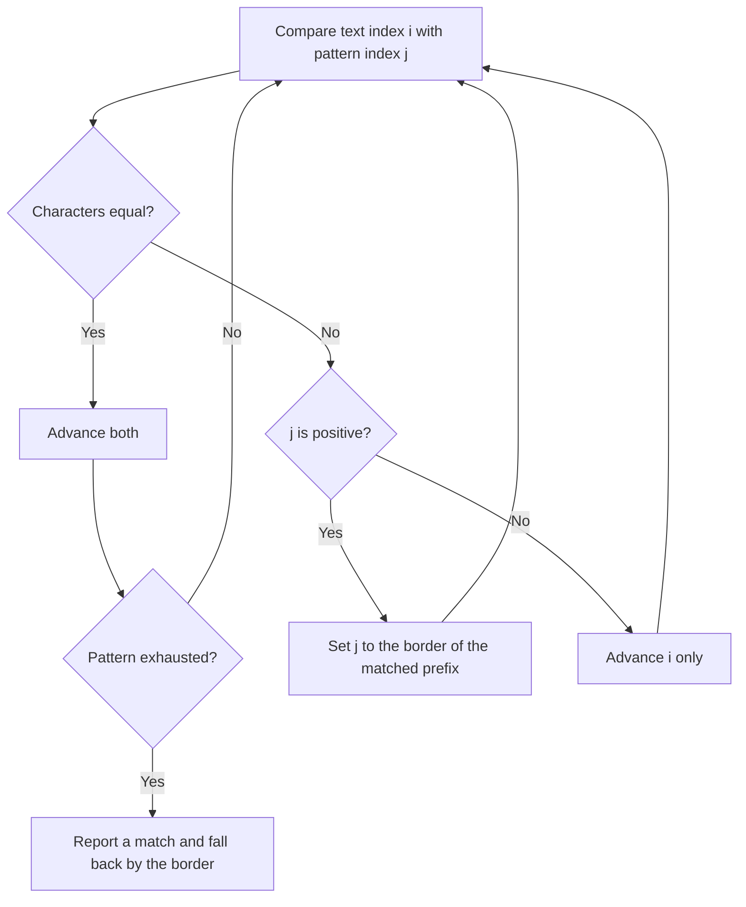

## Why this matters

A nested loop that checks the pattern at every text offset is correct and easy to explain. It is also the wrong final answer when the strings are long. Interviewers use "find the first occurrence," "longest prefix that is also a suffix," and "does this string repeat" to see whether you know the linear string algorithms, or at least the border idea those algorithms share. Knuth-Morris-Pratt, Rabin-Karp, and the Z-algorithm all answer pattern search. They do not memorize the same table. KMP stores how far a partial match can fall back. Rabin-Karp hashes a window and slides it. The Z-algorithm stores how far each position matches the prefix. You should be able to build each table by hand on a short string and say which one a problem is actually asking for.

## Intuition

After a mismatch, you already know a chunk of characters. Throwing that chunk away and restarting at the next text character repeats work. A border of a string is a proper prefix that is also a suffix. If the pattern's matched part has a border of length k, the next comparison can resume at pattern index k, because those k characters are already known to match the text. KMP precomputes, for every prefix of the pattern, the longest border. Rabin-Karp does not use borders. It treats the window as a number in a large base, updates that number in constant time when the window slides by one, and checks the real characters only when the numbers agree. The Z-array answers a different question that happens to solve search: for each index, how long is the substring starting there that copies the beginning of the whole string.

## Core concept in depth

A string here is a finite sequence of characters. Indexing starts at 0. A prefix of s is s from the start through some index. A suffix is s from some index through the end. Proper means the piece is not the whole string. The longest proper prefix that is also a suffix is the border. For "aabaa" the borders are "a" and "aa", and the longest has length 2. The prefix function, also called the longest-prefix-suffix array or LPS, stores that length for every prefix. lps[i] is the border length of the prefix that ends at i, which is the slice s[0] through s[i].

Building the prefix function is itself a KMP scan of the pattern against itself. Keep a variable length, the border you are currently trying to extend. Walk i from 1 to the end. If pattern[i] equals pattern[length], extend the border, store it, and move i. If not, and length is positive, set length to lps[length - 1] and try again without moving i. That fallback is safe because a border of a border is a border. If length is already 0, the prefix has no border, store 0, and move i. The whole build is linear: i only moves forward, and length only moves forward when i does or falls back along previously stored borders, so the total fallback is at most the number of successful extensions.

Searching with that table uses two indices, i in the text and j in the pattern. On a match, advance both. When j reaches the pattern length, you have an occurrence ending at i, so the start is i - j. To find the next one, set j to lps[j - 1] and continue, because the occurrence itself has a border. On a mismatch, if j is positive, set j to lps[j - 1] and do not advance i. If j is 0, advance i. Each text character is examined a constant number of times in aggregate, so the search is linear in the text length plus the pattern length. The naive double loop is linear only in the average case for random strings. Its worst case is the product of the lengths, on a pattern of many identical characters and a text of the same character.

Rabin-Karp picks a base and a modulus. The hash of a window of length m is the polynomial base to the m - 1 times the first character, plus base to the m - 2 times the next, and so on, all modulo the modulus. When the window slides, subtract the outgoing character times base to the m - 1, multiply by the base, and add the incoming character, reducing modulo the modulus at each step. That is a rolling hash. A hit is not a proof. Different windows can share a hash. On a hit, compare the characters, or use a second modulus and accept only a double hit if the problem allows a tiny error probability. With one large prime modulus the error is rare for interview constraints and still not zero. Choose a base larger than the alphabet, often 26 or 256, and a prime modulus such as 10 to the 9 plus 7. In Python the modulus is optional because integers do not overflow, but a bounded hash is what the algorithm is. Reduce the subtraction with an added modulus so it does not go negative.

The Z-array of a string s has Z[0] = 0 by convention, and Z[i] equal to the greatest k such that the slice starting at i of length k equals the prefix of length k. The algorithm maintains a Z-box, the rightmost segment [left, right] that is known to match a prefix. If i lies past that box, compare characters from scratch and, if you match at least one, set the box to the new segment. If i lies inside the box, the mirror position i - left already has a Z value, and the box promises that the text around i copies the text around the mirror. So Z[i] starts at the minimum of Z[i - left] and the distance from i to the end of the box. Then extend by explicit comparisons past the box. Each character is copied into a successful comparison at most once, because the right endpoint only moves forward, so the algorithm is linear.

Search by Z is concatenation. Build the Z-array of pattern, plus a separator that appears in neither string, plus the text. An index whose Z value equals the pattern length, and that sits inside the text portion, is a match. The separator stops a match from crossing the boundary. The same prefix function answers "longest happy prefix": the border of the entire string is lps of the last index, and the string itself is excluded because borders are proper. Repeated substring pattern is the border test: a string repeats a block when it has a border whose length makes the period divide the length. If n is positive and lps[n - 1] is positive and n modulo (n - lps[n - 1]) is 0, the string is made of a repeated block. "abcabcabc" has period 3. "abab" has period 2. "aba" does not.

The naive specification is still worth writing, because it is the oracle. Recurse on a candidate alignment: if the pattern is exhausted, you matched; if the text is exhausted or the characters differ, that alignment fails; otherwise consume one character from both. Try every start iteratively. That recursion is the definition of "occurs at this index." KMP, Rabin-Karp, and Z compute the same answer. They differ in the table and in whether a hash collision can force an extra comparison.

## Diagram and dry run



Prefix function of "ababaca".

| i | character | length after the step | lps so far, written through i |
| --- | --- | --- | --- |
| 0 | a | 0 | 0 |
| 1 | b | mismatch at 0 | 0, 0 |
| 2 | a | extends to 1 | 0, 0, 1 |
| 3 | b | extends to 2 | 0, 0, 1, 2 |
| 4 | a | extends to 3 | 0, 0, 1, 2, 3 |
| 5 | c | falls from 3 to 1 to 0, then stores 0 | 0, 0, 1, 2, 3, 0 |
| 6 | a | extends to 1 | 0, 0, 1, 2, 3, 0, 1 |

At i = 5 the character c does not match pattern[3], which is b. The border of the prefix of length 3 is lps[2] = 1, and c does not match pattern[1], which is b. The border of that shorter prefix is lps[0] = 0, and c does not match pattern[0]. Store 0.

Z-array of "aabaab". Z[0] is 0. Index 1 matches one a and then stops, so Z[1] is 1 and the box is the single character at index 1. Index 2 is b against a, so Z[2] is 0. Index 3 matches a, a, b, three characters, and the box becomes indices 3 through 5. Index 4 copies the mirror Z[1], which is 1, and cannot extend. Index 5 copies Z[2], which is 0. The array is 0, 1, 0, 3, 1, 0.

A rolling window on text "abcd" and pattern "bcd", base 10, no modulus, characters as their alphabet rank a=1. The pattern hash is 2 * 100 + 3 * 10 + 4 = 234. The first window "abc" hashes to 123. Slide: drop 1, multiply 23 by 10, add 4, get 234. The hashes agree, and the characters agree.

## Runnable Python

The prefix function and the search are iterative. The recursive helper is the naive alignment check, the specification KMP replaces. Use KMP when you need a guaranteed linear scan. Use the recursive checker only on short strings or as an oracle.

```python
def build_lps(pattern: str) -> list[int]:
    lps = [0] * len(pattern)
    length = 0
    i = 1
    while i < len(pattern):
        if pattern[i] == pattern[length]:
            length += 1
            lps[i] = length
            i += 1
        elif length:
            length = lps[length - 1]
        else:
            lps[i] = 0
            i += 1
    return lps


def kmp_search(text: str, pattern: str) -> int:
    if pattern == "":
        return 0
    lps = build_lps(pattern)
    i = j = 0
    while i < len(text):
        if text[i] == pattern[j]:
            i += 1
            j += 1
            if j == len(pattern):
                return i - j
        elif j:
            j = lps[j - 1]
        else:
            i += 1
    return -1


def naive_search(text: str, pattern: str) -> int:
    def match_at(i: int, j: int) -> bool:
        if j == len(pattern):
            return True
        if i == len(text) or text[i] != pattern[j]:
            return False
        return match_at(i + 1, j + 1)

    if pattern == "":
        return 0
    last = len(text) - len(pattern)
    for start in range(last + 1):
        if match_at(start, 0):
            return start
    return -1
```

`build_lps("ababaca")` returns 0, 0, 1, 2, 3, 0, 1. `kmp_search("abababaca", "ababaca")` returns 2. `naive_search` returns the same index. An empty pattern returns 0, matching the usual library convention. A pattern longer than the text returns -1 because the start loop is empty and the KMP loop never fills j.

## Complexity and trade-offs

| Algorithm | Time | Extra space | Failure mode |
| --- | --- | --- | --- |
| Naive, every alignment | Theta of the product of the lengths, worst case | Theta(1) plus the recursion depth of the pattern if you match recursively | too slow on long repetitive strings |
| KMP | Theta of text length plus pattern length | the prefix array, linear in the pattern | none if the table is right |
| Rabin-Karp, one hash | expected linear, worst case the product if every window collides and you verify | Theta(1) | a collision you forget to verify |
| Z-algorithm | Theta of the concatenated length | the Z-array | a separator that occurs in the data |

KMP and Z are deterministic and linear. Rabin-Karp is the one you want when you have many patterns against one text and you can hash the patterns into a set, or when the interview is about rolling hashes specifically. A second modulus makes a false hit negligible. It does not make it impossible. For a library `find`, a well-implemented hybrid such as the one inside CPython is allowed to be more complicated than KMP. In an interview, name KMP or Z and implement one of them cleanly.

## Tricks, tips, and patterns

The border length lps[n - 1] is the longest happy prefix. The smallest period of a string that is built by repeating a block is n - lps[n - 1], and that period must divide n. When you only need existence of a pattern, you can stop KMP at the first time j reaches the pattern length. When you need all occurrences, fall back with the border and keep scanning, and remember that occurrences may overlap. A rolling hash of every prefix lets you compare two substrings in constant time after linear preprocessing, as long as you accept the collision story or verify. That is the bridge from Rabin-Karp to "are these two slices equal." Do not build the prefix function on the text. Build it on the pattern, or on pattern plus separator plus text when the problem is about the whole concatenation.

## Common mistakes and edge cases

Off-by-one in the fallback: the value to assign to j on a mismatch is lps[j - 1], the border of the matched prefix, not lps[j]. Forgetting that borders are proper, and returning the whole string as its own happy prefix. An empty pattern, an empty text, or a pattern longer than the text. Using a separator that appears in the text, so a Z match crosses the join. A rolling hash that goes negative after the subtraction, or that overflows a 32-bit integer in other languages before the modulus. Treating a hash hit as a match. Rebuilding the prefix function from scratch inside the search loop. Assuming the naive algorithm is always quadratic. It is quadratic in the worst case and often fine on short interview inputs. Say which bound you are claiming.

## Interview notes

State the definition of lps[i] before you write the loop. Dry-run "ababaca" or "aabaab". If the interviewer asks why the fallback does not miss a match, say that every shorter border is already stored, because a border of a border is a border, and the text characters you skip were compared on the way in. For Rabin-Karp, say "expected linear, verify collisions." For the repeated-string problem, derive the period from the border instead of inventing a new scan. Mention Z if you are more fluent with the box than with the prefix function. They are the same family.

## Practice problems

1. [Find the Index of the First Occurrence](/practice/find-the-index-of-the-first-occurrence) — implement KMP or a verified rolling hash.
2. [Longest Happy Prefix](/practice/longest-happy-prefix) — the last entry of the prefix function.
3. [Repeated Substring Pattern](/practice/repeated-substring-pattern) — the period test.
4. [Rabin-Karp Search](/practice/rabin-karp-search) and [Z-Algorithm Search](/practice/z-algorithm-search).

## Summary and cheat sheet

- A border is a proper prefix that is also a suffix. lps[i] is the longest border of the prefix ending at i.
- On a mismatch, resume the pattern at lps[j - 1]. Do not rewind the text.
- KMP build and search are both linear.
- Rabin-Karp slides a polynomial hash in constant time and verifies character equality on a hit.
- Z[i] is the longest prefix match starting at i. A Z-box copies mirror values and only extends the right edge forward.
- Search with Z by scanning pattern, a fresh separator, and the text.
- A string is a repeated block when n - lps[n - 1] divides n and the border is non-empty.

## Further reading

- [Wikipedia — Knuth-Morris-Pratt algorithm](https://en.wikipedia.org/wiki/Knuth%E2%80%93Morris%E2%80%93Pratt_algorithm)
- [CP-Algorithms — Prefix function](https://cp-algorithms.com/string/prefix-function.html)
- [CP-Algorithms — Rabin-Karp](https://cp-algorithms.com/string/rabin-karp.html)
- [CP-Algorithms — Z-function](https://cp-algorithms.com/string/z-function.html)
