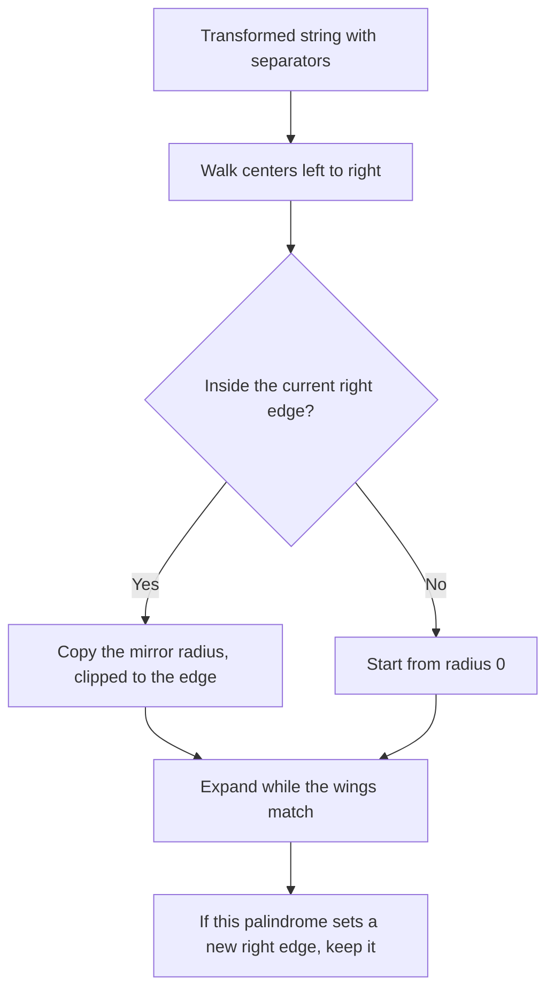

## Why this matters

Palindromes are a string topic of their own because the center of the answer can sit on a character or between two characters, and because the naive expansion repeats work that a radius array can reuse. Longest palindromic substring and the count of palindromic substrings are on the standard interview list. Manacher's algorithm solves the longest one in linear time. You should also know the quadratic expand-around-centers solution, which is what most interviews actually want written down, and you should know that the longest palindromic subsequence is a different problem and a dynamic program. The second half of this lesson is the suffix array, the sorted list of every suffix. You will not be asked to code a linear construction in a 45-minute round. You will be asked what the structure is, what the LCP array adds, and which questions become binary search plus a longest-common-prefix check once the suffixes are sorted.

## Intuition

A palindrome reads the same forward and backward, so it is determined by a center and a radius. Expand every center while the wings match. That is correct. Manacher notices that once you have expanded a long palindrome, the radii inside its right half mirror the radii inside its left half, until they hit the boundary of the long one. The suffix array is a different intuition: sorting the suffixes puts equal prefixes next to each other. The longest repeated substring is then the maximum longest-common-prefix of two adjacent suffixes. Pattern search is a binary search over that sorted list.

## Core concept in depth

A palindrome is a string equal to its reverse. The empty string and every single character are palindromes. A substring is a contiguous slice. A subsequence is not required to be contiguous. Those two words are the usual trap. Longest palindromic substring asks for a contiguous slice. Longest palindromic subsequence asks for a not-necessarily-contiguous sequence, and it is the longest common subsequence of the string with its reverse, or a direct interval DP. Do not run Manacher on a subsequence problem.

Expand around centers. There are 2n - 1 centers in a string of length n: n characters and n - 1 gaps between characters. For each center, walk outward while the indices stay inside the string and the characters match. Track the best slice. Each expansion can walk the whole string, and there are linearly many centers, so the time is quadratic and the extra space is constant if you only keep the best endpoints. Counting palindromic substrings is the same walk, incrementing a counter on every successful radius, including the single-character palindromes. A substring is counted once per center. That is the right count, because each palindromic substring has one center.

Manacher's algorithm makes the center story uniform and then adds the mirror. Insert a separator, conventionally a hash, between characters and at both ends. "abba" becomes "#a#b#b#a#". Every palindrome in the original string, odd or even, becomes an odd-length palindrome in the transformed string, centered on a character or on a separator. Let p[i] be the radius in the transformed string, the largest number such that the transformed characters i - p[i] and i + p[i] are inside and the slice between them is a palindrome. The corresponding original length is p[i], because the separators account for half the transformed width. Maintain the center and the right edge of the palindrome that currently reaches farthest right. When i is strictly inside that right edge, the mirror index is 2 * center - i, and p[i] starts at the minimum of p[mirror] and the distance from i to the right edge. Then try to expand past that guess by comparing characters. If i plus the new radius passes the old right edge, this center becomes the new owner of the right edge. The right edge only moves forward, and every expansion step that increases it charges a character, so the total expansion work is linear. The transform itself is linear. The answer is the maximum p[i], mapped back to a slice of the original string. If the center index in the transformed string is i and the radius is r, the original start is (i - r) // 2 and the original length is r.

The simple expansion is the algorithm to code under time pressure. Manacher is the algorithm to name when they ask for linear time, and to code if you have already practiced the radius table. Both return a real slice. If several slices tie, either is acceptable unless the problem asks for the earliest one. Take the one you find first and say so.

A suffix of s is a slice from some index through the end. The suffix array is the permutation of starting indices sorted by the suffixes those indices name. For "banana" the suffixes are banana, anana, nana, ana, na, a. Sorted in dictionary order they are a, ana, anana, banana, na, nana, so the suffix array is 5, 3, 1, 0, 4, 2. Sorting with ordinary string comparison costs an extra linear factor in the string length per comparison, so this construction is fine for teaching and too slow for a long string. Linear constructions exist. The DC3 algorithm, also called skew, and the prefix-doubling algorithm that sorts by the first 1, 2, 4, 8 characters, are the ones textbooks name. Prefix doubling runs in n log squared n with a standard sort, or n log n with a radix sort. You should be able to describe doubling: each suffix is a pair of ranks of its two halves, and after a sort the pairs become the new ranks. You are not expected to debug DC3 on a whiteboard.

The LCP array stores, between each pair of adjacent entries in the suffix array, the length of their longest common prefix. For "banana" the adjacent LCP values are 1 (a against ana), 3 (ana against anana), 0 (anana against banana), 0 (banana against na), and 2 (na against nana). A direct comparison computes this in quadratic time. Kasai's algorithm computes it in linear time from the string and the suffix array, using one inequality: if the LCP of the suffix starting at i with its neighbor in suffix-array order is h, then the LCP of the suffix starting at i + 1 with its own neighbor is at least h - 1. You can drop the first character and the rest of the common prefix still matches, except that the neighbor might change. Mention Kasai. Implement the direct comparison unless you have the linear version solid.

What the pair of arrays gives you. The longest repeated substring is the maximum LCP, and the substring is the prefix of either adjacent suffix of that length. The number of distinct substrings is n(n + 1) / 2 minus the sum of the LCP array, because every substring is a prefix of some suffix, and adjacent suffixes share LCP prefixes that would otherwise be counted twice along the sorted order. Pattern search is binary search on the suffix array: compare the pattern with the suffix at the middle index, and walk left or right. With an LCP structure that answers range minimum queries, the binary search compares only the characters it has not already deduced, but a plain binary search that compares the pattern from scratch is already n log n character inspections in the worst case and is the right interview description. A suffix automaton and a suffix tree represent the same family of facts with different shapes. The tree is the compacted trie of all suffixes. The array is the more common competitive-programming tool. For this course the array plus the LCP definition is the required intro.

## Diagram and dry run



Expand-around-centers on "abba". Centers and the slice they produce:

| Center | Expansion | Slice |
| --- | --- | --- |
| on a at 0 | single character | a |
| between 0 and 1 | a against b, stop | empty gap |
| on b at 1 | single b, wings a and b differ | b |
| between the two b characters | b matches b, then a matches a | abba |
| on b at 2 | single b | b |
| between 2 and 3 | b against a, stop | empty gap |
| on a at 3 | single a | a |

The best slice is "abba".

Manacher on the same string. The transformed characters are hash, a, hash, b, hash, b, hash, a, hash, at indexes 0 through 8. Radii grow as follows. Index 0 cannot expand. Index 1 expands to radius 1, and the right edge becomes 2. Index 2 does not expand. Index 3 expands to radius 1, and the right edge becomes 4. Index 4, the middle hash, expands through both b characters and both a characters out to the ends, radius 4, and the right edge becomes 8. Radius 4 is the whole original string. Later centers sit inside that edge and only copy mirrors. The original start is (4 - 4) / 2 = 0 and the length is 4.

Suffix array of "banana":

| Suffix array index | Start | Suffix | LCP with the next row |
| --- | --- | --- | --- |
| 5 | 5 | a | 1 |
| 3 | 3 | ana | 3 |
| 1 | 1 | anana | 0 |
| 0 | 0 | banana | 0 |
| 4 | 4 | na | 2 |
| 2 | 2 | nana | none |

The longest repeated substring is "ana", from the LCP of 3.

## Runnable Python

Center expansion is a pair of loops, one iterative scan of centers and one iterative expansion. The recursive formulation expands one wing and returns the endpoints. It is the same algorithm with the call stack holding the radius. Prefer the loops. The suffix-array helpers sort and then compare adjacent suffixes. They are the introductory construction, not DC3.

```python
def longest_palindrome(s: str) -> str:
    if s == "":
        return ""
    best_l, best_r = 0, 0

    def expand(left: int, right: int) -> tuple[int, int]:
        while left >= 0 and right < len(s) and s[left] == s[right]:
            left -= 1
            right += 1
        return left + 1, right - 1

    for i in range(len(s)):
        for left, right in (expand(i, i), expand(i, i + 1)):
            if right - left > best_r - best_l:
                best_l, best_r = left, right
    return s[best_l:best_r + 1]


def expand_rec(s: str, left: int, right: int) -> tuple[int, int]:
    if left < 0 or right >= len(s) or s[left] != s[right]:
        return left + 1, right - 1
    return expand_rec(s, left - 1, right + 1)


def suffix_array(s: str) -> list[int]:
    return sorted(range(len(s)), key=lambda i: s[i:])


def lcp_adjacent(s: str, sa: list[int]) -> list[int]:
    values = []
    for a, b in zip(sa, sa[1:]):
        k = 0
        while a + k < len(s) and b + k < len(s) and s[a + k] == s[b + k]:
            k += 1
        values.append(k)
    return values
```

`longest_palindrome("abba")` returns "abba". `longest_palindrome("aba")` returns "aba". `expand_rec("abba", 1, 2)` starts between the two b characters and returns the endpoints 0 and 3. `suffix_array("banana")` returns 5, 3, 1, 0, 4, 2. `lcp_adjacent` of that array returns 1, 3, 0, 0, 2. The maximum entry is the length of the longest repeated substring.

## Complexity and trade-offs

| Tool | Time | Space | What you get |
| --- | --- | --- | --- |
| Expand around centers | Theta(n squared) | Theta(1) extra | one palindromic substring, or a count |
| Manacher | Theta(n) | Theta(n) for the transform and the radii | the same substring, linear |
| Interval DP for the subsequence | Theta(n squared) | Theta(n squared), rollable | a subsequence, not a slice |
| Suffix array by sorting suffixes | Theta(n squared log n) character work | Theta(n) | the order of suffixes |
| Prefix doubling | Theta(n log squared n) or better with radix sort | Theta(n) | the same order, the practical construction |
| Kasai LCP | Theta(n) after the suffix array | Theta(n) | adjacent LCP values |
| Direct adjacent LCP | Theta(n squared) worst case | Theta(1) extra | fine for a short demo |

Manacher is not a replacement for the subsequence DP. The suffix array is not a replacement for KMP when you have one pattern and one text and no other queries. Build the heavier structure when you have many queries, repeated-substring questions, or a reason to binary-search suffixes.

## Tricks, tips, and patterns

Write 2n - 1 centers on the board so you do not forget even lengths. In the transform, the original length equals the radius, and the original start is (i - r) // 2. Guard the empty string before you divide. For counts, every radius step is one palindromic substring, and the single letters must be included. If the problem allows any longest slice, keep the first maximum and do not sort the candidates. For suffix arrays, draw "banana" from memory. It is the example every reader of the structure has seen, which makes your LCP numbers easy to check. When you need the longest common substring of two strings, concatenate them with a separator and take the maximum LCP among adjacent suffixes that come from different sides. That is the standard application, and it is still an introduction, not a second data structure.

## Common mistakes and edge cases

Returning a subsequence from an expansion, or a substring from the subsequence DP. Forgetting even centers, so "aa" becomes "a". An infinite expansion because the bounds are checked after the character access. Manacher radii copied from the mirror without clipping to the right edge, which invents characters past the known palindrome. Mapping the transformed index back to the original string with the wrong formula and slicing off a separator. An empty string. A string of one character. Suffix sorting that compares only the first character. LCP computed against the original index order instead of the suffix-array order. Claiming a linear suffix array and then coding `sorted` on the slices. Those are different algorithms. Say which one you wrote.

## Interview notes

Start with expand-around-centers unless they asked for linear time. Dry-run "abba" or "cbbd". Name Manacher and the mirror idea in two sentences if they push on complexity. If the word subsequence appears, stop and switch to the DP from the classic families lesson. For suffix arrays, define the array, sort "banana", define LCP, and name one query: longest repeated substring, or pattern search by binary search. Mention Kasai and prefix doubling as the efficient constructions. Do not start DC3 unless you can finish it.

## Practice problems

1. [Longest Palindromic Substring](/practice/longest-palindromic-substring) — expand, or Manacher if you want the linear pass.
2. [Palindromic Substrings](/practice/palindromic-substrings) — count every center you can expand.
3. [Longest Palindromic Subsequence](/practice/longest-palindromic-subsequence) — the DP, not Manacher.
4. [Valid Palindrome](/practice/valid-palindrome) — a two-pointer check, useful as a warmup before radii.
5. [Palindrome Partitioning](/practice/palindrome-partitioning) — backtracking over palindromic cuts.

## Summary and cheat sheet

- A palindromic substring has a center and a radius. There are 2n - 1 centers.
- Expand-around-centers is quadratic and is the usual interview code.
- Manacher inserts separators, copies mirror radii inside the current right edge, and runs in linear time.
- Map a transformed center i and radius r back with start (i - r) // 2 and length r.
- A palindromic subsequence is a different problem. Use DP.
- The suffix array is the starts of all suffixes in sorted order. Sorting slices is the teaching construction.
- The LCP array stores adjacent shared-prefix lengths. Its maximum is the longest repeated substring.
- Kasai builds LCP in linear time. Prefix doubling builds the suffix array efficiently. Pattern search is binary search on the suffix array.

## Further reading

- [Wikipedia — Longest palindromic substring](https://en.wikipedia.org/wiki/Longest_palindromic_substring)
- [CP-Algorithms — Manacher](https://cp-algorithms.com/string/manacher.html)
- [Wikipedia — Suffix array](https://en.wikipedia.org/wiki/Suffix_array)
- [CP-Algorithms — Suffix array](https://cp-algorithms.com/string/suffix-array.html)
- [Wikipedia — LCP array](https://en.wikipedia.org/wiki/LCP_array)
