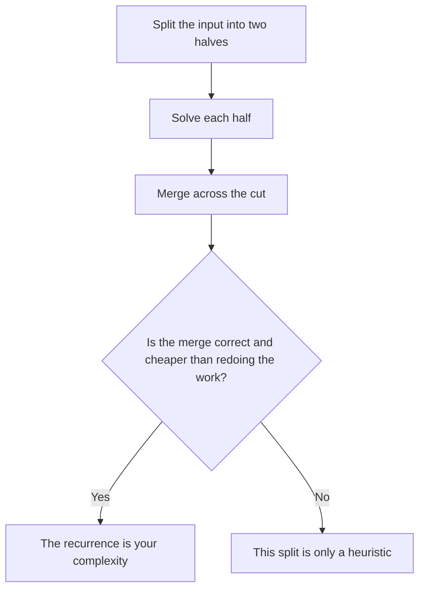

## Why this matters

Some problems are too big for the textbook dynamic program and too structured for a blind search. Divide and conquer is how mergesort counts inversions and how Karatsuba multiplies. Square-root decomposition is the array technique you use when a Fenwick tree does not fit the query, or when you want a correct block solution before you build a segment tree. Meet-in-the-middle cuts an exponential subset search from 2 to the n down to about 2 to the n over 2, which is the difference between impossible and a million operations when n is 40. Randomized algorithms are how you shuffle fairly, how quicksort gets its expected bound, and how a majority element can be found by sampling. Interviewers at this level ask these when the linear scan and the knapsack table are both the wrong shape.

## Intuition

Divide and conquer splits the instance, solves the halves, and pays for a merge. The Master theorem, from the foundations module, turns that recurrence into a bound once the merge cost is honest. Square-root decomposition splits the array into blocks of length about sqrt(n), so a query walks a few loose elements plus a few whole blocks, and both pieces are about sqrt(n). Meet-in-the-middle splits the set into two halves, lists every subset sum of each half, and matches them. The split is the algorithm. Randomization changes either the running time or the error. A Las Vegas algorithm always returns the right answer and only the time is random. A Monte Carlo algorithm has a bounded chance of being wrong. Fisher-Yates and randomized quicksort are Las Vegas. A primality test that can falsely accept a composite is Monte Carlo.

## Core concept in depth

An inversion is a pair of indexes i before j with the earlier value strictly larger. The brute force checks every pair. Mergesort already splits the array and merges sorted halves. While merging, every time the next output comes from the right half, it forms an inversion with every still-unused element of the left half, because those left elements are earlier in the original array and larger than the right element you just took. Elements inside each half were counted by the recursive calls. Cross pairs are counted exactly once, in the merge. The recurrence is the mergesort recurrence, two halves plus linear merge, which the Master theorem places in Theta(n log n). The same merge is stable if you take the left element when the two heads are equal, and equal heads are not inversions. Count only a strict inequality.

Closest pair in the plane splits points by x-coordinate, solves both halves, and lets d be the smaller distance. A closer pair that crosses the cut lies in a vertical strip of width 2d. Sort that strip by y-coordinate. A packing argument says each point needs only a constant number of later neighbors in that order, classically seven: points inside a d-by-2d rectangle that are at least d apart cannot be packed more densely than that. Presort by y and the merge stays linear, so the recurrence remains n log n. State the strip and the constant. Code the geometry only if time remains. Inversions are the version you should be able to finish.

Karatsuba multiplication is the same shape on integers. Write the two numbers as a * B + b and c * B + d, with B a power of the base. The schoolbook product uses four half-size products. The identity (a + b)(c + d) - ac - bd equals ad + bc, so three half-size products are enough. The recurrence T(n) = 3T(n / 2) + Theta(n) solves to about n to the power log base 2 of 3, which is near n to the 1.585, better than quadratic. Fast exponentiation from the number-theory lesson is the one-dimensional version: square, and multiply once more when the bit is set.

Square-root decomposition, also called a block array, stores the array and an auxiliary value per block. For range sum, the auxiliary value is the block sum. Choose the block length B as the integer square root of n, at least 1. A point update changes the element and adds the delta into its block, in constant time. A range query from left to right adds the loose prefix until the next block boundary, adds each fully covered block in constant time, and adds the loose suffix. The loose ends are shorter than one block, and the number of full blocks is at most n / B. With B near sqrt(n), both are Theta(sqrt(n)). Range minimum is the same query shape, but a point update recomputes its block in Theta(B) unless the block keeps more structure. Invertible prefix sums belong in a Fenwick tree or a segment tree, which are Theta(log n). Range add plus range sum needs lazy tags. That is a segment tree, not the plain block sum.

Meet-in-the-middle applies when the search space is a product of two smaller spaces. Subset sum with n around 40 is the standard case. A direct recursion tries 2 to the n subsets. Split the array at n / 2. Enumerate every subset sum of the left half and every subset sum of the right half. Sort one list, or drop it into a frequency map, and for each left sum ask how many right sums equal target minus the left sum. Each half has size at most 20, and 2 to the 20 is about a million. Iterative doubling appends each new value plus every old sum, and the recursive form returns the tail sums together with those sums plus the head. Both list each subset once. Time is about 2 to the n over 2, times n if you sort one side. Space stores both lists. Non-negative values are required for the knapsack DP, not for the split. If n is near 40 and the values are huge, the DP table does not fit. If n is 200 and the target is a few thousand, the split does not finish and the DP does.

Randomized algorithms need a source of uniform integers and a theorem about what "uniform" buys you. Fisher-Yates shuffles an array in place. For i from the last index down to 1, swap i with an index drawn uniformly from 0 through i inclusive. Every permutation has probability 1 over n factorial. The proof is induction on the suffix: the element that lands at the end is uniform among all elements, and the prefix is then a uniform shuffle of what remains. Drawing j only from 0 through i - 1 is biased, because the current element cannot stay put on that step. Reservoir sampling keeps k items from a stream of unknown length. Fill the reservoir with the first k items. When item i arrives, indexes starting at 0, draw j from 0 through i, and if j is less than k replace slot j. Each item seen so far is equally likely to be kept. Randomized quicksort picks a uniform pivot, or shuffles with Fisher-Yates and then partitions. The expected number of comparisons is Theta(n log n). One unlucky sequence of pivots is still quadratic. The output is sorted either way, so the algorithm is Las Vegas. A Monte Carlo majority finder picks a random index and checks whether that value occurs more than n / 2 times. If a majority exists, each trial succeeds with probability greater than one half, so a few independent trials fail only with a small probability. Boyer-Moore, from the intervals lesson, is the deterministic linear solution. Prefer it when you can remember the counter. Know the sampling version so "randomized" is not a blank word.

## Diagram and dry run



Inversions of 2, 4, 1, 3. The sorted halves are 2, 4 and 1, 3, each with zero internal inversions.

| Left head | Right head | Emit | Inversions added | Running count |
| --- | --- | --- | --- | --- |
| 2 | 1 | 1 | 2, because both 2 and 4 sit above 1 | 2 |
| 2 | 3 | 2 | 0 | 2 |
| 4 | 3 | 3 | 1, because 4 remains on the left | 3 |
| 4 | none | 4 | 0 | 3 |

The three inversions are (2, 1), (4, 1), and (4, 3).

Subset sums of 1, 2, 3, 4 with target 5. The left half 1, 2 produces 0, 1, 2, 3. The right half 3, 4 produces 0, 3, 4, 7. Complementary counts: left 1 matches right 4, and left 2 matches right 3. Two subsets, which are 1 with 4, and 2 with 3.

Block sums of 1, 2, 3, 4, 5, 6 with block length 2. The block totals are 3, 7, and 11. The query from index 1 through index 4 takes the loose element 2, the full block 3 + 4, and the loose element 5, totaling 14.

A three-element Fisher-Yates step, if the draws are "swap index 2 with 0" and then "swap index 1 with 1", turns a, b, c into c, b, a. A different sequence of draws produces a different permutation. The algorithm's claim is about the distribution, not about one seed.

## Runnable Python

Inversion counting is the recursive divide and conquer. Block sums are iterative. Subset sums are shown both as a recursion, which is the definition, and as the iterative doubling used in the count. The shuffle is iterative. Pass a random generator so a test can fix the draws.

```python
def count_inversions(nums: list[int]) -> int:
    def sort_count(items: list[int]) -> int:
        if len(items) <= 1:
            return 0
        mid = len(items) // 2
        left, right = items[:mid], items[mid:]
        inversions = sort_count(left) + sort_count(right)
        i = j = k = 0
        while i < len(left) and j < len(right):
            if left[i] <= right[j]:
                items[k] = left[i]
                i += 1
            else:
                items[k] = right[j]
                j += 1
                inversions += len(left) - i
            k += 1
        while i < len(left):
            items[k] = left[i]
            i += 1
            k += 1
        while j < len(right):
            items[k] = right[j]
            j += 1
            k += 1
        return inversions

    return sort_count(list(nums))


def subset_sums(nums: list[int]) -> list[int]:
    sums = [0]
    for value in nums:
        sums.extend(value + old for old in sums)
    return sums


def subset_sums_rec(nums: list[int], index: int = 0) -> list[int]:
    if index == len(nums):
        return [0]
    rest = subset_sums_rec(nums, index + 1)
    return rest + [nums[index] + value for value in rest]


def count_subsets(nums: list[int], target: int) -> int:
    mid = len(nums) // 2
    freq: dict[int, int] = {}
    for value in subset_sums(nums[mid:]):
        freq[value] = freq.get(value, 0) + 1
    return sum(freq.get(target - value, 0) for value in subset_sums(nums[:mid]))


def fisher_yates(items: list[int], randrange) -> None:
    for i in range(len(items) - 1, 0, -1):
        j = randrange(i + 1)
        items[i], items[j] = items[j], items[i]
```

`count_inversions([2, 4, 1, 3])` returns 3. `subset_sums([1, 2])` returns 0, 1, 2, 3. `subset_sums_rec([1, 2])` returns the same four numbers in a different order, 0, 2, 1, 3, because the head is added after the tail. `count_subsets([1, 2, 3, 4], 5)` returns 2. `fisher_yates` on a copy of 1, 2, 3 with a generator that yields 0 and then 1 produces 3, 2, 1. The block query from the dry run is the three-phase sum from the core section: loose ends plus whole blocks, 14 on indexes 1 through 4.

## Complexity and trade-offs

| Method | Time | Space | Use it when |
| --- | --- | --- | --- |
| Pair scan for inversions | Theta(n squared) | Theta(1) | n is a few thousand and you want an oracle |
| Mergesort inversions | Theta(n log n) | Theta(n) | the definition is a cross pair |
| Schoolbook multiplication | Theta(n squared) | Theta(n) | the numbers are short |
| Karatsuba | Theta(n to the log base 2 of 3) | Theta(n) | the numbers are long |
| Block sum, point update | Theta(sqrt(n)) per query, Theta(1) per update | Theta(n) | a tree is overkill or the aggregate is odd |
| Fenwick prefix sum | Theta(log n) | Theta(n) | the query is a prefix of an invertible operation |
| Direct subset recursion | Theta(2 to the n) | Theta(n) stack | n is at most about 20 |
| Meet-in-the-middle | Theta(2 to the n over 2) times a log or a hash | Theta(2 to the n over 2) | n is about 40 and values are large |
| Knapsack DP | Theta(n times target) | Theta(target) | the target is small |
| Fisher-Yates | Theta(n) | Theta(1) extra | you need a uniform shuffle |
| Randomized quicksort | expected Theta(n log n) | Theta(log n) expected stack | average pivots are acceptable |

A block size that is not near the square root still correct. It is just slower. If updates and queries are mixed and the operation is a prefix sum, write the Fenwick tree from the trees module instead of tuning B. Meet-in-the-middle memory is the real constraint: two arrays of a million integers are fine, and two arrays of 2 to the 30 are not.

## Tricks, tips, and patterns

Count cross inversions only when the right head wins, and take the left head on ties. Copy the array before sorting if the caller needs the original order. For subset sums, iterative doubling uses less stack than the recursion and produces each subset once. Hash the smaller half. If the target can be formed in more than one way, store frequencies, not a set of seen sums. For blocks, write the three-phase query, loose prefix, full blocks, loose suffix, and test a range that starts in the middle of a block. For shuffles, the random call includes the current index. If you need a reproducible test, inject the random function. Do not use a shuffle as a sort. Do not use meet-in-the-middle when a polynomial DP fits.

## Common mistakes and edge cases

Counting an equal pair as an inversion. Forgetting the inversions inside the halves and only counting the merge, or double-counting by also scanning. An off-by-one in the strip of closest pair, using width d instead of 2d, so one point of a crossing pair falls outside. A block query that adds a full block and also adds its elements. A block length of 0 on an empty array. Watch the empty array before you divide. Meet-in-the-middle that forgets the empty subset, whose sum is 0, so a target of 0 is wrong. Using a set instead of a frequency map when duplicate sums are different subsets. A biased shuffle that never swaps an element with itself. Reservoir sampling that draws from 1 through i instead of 0 through i. Claiming quicksort is always n log n. The expectation is n log n. One unlucky pivot sequence is quadratic. Integer overflow in other languages when subset sums exceed 32 bits. Python will not overflow, and the hash map will simply hold big integers.

## Interview notes

Name the split, the merge, and the recurrence before you code inversions. Dry-run 2, 4, 1, 3. If they ask about closest pair, draw the strip and say "a constant number of y-neighbors," and only then start code if time remains. For subset sum, ask for n and for the magnitude of the target. That answer chooses DP or meet-in-the-middle. For a shuffle, write Fisher-Yates and state the inclusion of index i in the draw. If they ask "does random make it correct or fast," classify Las Vegas versus Monte Carlo on the algorithm you just named.

## Practice problems

1. [Count Inversions](/practice/count-inversions) — the mergesort cross count.
2. [Count Subsets With Sum](/practice/count-subsets-with-sum) — meet-in-the-middle, n at most 20 in the tests and the same split you would use at 40.
3. [Pow(x, n)](/practice/powx-n) — divide and conquer on the exponent.
4. [Majority Element](/practice/majority-element) — Boyer-Moore, with the sampling algorithm as the randomized cousin.
5. [Knapsack](/practice/knapsack) — the DP you switch to when the capacity is the small parameter.

## Summary and cheat sheet

- Divide and conquer is a split, two recursive solutions, and a merge you can prove. Inversions merge in linear time and the total is n log n.
- Closest pair keeps a strip of width 2d and checks a constant number of y-neighbors.
- Karatsuba uses three half products instead of four.
- Block arrays answer range sums in Theta(sqrt(n)). Fenwick or segment trees win for invertible prefix structure.
- Meet-in-the-middle lists both halves. Hash one side. Use it when 2 to the n over 2 fits and the DP table does not.
- Fisher-Yates draws j from 0 through i inclusive. That is a uniform shuffle.
- Randomized quicksort is expected n log n and always correct. A Monte Carlo test can be wrong with small probability.
- Pick the algorithm from the small parameter: n, the target, the query shape, or the error model.

## Further reading

- [Wikipedia — Divide-and-conquer algorithm](https://en.wikipedia.org/wiki/Divide-and-conquer_algorithm)
- [Wikipedia — Closest pair of points problem](https://en.wikipedia.org/wiki/Closest_pair_of_points_problem)
- [Wikipedia — Karatsuba algorithm](https://en.wikipedia.org/wiki/Karatsuba_algorithm)
- [CP-Algorithms — Sqrt decomposition](https://cp-algorithms.com/data_structures/sqrt_decomposition.html)
- [Wikipedia — Fisher-Yates shuffle](https://en.wikipedia.org/wiki/Fisher%E2%80%93Yates_shuffle)
- [CLRS, Introduction to Algorithms, chapters 2, 4, 5, and 7](https://mitpress.mit.edu/9780262046305/introduction-to-algorithms/)
