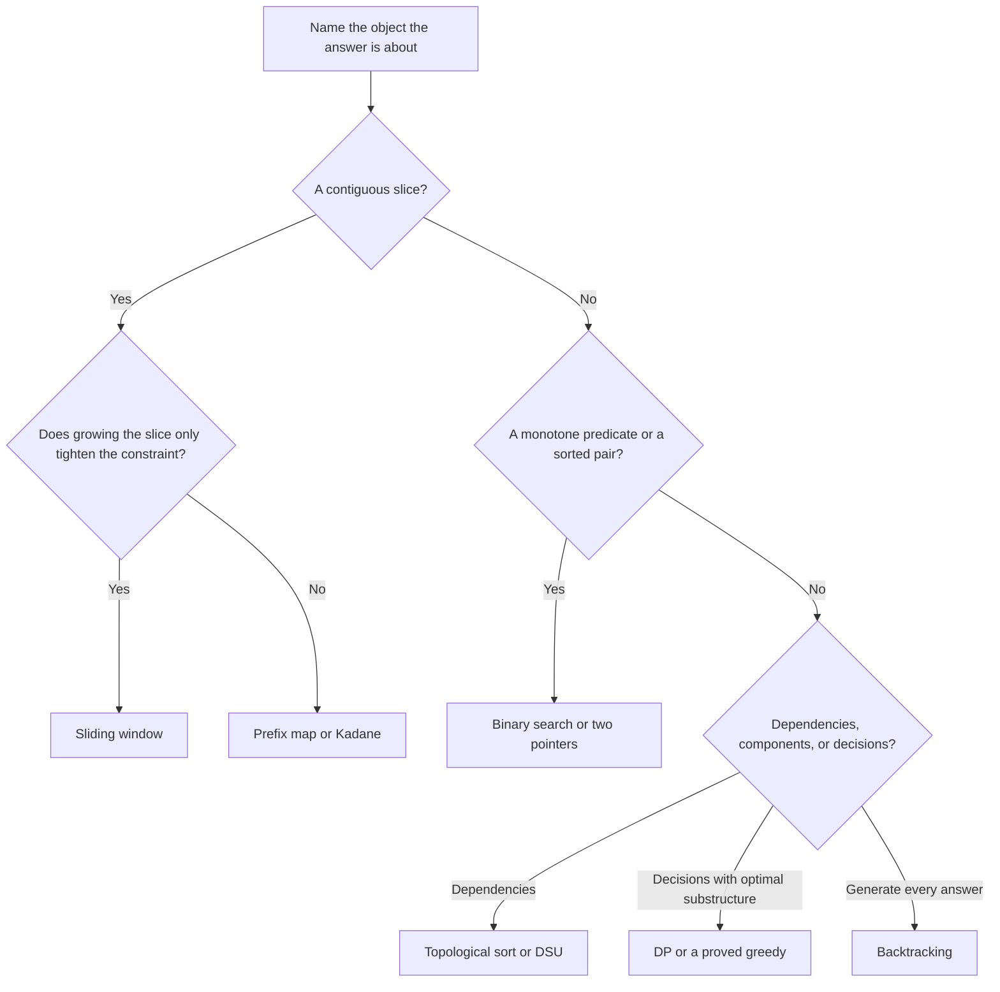

## Why this matters

A 45-minute interview is a recognition problem before it is a coding problem. The candidates who stall are often fluent in isolation and slow to name the family. This lesson is the index for the course: about twenty patterns that cover the coding rounds aimed at the 15 to 20 LPA band. A pattern is not a slogan you paste onto a problem. It is a contract between the shape of the input and a technique whose correctness you already proved in an earlier lesson. You use the index to choose a family in the first few minutes, then you drop into that lesson's argument. Memorizing two hundred solutions without the contracts does not survive a reworded prompt.

## Intuition

Read the contract out loud. Contiguous subarray, sorted pair, monotone predicate, shortest unweighted path, dependencies, optimal substructure, a prefix code, a stream of the top k. Each phrase points at one or two families and rules out the rest. If two families still fit, compare their parameters. A subset question with n near 40 is meet-in-the-middle. The same question with a small target is knapsack. A range sum of an invertible array is a prefix or a Fenwick tree, not a fresh scan, once the queries repeat. The diagram below is the first cut. The catalog is the second.

## Core concept in depth

1. Two pointers. Trigger: a sorted array, a pair that sums to a target, a palindrome check, or a partition you can move inward. Tool: one index from each end, or a slow write index and a fast read index. The proof is that each discarded side cannot contain the answer. Lesson: [Two pointers](/lessons/two-pointers). Start with [Two Sum II](/practice/two-sum-ii), [Container With Most Water](/practice/container-with-most-water), and [Valid Palindrome](/practice/valid-palindrome). The usual bug is moving both pointers on an unsorted array and claiming the pair is gone.

2. Sliding window. Trigger: a contiguous slice, a longest or shortest slice under a constraint that only gets tighter when the slice grows. Tool: advance the right edge, and advance the left edge while the constraint is broken. Lesson: [Sliding window](/lessons/sliding-window). Problems: [Longest Substring Without Repeating Characters](/practice/longest-substring-without-repeating-characters), [Minimum Window Substring](/practice/minimum-window-substring), [Longest Repeating Character Replacement](/practice/longest-repeating-character-replacement). If the constraint is not monotone, the window is the wrong family and a prefix map may be the right one.

3. Prefix sums. Trigger: many range sums, a subarray sum equal to k, or "divisible by k." Tool: a prefix array, or a map from prefix value to how often you have seen it. Lesson: [Prefix sums and Kadane](/lessons/prefix-sums-and-kadane). Problems: [Subarray Sum Equals K](/practice/subarray-sum-equals-k), [Product of Array Except Self](/practice/product-of-array-except-self), [Continuous Subarray Sum](/practice/continuous-subarray-sum). Remember that a prefix of 0 is already in the map before the loop, or the subarray that starts at index 0 disappears.

4. Kadane and running extrema. Trigger: a maximum subarray, a maximum product, or a best-so-far price. Tool: a running best that resets when the past cannot help the future. Same lesson as prefixes. Problems: [Maximum Subarray](/practice/maximum-subarray), [Maximum Product Subarray](/practice/maximum-product-subarray), [Best Time to Buy and Sell Stock](/practice/best-time-to-buy-and-sell-stock). The product version tracks both the best and the worst ending here, because a negative can flip.

5. Binary search on a predicate. Trigger: a sorted array, or an unsorted array hiding a monotone yes-or-no function of a numeric answer, such as "can this capacity ship in time." Tool: the lower-bound loop from the searching lesson, and a linear check of the candidate. Lesson: [Binary search variants](/lessons/binary-search-variants). Problems: [Koko Eating Bananas](/practice/koko-eating-bananas), [Split Array Largest Sum](/practice/split-array-largest-sum), [Capacity to Ship Packages Within D Days](/practice/capacity-to-ship-packages-within-d-days). Draw the predicate. If it is not monotone, you are not allowed to discard a half.

6. Fast and slow pointers. Trigger: a cycle in a linked list, the middle of a list, or a duplicate in a restricted range that you can treat as a functional graph. Tool: Floyd's cycle finding. Lesson: [Linked list patterns](/lessons/linked-list-patterns). Problems: [Linked List Cycle](/practice/linked-list-cycle), [Linked List Cycle II](/practice/linked-list-cycle-ii), [Find the Duplicate Number](/practice/find-the-duplicate-number). Do not destroy the list if the problem forbids it.

7. Linked list reversal. Trigger: reverse a whole list, a sublist, or groups of k. Tool: three references, previous, current, and next, or a recursive reverse of the tail that you only use when you can explain the stack. Same lesson. Problems: [Reverse Linked List](/practice/reverse-linked-list), [Reverse Linked List II](/practice/reverse-linked-list-ii), [Reverse Nodes in k-Group](/practice/reverse-nodes-in-k-group). Draw the empty list and a list of one node before you touch k-group.

8. Monotonic stack. Trigger: the next greater element, the previous smaller element, or the largest rectangle in a histogram. Tool: a stack of indexes whose values stay increasing or decreasing, popping when the newcomer breaks the order. Lesson: [Monotonic stacks](/lessons/monotonic-stacks). Problems: [Daily Temperatures](/practice/daily-temperatures), [Next Greater Element I](/practice/next-greater-element-i), [Largest Rectangle in Histogram](/practice/largest-rectangle-in-histogram). Store indexes, not values, when the answer is a distance.

9. Monotonic deque. Trigger: the maximum or minimum inside every window of a fixed length. Tool: a deque of indexes, dropping the back while it is worse than the newcomer, and dropping the front when it slides out of the window. Problem: [Sliding Window Maximum](/practice/sliding-window-maximum). A heap also works and costs an extra log factor, plus lazy deletion. The deque is linear.

10. Hash counting. Trigger: a complement you can look up, a frequency, an anagram, a longest consecutive run. Tool: a map or a set, and a statement about expected constant time. Lesson: [Hash maps and sets](/lessons/hash-maps-and-sets). Problems: [Two Sum](/practice/two-sum), [Group Anagrams](/practice/group-anagrams), [Longest Consecutive Sequence](/practice/longest-consecutive-sequence). Worst-case hash time is linear per operation. Say "expected." Caches with eviction are the design problems [LRU Cache](/practice/lru-cache) and [LFU Cache](/practice/lfu-cache), taught in [LRU and LFU](/lessons/lru-and-lfu).

11. BFS for shortest paths. Trigger: an unweighted graph or a grid, and a minimum number of edges or steps. Tool: a queue and a visited set marked when you enqueue, not when you dequeue. Lesson: [BFS, DFS, and grids](/lessons/bfs-dfs-and-grids). Problems: [Number of Islands](/practice/number-of-islands), [Rotting Oranges](/practice/rotting-oranges), [Word Ladder](/practice/word-ladder), [Shortest Path in Binary Matrix](/practice/shortest-path-in-binary-matrix). Weighted edges with non-negative weights are Dijkstra, from the shortest-paths lesson, not this queue.

12. Backtracking. Trigger: generate combinations, permutations, partitions, or a search that must undo a choice. Tool: recurse, mark, explore, unmark. Lesson: [Backtracking](/lessons/backtracking). Problems: [Subsets](/practice/subsets), [Permutations](/practice/permutations), [Combination Sum](/practice/combination-sum), [Word Search](/practice/word-search), [N-Queens II](/practice/n-queens-ii), [Palindrome Partitioning](/practice/palindrome-partitioning). Prune with a bound when you have one. Do not prune with a wish.

13. Topological sort. Trigger: prerequisites, a course schedule, an alien order you do not have in this bank, or any DAG where an edge means "before." Tool: Kahn's algorithm, indegrees and a queue, or DFS with colors. A cycle means no order. Lesson: [Topological sort](/lessons/topological-sort). Problems: [Course Schedule](/practice/course-schedule) and [Course Schedule II](/practice/course-schedule-ii). If the graph is undirected, this is the wrong tool.

14. Union-find. Trigger: connectivity under unions, a redundant edge, accounts that share an email, or Kruskal. Tool: parent pointers, union by rank, and path compression. Lesson: [MST, DSU, and bridges](/lessons/mst-dsu-and-bridges). Problems: [Number of Provinces](/practice/number-of-provinces), [Redundant Connection](/practice/redundant-connection), [Accounts Merge](/practice/accounts-merge). If you need the path itself, BFS or DFS is the better answer. DSU answers "same component," not "the route."

15. Heaps and top-k. Trigger: the k largest, a running median, or merging k sorted lists. Tool: a binary heap. For the kth largest, a heap of size k is enough. Lesson: [Binary heaps](/lessons/binary-heaps). Problems: [Kth Largest Element in an Array](/practice/kth-largest-element-in-an-array), [Top K Frequent Elements](/practice/top-k-frequent-elements), [Merge k Sorted Lists](/practice/merge-k-sorted-lists), [K Closest Points to Origin](/practice/k-closest-points-to-origin). Quickselect has a better expected bound and a worse constant in practice. Name both if they ask.

16. Intervals. Trigger: merge overlaps, how many rooms, how many arrows, or a schedule sorted by finish time. Tool: sort by the endpoint the argument names, then scan. Lesson: [Partitions, majority, and intervals](/lessons/partitions-majority-and-intervals). Problems: [Merge Intervals](/practice/merge-intervals), [Meeting Rooms II](/practice/meeting-rooms-ii), [Non-overlapping Intervals](/practice/non-overlapping-intervals), [Insert Interval](/practice/insert-interval). Sorting by the wrong endpoint is the entire bug.

17. Greedy exchange. Trigger: a local choice you can swap into any optimal solution, jumps, gas, or the smallest number after deletions. Tool: one forward pass after you can say the swap. Lesson: [Greedy algorithms](/lessons/greedy-algorithms). Problems: [Jump Game](/practice/jump-game), [Gas Station](/practice/gas-station), [Partition Labels](/practice/partition-labels), [Task Scheduler](/practice/task-scheduler). If you cannot finish the exchange sentence, go back to DP. Non-canonical coins are the counterexample.

18. Knapsack dynamic programming. Trigger: optimal substructure on a capacity, a count of ways, or a take-or-skip decision, with n and the capacity both moderate. Tool: the 0/1 loop that walks capacity backward, or the unbounded loop that walks it forward. Lesson: [Classic DP families](/lessons/classic-dp-families), after the [DP framework](/lessons/dp-framework). Problems: [Knapsack](/practice/knapsack), [Coin Change](/practice/coin-change), [Coin Change II](/practice/coin-change-ii), [Partition Equal Subset Sum](/practice/partition-equal-subset-sum), [House Robber](/practice/house-robber), [Word Break](/practice/word-break), [Longest Common Subsequence](/practice/longest-common-subsequence), [Edit Distance](/practice/edit-distance). Combinations and permutations of coins are different loop orders. Do not mix them.

19. Bitmask and state-machine DP. Trigger: a subset of a small ground set, or a stock problem whose state is "holding, sold, cooling." Tool: an integer mask, or a fixed handful of rolling variables. Lesson: [Advanced DP](/lessons/advanced-dp) and the mask arithmetic in [Bit manipulation](/lessons/bit-manipulation). Problem: [Best Time to Buy and Sell Stock with Cooldown](/practice/best-time-to-buy-and-sell-stock-with-cooldown). If the ground set is larger than about 20, the mask does not fit. Use the bit lesson's test, set, and clear operations, and do not reinvent them in the DP loop.

20. Tries and string matching. Trigger: many prefixes, a dictionary of words, or a single pattern searched in a long text. Tool: a trie node per character, or the prefix function, or a rolling hash. Lessons: [Segment trees, Fenwick trees, and tries](/lessons/segment-fenwick-and-tries) and [KMP, Rabin-Karp, and Z](/lessons/kmp-rabin-karp-z). Problems: [Implement Trie](/practice/implement-trie), [Word Break](/practice/word-break), [Find the Index of the First Occurrence](/practice/find-the-index-of-the-first-occurrence), [Longest Happy Prefix](/practice/longest-happy-prefix). Word break is DP over the dictionary. The trie is how the dictionary is stored when the word list is the heavy part. They compose.

Two shapes sit underneath almost every entry. A search that tries a choice and undoes it is recursive backtracking. A scan that maintains an invariant and moves an endpoint is an iterative window, pointer, or stack. When a problem is new, write the recursive specification if the object is a decision tree, or the invariant if the object is a scan, and only then tighten it. The [approach guide](/lessons/interview-approach-guide) is the order of work. This catalog is the menu that guide points at.

## Diagram and dry run



Classify four prompts before writing code.

| Prompt | Family | Why the neighbors lose |
| --- | --- | --- |
| Longest subarray with at most two distinct values | Sliding window | Prefix sums do not express "at most two distinct" as a numeric target |
| Minimum capacity so the packages ship within D days | Binary search on the answer | The capacity is monotone, and a greedy check is linear |
| Can these courses be finished given prerequisites | Topological sort | Union-find would ignore edge direction |
| Count subsets of 40 integers that sum to a huge target | Meet-in-the-middle | The knapsack table is the size of the target, which does not fit |

A fifth prompt, "range sum with point updates, many of them," is a Fenwick tree or a segment tree, from the trees module, not a pattern you invent during the round. If you only remember blocks, say "sqrt(n) per query" and offer the tree as the improvement.

## Runnable Python

The same two-sum specification, first as a recursive search that tries the rest of the array, then as the iterative hash scan you should actually submit. The recursion is the brute force. It makes the complement explicit. The loop keeps the invariant that every index before i is already stored.

```python
def two_sum_rec(nums: list[int], target: int, i: int = 0) -> list[int]:
    if i >= len(nums):
        return []
    for j in range(i + 1, len(nums)):
        if nums[i] + nums[j] == target:
            return [i, j]
    return two_sum_rec(nums, target, i + 1)


def two_sum(nums: list[int], target: int) -> list[int]:
    seen: dict[int, int] = {}
    for i, value in enumerate(nums):
        need = target - value
        if need in seen:
            return [seen[need], i]
        seen[value] = i
    return []
```

On 2, 7, 11, 15 with target 9, the recursive search returns indexes 0 and 1 after one successful pair check. The hash scan stores 2 at index 0, then sees 7 whose complement is already stored, and returns the same indexes. Both are correct. The recursion does Theta(n squared) additions in the worst case. The hash scan is expected linear. In a round you may say the recursive version in one sentence and write the loop.

## Complexity and trade-offs

| If you recognize | You usually pay | If you miss it, you pay |
| --- | --- | --- |
| Sliding window or two pointers | linear after a possible sort | a quadratic double loop |
| Binary search on the answer | the check times log of the range | a linear scan of every candidate answer |
| Monotonic stack or deque | linear | a nested "scan until greater" |
| Hash complement | expected linear, linear space | a sort plus two pointers, or worse |
| BFS on an unweighted graph | linear in vertices plus edges | Dijkstra's extra log, still correct |
| DSU | almost linear | a BFS per query |
| 0/1 knapsack | n times capacity | 2 to the n subsets |
| Meet-in-the-middle | 2 to the n over 2 | a DP table that does not fit |
| Trie or KMP | linear in the total characters | a scan of the text per pattern |

Recognition does not change the optimal complexity. It changes whether you reach it before the clock does. A correct quadratic solution that you finish and test is worth more than a named linear solution you do not finish. State the quadratic, then improve it if the constraints require it.

## Tricks, tips, and patterns

Keep a one-page index of the twenty triggers, not the twenty codes. In the round, write the trigger you think you heard and the invariant it needs. If you cannot write the invariant, you have not recognized the pattern, you have remembered a title. Sort endpoints only after you know which endpoint the exchange uses. Mark visited when you enqueue. Walk capacity backward for 0/1 knapsack. Include the empty prefix in a prefix map. Draw 2n - 1 palindrome centers. For graphs, ask directed or undirected, weighted or not, and whether a cycle is possible. Those three questions choose BFS, Dijkstra, topo, or DSU. When the problem says "return any" you may break ties however the code finds them. When it says "return all," you need the generator, which is usually backtracking.

## Common mistakes and edge cases

Forcing a window onto a non-monotone constraint and skipping the true answer. Binary searching a predicate you have not tested at the boundaries. Using BFS on negative weights. Using DSU on a directed dependency. A greedy coin solution on a non-canonical system. Mixing coin combinations with coin permutations. Forgetting the empty-prefix key. Popping a monotonic stack of values when the answer needs indexes. Generating subsets with duplicate branches because you did not sort and skip. A trie that marks every character as a word end. An off-by-one in binary search that loops forever because the mid update does not shrink the range. Pattern names used in the interview without a complexity. The name is not the solution.

## Interview notes

Spend the first three minutes on the contract and the family. Say "this is a monotone capacity, I will binary search it and check a day count" rather than "I have seen this." If you are wrong, the invariant will fail on the example and you still have time to switch. The [approach guide](/lessons/interview-approach-guide) tells you how to spend the rest of the slot. The next lesson is a timed rehearsal of that spending. Do not collect new patterns during a mock. Use this list.

## Practice problems

Work one problem from each family you cannot yet name in under a minute. A compact set that touches the catalog:

1. [Two Sum](/practice/two-sum), [Longest Substring Without Repeating Characters](/practice/longest-substring-without-repeating-characters), and [Subarray Sum Equals K](/practice/subarray-sum-equals-k).
2. [Koko Eating Bananas](/practice/koko-eating-bananas), [Daily Temperatures](/practice/daily-temperatures), and [Sliding Window Maximum](/practice/sliding-window-maximum).
3. [Course Schedule](/practice/course-schedule), [Number of Islands](/practice/number-of-islands), and [Redundant Connection](/practice/redundant-connection).
4. [Coin Change](/practice/coin-change), [House Robber](/practice/house-robber), and [Word Break](/practice/word-break).
5. [Jump Game](/practice/jump-game), [Merge Intervals](/practice/merge-intervals), and [Implement Trie](/practice/implement-trie).

## Summary and cheat sheet

- A pattern is a trigger plus an invariant you can prove, not a problem title.
- Window and two pointers need a monotone reason to move an endpoint.
- Binary search needs a monotone predicate. Test both bounds.
- Stacks and deques stay ordered. Store indexes when distance matters.
- BFS is for unweighted distance. Dijkstra is for non-negative weights. Topo is for directed prerequisites. DSU is for undirected connectivity.
- 0/1 knapsack walks capacity backward. Unbounded walks it forward. Masks need a small ground set.
- Meet-in-the-middle is the subset tool when n is near 40. DP is the tool when the target is small.
- Tries store prefixes. KMP stores borders. Do not confuse a substring with a subsequence.
- Say the family, the complexity, and the invariant before you code.

## Further reading

- [Wikipedia — Algorithmic paradigm](https://en.wikipedia.org/wiki/Algorithmic_paradigm)
- [CP-Algorithms](https://cp-algorithms.com/) — the same families, written as reference implementations.
- [CLRS, Introduction to Algorithms](https://mitpress.mit.edu/9780262046305/introduction-to-algorithms/) — the proofs this catalog points at.
- The previous lesson in this course, [Interview approach](/lessons/interview-approach-guide), for the order of work inside one problem.
