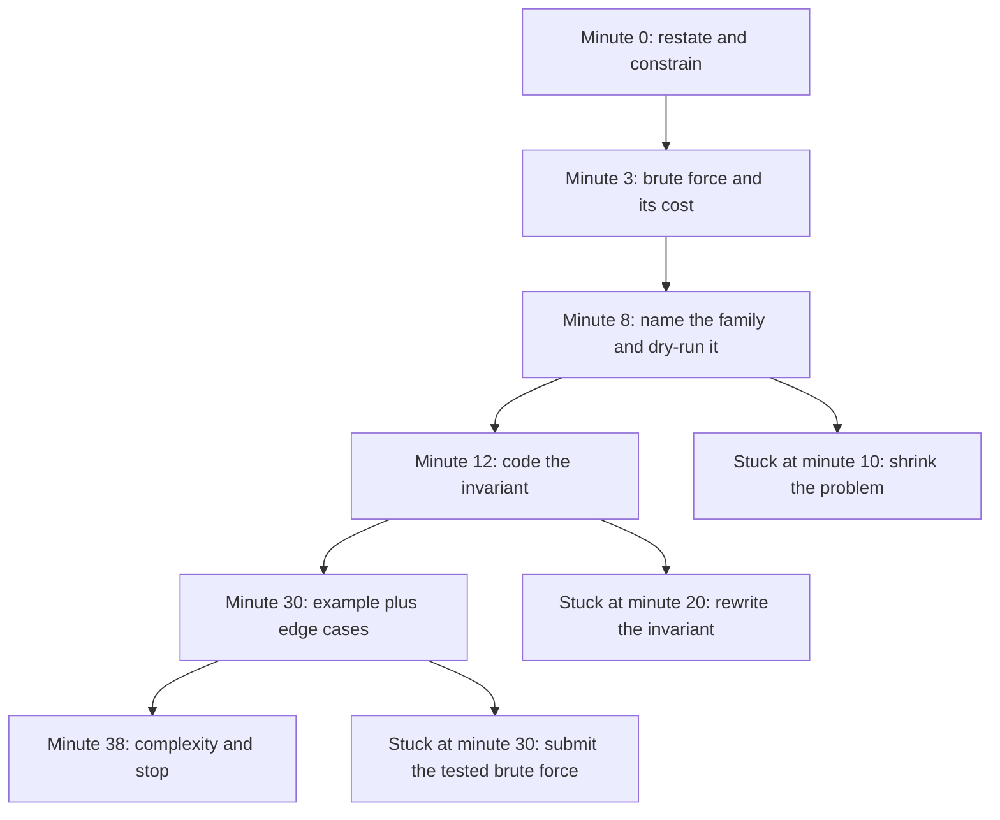

## Why this matters

Knowing the twenty patterns and using one of them at minute six are different skills. A hiring loop aimed at about 15 to 20 LPA is usually an online assessment and then one or two live coding rounds, sometimes with a short conversation about a project you actually built. Each live slot is about 45 to 60 minutes and contains one hard problem or two medium ones. The interviewer is scoring whether you can clarify a contract, reach a correct approach, code it, and test it, while they can still follow you. This lesson is the rehearsal protocol for that slot. The approach guide is the checklist for a single problem. The pattern catalog is the menu. This chapter is the clock.

## Intuition

Treat a mock as a closed-book performance, not as a study session. Pick a problem you have not solved this week. Start a timer. Speak the way you will speak on the call. When you get stuck, follow the stuck protocol below instead of opening the editorial. After the timer, and only then, read the editorial and write a short after-action note: which trigger you missed, which test would have caught the bug, and which lesson to reread. Five honest mocks will teach you more than twenty editorial read-throughs. The point of the note is to change the next mock, not to collect remorse.

## Core concept in depth

The loop, so you can aim at it. An online assessment is two or three problems in 60 to 90 minutes, often with hidden tests and no interviewer to rescue a misread constraint. Practice those as silent timed sets: no hints, submit only when the examples and your own edge cases pass. A live round is slower and more verbal. You can ask whether the array is sorted, whether values fit in 32 bits, and whether "substring" was meant rather than "subsequence." Ask. A wrong assumption you did not check becomes a wrong program you then debug in public. A hiring-manager conversation at this band is about a project, a bug you owned, and how you tested it. It is not a third algorithms final. Do not neglect it, and do not let it crowd out the coding practice that decides the earlier rounds.

The 45-minute script for one medium-hard problem. Minutes 0 to 3: restate the problem in one sentence, name the input size, and ask the two constraints that choose a family. Write an example the interviewer did not give you, including an empty input or a one-element input. Minutes 3 to 8: state a correct brute force and its complexity. If the constraints allow it, say so and offer to code it. If they do not, name the family from the catalog and the invariant. Minutes 8 to 12: dry-run the intended approach on the example, by hand, before any code. This is where off-by-one and "I actually needed indexes" show up cheaply. Minutes 12 to 30: code the approach in order, helper functions first if the helper is the risky part. Compile early. Minutes 30 to 38: run the given example, then the empty case, the single-element case, and one case that used to break your invariant. Minutes 38 to 45: state complexity again, mention one improvement you did not implement, and stop talking yourself into a rewrite. If the slot is two problems, the first one must be done by minute 20. A perfect solution to problem one and silence on problem two loses to two correct medium solutions.

The stuck protocol. At minute 10, if you have no family, shrink the problem. Drop a constraint, solve that, and say which constraint you dropped. At minute 20, if the approach is named but the code is tangled, stop typing and rewrite the invariant in one line. Delete code that does not serve that line. At minute 30, if the idea is still incomplete, code the brute force you already believe, test it, and spend the rest on one optimization you can finish. A tested quadratic beats an untested linear sketch. Never spend the last ten minutes rewriting a working solution into a different style.

What you say while you code. Narrate decisions, not keystrokes. "I store indexes because the answer is a distance." "I walk the capacity backward so each item is used once." "I mark the cell when I enqueue it, otherwise the queue holds duplicates." Silence of a minute while you think is fine if you announce it. Silence of five minutes while the interviewer wonders whether you are stuck is how rounds die. If you want a hint, ask a precise question: "Is the graph guaranteed to be a DAG?" is a clarifying question. "Can you tell me the trick?" is a request for them to solve it. Prefer the first.

How to practice across six weeks with this course, assuming you already write ordinary Python. Week 1: foundations, arrays, hashing, and ten problems from those lessons, untimed, with the editorial only after a real attempt. Week 2: lists, stacks, recursion, backtracking, fifteen problems, and one 45-minute mock at the end. Week 3: binary search, sorts, trees, heaps, fifteen problems, two mocks. Week 4: graphs, including one weighted shortest path and one DSU problem, two mocks. Week 5: the three DP lessons, greedy, and bits, fifteen problems, two mocks. Week 6: number theory, string algorithms, the advanced techniques, the pattern catalog, and a mock every other day. The point of the early weeks is correctness and vocabulary. The point of week 6 is the clock. If a mock collapses, the after-action note names a lesson, and the next day you reread that lesson rather than collecting a new problem set.

The scorecard, out of ten, filled in after every mock before you read the editorial. One point for a restated contract and a real question about constraints. One point for a brute force and its cost. Two points for a correct approach you can justify. One point for stating complexity before the code. Two points for code that passes the example and your edge cases. One point for those edge cases actually being the dangerous ones. One point for narration the interviewer could follow. One point for either a second problem or a substantive follow-up, such as "what if the weights can be negative." A seven is a passable round. A nine is a strong one. A four with a beautiful solution you found at minute 50 is a failed slot. Write the number down. The trend is the feedback.

The after-action note has four lines and no more. What family was it. What trigger you should have heard. What bug a test would have caught. Which lesson section to reread, by name. If you missed a pattern that is on the catalog, you do not need a new resource. You need another problem from that row of the catalog, solved cold two days later. Spacing matters. Solving the same problem again the same evening mostly tests your short-term memory.

What to stop doing. Reading an editorial in the first fifteen minutes. Collecting problems into a list you never close. Rewatching a solution video at 2x and counting it as practice. Grinding near-duplicate prompts that change only a number. This course already replaced that style of drill with distinct classics. Use them. Also stop claiming a complexity you did not derive. If the interviewer asks "why is this linear" and you say "because it is a sliding window," you have not answered. The answer is "each index enters and leaves the window at most once."

A note on tools. In a shared editor you may not have your snippets. Practice without them. Type the binary-search skeleton, the BFS skeleton, and the knapsack loop from memory once a week until they are boring. You are allowed to use clear names. You are not required to compress the program into a single expression. Interview code should be readable by the person who has to decide whether to hire you.

The project conversation, briefly, because it shares the slot budget on some loops. Pick one project. Be ready to explain the data, the slow query or the bug, the measurement that showed the fix, and what you would redo. That story is not a substitute for the pattern catalog. It is the part of the loop the catalog does not cover. Four or five sentences, then a pause for their question, beats a tour of every file.

## Diagram and dry run



A reconstructed round on "longest substring without repeating characters," with the clock.

| Minute | What you do | What you do not do |
| --- | --- | --- |
| 1 | Restate: longest contiguous slice with all distinct characters. Ask the character set and the length. | Start a nested loop in the editor |
| 4 | Brute force: every pair of endpoints, check the slice with a set. Quadratic times the alphabet, or cubic if you rescan. | Claim it is fine for length 10 to the 5th |
| 7 | Family: sliding window. Invariant: the window holds distinct characters. Move the left edge while the new character is already inside. | Reach for a suffix array |
| 11 | Dry-run "abba" or "abcabcbb" on paper. Window lengths 1, 2, 3, then a repeat forces the left edge forward. Answer 3. | Dry-run in your head only |
| 25 | Code the map from character to last index, or a frequency map. Both are fine if the invariant holds. | Rewrite twice between the two styles |
| 34 | Run the example, the empty string, a string of one character, and a string of all identical characters. | Invent a new approach because the all-identical case was boring |
| 40 | Time is linear because each index is pushed and popped at most once. Space is the alphabet. Stop. | Micro-optimize the hash |

That round scores the approach points, the code points, and the edge-case point. It loses the second-problem point because there was no time left, which is acceptable when the single problem was the hard one. If this had been the first of two mediums, minute 40 would be a failure of pacing, and the after-action note would say so.

## Runnable Python

Keep the brute-force specification next to the window, so the mock has something to test against. The recursive checker below answers "does this slice contain a duplicate" by scanning the tail. It is intentionally naive. The iterative window is the solution you code after minute 7. Use the checker on short strings when you want an oracle. Use the window in the interview.

```python
def has_repeat(s: str, left: int, right: int) -> bool:
    if left >= right:
        return False
    if s[right] in s[left:right]:
        return True
    return has_repeat(s, left, right - 1)


def longest_unique_brute(s: str) -> int:
    best = 0
    for left in range(len(s)):
        for right in range(left, len(s)):
            if has_repeat(s, left, right):
                break
            best = max(best, right - left + 1)
    return best


def longest_unique(s: str) -> int:
    last: dict[str, int] = {}
    left = best = 0
    for right, ch in enumerate(s):
        if ch in last and last[ch] >= left:
            left = last[ch] + 1
        last[ch] = right
        best = max(best, right - left + 1)
    return best
```

On "abcabcbb" both functions return 3. On the empty string both return 0. On "aaaa" both return 1. The brute force is the one you describe at minute 4. The window is the one you code. If they disagree on a case you invented, believe neither until you dry-run that case by hand. The hand dry-run is the third implementation, and it is the one that adjudicates.

## Complexity and trade-offs

| Way of spending the 45 minutes | What the interviewer can grade | Likely score on the card |
| --- | --- | --- |
| Clarify, brute force, invariant, code, tests | the whole round | 7 to 10 if the idea is sound |
| Silent coding of a memorized solution | only the final program | high if it is the right memory, harsh if the prompt differs |
| Twenty minutes of theory, little code | communication, not execution | stuck near 4 |
| A tested quadratic when the linear form would not fit the clock | honesty and correctness | often enough, and you can name the improvement |
| A rewrite in the last eight minutes | almost nothing, the tests were wiped | the failure mode this protocol exists to prevent |

Mocks are more expensive than untimed practice and more informative per hour. Two a week is enough in the last fortnight. More than that, without after-action notes, is just fatigue. Untimed work is where you learn a proof. Timed work is where you learn whether you can find the proof under a clock. You need both, in that order.

## Tricks, tips, and patterns

Put the constraints at the top of the editor as a comment before you code. Write the function signature early so you stop solving a different problem. Keep a tiny list of edge cases you always consider: empty, one element, all equal, already sorted, reverse sorted, duplicates, negative numbers if the statement allows them, and the maximum size. Not every case applies. Choosing which ones apply is the skill. When the interviewer offers a follow-up, repeat the new constraint and say what it breaks in your current invariant before you edit. For the assessment, read all problems for two minutes and start with the one you can finish, not the one that looks impressive.

## Common mistakes and edge cases

Starting the timer and opening a tab of hints. Counting a reread of your own code as a mock. Skipping the hand dry-run because the problem felt familiar. Familiar problems are where you narrate badly, because you skip the invariant the interviewer needed to hear. Failing to ask whether indexes or values are required. Off-by-one errors you would have seen on paper. A binary search whose range does not shrink. Forgetting to reset state between tests in an assessment. Talking for fifteen minutes without a function signature. Ending the mock without the four-line note, so the next mock repeats the same miss. Treating a score of 5 as "almost" and not rereading the lesson. Five means a specific family is still cold.

## Interview notes

On the day, use the same script. Bring a blank page for the dry-run. If you blank on a pattern name, describe the invariant anyway. "Each index moves forward only" is enough to start a window even if you forget the phrase sliding window. If you finish early, ask what they would like next: a harder constraint, tests, or complexity. Do not invent a third problem they did not ask for. Thank them and stop. The catalog and the approach guide are the two pages to review the evening before, not a new chapter.

## Practice problems

Run these as mocks, one per sitting, closed notes. Stop at 45 minutes even if you are close, then write the four-line note.

1. [Minimum Window Substring](/practice/minimum-window-substring) — window, easy to over-talk.
2. [Course Schedule II](/practice/course-schedule-ii) — graph family choice in the first three minutes.
3. [Edit Distance](/practice/edit-distance) — DP table, dry-run a 3 by 3 before coding.
4. [LRU Cache](/practice/lru-cache) — design plus code, a common second half of a round.
5. [Count Subsets With Sum](/practice/count-subsets-with-sum) — forces the parameter question, n versus target.

Then one mixed pair in a single 45-minute sitting: [Valid Parentheses](/practice/valid-parentheses) and [Coin Change](/practice/coin-change). The pair is the pacing drill. The first should be done while the clock still has twenty minutes.

## Summary and cheat sheet

- A mock is closed-book and timed. The editorial comes after the note.
- Minutes 0 to 3 restate. Minutes 3 to 8 are the brute force. Minutes 8 to 12 are the hand dry-run. Then code, then edge cases, then stop.
- At minute 30, a tested simpler solution beats a rewrite.
- Score out of ten before you read the solution. Keep a four-line note: family, trigger, bug, lesson.
- Six weeks: vocabulary first, clock last. Two mocks a week near the end.
- Ask about constraints. Narrate decisions. Type the skeletons from memory.
- The assessment is silent. The live round is the same algorithms plus the script.
- Review the pattern catalog and the approach guide the evening before, then sleep.

## Further reading

- [Wikipedia — Software engineering interview](https://en.wikipedia.org/wiki/Job_interview) is broader than a coding round. Use it for the conversational half.
- [CP-Algorithms](https://cp-algorithms.com/) when an after-action note names a technique you want stated formally.
- The two companions in this course: [Interview approach](/lessons/interview-approach-guide) and [Interview patterns](/lessons/interview-patterns).
