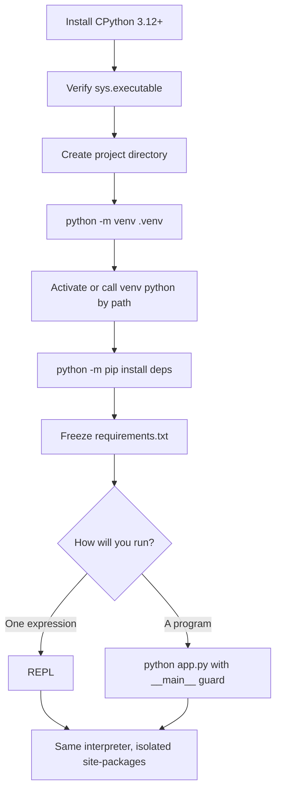

## Why this matters

Python is the default language for a huge slice of product engineering: HTTP APIs, data jobs, automation, machine-learning glue, and the whiteboard language many Indian product and service companies still use in SDE-1 and SDE-2 loops. A 15–20 LPA backend offer rarely hinges on reciting syntax. It hinges on whether you can ship a small service whose dependencies install the same way on your laptop, in CI, and on a teammate's machine.

That bar is lost in the first hour if the environment is sloppy. The classic failures are concrete. You install `requests` with one interpreter and run the script with another, so import fails even though `pip list` looks fine. You install packages into the system Python, then a later OS update or a second project upgrades a shared library and both projects break. You copy a snippet from a Python 2 tutorial and `print` is a statement, `raw_input` does not exist, and integer division surprises you. You commit a `.venv` directory full of platform-specific binaries and the repository becomes unusable on the other operating system.

This lesson fixes the foundation every later module assumes. You will know which binary you are talking to, how to isolate a project, how to record dependencies, and how to run a script so that importing it as a library does not execute side effects. Those habits are interview-relevant because hiring managers ask "how do you set up a Python service?" and the answer is not "I click Run in an IDE."

## Intuition

Treat the machine as a workshop with one power outlet and many jobs. The **interpreter** is the power tool: CPython reads your source, compiles it to bytecode, and executes that bytecode. A **script** is a saved blueprint you can run again. The **REPL** is a scrap of paper on the bench where you try one cut before you commit it to the blueprint. A **virtual environment** is a labeled cabinet. Packages you install while that cabinet is open land inside it, not in the shared hallway. **pip** is the catalog that delivers wheels into the open cabinet. **requirements.txt** is the packing list so another cabinet can be stocked the same way.

The mental model that prevents bugs is identity, not brand names. "I installed requests" is incomplete. "This `python` executable, whose `sys.prefix` is this venv, has `requests` on its `sys.path`" is complete. Whenever a module is missing, you ask which executable ran, not whether the internet works.

## Core concept in depth

### Language versus implementation

Python-the-language is specified by the language reference and by PEPs that change syntax or semantics. CPython is the reference implementation, written mostly in C, and it is what `python.org` installs. PyPy is an alternative implementation with a JIT. MicroPython targets microcontrollers. Interview code and almost all backend jobs mean CPython 3.11 or 3.12 unless the job description says otherwise. When someone says "Python is slow," they usually mean CPython executing pure-Python loops, not the language's abstract semantics. The GIL, bytecode, and extension modules all belong to CPython. Later lessons on concurrency and performance depend on that distinction.

Python 3 is not a dialect of Python 2. Print is a function. Division of two ints with `/` yields a float. Strings are Unicode text, and `bytes` are a separate type. `range` is a lazy sequence. There is no `xrange`, no `raw_input`, and no `iteritems`. If a tutorial shows those names, close it.

### Installing and selecting an interpreter

Install Python 3.12 or newer from the official installer, from `pyenv`, or from your OS package manager when you understand which version it pins. On Windows, enable "Add python.exe to PATH" and rely on the **py launcher**. `py -3.12 --version` selects a specific install even when several exist. `py -0p` lists registered interpreters. On macOS and Linux, `python3` is often the system binary and `python` might be absent or might point at an older install. Never assume the bare name `python` is the one you just installed.

Verify both the version and the path:

```bash
python --version
python -c "import sys; print(sys.executable)"
python -m pip --version
```

`python -m pip` is the habit that saves you. The `-m` flag runs a module using the interpreter you just named, so pip installs into that interpreter's `site-packages`. A bare `pip` command is a script whose shebang may point at a different Python. That mismatch is the number-one "I installed it but import fails" bug.

### The REPL

Start `python` with no arguments and you are in the Read–Eval–Print Loop. Each line is read, compiled, executed, and the result of an expression is printed and stored in `_`. Use it to probe types, try a slice, or call `help(str.split)`. `dir(obj)` lists attributes. `type(obj)` and `id(obj)` tell you what object you hold and its identity. Exit with `exit()` or Ctrl-Z then Enter on Windows, Ctrl-D on Unix.

The REPL is a terrible place to write a program. History is easy to lose, there is no review, and indentation mistakes pile up. Use it for questions that fit in one expression. Put anything you want to keep in a file.

### Scripts and the main guard

A program is a `.py` file. The conventional entry function is `main`, and the file calls it only when it is executed as a script:

```python
def main() -> None:
    name = input("Your name: ")
    print(f"Welcome to CodeCraft Academy, {name}!")


if __name__ == "__main__":
    main()
```

`__name__` is a module global set by the import system. When you run `python hello.py`, the interpreter sets `__name__` to `"__main__"`. When another file executes `import hello`, `__name__` inside `hello` is `"hello"`, so `main()` does not run. That guard is how libraries stay import-safe. Forgetting it means importing a module opens a network connection, parses argv, or starts a server. Interviewers notice that bug immediately in take-home projects.

Run the file with the same interpreter you installed packages into: `python hello.py`. Pass arguments after the filename; they land in `sys.argv`.

### Virtual environments

A venv is a directory containing a small Python launcher, a `pyvenv.cfg` that points at the base interpreter, and a `site-packages` folder. Creating one does not copy the entire standard library. The venv's `python` delegates to the base install and adds its own site-packages at the front of `sys.path`.

```bash
python -m venv .venv
```

Activation changes your shell's `PATH` so that `python` and `pip` resolve inside `.venv`. On Windows PowerShell:

```powershell
.\.venv\Scripts\Activate.ps1
```

On macOS and Linux: `source .venv/bin/activate`. The prompt usually gains a `(.venv)` prefix. `deactivate` restores the previous PATH. Activation is a shell convenience, not a requirement. You can always call `.venv\Scripts\python.exe` or `.venv/bin/python` explicitly, which is what CI should do so it does not depend on a human's prompt.

Detect a venv in code by comparing prefixes. In a venv, `sys.prefix` is the venv directory and `sys.base_prefix` is the interpreter the venv was created from. If they differ, you are inside a venv. This is more reliable than looking at an environment variable, because the variable is set by activation scripts and is absent when you invoke the venv Python by path.

Do not commit `.venv`. Add it to `.gitignore`. The directory contains absolute paths and platform binaries. Commit the dependency list instead.

### pip, requirements, and what not to install globally

| Command | What it actually does |
| --- | --- |
| `python -m pip install pkg` | Download a compatible wheel or sdist into this interpreter |
| `python -m pip install pkg==1.2.3` | Pin an exact version |
| `python -m pip install -r requirements.txt` | Install every line in the file |
| `python -m pip freeze` | Print name==version for installed distributions |
| `python -m pip uninstall pkg` | Remove a distribution |
| `python -m pip list` | Show installed distributions |
| `python -m pip check` | Warn about broken dependency relationships |

`freeze` records what is installed, including transitive dependencies, which makes it a blunt lock. A hand-written `requirements.txt` of direct dependencies is easier to read and less reproducible. Professional services eventually use a lock file (pip-tools, Poetry, or uv). For this course, freeze is enough if you understand it snapshots the whole environment, not your intent.

Upgrade pip itself inside the venv before installing much else: `python -m pip install -U pip`. Never `sudo pip install` into the system interpreter. Never install application dependencies into the Python that came with the OS if that Python is used by system tools.

### A first-day layout

```text
my-service/
  .venv/              # local, gitignored
  .gitignore          # contains .venv/
  requirements.txt
  app.py
  README.md
```

`.gitignore` should also ignore `__pycache__/`, `*.pyc`, `.pytest_cache/`, and `.mypy_cache/`. Those are caches, not source.

## Diagram / flowchart



### Dry-run: first day on a clean machine

| Step | Action | Result you should see |
| --- | --- | --- |
| 1 | `python -c "import sys; print(sys.executable)"` | A path ending in `python.exe` or `python`, version 3.12+ |
| 2 | `python -m venv .venv` | A `.venv` directory with `Scripts` or `bin` and `pyvenv.cfg` |
| 3 | Activate, then `python -c "import sys; print(sys.prefix)"` | Prefix is the project `.venv`, not the base install |
| 4 | `python -m pip install rich` | rich appears only in this venv's site-packages |
| 5 | Deactivate, run system `python -c "import rich"` | `ModuleNotFoundError` if the system env never had rich |
| 6 | Run `.venv` python on `hello.py` | Program prints, and imports resolve inside the venv |

Step 5 is the proof that isolation works. If rich imports after deactivate, you installed it into the wrong interpreter earlier.

## Code

The script below is the check you should run at the start of every project. It prints the interpreter identity and whether you are inside a venv. Extend it later to print `sys.path` when an import fails.

```python
import platform
import sys


def in_virtualenv() -> bool:
    base = getattr(sys, "base_prefix", sys.prefix)
    return sys.prefix != base


def describe_environment() -> None:
    print("=== CodeCraft environment check ===")
    print(f"version     : {sys.version.split()[0]}")
    print(f"executable  : {sys.executable}")
    print(f"platform    : {platform.platform()}")
    print(f"prefix      : {sys.prefix}")
    print(f"base_prefix : {getattr(sys, 'base_prefix', sys.prefix)}")
    print(f"inside venv : {in_virtualenv()}")
    print(f"path entries: {len(sys.path)}")


if __name__ == "__main__":
    describe_environment()
```

Run it twice: once with the system interpreter and once with `.venv\Scripts\python`. The `prefix` line must change. If it does not, you are not using the venv, and every later `pip install` will confuse you.

## Complexity analysis

Setup is not an algorithm, but the cost model is real and interviewers respect candidates who talk about it.

| Choice | Time cost when it goes wrong | Time cost when it is habitual |
| --- | --- | --- |
| Global `pip install` | Hours tracing which of three Pythons imported a package | One venv per repo, created in seconds |
| No lock or freeze | "Works on my machine" during the take-home review | `pip install -r` reproduces the environment |
| Wrong interpreter | `ModuleNotFoundError` that looks like a code bug | `sys.executable` answers it in one command |
| Committing `.venv` | Clone times and broken binaries on the other OS | Gitignore plus a requirements file |
| Unpinned dependencies | A Friday release upgrades you into a breaking API | Pins, then deliberate upgrades |

Creating a venv is O(1) relative to project size: it writes a small tree and points at the base install. Installing packages is dominated by download and wheel extraction, not by Python's runtime. The expensive resource is your debugging time, which grows with the number of interpreters you have accidentally mixed.

## Tricks, tips and patterns

- Always invoke tools as modules: `python -m pip`, `python -m venv`, `python -m pytest`, `python -m json.tool`. The module form binds the tool to the interpreter.
- Name the environment directory `.venv` so editors, gitignore templates, and teammates recognize it. Avoid `env`, `myenv`, and `venv2`.
- On Windows, if activation is blocked, set the current-user execution policy for local scripts rather than bypassing it globally in a way you do not understand. Calling the venv `python.exe` by path avoids activation entirely.
- Use `py -3.12 -m venv .venv` when several versions are installed so the venv is created from the version you intend. A venv does not float to a newer Python later; recreate it after you upgrade the base interpreter.
- Keep a one-line smoke check in every README: the exact command that creates the venv, installs requirements, and runs the app.
- When a tutorial says `pip install`, translate it to `python -m pip install` before you type it.
- `python -c "import pkg; print(pkg.__file__)"` shows the file that actually got imported. That path tells you which environment won.

## Common mistakes and edge cases

- Installing with `pip` from one terminal and running `python` from another. The fix is to print `sys.executable` in both contexts.
- Forgetting to activate, then concluding the package is broken. The package is in a different `site-packages`.
- Creating the venv with Python 3.12 and later upgrading the base install in place so `pyvenv.cfg` points at a missing home. Recreate the venv.
- Mixing Conda base, Conda env, and venv in one shell. `which python` or `Get-Command python` must match the environment you think is active. Conda activation and venv activation overwrite PATH in ways that stack badly.
- Committing `.venv`, `__pycache__`, or a local `secrets.env` because the gitignore was copied too late.
- Following Python 2 examples: `print x`, `except Exception, e`, `dict.iteritems()`, `/` truncating integers.
- Using `sudo` to silence a permission error. That installs into a system location you should not own. The permission error was a signal to use a venv.
- Assuming the IDE's selected interpreter matches the terminal. Set the IDE interpreter to `.venv` explicitly after you create it.

## Interview notes

You will not be asked to recite pip flags. You will be asked, in a screening or a system-design sidebar, how a Python service gets from a laptop to a repeatable build. A strong answer has four beats.

First, isolate dependencies per project with `venv` (or an equivalent such as `uv`, Poetry, or a container image). Say what problem isolation solves: two services can pin different versions of the same library. Second, distinguish the standard library, which ships with CPython, from third-party distributions on PyPI. Third, explain reproducibility: direct dependencies plus a lock or a frozen list, installed in CI with the same major Python version. Fourth, mention the `__main__` guard so the module can be imported by tests without starting the server.

Follow-ups you should be ready for:

- **venv versus virtualenv versus conda.** `venv` is in the standard library since 3.3 and is enough for application work. `virtualenv` is a third-party tool with a few extra features. Conda installs non-Python binaries too and is common in data science; it is a different ecosystem, not a better venv.
- **Why not commit site-packages?** They are platform-specific and huge. Commit the lock, install in CI.
- **How does Docker relate?** An image pins the OS, the interpreter, and the packages together. You still want a lock file so the image build is deterministic. Containers are covered in the Cloud/DevOps course.
- **What is `python -m`?** It executes a module's `__main__` with the chosen interpreter, avoiding a stray script on PATH.

If you can draw `sys.prefix` versus `sys.base_prefix` on a whiteboard, you already sound like someone who has debugged a real environment.

## Practice problems

1. **Env Inspector** (easy) — return the version triple and whether `sys.prefix` differs from `sys.base_prefix`. [Practice: python-ex-env-inspector]
2. **Which Python** (easy) — given a list of executable paths and a desired major.minor, pick the matching path or return an empty string. [Practice: python-ex-which-python]
3. **Requirements Parse** (easy) — parse `name==version` lines, ignoring blanks and comments, into pairs. [Practice: python-ex-parse-requirements]
4. **Main Guard** (medium) — explain in a sentence, then implement a function that returns `"script"` when `__name__` is `"__main__"` and `"imported"` otherwise. [Practice: python-ex-main-guard]
5. **Pin Check** (medium) — given frozen lines and a direct dependency name, return the pinned version or `None` if it is absent. [Practice: python-ex-pin-check]

## Summary / cheat sheet

- Install CPython 3.12+ and prove it with `sys.executable`, not with a guess about PATH.
- Create one `.venv` per project and install with `python -m pip` so the tool and the interpreter match.
- Commit `requirements.txt` or a lock file. Never commit `.venv` or `__pycache__`.
- Put executable code behind `if __name__ == "__main__":` so imports stay side-effect free.
- When an import fails, print `sys.executable` and `sys.path` before you change code.
- Python 3 semantics only: functions for `print`, true division, Unicode `str`, separate `bytes`.

## Further reading

- [Python 3 documentation — Tutorial](https://docs.python.org/3/tutorial/)
- [venv — Creation of virtual environments](https://docs.python.org/3/library/venv.html)
- [Installing packages with pip](https://packaging.python.org/en/latest/tutorials/installing-packages/)
- [PEP 405 — Python Virtual Environments](https://peps.python.org/pep-0405/)
- [Using Python on Windows — the py launcher](https://docs.python.org/3/using/windows.html)
