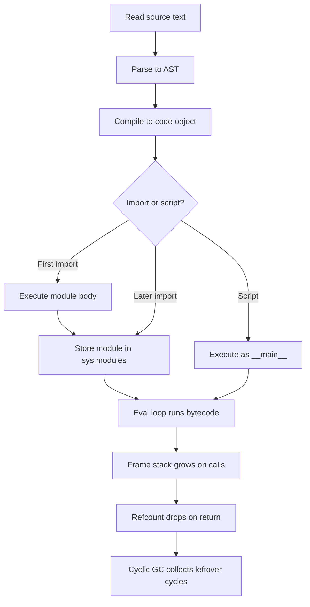

## Why this matters

Backend interviews at the 15–20 LPA band rarely ask you to write a compiler. They do ask why a "simple" loop is slow, why editing a file did not change what production imported, and why a circular import explodes only sometimes. Those questions are about CPython's execution model: source is compiled to bytecode, bytecode runs on a stack machine, and imports are cached in `sys.modules` after the first load.

If you only know syntax, you treat the interpreter as a black box that "runs lines." That model fails the moment a `.pyc` is stale, a module is imported twice under two names, or a colleague says "this is CPU-bound so threads will not help." The GIL and the eval loop are the reason that sentence is usually true for pure Python, and you cannot discuss concurrency honestly until you have seen the loop those threads share.

This lesson gives you a precise picture of one run of one function, without pretending you need to read CPython's C sources on day two.

## Intuition

Think of CPython as a two-stage kitchen. The **compiler** turns your recipe (source) into a stack of index cards (bytecode). The **eval loop** is a cook who only understands those cards: load a value, add, call, return. The cook does not re-read the English recipe on every pancake. That is why syntax errors appear before any line runs, and why a tight loop still pays an interpreter tax on every card.

A `.pyc` file is a filed copy of the cards so the next process can skip most of the translation. It is a cache, not a deliverable. `sys.modules` is a tray that already holds cooked modules: the second `import` does not cook again, it hands you the same object.

## Core concept in depth

### From source to a code object

When you run `python app.py`, CPython reads the file as text, parses it into an abstract syntax tree, and compiles that tree into a **code object**. The code object holds bytecode, constants, names, and local variable names. It is not yet "running." Execution starts when the eval loop is pointed at that code object with an empty stack and a frame of locals.

You can compile without running:

```python
source = "x = 2 + 3 * 4\nprint(x)"
code = compile(source, "<demo>", "exec")
print(code.co_names)
print(code.co_consts)
```

`co_consts` contains the literal numbers. `co_names` contains the names the bytecode will look up, such as `print`. The multiplication happens at runtime unless the compiler folded it. CPython does fold some constant expressions, so do not be surprised if `2 + 3 * 4` shows up as the constant `14` in newer versions. The lesson is the pipeline, not a promise about a particular peephole optimization.

### Bytecode and the stack

`dis.dis` prints the bytecode. You do not memorize opcodes for interviews. You learn to see the shape: `LOAD_CONST`, `LOAD_FAST` (a local), `BINARY_OP` or `BINARY_ADD` depending on version, `CALL`, `RETURN_CONST` or `RETURN_VALUE`. The machine is a stack. Loads push. Operators pop operands and push a result. A call pops the callable and arguments and pushes the return value.

```python
import dis

def total(xs):
    s = 0
    for x in xs:
        s += x
    return s

dis.dis(total)
```

Locals are slots in the frame, which is why `LOAD_FAST` is cheaper than looking up a global. That single fact explains a real performance trick: inside a hot loop, binding a global function to a local name avoids repeated global dictionary lookups. It also explains why "Python is slow" is specifically about the eval loop executing many simple opcodes, not about the CPU being unable to add integers. NumPy and database drivers move the loop into C so one Python call does thousands of additions.

### Frames, the call stack, and tracebacks

Every call pushes a **frame**: the code object, the instruction pointer, locals, and the previous frame. A traceback is that chain printed from the outside in, which is why the last line is the line that raised and the lines above it are the callers. Recursion is just frames until CPython hits `sys.getrecursionlimit()` (default 1000). That limit is about stack overflow protection, not about the algorithm being illegal. Deep recursion on a linked list of a million nodes will crash even if the algorithm is O(n). You rewrite it as a loop or raise the limit only when you understand the risk.

### `.pyc` and `__pycache__`

After a successful import, CPython writes bytecode to `__pycache__/module.cpython-312.pyc` (the number matches the interpreter). The file header stores a validation stamp so a source edit invalidates the cache. You do not commit these files. If behavior disagrees with the source you are staring at, check that you imported the file you think you imported (`module.__file__`) before you blame the cache. Deleting `__pycache__` is safe; it is regenerated.

The cache is per interpreter version. A 3.11 `.pyc` is not loaded by 3.12. That is another reason a committed `__pycache__` is useless and sometimes actively confusing.

### `sys.modules` and what import really does

The first `import pkg.mod` searches `sys.path`, loads the source or the cached bytecode, executes the module body top to bottom, and stores the module object in `sys.modules` under its name. The second import returns that same object and does **not** re-execute the body. That is why a module-level list or a database connection is a process-wide singleton, and why "I'll just import it again to reset" does nothing.

`importlib.reload` exists and is a footgun: other modules may still hold the old object. Tests that need a clean module re-execute in a fresh process, or they stop using import-time side effects.

Circular imports fail when module A, while still executing, imports B, and B tries to use a name A has not assigned yet. The error looks like `ImportError: cannot import name 'X'`. The fix is to move the import inside the function that needs it, or to break the cycle by moving the shared name to a third module. You will meet this the first time two packages "just need" each other at top level.

### Reference counting and the cyclic GC

CPython frees most objects when their reference count hits zero. That is why files closed with a `with` block disappear promptly, and why a global cache lives until the process exits. Containers that point at each other form a cycle the refcount cannot see. A generational garbage collector periodically collects those cycles. You rarely call `gc.collect()` in application code. You do need the model: holding a large list in a global, or in a closure that outlives the request, is a leak even though Python "has GC."

`id(obj)` is the object's identity for its lifetime. After the object dies, the id can be reused. Do not store ids as long-lived keys and assume they still mean the same object.

## Diagram / flowchart



### Dry-run: two imports of the same module

Imagine `counter.py` contains `HITS = 0` then `HITS += 1` at import time, and a function that returns `HITS`.

| Step | Action | What CPython does |
| --- | --- | --- |
| 1 | Process starts | `sys.modules` has builtins and frozen imports only |
| 2 | First `import counter` | Search `sys.path`, compile, execute body, `HITS` becomes 1, store module |
| 3 | Second `import counter` | Dict hit in `sys.modules`. Body does not run. `HITS` stays 1 |
| 4 | `counter.HITS += 1` from anywhere | Same module object. Every importer sees 2 |
| 5 | Process exits | Module globals are released with the interpreter |

The dry-run is the whole rule of module-level state: it is a singleton for the process, initialized once.

## Code

```python
import dis
import sys


def add(a, b):
    return a + b


def explain() -> None:
    print("recursion limit:", sys.getrecursionlimit())
    print("loaded modules:", len(sys.modules))
    print("--- bytecode for add ---")
    dis.dis(add)


if __name__ == "__main__":
    explain()
```

Read the disassembly top to bottom. You should see the parameters loaded, an add, and a return. Then print `len(sys.modules)` again after importing `json` and `pathlib`. The count rises by the modules those imports pull in, and a second pair of imports does not double it.

## Complexity analysis

| Stage | Cost | When it dominates |
| --- | --- | --- |
| Parse and compile a module | Roughly linear in source size, paid once per process | Short-lived CLI tools that import a huge framework |
| Bytecode dispatch | A large constant per Python operation | Tight loops over millions of pure-Python iterations |
| `LOAD_FAST` local | Cheaper than a global dict lookup | Hot loops that call a global built-in each iteration |
| Import hit in `sys.modules` | Effectively O(1) | Application code that imports inside a request by mistake |
| Refcount updates | Small, on almost every object touch | Usually noise next to I/O; visible in microbenchmarks |
| Cyclic GC | Pauses proportional to the generation scanned | Long-running processes with many short-lived containers |

The interview sentence: I/O-bound work hides bytecode overhead; CPU-bound pure Python does not. Moving the inner loop to a C extension, a database, or a vectorized library changes the cost model more than tweaking opcodes.

## Tricks, tips and patterns

- When production "did not pick up the change," print `module.__file__` and the process start time before you touch bytecode caches.
- Bind hot global callables to locals inside a tight loop if a profiler says name lookup matters. Do this after measuring, not before.
- Keep import-time work tiny: no network, no large file reads, no database pools created as a side effect of import. Tests and circular imports both get worse.
- Use `python -c "import dis, mymod; dis.dis(mymod.fn)"` to inspect a function without editing it.
- Treat `sys.modules` as process state. Tests that mutate module globals must put them back, or they leak into the next test.
- Do not raise `sys.setrecursionlimit` to paper over a linear recursion that should be a loop. The limit is protecting the C stack.
- `__pycache__` belongs in `.gitignore` next to `.venv`.

## Common mistakes and edge cases

- Assuming source is interpreted line by line. A syntax error anywhere in the file prevents the module from running at all.
- Expecting a second `import` to re-run module-level initialization. It will not.
- Editing an installed copy in `site-packages` while your venv imports a different path. `__file__` is the tie-breaker.
- Confusing a code object with a function. The function adds defaults, closure cells, and `__globals__`. The code object is the reusable bytecode.
- Believing reference counting frees cyclic graphs immediately. Two objects that point at each other wait for the cyclic collector.
- Using `id` after the object may have died. The number can be recycled.
- Recursive algorithms that are correct on paper and crash at depth 1000 on a long input. Always ask how deep the Python stack gets.
- Committing `.pyc` files and then debugging a mismatch between teammates on different Python versions.

## Interview notes

A strong candidate can narrate one function call: compile once, push a frame, run a stack machine, pop the frame, drop refcounts. From that story you can answer three common follow-ups.

**Why are threads awkward for CPU-bound Python?** The eval loop holds the GIL while it runs bytecode. Threads help when the GIL is released (most I/O, many C extensions) and do not speed up pure-Python number crunching. Multiprocessing or native code does. You only need the headline here; the concurrency module proves it.

**Why did my config change not apply?** The module was imported once, the dict was built at import, and nothing re-read the file. Restart the process or re-read explicitly. `importlib.reload` is not a configuration strategy.

**What is a traceback telling you?** The bottom frame is the failure. The frames above are the call chain. Read names and line numbers; do not guess.

You might also be asked what `__pycache__` is. Answer: a versioned bytecode cache for faster imports, safe to delete, not a build artifact you ship instead of source.

## Practice problems

1. **Constant Fold Peek** (easy) — compile an expression and return the tuple of `co_consts` that are integers. [Practice: python-ex-co-consts]
2. **Import Once** (medium) — simulate `sys.modules` with a dict: a name loads a factory only on the first call. [Practice: python-ex-import-once]
3. **Recursion Budget** (easy) — return how many calls a recursive countdown can make before it would pass a supplied limit. [Practice: python-ex-recursion-budget]
4. **Frame Labels** (medium) — given a list of call names that raise at the end, return them bottom-of-traceback first. [Practice: python-ex-traceback-order]
5. **Hot Local** (medium) — count how many times a name would be looked up as a global versus a local in a tiny cost model. [Practice: python-ex-lookup-cost]

## Summary / cheat sheet

- Source compiles to a code object; the eval loop runs bytecode on a stack.
- Each call is a frame. Tracebacks print that chain. Recursion depth is a real limit near 1000.
- `.pyc` files are a disposable cache in `__pycache__`, tagged by interpreter version.
- `sys.modules` makes import-time state a process singleton. The body runs once.
- Reference counting frees most objects; a cyclic GC handles cycles. Globals and closures keep objects alive.
- Pure-Python loops pay dispatch overhead. I/O and C extensions are where the GIL story changes.

## Further reading

- [dis — Disassembler for Python bytecode](https://docs.python.org/3/library/dis.html)
- [The import system](https://docs.python.org/3/reference/import.html)
- [Data model — code objects](https://docs.python.org/3/reference/datamodel.html#code-objects)
- [gc — Garbage Collector interface](https://docs.python.org/3/library/gc.html)
- [sys.modules](https://docs.python.org/3/library/sys.html#sys.modules)
