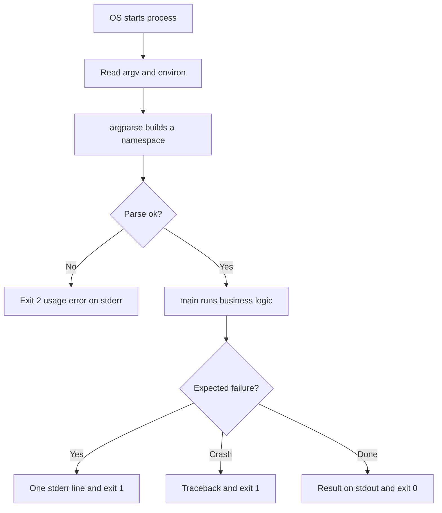

## Why this matters

A backend engineer does not only serve HTTP. You write migration commands, queue workers, import scripts, and one-off fixes that operations will run at 2 a.m. Those programs are judged by a contract the shell understands: arguments are explicit, success is exit code 0, failure is non-zero, data stays on stdout, and diagnostics stay on stderr. Break that contract and CI cannot tell a failed migration from a successful one that printed the word "error" in a log line.

Interviews hide this inside practical rounds. "Add a flag to your script." "How would a cron job know it failed?" "Why did the pipeline keep going after your command crashed?" If you only call `print` and let exceptions dump a traceback by accident, you will fail those questions even with perfect algorithms.

## Intuition

A program is a function the operating system calls. The OS passes a list of strings (`sys.argv`), a set of environment variables, and three standard streams. Your process returns a small integer. Zero means "the job finished as intended." Anything else means "do not trust the output, and do not run the next step."

`argparse` is the parser that turns those strings into typed values and writes a help page so future you does not read the source to remember a flag. The `__main__` guard is the doorbell: it rings when the OS invoked this file, and stays silent when a test imported it.

## Core concept in depth

### `sys.argv` is just strings

`sys.argv[0]` is the script path as the OS saw it. The rest are arguments, still strings, even when the human typed a number. You convert them yourself, or you let `argparse` convert them and reject garbage before your business logic runs. Never parse flags by hand with `if arg == "--force"` once you have more than one option. You will get the order wrong, forget `--help`, and mishandle values that start with a dash.

```python
import argparse

def build_parser() -> argparse.ArgumentParser:
    parser = argparse.ArgumentParser(description="Sum integers from a file or flags")
    parser.add_argument("--times", type=int, default=1, help="repeat the sum")
    parser.add_argument("--shout", action="store_true", help="uppercase the label")
    parser.add_argument("numbers", nargs="*", type=int, help="integers to add")
    return parser
```

`type=int` raises a clean error and exits with status 2 when the user passes `foo`. `action="store_true"` stores `False` when the flag is absent. `nargs="*"` collects a list. Required positional arguments are how you force the caller to supply a path. Defaults belong on optional flags, and they should be the safe behavior, not the destructive one. `--dry-run` that defaults to false is a choice you document; a `--delete` that defaults to true is a bug.

### Exit codes

`sys.exit(0)` ends the process successfully. `sys.exit(1)` is a generic failure. `sys.exit("message")` prints the message to stderr and exits with status 1. If `main` raises `SystemExit`, the interpreter uses that code. If any other exception escapes `main`, the interpreter prints a traceback and exits with status 1. That default is acceptable for a crash and unacceptable for an expected error like "file not found," because a traceback is a poor user interface and it hides the exit code story under noise.

Catch expected failures at the edge, print one line to stderr, and exit non-zero. Let unexpected failures crash so you see the traceback during development. Do not blanket `except Exception` and exit 0. That turns bugs into successful cron jobs.

Convention worth memorizing: 0 success, 1 application failure, 2 command-line usage error (argparse already uses 2). Reserve other codes only when a caller documents them.

### stdout versus stderr

`print` writes to stdout. Progress, warnings, and errors belong on stderr: `print("missing id", file=sys.stderr)`. Pipelines consume stdout. If you mix a JSON document with "Processing..." on the same stream, the next program cannot parse it. Logs go to stderr or to the `logging` module configured with a stream handler on stderr. You will configure logging properly in a later module; until then, the split is the rule.

`sys.stdin.read()` is how a filter program accepts a pipe. For large input, iterate `for line in sys.stdin` so you do not hold the whole stream. Remember that a line includes its trailing newline unless you strip it.

### Environment variables

Configuration that changes between laptop, CI, and production belongs in the environment, not in a constant edited before each deploy. `os.environ["DATABASE_URL"]` raises `KeyError` when the variable is missing, which is what you want for a required secret. `os.environ.get("LOG_LEVEL", "INFO")` is appropriate for an optional knob with a safe default. Do not invent a default for a password.

Environment values are strings. Parse `"true"` explicitly. `"false"` is a non-empty string, so `if os.environ.get("DEBUG")` is true for the value `false`. Compare against an allow-list of truthy tokens or use a typed settings layer later.

Never print raw environment dumps in logs. They contain secrets.

### `python -m` and package entry

`python -m package.module` runs a module as `__main__` while putting the current directory on `sys.path` in a defined way. It also fails clearly when the package is not importable, which is a better error than running a stray `script.py` that imports an old checkout. Prefer `python -m pytest` and `python -m myapp` over scripts whose shebang points at a system Python you do not control.

A shebang (`#!/usr/bin/env python3`) matters on Unix when the file is executable. On Windows the py launcher associates `.py` files. Do not depend on a shebang inside a venv-managed service; call the venv interpreter by path from the service manager.

### Working directory is not the script directory

Open files with paths relative to the current working directory only when that is the contract. A cron job's cwd is often not the repository. `Path(__file__).resolve().parent` is the directory containing the current file, which is the right anchor for data that ships beside the code. Mixing the two is how "it works when I run it from the repo root" becomes a production incident.

## Diagram / flowchart



### Dry-run: a sum command in a pipeline

Command shape: `python -m tools.sum --times 2 10 5`.

| Step | Input | Result |
| --- | --- | --- |
| 1 | argv has `--times`, `2`, `10`, `5` | Parser sets times=2, numbers=10 and 5 |
| 2 | Body computes `(10+5)*2` | Value 30 |
| 3 | `print(30)` | stdout is `30` plus newline, stderr empty |
| 4 | `return 0` | Shell sees success and may pipe stdout onward |
| 5 | User passes `--times foo` | argparse writes usage to stderr, exit 2, no stdout payload |

If step 5 printed a traceback and also a partial sum, the pipeline would be unsafe. Parsing happens before work.

## Code

```python
import argparse
import sys


def build_parser() -> argparse.ArgumentParser:
    parser = argparse.ArgumentParser(description="Repeat a label")
    parser.add_argument("label")
    parser.add_argument("--times", type=int, default=1)
    parser.add_argument("--shout", action="store_true")
    return parser


def main(argv: list[str] | None = None) -> int:
    args = build_parser().parse_args(argv)
    if args.times < 0:
        print("times must be >= 0", file=sys.stderr)
        return 1
    text = args.label.upper() if args.shout else args.label
    for _ in range(args.times):
        print(text)
    return 0


if __name__ == "__main__":
    sys.exit(main())
```

Passing `argv` into `main` is the design that makes this testable. Tests call `main(["hi", "--times", "2"])` and never touch the real process arguments. `parse_args` reads `sys.argv[1:]` only when you pass `None`.

## Complexity analysis

| Concern | Cost |
| --- | --- |
| argparse on a short argv | Negligible, once per process |
| Reading stdin line by line | O(n) time, O(1) extra memory if you do not store lines |
| Reading the whole stdin into one string | O(n) memory, risky for multi-gigabyte pipes |
| Environment lookup | O(1) average per key |
| Wrong exit code | Unbounded human cost: the next job runs on bad data |

Argument parsing is never your hotspot. Streaming versus slurping stdin is. A log processor that does `data = sys.stdin.read()` will be killed by the OOM killer on a file that a line loop would have handled.

## Tricks, tips and patterns

- Give `main` an `argv` parameter and return an int. The `__main__` block only calls `sys.exit(main())`.
- Default destructive flags to off. Require `--yes` for irreversible actions.
- Write machine-readable results to stdout and human notes to stderr.
- Use `pathlib.Path` for paths from argparse; set `type=Path` so missing-file checks are uniform.
- Read required secrets from the environment at startup and fail fast, before you open a connection pool halfway through a job.
- `python -m module` keeps imports honest. Document that command in the README, not a personal shell alias.
- Return early on `times == 0` or empty input with exit 0 if doing nothing is success. Document that choice so callers do not treat silence as failure.

## Common mistakes and edge cases

- Treating a printed `"ERROR"` as a failure while exiting 0. CI greps are fragile; status codes are the contract.
- Catching all exceptions, printing `"ok"`, and exiting 0. You just hid a bug.
- Using `except SystemExit` around `parse_args` and swallowing usage errors. Let argparse exit.
- Boolean environment variables checked with truthiness. The string `0` and the string `false` are both true in Python.
- Relative file paths that depend on the developer's cwd.
- Putting secrets in argv. Process listings show arguments. Prefer the environment or a file with tight permissions.
- Forgetting that `nargs="*"` can be an empty list. Your sum should define what an empty sum means.
- Encoding surprises on Windows when printing characters the console code page cannot represent. UTF-8 mode (`PYTHONUTF8=1`) or writing bytes explicitly is the durable fix. Do not assume every locale is UTF-8.

## Interview notes

Walk through a command the way an on-call engineer will run it. "The process parses argv first. Usage errors exit 2 without touching the database. Expected domain errors print one stderr line and exit 1. Success prints a single JSON object to stdout and exits 0. Configuration comes from the environment, and a missing database URL aborts before work starts."

Follow-ups:

- **How do you test a CLI without spawning a process?** Call `main(argv)` and capture stdout with a redirect, or separate parsing from the function that does the work and unit-test that function. Spawning is an integration test, not the default.
- **Why not click or typer?** They are excellent. argparse is in the standard library, so a take-home has zero install friction. Know one third-party CLI library by name and say you would use it when subcommands grow.
- **What does a non-zero code mean for cron or Kubernetes?** The scheduler records a failure. A Job retries or alerts. Exit 0 after a partial write is how you corrupt data quietly.

If you mention stdout versus stderr without being asked, you sound like you have shipped a pipeline.

## Practice problems

1. **Argv Sum** (easy) — sum a list of integers and reject negatives with a status-style result. [Practice: python-ex-argv-sum]
2. **Exit Class** (easy) — map an outcome name to 0, 1, or 2. [Practice: python-ex-exit-code]
3. **Env Bool** (medium) — parse an environment-style string into a real bool without treating `"false"` as true. [Practice: python-ex-env-bool]
4. **Stream Sum** (easy) — sum integers from a list of lines, skipping blanks. [Practice: python-ex-stream-sum]
5. **Shout Label** (easy) — apply the label/times/shout rules and return the lines you would print. [Practice: python-ex-shout-label]

## Summary / cheat sheet

- `sys.argv` is a list of strings. Let argparse type-check and build `--help`.
- Exit 0 only when the job succeeded. Exit 1 for expected failure, 2 for bad usage.
- stdout is for data. stderr is for humans and errors.
- Required config comes from the environment and fails fast. `"false"` is not false until you parse it.
- `main(argv) -> int` stays import-safe and testable behind the `__main__` guard.
- Anchor data files to `__file__` when they ship with the code, not to the caller's cwd.

## Further reading

- [argparse — Parser for command-line options](https://docs.python.org/3/library/argparse.html)
- [sys — System-specific parameters](https://docs.python.org/3/library/sys.html)
- [os.environ](https://docs.python.org/3/library/os.html#os.environ)
- [PEP 324 history is optional; the tutorial on modules and scripts](https://docs.python.org/3/tutorial/modules.html)
- [pathlib — Object-oriented filesystem paths](https://docs.python.org/3/library/pathlib.html)
