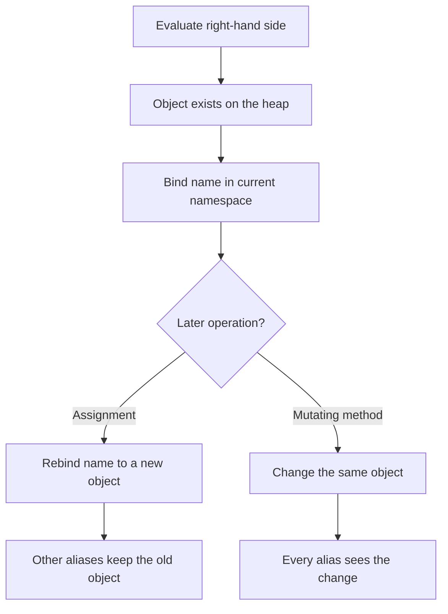

## Why this matters

Every bug that "changes a value somewhere else" is a story about names and objects. Python does not store data inside a variable box. A name is an entry in a namespace that points at an object. Assignment moves the name. Mutation changes the object while every name still pointing at it sees the change. Candidates who cannot draw that picture write functions that accidentally share a list across requests, compare with `is` because it worked once in the REPL, and treat `True` as if it were not an integer.

Operators are the other half of the same lesson. `/` and `//` do different jobs. `and` and `or` return operands, not necessarily `True` or `False`. `==` asks about value; `is` asks about identity. Interview whiteboards are full of these, and so is production code that mixes flags, counters, and configuration objects.

## Intuition

Picture a desk of labeled sticky notes and a warehouse of objects. The note `user` sticks to a dict in the warehouse. `alias = user` writes a second note on the **same** dict. `alias["role"] = "admin"` edits the dict, so reading `user["role"]` shows `"admin"`. `user = dict(role="guest")` peels the `user` note off and sticks it to a new dict. `alias` still points at the original.

Immutable objects refuse edits. You cannot change the integer `10` into `11`. `n = n + 1` builds a new integer and moves the note. Strings work the same way. That is why sharing an int is safe and sharing a list is a design decision you must make on purpose.

## Core concept in depth

### Binding, rebinding, and mutation

A namespace is a mapping from names to objects: a module's globals, a function's locals, a class dict, an instance dict. `x = 10` binds `x` in the current namespace. It does not copy 10 into a slot that belongs to `x`. The next `x = 11` rebinds the name. Any other name that still referred to the old object is unchanged.

Mutation is a method call or item assignment that alters an object's internal state: `items.append(1)`, `row["n"] = 3`, `bucket.add(4)`. No name changes. Every alias observes the new state. This is the rule behind default-argument bugs, cache bugs, and "I passed a list to a helper and my caller changed."

`id(obj)` returns the identity CPython uses for `is`. Two names with the same `id` are the same object. Do not serialize ids or use them as database keys; they are process-local and can be reused after collection.

### The built-in types you must know cold

| Type | Example expression | Mutable | Typical use |
| --- | --- | --- | --- |
| `int` | `42` | No | Counts, indexes, bit flags |
| `float` | `3.14` | No | Measurements; not money |
| `bool` | `True` | No | Flags; subclass of `int` |
| `str` | `"hi"` | No | Text |
| `bytes` | `b"hi"` | No | Raw octets |
| `list` | a list of 1, 2 | Yes | Ordered, allows duplicates |
| `tuple` | a tuple of 1, 2 | No | Fixed records, dict keys if contents are hashable |
| `dict` | `dict(a=1)` | Yes | Keyed lookup |
| `set` | `set([1, 2])` | Yes | Membership, uniqueness |
| `NoneType` | `None` | No | The single sentinel for "no value" |

`bool` is a subclass of `int`. `True == 1` and `False == 0` are both true, and `True + True` is `2`. That is useful for counting flags (`sum(flags)`) and dangerous when a JSON encoder or a database driver treats a boolean as a number by accident. `isinstance(True, int)` is true. If you need a real boolean, compare with `is True` only when the value must be the singleton, which is rare. Usually you want the truth value, or an explicit `bool(...)`.

`None` is a singleton. There is one `None` object. Test it with `x is None`, not `x == None`. Some classes define equality in a way that makes `== None` surprising; identity does not consult `__eq__`.

### Arithmetic and division

`+ - * **` do what you expect. `**` is exponentiation and associates to the right: `2 ** 3 ** 2` is `2 ** 9`, not `8 ** 2`. Unary minus has lower precedence than `**`, so `-2 ** 2` is `-(2 ** 2)`, which is `-4`, not `4`. That line shows up in interviews because it looks like a bug and is not.

In Python 3, `/` is true division and always returns a float: `7 / 2` is `3.5`. `//` is floor division: it divides and applies the floor function, so `7 // 2` is `3` and `-7 // 2` is `-4`, not `-3`. `%` is the remainder consistent with that floor: `a == (a // b) * b + (a % b)`. Negative remainders surprise people who learned the sign-follows-dividend rule from other languages. Use `divmod(a, b)` when you need both.

### Comparison, identity, and membership

`==` calls equality. `!=` is its negation. Chained comparisons are syntactic sugar with short-circuit: `0 < x < 10` evaluates `x` once and means `(0 < x) and (x < 10)`. It is not a single three-way operator you can override as a unit.

`is` is identity. Use it for `None`, and occasionally for sentinels you created (`_MISSING = object()`). Do not use it for strings, numbers, or tuples. CPython interns small integers and some strings, so `a is b` can be true in a REPL session and false when the same values are computed. Interning is an optimization, not a language guarantee.

`in` uses equality for lists and tuples, walking them in linear time. For sets and dicts it uses hashing and is average constant time. `in` on a dict searches keys, not values. `"a" in dict(a=1)` is true.

### Logical operators return operands

`and` and `or` short-circuit and return the last operand they evaluated, not a forced boolean.

- `0 or 5` evaluates to `5` because `0` is falsy.
- `"hi" and "there"` evaluates to `"there"` because `"hi"` is truthy and `and` must look at the second operand.
- `"" or "default"` evaluates to `"default"`.

That is why `name = user_name or "anonymous"` works, and why it is wrong when `user_name` can be a legitimate falsy value such as `0` or an empty string you must preserve. Use `if user_name is None` when `None` is the only missing marker.

`not` always returns an actual `bool`.

### Truthiness

Falsy values: `None`, `False`, numeric zeros (`0`, `0.0`, `0j`), and empty containers (`""`, empty bytes, empty list, empty tuple, empty dict, empty set). Almost everything else is truthy, including a non-empty container of zeros and any custom object that does not define `__bool__` or `__len__`. A non-empty list is truthy even when its items are falsy.

### Bitwise operators

`& | ^ ~ << >>` operate on ints as infinite two's-complement bit strings. They are not boolean operators. `True & False` works only because bools are ints, and it is a style bug in application code. Use bitwise operators for flags and hashes, and `and`/`or` for logic. Parentheses are mandatory when you mix them: `&` binds tighter than comparisons in a way that regularly surprises people. `1 < 2 & 3 < 4` is not `(1 < 2) and (3 < 4)`.

## Diagram / flowchart



### Dry-run: aliasing a list

| Step | Code | Names and objects |
| --- | --- | --- |
| 1 | `a = [1]` | `a` points at list L, contents 1 |
| 2 | `b = a` | `b` points at L. `a is b` is true |
| 3 | `b.append(2)` | L is now 1, 2. `a` prints the same |
| 4 | `a = a + [3]` | `+` builds a new list M. `a` points at M. `b` still points at L |
| 5 | `a += [4]` if `a` were still L | `+=` on a list mutates in place. On an int it rebinds |

Step 4 versus step 5 is the interview fork. For lists, `+` creates a new list and `+=` extends in place when the left side is already a list. For ints, both forms rebind, because an int cannot grow in place.

## Code

```python
def demonstrate() -> None:
    a = [1, 2]
    b = a
    b.append(3)
    print("shared", a, "same object", a is b)

    c = a + [4]
    print("plus copies", c, "a unchanged", a, "c is a", c is a)

    n = 10
    m = n
    n = n + 1
    print("ints rebound", n, m, "same", n is m)

    print("true division", 7 / 2, "floor", 7 // 2, "neg floor", -7 // 2)
    print("or returns operand", 0 or 5, "and returns operand", "hi" and "there")
    print("bool is int", isinstance(True, int), True + True)
    print("chain", 1 < 2 < 3)


if __name__ == "__main__":
    demonstrate()
```

Predict the prints before you run it. The shared list should show three items through both names. `m` should stay 10. Floor division of `-7` by `2` should be `-4`.

## Complexity analysis

| Operation | Time | Notes |
| --- | --- | --- |
| Local name binding | O(1) | Store a pointer in the frame |
| `list.append` | Amortized O(1) | Occasional resize copies pointers |
| `x in list` | O(n) | Equality scan |
| `x in set` or `x in dict` | O(1) average | Hashing; degrades if hashes collide pathologically |
| `a + b` for lists | O(len(a) + len(b)) | Always a new list |
| `a += b` for lists | O(len(b)) amortized | Extends `a` when `a` is a list |
| Integer addition | Grows with the number of digits | Python ints are arbitrary precision, not machine words |

Choosing a list for membership tests inside a loop is the complexity bug this table exists to prevent. Build a set when you ask `in` many times.

## Tricks, tips and patterns

- Swap with `a, b = b, a`. The right side is a tuple built before any rebinding.
- Unpack `head, *rest = items` when you want the first element and the remainder as a list.
- Use `divmod` instead of pairing `//` and `%` so the sign rule is applied once.
- Prefer `x is None` and `x is not None`.
- Count booleans with `sum`. A list of bools sums as integers.
- Copy a list with `items.copy()` or `items[:]` when you need an independent top-level list. That is a shallow copy; nested lists are still shared. Deep copy is a later lesson.
- Parenthesize exponentiation with negatives: `(-2) ** 2`.

## Common mistakes and edge cases

- Using `is` to compare integers or strings because the REPL interned them.
- Assuming `+=` always rebinds. On lists it mutates. On tuples `+=` fails if you expected in-place growth, because a tuple has no `__iadd__` that succeeds; the statement tries to rebind and raises if the name is a tuple element... actually `t += (1,)` rebinds a local name `t` to a new tuple. The surprise is `a[0] += (1,)` when `a[0]` is a tuple: the addition succeeds, then item assignment into a tuple fails, but a list inside would have been mutated before the failed assignment. Know the simple case first: locals rebind, mutating methods mutate.
- Floor division toward negative infinity, not toward zero. `int(-1.5)` truncates toward zero and is a different operation from `//`.
- `bool` arithmetic leaking into APIs. Serialize real booleans, do not add them unless you mean a count.
- `or` replacing a valid empty string or zero with a default.
- Chained comparisons with side effects in the middle expression. The middle runs once, which is good, but do not rely on side effects for clarity.
- Bitwise `&` where you meant `and`, especially in filter conditions without parentheses.
- Forgetting that `**` is right-associative.

## Interview notes

Draw the sticky notes before you write code for any problem that passes a list into a helper. Say out loud: "I will copy if the caller must not see my appends; I will mutate if the contract is in-place and the prompt asks for O(1) extra memory."

Be ready for these follow-ups:

- **What does `+=` do for a list versus an int?** List: in-place extend when the object implements it. Int: rebind to a new int.
- **Why is `is` wrong for numbers?** Identity is not value. Interning of small ints is a CPython detail.
- **What is the difference between `/` and `//`?** True division versus floor division, and floor goes toward negative infinity.
- **What does `a and b` return?** The last evaluated operand, which may not be a bool.
- **Is `True` an int?** Yes, a subclass. `isinstance(True, int)` is true. Equality with `1` holds.

If you mention that `in` on a list is linear and `in` on a set is average constant time, you have connected types to complexity, which is what the loop is scoring.

## Practice problems

1. **Alias Trace** (easy) — given operations on a shared list, return the final contents of both names. [Practice: python-ex-alias-trace]
2. **Clamp** (easy) — clamp a number to an inclusive range using comparisons only. [Practice: python-ex-clamp]
3. **Floor Pair** (medium) — return quotient and remainder with floor-division signs for negatives. [Practice: python-ex-floor-pair]
4. **Or Default** (medium) — apply a default only when the value is `None`, preserving `0` and `""`. [Practice: python-ex-none-default]
5. **Truthy Count** (easy) — count truthy items in a mixed list of ints, strings, and Nones. [Practice: python-ex-truthy-count]
6. **Safe Swap** (easy) — swap two list indexes without a temporary, using unpacking. [Practice: python-ex-swap-indexes]

## Summary / cheat sheet

- Names bind to objects. Assignment rebinds. Methods like `append` mutate.
- Aliases share mutations. `+` on lists builds a new list; `+=` on lists usually mutates.
- `==` is value, `is` is identity. Use `is` for `None`.
- `/` returns float. `//` floors toward negative infinity.
- `and` and `or` short-circuit and return operands. `not` returns a bool.
- `True` is an int. Empty containers and zeros are falsy.
- `in` is linear on lists and average constant time on sets and dict keys.

## Further reading

- [Python data model](https://docs.python.org/3/reference/datamodel.html)
- [Built-in types](https://docs.python.org/3/library/stdtypes.html)
- [Operator precedence](https://docs.python.org/3/reference/expressions.html#operator-precedence)
- [PEP 285 — Adding a bool type](https://peps.python.org/pep-0285/)
- [Truth value testing](https://docs.python.org/3/library/stdtypes.html#truth-value-testing)
