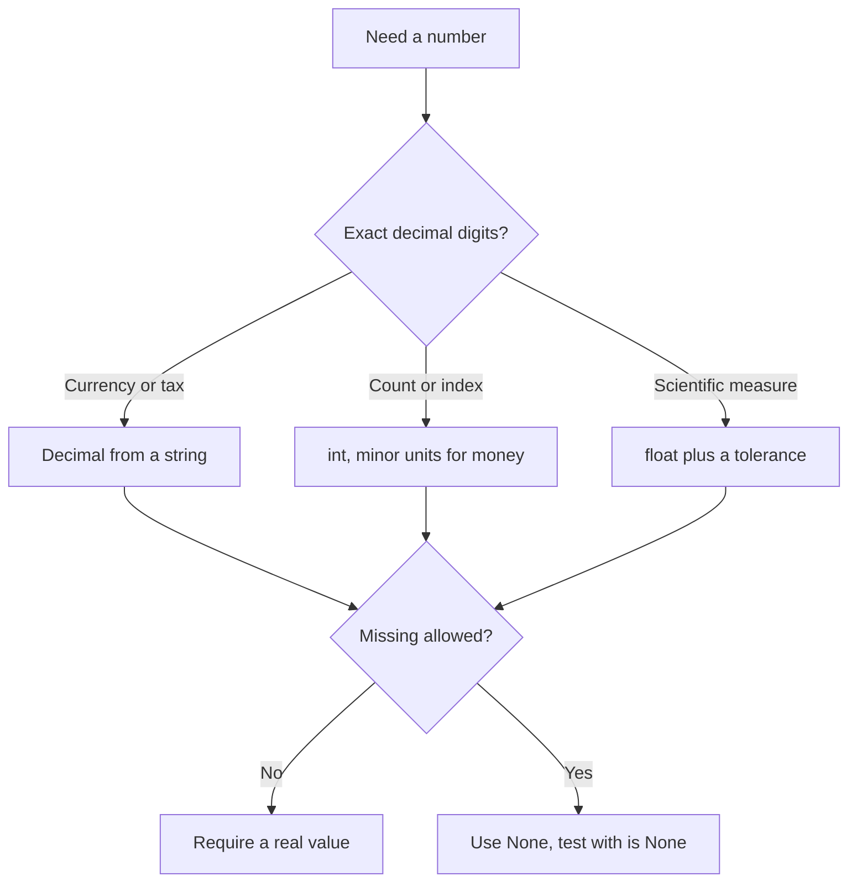

## Why this matters

Money bugs, off-by-one pagination bugs, and "this flag counted as 1" bugs all come from the numeric tower. Python's `int` is not a 64-bit word. Its `float` is an IEEE 754 binary fraction, so `0.1 + 0.2` is not `0.3`. Its `bool` is a subclass of `int`, so a boolean can sneak into a sum and look like data. `None` is not `0`, not `False`, and not an empty string, and APIs that collapse those together corrupt optional fields.

Backend interviews ask you to compute a price, a rate limit, or a page offset under these rules. They also ask why you would reach for `decimal.Decimal` instead of `float` when the ticket says "currency." You should answer with representation, not with a slogan about floats being "imprecise."

## Intuition

An `int` is a digit string that grows when it needs another limb. Adding two huge integers costs more as they get longer, and it never silently overflows into a negative number the way a fixed-width C `int` can. A `float` is a fixed-size scientific notation in base 2: a sign, an exponent, and a fraction. Many decimal fractions you care about, including tenths, have no finite base-2 expansion, just as one third has no finite base-10 expansion. The stored value is the closest representable approximation.

`None` is a separate object that means "this name has no business value." Zero is a business value. An empty string is a business value. `False` is a business value. Keep them apart.

## Core concept in depth

### Integers do not overflow

`10 ** 100` is a real int with 101 digits. There is no `MAX_INT` you should check before multiplying. The cost is time and memory proportional to the number of digits, which matters in cryptographic code and almost never in a CRUD handler. Bitwise operations still work, and negative numbers behave as infinite two's-complement: `~0` is `-1`, `~1` is `-2`. Right shifts on negatives are arithmetic-style floor shifts, consistent with `//` by powers of two.

Use ints for identifiers, counts, byte sizes, and money **in minor units** (paise, cents) when you do not want a decimal type. Integer paise cannot represent a fraction of a paisa, which is usually what you want.

### Floor division and modulo, including negatives

`//` floors. `%` satisfies `a == (a // b) * b + (a % b)`. For positive numbers this matches elementary school. For negatives, the remainder takes the sign of the divisor in Python, because the quotient was floored:

- `7 // 2` is `3`, `7 % 2` is `1`
- `-7 // 2` is `-4`, `-7 % 2` is `1`
- `7 // -2` is `-4`, `7 % -2` is `-1`

If you need truncation toward zero, convert via `int(a / b)` only when the values are safely inside the exact integer range of floats, which is not a general solution. For ints, write an explicit toward-zero helper if a protocol demands it, and test it with negatives. Most interview problems state "positive integers" so you can ignore the sign. Read the prompt before you assume.

### Floats and why money is not a float

`0.1 + 0.2 == 0.3` is false. The error is tiny and then compounds through subtraction of nearly equal quantities. Formatting with an f-string rounds for display and hides the stored error: printing two digits can show `0.30` while the equality still fails. Never use float for currency, tax, or anything that must match a bank's decimal arithmetic.

`decimal.Decimal` stores base-10 digits. Construct it from a string, not from a float. `Decimal("0.1")` is exact. `Decimal(0.1)` captures the binary approximation you were trying to escape. Set a context for rounding when you divide: bankers' rounding versus `ROUND_HALF_UP` is a product decision, not a default you should discover in production.

`fractions.Fraction` keeps a rational exactly. It is the right tool for ratios you will compare, and a poor tool for hot loops because the integers in the numerator grow.

`math.isclose` compares floats with a relative and absolute tolerance. Use it in tests. Do not use it to decide whether a customer was charged the right amount.

Special values: `float("inf")`, `float("-inf")`, and `float("nan")`. NaN is not equal to itself. `nan == nan` is false, and NaN poisons comparisons in sorts if you let it into a list of scores. Filter it at the boundary.

### `bool` as a subclass of `int`

`isinstance(True, int)` is true. `True == 1` is true. `False == 0` is true. `sum([True, False, True])` is `2`. This is deliberate and permanent. Consequences:

- A JSON library might emit `true`, while a careless path that added booleans into an int column stores `1`.
- `if count` is wrong when you meant `if count is not None` and count can be zero. It is also wrong when a caller passed `False` and you treated it as a missing count.
- Dict keys: `True` and `1` are the same key because equality and hash agree. A dict written with key `1` and then key `True` has one entry. That bug is rare and unforgettable.

Prefer `if flag:` for real booleans. Prefer explicit comparisons for numbers and `None`.

### `None` is the absence of a value

Functions with no `return` return `None`. A dict `.get` returns `None` by default when the key is missing, which collides with a stored value of `None`. If both "missing" and "present but null" matter, use a sentinel:

```python
_MISSING = object()

def lookup(mapping, key):
    value = mapping.get(key, _MISSING)
    if value is _MISSING:
        return "missing"
    if value is None:
        return "present-null"
    return value
```

`_MISSING` is a unique object. Nothing else `is` that object. Do not use a string sentinel like `"MISSING"` if that string can be real data.

Optional parameters should default to `None` and then branch, not to a mutable, and not to a usable business value you cannot distinguish from "caller omitted it" unless omission and that value truly mean the same thing.

## Diagram / flowchart



### Dry-run: one rupee in three representations

Start with 10 rupees and 20 paise, add 10 paise, compare to 10 rupees and 30 paise.

| Representation | Expression shape | Equal to 10.30? |
| --- | --- | --- |
| float | 10.20 + 0.10 compared with 0.1-style literals | Often false; binary fractions |
| int paise | 1020 + 10 compared with 1030 | True, exact |
| Decimal | Decimal("10.20") + Decimal("0.10") compared with Decimal("10.30") | True, exact |

The interview move is to store paise as ints or store Decimal strings. Display formatting is a separate step at the edge.

## Code

```python
from decimal import Decimal, ROUND_HALF_UP


def paise_total(rupees: int, paise: int) -> int:
    if paise < 0 or paise >= 100:
        raise ValueError("paise must be in 0..99")
    return rupees * 100 + paise


def money_add(a: str, b: str) -> str:
    total = (Decimal(a) + Decimal(b)).quantize(Decimal("0.01"), rounding=ROUND_HALF_UP)
    return format(total, "f")


def classify(value: object) -> str:
    if value is None:
        return "none"
    if value is True:
        return "bool-true"
    if value is False:
        return "bool-false"
    if isinstance(value, int):
        return "int"
    if isinstance(value, float):
        return "float"
    return "other"


if __name__ == "__main__":
    print(paise_total(10, 20) + 10)
    print(money_add("10.20", "0.10"))
    print(0.1 + 0.2 == 0.3)
    print(classify(True), classify(1), classify(None), classify(0))
```

Notice the order in `classify`. `True` is an int, so the `value is True` test must run before `isinstance(value, int)`. That order is the entire lesson in one function.

## Complexity analysis

| Operation | Cost |
| --- | --- |
| Add two machine-sized ints | Effectively O(1) |
| Add two n-digit ints | O(n) in the number of digits |
| Float arithmetic | O(1), hardware, with rounding |
| Decimal add | Slower than float, exact in base 10, fine for money volumes |
| `Decimal(float)` | O(1) and already wrong; avoid |
| `is None` | O(1) identity test |

You will not optimize integer addition in a web handler. You will choose the representation so that correctness does not depend on a tolerance. The expensive mistake is a reconciliation job that compares float totals and writes off "dust" that is actually a systematic bias.

## Tricks, tips and patterns

- Store money as integer minor units or as `Decimal`. Convert to `Decimal` from strings at the boundary.
- Quantize explicitly at the rounding step a product owner can name. Do not round on every intermediate add unless the ledger says to.
- Test `value is None` before `isinstance(value, int)` if booleans must be classified separately.
- Use `math.isclose` in numerical tests, never `==` on computed floats.
- Reject NaN at ingestion. Sorting and aggregation both misbehave around it.
- `int("08")` works in Python 3. It is not an octal literal. `int("0x10", 16)` is how you parse a base.
- Bit flags belong in ints with named constants: `READ, WRITE = 1, 2`. Test with `&`, set with `|`, clear with `& ~mask`.

## Common mistakes and edge cases

- Constructing `Decimal` from a float.
- Using float for currency because "it is only a few paise." A few paise times a million invoices is a real amount, and the error is not random.
- Checking `if not value` to mean missing, which treats `0`, `0.0`, and `False` as missing.
- Forgetting `bool` before `int` in a type ladder.
- Building a dict with both `True` and `1` as keys and expecting two entries.
- `//` on negatives when the prompt assumed truncation toward zero.
- Comparing NaN with `==` and concluding the value is present and unique.
- Integer division leftovers from Python 2 tutorials that claim `7/2` is `3`.

## Interview notes

When a prompt says "price," pause and choose a representation out loud. "I will keep amounts in paise as ints so addition is exact." If the prompt has tax rates like 18 percent, multiply with an integer fraction (`amount * 18 // 100`) only after you state the rounding rule, or use Decimal and quantize. Interviewers care more about the rounding sentence than about the arithmetic.

Follow-ups:

- **Why is `0.1 + 0.2` not `0.3`?** Base-2 floating point cannot represent those decimals exactly. The sum of the approximations is a different approximation than the literal `0.3`.
- **How is `bool` related to `int`?** Subclass. `True` equals `1` and hashes as `1`.
- **How do you represent optional integers?** `int | None` in annotations, `None` at runtime, test with `is None`, and do not use `0` as a sentinel if zero is valid.
- **What does floor division do on negatives?** Toward negative infinity, with `%` defined to match.

A crisp answer on `Decimal("0.10")` versus `Decimal(0.10)` is a small signal that you have lost money in a bug tracker before, or that you listened to someone who did.

## Practice problems

1. **Paise Add** (easy) — add two rupee-paise pairs and return total paise. [Practice: python-ex-paise-add]
2. **Float Dust** (easy) — given a list of hundredths as strings, sum them with Decimal and return the quantized string. [Practice: python-ex-decimal-sum]
3. **Classify Number** (medium) — label None, bool, int, and float in the correct order. [Practice: python-ex-classify-number]
4. **Floor Div** (medium) — return quotient and remainder for any sign, matching Python. [Practice: python-ex-floor-div]
5. **Optional Count** (medium) — distinguish missing from zero when folding a list of optional counts. [Practice: python-ex-optional-count]

## Summary / cheat sheet

- `int` is arbitrary precision and does not overflow. Digit count drives the cost of huge ints.
- `//` floors toward negative infinity. `%` is defined so the division identity holds.
- `float` is binary IEEE 754. Do not use it for money. Build `Decimal` from strings and quantize on purpose.
- NaN is not equal to itself. Keep it out of business data.
- `bool` subclasses `int`. Check identity of `True` and `False` before a general int test. `1` and `True` collide as dict keys.
- `None` means absent. `0`, `""`, and `False` are present values. Test absence with `is None`.

## Further reading

- [Numeric types](https://docs.python.org/3/library/stdtypes.html#numeric-types-int-float-complex)
- [decimal — Decimal fixed point and floating point arithmetic](https://docs.python.org/3/library/decimal.html)
- [fractions — Rational numbers](https://docs.python.org/3/library/fractions.html)
- [math.isclose](https://docs.python.org/3/library/math.html#math.isclose)
- [IEEE 754 overview from the Python tutorial on floating point](https://docs.python.org/3/tutorial/floatingpoint.html)
