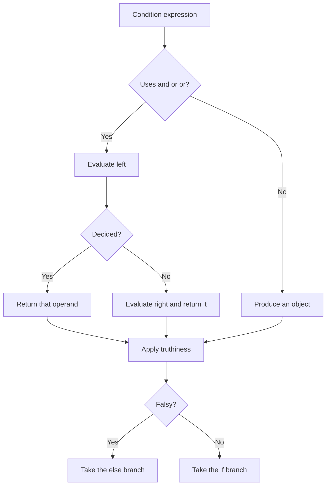

## Why this matters

Conditions are where business rules become control flow. A wrong truthiness check treats a zero balance as "no account." A precedence mistake applies a discount flag to the wrong clause. A chained comparison looks obvious and hides a function call that runs once, which is good, or a bitwise operator, which is not what you meant. Interviewers read your `if` lines as carefully as your algorithms, because that is where off-by-one and "empty means missing" bugs live.

This lesson pins down three mechanisms people blur together: rich comparisons, the boolean operators that return operands, and truth-value testing. Once they are separate, `if items` versus `if items is not None` stops being a style argument and becomes a spec.

## Intuition

Python asks "is this object something we should treat as no?" rather than "is this the boolean false?" Containers answer by their length. Numbers answer by being zero or not. `None` answers yes, I am nothing. Your own class answers with `__bool__` if you defined one, otherwise with `__len__`, otherwise it is always something.

Separately, `and` and `or` are control-flow operators that pick an object and hand it back. They are not functions that return `True` or `False`. The `if` statement then applies truthiness to whatever object it received. Two steps, not one.

## Core concept in depth

### Rich comparisons

The operators `< <= > >= == !=` dispatch to special methods. Built-in types compare within a family: ints and floats compare numerically, strings compare lexicographically by Unicode code point, not by locale. Different types usually refuse ordering: `1 < "2"` raises `TypeError` in Python 3. Equality across types is usually false rather than an error: `1 == "1"` is false. Do not rely on that as validation. Convert at the boundary so you never compare a user id int with a path parameter string by accident. They will silently be unequal and your lookup will miss.

Lists and tuples compare lexicographically: first item, then the next, and the shorter one is smaller if the shared prefix matches. That is handy for sorting records and surprising if you thought comparison meant length.

`==` can be overridden. `is` cannot. NaN's equality is false even with itself, so a set of floats can contain multiple NaNs in surprising ways. Keep NaN out.

### Chained comparisons

`a < b < c` means `(a < b) and (b < c)` except `b` is evaluated once. It short-circuits: if `a < b` is false, `c` is not evaluated and `b` is not compared again. This is the right way to write a range test. Do not write `a < b and b < c` unless the middle expression is a name you are fine evaluating twice; even then the chain is clearer.

Chains mix any comparison operators: `0 <= x == y` is legal and means `(0 <= x) and (x == y)`. It is rarely what a reader expects. Prefer a range chain or an equality on its own line.

### Short-circuit operators

`or` returns the first truthy operand, or the last operand if all are falsy. `and` returns the first falsy operand, or the last operand if all are truthy. Evaluation stops as soon as the result is determined, so the right-hand call does not run when the left-hand side already decides.

Use that for guards: `user is not None and user.is_active`. If you swap the sides, `user.is_active` runs even when `user` is `None` and raises. Order is the feature.

Do not use `or` as a substitute for a full conditional when legitimate values are falsy. A score of `0` must not become the default `100`. A display name of `""` must not become `"guest"` if the user cleared their name on purpose. Restrict `or` defaults to cases where every falsy input truly means "missing," or test `is None`.

`not x` returns `True` or `False`, never the operand. `not not x` is a verbose `bool(x)`. Call `bool(x)` if you need an actual boolean for a JSON field. Leaving the operand in place is how a response body accidentally contains a list instead of `true`.

### The falsy list, memorized

| Object | Truth value | Why |
| --- | --- | --- |
| `None` | Falsy | Singleton absence |
| `False` | Falsy | Boolean false |
| `0`, `0.0`, `0j` | Falsy | Numeric zero |
| `Decimal("0")` and `Fraction(0, 1)` | Falsy | Numeric zero |
| `""`, empty bytes, empty list, tuple, dict, set, range(0) | Falsy | Length zero |
| Non-empty containers | Truthy | Length non-zero, even if every item is falsy |
| Custom instance with no `__bool__` or `__len__` | Truthy | Default |
| NaN | Truthy | It is not zero |

`if items:` means "has at least one element" for a list you know exists. It does not mean "the argument was passed." If the parameter default is `None` meaning "use the standard list" and `[]` meaning "explicitly empty," you must use `is None`. Collapsing them is a requirements bug, not a Python bug.

### Precedence you will actually hit

From tighter to looser, the collisions that cause defects:

1. `**` binds tighter than unary minus. `-2 ** 2` is `-4`.
2. `* / // %` bind tighter than `+ -`.
3. Comparisons bind tighter than `not`, which binds tighter than `and`, which binds tighter than `or`.
4. Bitwise `&` binds tighter than comparisons? No: comparisons bind looser than bitwise shifts and `&`. The practical rule is: never mix `&` and `<` without parentheses. `1 < 2 & 3 < 4` is parsed in a way that does not mean "both comparisons." Write `(1 < 2) and (3 < 4)`.
5. Conditional expressions (`x if cond else y`) bind loosely. Parenthesize them when they are an argument or an operand.

When in doubt, parenthesize business rules. A reader should not need the precedence table to audit a discount.

### Identity and sentinels, again, in conditions

`if x is None` is the condition for absence. `if x is not None` is the condition for presence, including presence of a falsy value. `if x == None` works for `None` itself and is still the wrong habit, because it invites a linter fight and breaks if a class defines equality badly.

## Diagram / flowchart



### Dry-run: a guard that must keep zero

Spec: use the caller's limit when it is an int, including zero. Use 10 only when the caller passed `None`.

| Call | Wrong `limit or 10` | Right `10 if limit is None else limit` |
| --- | --- | --- |
| `None` | 10 | 10 |
| `0` | 10, incorrectly | 0 |
| `3` | 3 | 3 |
| `False` if someone passed a bool | 10, and you should have rejected a bool | You still need the int check |

The right column is the spec. The left column is what people write under time pressure. Say the spec in words before you pick an operator.

## Code

```python
def limit_or_default(limit: int | None, default: int = 10) -> int:
    if limit is None:
        return default
    if isinstance(limit, bool) or not isinstance(limit, int):
        raise TypeError("limit must be an int or None")
    if limit < 0:
        raise ValueError("limit must be >= 0")
    return limit


def in_range(x: int, low: int, high: int) -> bool:
    return low <= x <= high


def first_present(values: list[object]) -> object:
    for value in values:
        if value is not None and value != "":
            return value
    return None


if __name__ == "__main__":
    print(limit_or_default(0), limit_or_default(None))
    print(in_range(5, 1, 10), in_range(0, 1, 10))
    print(first_present([None, "", 0, 4]))
```

`first_present` keeps `0` because zero is present. It skips `None` and empty string because this particular spec says those two are blanks. Another spec would skip every falsy value. The code should match the sentence, not a habit.

## Complexity analysis

| Check | Cost |
| --- | --- |
| `is None` | O(1) |
| Truthiness of a list | O(1); uses cached length, does not scan items |
| `a < b < c` | Two comparisons, middle evaluated once |
| `x in list` inside a condition | O(n) per check |
| Short-circuit skipping a call | Saves the entire cost of the skipped call, which may be a query |

The performance note that matters: `if items:` does not scan the list. People rewrite it as `if len(items) > 0` out of fear. Both are fine; length is also O(1) for built-in containers. The slow version is `if len([i for i in items if i])` when you meant "non-empty."

Short-circuit is also a complexity tool. `cached or expensive()` does not call `expensive` when `cached` is truthy. Document that so nobody "cleans it up" into a call that always runs.

## Tricks, tips and patterns

- Write range tests as `low <= x <= high`.
- Guard attribute access: `obj is not None and obj.ready`.
- Force a boolean at a serialization boundary with `bool(value)` so the JSON type is stable.
- Parenthesize any expression that mixes `&` or `|` with comparisons.
- Parenthesize `-2 ** 2` as `(-2) ** 2` when you want four.
- Prefer `if not items:` for "empty container" when `None` is impossible. Prefer `is None` when both empty and missing exist.
- `all` and `any` short-circuit on iterables and use truthiness of each item. `all([])` is true. That vacuous truth surprises people writing validators: an empty list of rules passes `all`. Decide whether empty means valid.

## Common mistakes and edge cases

- `if value:` rejecting zero, empty string, or `False`.
- `value or default` doing the same thing by accident.
- Comparing ints to numeric strings and wondering why the branch never hits.
- Chaining comparisons that are not a range, so the reader mis-parses `a == b == c` (this one is actually "all equal," which may be intended; just do not mix operators).
- `1 < 2 & 3 < 4` without parentheses.
- Assuming `not not x` is required. It is not, unless you need a bool.
- `all` on an empty iterable returning true, so a missing config list looks valid.
- Locale assumptions: `"ä" < "b"` follows code points, not a dictionary. Use a collation library when humans will see the order.
- `==` on floats after arithmetic. Use a tolerance or do not use floats.

## Interview notes

Translate every condition into English before you write it, and translate it back after. "If the account exists and the balance is at least the price" is `account is not None and account.balance >= price`. It is not `if account and account.balance`, if a zero balance must still enter a logging branch. Say which falsy values are legal.

Common prompts:

- **What is truthy?** Non-empty containers, non-zero numbers, `True`, and ordinary objects. State the falsy list if they push.
- **What does `or` return?** An operand. Give `0 or 5` equals `5` as the example, then the counterexample where `0` is valid.
- **How do you test a range?** One chain, so the middle is evaluated once.
- **Why did `1 < "2"` throw?** Python 3 does not order unlike types.

If you mention `all([])` is true, you have debugged a validator. Mention it when the problem is "every item satisfies," and state the empty policy.

## Practice problems

1. **In Range** (easy) — inclusive range test using a chained comparison. [Practice: python-ex-in-range]
2. **Coalesce None** (easy) — default only for `None`, keep zero and empty string. [Practice: python-ex-coalesce-none]
3. **First Present** (medium) — first value that is neither `None` nor `""`, where zero counts. [Practice: python-ex-first-present]
4. **All Valid** (medium) — `all` with an explicit policy for an empty rule list. [Practice: python-ex-all-valid]
5. **Precedence Fix** (medium) — given operator trees for discount rules, evaluate with comparisons grouped correctly. [Practice: python-ex-precedence]
6. **Guard Active** (easy) — return whether a user dict is non-null and active, without raising. [Practice: python-ex-guard-active]

## Summary / cheat sheet

- Comparisons return booleans. Unlike types are not ordered in Python 3. `==` across types is usually false.
- `a < b < c` evaluates `b` once and short-circuits.
- `and` and `or` return operands and skip the side they do not need. `not` returns a bool.
- Falsy means `None`, `False`, numeric zero, or a container of length zero.
- `if xs:` means non-empty. `if xs is None:` means missing. Do not swap them.
- Parenthesize bitwise mixes and unary minus around `**`.
- `all([])` is true. State the empty policy in validators.

## Further reading

- [Truth value testing](https://docs.python.org/3/library/stdtypes.html#truth-value-testing)
- [Comparisons](https://docs.python.org/3/reference/expressions.html#comparisons)
- [Boolean operations](https://docs.python.org/3/reference/expressions.html#boolean-operations)
- [Operator precedence](https://docs.python.org/3/reference/expressions.html#operator-precedence)
- [all and any](https://docs.python.org/3/library/functions.html#all)
