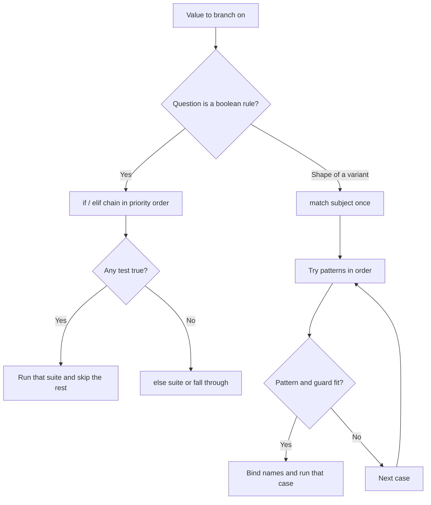

## Why this matters

Branching is business logic in its most reviewable form. A wrong `elif` order charges the wrong tax slab. A missing `else` silently does nothing when a new status appears. An `if` that tests truthiness instead of `None` drops zero-quantity orders. At 15–20 LPA, interviewers and reviewers both read your branches as the specification. They want the cases exhaustive, the order justified, and the failure mode loud.

`match`, added in Python 3.10, is how you branch on the shape of a value: a command tuple, a result tag, an API payload kind. It replaces long `isinstance` ladders when the data is a discriminated union. It does not replace boolean business rules. Knowing which tool you are holding is the lesson.

## Intuition

`if` asks a yes-or-no question about a value you already understand. You stack questions with `elif` so that the first true question wins and the rest are skipped. `else` is the bucket for "none of the questions were true," which means you must be sure that bucket is safe.

`match` asks "what shape is this object?" The subject is evaluated once. Each `case` is a pattern, not a boolean expression. The first pattern that fits wins, and names in the pattern become variables. A final `case _` is the explicit "anything else," which is how you stop a new variant from falling off the end.

## Core concept in depth

### if, elif, else

The suite under a true test runs, and the rest of the chain is skipped. Tests can be any expression; truthiness decides. There is no `switch` on integers in the C sense and no fall-through. You do not `break` out of an `if`.

Order is semantics. For a grade boundary, test the top band first if you write `score >= 90`, then `score >= 80`, and so on. If you reverse them, a 95 hits `>= 80` first and never reaches the distinction band. Write the bands in the order a reviewer can check with one example per line.

`else` on a chain means "none of the above." Use it when that situation is real and handled. Omit it when "do nothing" is correct, and say so with a comment only if the omission would look like a mistake. Prefer raising on an impossible state rather than an `else` that returns a bland default. A new order status should not be treated as "delivered" because it failed every equality check.

### The conditional expression

`label = "ok" if code == 0 else "fail"` is an expression. It returns a value. Both branches are expressions, not suites, so you cannot put statements there. Only the chosen branch is evaluated, so a call with a side effect in the other branch does not run.

It binds loosely. If it is an argument to a function or an operand, parenthesize it. Nested conditional expressions are legal and usually worse than an `if` chain. One conditional expression for a label is fine. Three nested ones are a puzzle.

Do not use a conditional expression to hide a mutation. If each branch does different work, write an `if` statement.

### Guard clauses

A guard clause handles the bad case at the top and returns or raises, so the rest of the function is the happy path at a lower indent. This is easier to read than a pyramid of `if` blocks wrapping the real work. Guards should be cheap and local: missing input, wrong type, empty collection when empty is illegal. They should not hide the main rule five returns later with no name.

### match and patterns

```python
def describe(command: tuple) -> str:
    match command:
        case ("ping",):
            return "pong"
        case ("add", int(x), int(y)):
            return str(x + y)
        case ("get", str(key)):
            return f"fetch {key}"
        case _:
            return "unknown"
```

The subject `command` is evaluated once. `case ("ping",)` matches a one-element tuple whose item equals `"ping"`. A class pattern `int(x)` matches an int and binds `x`. Several alternatives can share a body with `|`. A guard adds a condition: `case ("add", x, y) if x >= 0`. Guards are not patterns; they run after the pattern matches, and a failing guard tries the next case.

`case _` matches everything and creates no name. `case x` also matches everything and binds `x`, which is a capture, not a constant comparison. A bare name in a pattern always binds. To compare against a constant you dotted or qualified, use a dotted name (`case Status.OPEN`) or an equality guard. This is the most common `match` bug: `case READY` binds a new variable named `READY` instead of comparing to the constant `READY`.

Mapping patterns match dicts that contain at least the listed keys. Extra keys are ignored unless you use a catch-all mapping pattern. Sequence patterns match lists and tuples by position. You can capture the rest with a star pattern. Matching is structural, not a place to run arbitrary code. Keep the work in the suite under the case.

`match` does not replace boolean logic like "age at least 18 and country in the allowed set." That is an `if`. Use `match` when the variants are different shapes: success versus error tuples, command names, AST nodes.

### Exhaustiveness is your job

The compiler does not force a final case. If you omit `case _` and nothing matches, `match` simply does nothing and falls through. For a function that must return a value, that means you fall off the end and return `None`, which is a silent bug. End command parsers with `case _` that raises `ValueError`. Treat "unknown" as a defect in the caller, not as an empty string, unless the spec says to ignore unknown commands.

## Diagram / flowchart



### Dry-run: grade bands and a command tuple

Grades: 95, 80, 79 with tests ordered `>= 90`, `>= 80`, else pass.

| Input | First true test | Result |
| --- | --- | --- |
| 95 | `>= 90` | distinction |
| 80 | `>= 80` after distinction fails | merit |
| 79 | neither | pass |
| 80 if merit is tested before distinction by mistake | `>= 80` | merit, even for 95 |

Command `("add", 2, 5)` against the matcher above:

| Case tried | Fits? | Why |
| --- | --- | --- |
| `("ping",)` | No | First item is not ping, and length differs |
| `("add", int, int)` | Yes | Name matches, both numbers are ints, bound and summed |
| later cases | Not tried | First match wins |

An `("add", True, 1)` input matches `int` patterns because `bool` is a subclass of `int`. If that matters, guard with `if type(x) is int`. Say so when the command comes from JSON, where booleans and numbers are different.

## Code

```python
def grade(score: int) -> str:
    if not isinstance(score, int) or isinstance(score, bool):
        raise TypeError("score must be an int")
    if score < 0 or score > 100:
        raise ValueError("score out of range")
    if score >= 90:
        return "distinction"
    if score >= 75:
        return "merit"
    if score >= 50:
        return "pass"
    return "fail"


def dispatch(command: tuple) -> str:
    match command:
        case ("ping",):
            return "pong"
        case ("echo", str(text)):
            return text
        case ("add", x, y) if type(x) is int and type(y) is int:
            return str(x + y)
        case _:
            raise ValueError(f"unknown command: {command!r}")


if __name__ == "__main__":
    print(grade(80), grade(49))
    print(dispatch(("echo", "hi")))
    print(dispatch(("add", 2, 5)))
```

`grade` uses separate `if` statements that return, which is the same control flow as `elif` with less indent. Either style is fine when every arm returns. Do not mix a non-returning `if` with a later `if` that assumed the first did not run, unless you meant both to run.

## Complexity analysis

| Form | Cost |
| --- | --- |
| Chain of k equality tests | O(k) comparisons, stops early |
| `match` with k patterns | O(k) pattern attempts in the worst case, subject evaluated once |
| Dict dispatch of named commands | O(1) average lookup after you build the table |
| Nested `if` that repeats a query | Pays for the query on every branch that re-evaluates it |

A five-way status check is not a performance problem. A loop that re-parses a string inside each branch is. When the set of commands is large and open, a dict from name to function is clearer than a hundred cases and is average constant time. `match` shines when each arm has a different shape, not when you are selecting among peers by a string code. You can still `match` the code and call it readable; just do not pretend it is faster than a dict.

## Tricks, tips and patterns

- Return from each arm so the happy path does not nest. Guards first, then the rule.
- Put the most specific pattern above the general one. `("add", x, y)` after a catch-all never runs.
- Use `type(x) is int` when booleans must not count as ints. `isinstance` is the wrong test there.
- Prefer `case _` that raises for parsers. Silent fall-through returns `None`.
- A dict of callables is the right dispatch when arms share a shape and differ by name.
- Conditional expressions are for values. Statements stay in `if` suites.
- One example per band in tests: just below, exactly on, and just above each boundary.

## Common mistakes and edge cases

- Band checks in the wrong order so a high score matches a lower band.
- `else` that treats unknown statuses as success.
- Bare names in `match` capturing instead of comparing to a constant.
- Forgetting that `match` does nothing when no case fits, then using the missing return value.
- `bool` matching an `int` class pattern.
- Nested conditional expressions nobody can parse in review.
- An `if` that mutates and a later `elif` that assumed a snapshot. Compute the condition into a name first.
- Comparing a status to a string while the object is an enum, so every arm fails and `else` runs.

## Interview notes

Narrate the order. "I test the top grade first because the conditions overlap. Each arm returns, so later bands are the remainder." For a command router, say whether variants differ in shape. If they do, `match` with a raising wildcard. If they are string codes with the same payload, a dict of functions.

Follow-ups you should expect:

- **Does Python fall through cases?** No. The first match wins and the others are skipped. There is no `break`.
- **What if nothing matches?** Execution continues after the `match`. If you needed a return value, you now have `None` unless you raise.
- **Why did `case OK` not compare?** A bare name binds. Use a dotted constant or a guard.
- **if versus elif?** `elif` is mutually exclusive and ordered. Two separate `if` statements can both run if the first does not return.

Boundary tests are the proof. Mention you would test 49, 50, 74, 75, 89, and 90 for the bands in the sample, not only the happy score of 100.

## Practice problems

1. **Grade Band** (easy) — map a score to a band with ordered thresholds and range checks. [Practice: python-ex-grade-band]
2. **Fizz Buzz** (easy) — classic divisibility branches, including the combined case first. [Practice: python-ex-fizzbuzz]
3. **Command Dispatch** (medium) — interpret ping, echo, and add tuples, and reject unknowns. [Practice: python-ex-command-dispatch]
4. **Status Step** (medium) — advance an order status along an allowed graph and reject illegal jumps. [Practice: python-ex-status-step]
5. **Tax Slab** (medium) — apply the first matching slab, not a sum of all matching slabs. [Practice: python-ex-tax-slab]

## Summary / cheat sheet

- `if` / `elif` / `else` runs the first true suite and skips the rest. There is no fall-through.
- Overlapping conditions are ordered from most specific to least. Boundaries need tests on both sides.
- A conditional expression picks a value and evaluates only the chosen branch.
- `match` tries patterns in order against a subject evaluated once. The first hit wins.
- A bare name in a pattern binds. It does not compare to an existing variable.
- End parsers with `case _` that raises, or a missing match becomes a silent `None`.
- Use a dict of functions when you are selecting by name among same-shaped arms.

## Further reading

- [if statements](https://docs.python.org/3/tutorial/controlflow.html#if-statements)
- [match statements](https://docs.python.org/3/tutorial/controlflow.html#match-statements)
- [PEP 634 — Structural Pattern Matching](https://peps.python.org/pep-0634/)
- [Conditional expressions](https://docs.python.org/3/reference/expressions.html#conditional-expressions)
