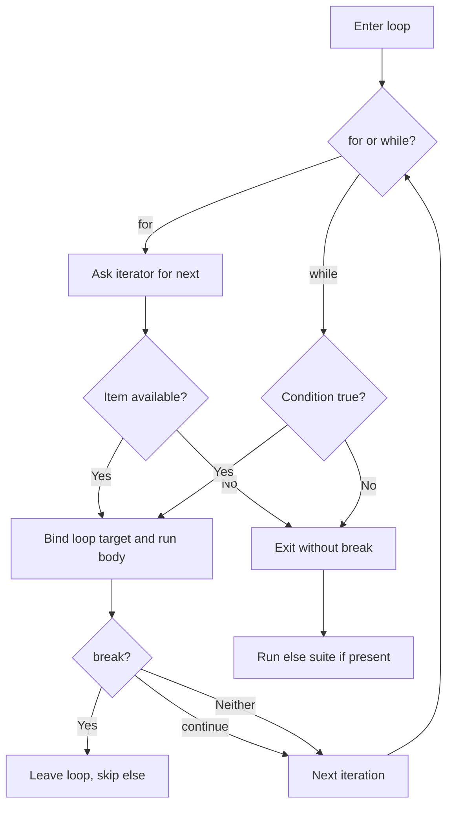

## Why this matters

Most interview problems are a loop with a well-chosen state variable: a running minimum, a pair of indexes, a count of open brackets. The difference between an O(n) solution and a timeout is rarely a clever keyword. It is whether you scan once, what you update inside the scan, and whether `break` fires on the right condition. The Python-specific hazards are different: mutating a list while iterating it, assuming `for` creates a scope, misunderstanding `for/else`, and writing a `while` whose condition never changes.

Production code has the same shapes. A worker drains a queue until it is empty. A parser consumes characters until a sentinel. A retry loop stops on success or on a budget. If you cannot say what the invariant is at the top of each iteration, you cannot review the loop.

## Intuition

A `for` loop asks an iterator for the next item until the iterator is exhausted. The loop variable is just a name that gets rebound each time. It is not a fresh local scope, and it still holds the last value after the loop ends.

A `while` loop checks a condition you control. You are responsible for moving something closer to done on every iteration. `break` leaves the loop now. `continue` skips the rest of the body and starts the next iteration. The optional `else` on a loop runs only when the loop did **not** `break`. It means "we exhausted the search without hitting the early exit," which is useful for search and easy to misread as "else means zero iterations."

## Core concept in depth

### for and iterators

`for item in container` asks the container for an iterator and pulls values. A list iterator yields items. A dict iterator yields keys. A file yields lines. `range(n)` yields integers without building a list, so `for i in range(10**9)` does not allocate a billion ints up front; it still should not run that many times.

The loop target is an assignment. `for a, b in pairs` unpacks each item. A mismatch raises `ValueError` immediately, which is what you want. After the loop, the target name still exists and refers to the last value, or was never bound if the iterable was empty. Do not assume the name is cleared.

`for` does not copy the container. If you append to a list while iterating that same list, you can skip items or loop forever as the iterator walks into items you just added. Iterate a shallow copy (`for item in items[:]`) or build a new list of changes and apply them after. Deleting the current item with `list.remove` inside the loop skips the next one because indexes shift under the iterator. Collect keeps, or iterate indexes from the end.

### range, enumerate, zip

`range(stop)` starts at 0 and excludes stop. `range(start, stop, step)` excludes stop and can step backward with a negative step. The stop is never included, which is the off-by-one you should say out loud: indexes `0` through `n-1` are `range(n)`.

`enumerate(items, start=0)` yields index and value. Use it whenever you would have written `range(len(items))` just to index. `range(len(...))` is appropriate when you need to walk indexes for a swap or a partition, not when you only need the item.

`zip(a, b)` stops at the shorter iterable. `zip(a, b, strict=True)` raises if lengths differ, which is the right default when a length mismatch is a bug. Truncation is how a column of labels silently loses its last row.

### while

Use `while` when there is no obvious sequence: read until a sentinel, retry until success or budget, advance an index with a rule that is not "plus one each time." The first line of the body or the condition itself must make progress. A classic infinite loop is `while low < high` with a body that never moves `low` or `high`. Prove progress: an integer index increases, a budget decreases, or a queue shrinks.

`while True` plus `break` is acceptable when the exit sits in the middle: read a record, stop on sentinel, otherwise process. Do not bury the `break` three helpers deep.

### break, continue, and loop else

`break` exits the innermost loop only. It does not exit an outer loop. If you need to leave nested loops, return from the function, or set a flag the outer condition checks. A flag is honest. A custom exception used only as a multi-level break is usually worse.

`continue` skips to the next iteration. In a `for`, you still draw the next item. In a `while`, you re-check the condition, so any increment must already have happened or the condition will spin. Putting `i += 1` after `continue` is a famous infinite loop.

The `else` clause on `for` or `while` runs when the loop completes without `break`. It does not run when you `break`, and it does not mean "the iterable was empty," although an empty `for` does run `else` because it never broke. The useful pattern is search:

```python
for user in users:
    if user["id"] == target:
        found = user
        break
else:
    found = None
```

If you `break`, you found a match and `else` is skipped. If you finish the list, `else` runs and records absence. Many teams ban `for/else` because readers forget the rule. Knowing it lets you read standard-library code and decide whether to use it. A plain flag is easier in application code. Use the flag in interviews unless the interviewer asks about `else`.

### Loop invariants

Before each iteration, state what is true. "Every index before `i` is non-negative" or "`best` is the maximum of the prefix." The body must restore that fact. This is how you derive two-pointer loops without memorizing them. It is also how you review someone else's `while`. If they cannot state the invariant, the loop is not done.

## Diagram / flowchart



### Dry-run: search with for/else, and a bad mutation

Search `ids = [4, 8, 15]` for `8`, then for `3`.

| Target | What happens | else runs? | Result |
| --- | --- | --- | --- |
| 8 | Second item matches, `break` | No | found 8 |
| 3 | Iterator exhausts | Yes | record missing |

Mutation bug: `nums = [1, 2, 3]` and the body removes even numbers with `remove` during `for n in nums`.

| Step | Iterator is on | Action | List becomes |
| --- | --- | --- | --- |
| 1 | 1 | odd, keep | 1, 2, 3 |
| 2 | 2 | even, remove 2 | 1, 3 |
| 3 | next slot after the removal | sees 3, which shifted into the slot | 3 is kept, and if 4 had followed 2 it would have been skipped |

Build a new list of kept items instead. Do not remove from the list you are walking forward.

## Code

```python
def first_index(nums: list[int], target: int) -> int:
    for index, value in enumerate(nums):
        if value == target:
            return index
    return -1


def running_max(nums: list[int]) -> list[int]:
    best = None
    out: list[int] = []
    for value in nums:
        if best is None or value > best:
            best = value
        out.append(best)
    return out


def drop_evens(nums: list[int]) -> list[int]:
    return [n for n in nums if n % 2]


def retry_until(attempts: int, outcomes: list[bool]) -> str:
    tried = 0
    while tried < attempts and tried < len(outcomes):
        if outcomes[tried]:
            return "ok"
        tried += 1
    return "exhausted"


if __name__ == "__main__":
    print(first_index([4, 8, 15], 8))
    print(running_max([3, 1, 4, 2]))
    print(drop_evens([1, 2, 3, 4]))
    print(retry_until(3, [False, False, True]))
```

`first_index` returns from inside the loop, which is the function-sized version of `break` plus a result. You do not need `for/else` when a `return` already separates found from missing.

## Complexity analysis

| Pattern | Time | Extra space |
| --- | --- | --- |
| Single `for` over n items, O(1) body | Θ(n) | O(1) besides the output |
| Nested loops over the same list | Θ(n²) unless an index range shrinks | Usually O(1) |
| `while` that advances an index by 1 | Θ(n) if the index starts at 0 and stops at n | O(1) |
| `while` that never moves the index | Unbounded | The bug |
| Building a new list instead of deleting in place | Θ(n) time and Θ(n) extra space | Safer than O(n²) `remove` in a loop |

`list.remove` inside a loop is quadratic because each removal shifts the tail. A new list is linear and obvious. Mention that trade when an interviewer asks for in-place and then asks about bugs. In-place can be linear if you write kept items toward the front with a write index and slice the tail once.

## Tricks, tips and patterns

- Prefer `for` with `enumerate` over `range(len(...))` unless you are swapping by index.
- Use `zip(..., strict=True)` when paired sequences must be the same length.
- Return early from a search. The code after the loop is the not-found path.
- Make `while` progress obvious: decrement a budget on the line before `continue` can fire.
- Copy or build a new list when the body needs to delete or insert.
- `for/else` means "no break." Prefer a flag in team code if readers do not know the rule.
- State the invariant in one comment only when the loop is subtle, such as a partition. Do not comment `i += 1`.

## Common mistakes and edge cases

- Removing or inserting in a list while a `for` walks it forward.
- `continue` before the increment in a `while`.
- `break` expected to leave both loops. It leaves one.
- Using the loop variable after an empty loop and catching `UnboundLocalError` or a stale value from a previous run. On an empty iterable the name is unchanged if it was bound before, or undefined if it was not.
- Off-by-one with `range`: `range(1, n)` drops the last index `n-1` if you meant `range(n)`.
- `zip` silently truncating the longer input.
- Assuming `for` starts a new scope. Closures inside the loop capture the same variable. That bug is explained with closures; the symptom is every callback seeing the last index.
- A `while` condition that uses a float counter. Count retries with an int.

## Interview notes

Before coding, name the scan. "One pass, track the minimum so far, update profit." Then name the exit. "I return on the first duplicate; if the loop ends, there was none." Complexity follows: one pass is linear, two nested full scans are quadratic. If you need better, say what extra memory buys you, usually a set.

Questions they add:

- **What does loop else do?** It runs only when `break` did not. Give the search example in one sentence, then offer the flag version.
- **Can you modify a list while iterating?** Not safely with a forward iterator. Build a new list or walk indexes backward when deleting.
- **Why is range(len) a smell?** Because you wanted the item, not the index. Use it when the algorithm is about indexes.
- **How do you exit two loops?** Return, or set a flag. Do not pretend `break` is labeled.

Always test empty input, one element, and the "never found" case. Those three catch most loop bugs in a phone screen.

## Practice problems

1. **First Index** (easy) — return the index of a target or -1. [Practice: python-ex-first-index]
2. **Running Max** (easy) — prefix maxima in one pass. [Practice: python-ex-running-max]
3. **Drop Evens** (easy) — return a new list of odd numbers without mutating during iteration. [Practice: python-ex-drop-evens]
4. **Retry Budget** (medium) — consume outcomes until success or the attempt budget ends. [Practice: python-ex-retry-budget]
5. **Two Sum Sorted** (medium) — opposite-end indexes on a sorted list, moving the correct pointer each step. [Practice: python-ex-two-sum-sorted]
6. **Compress Run** (medium) — one pass that groups consecutive equal values and counts them. [Practice: python-ex-run-length]

## Summary / cheat sheet

- `for` pulls from an iterator and rebinds the loop name. The name survives the loop. There is no new scope.
- Do not add or remove items in the list you are iterating forward. Build a new list.
- `range` excludes the stop. `enumerate` gives indexes. `zip(..., strict=True)` rejects length mismatches.
- `while` is for progress you control. Every path, including `continue`, must move toward the exit.
- `break` leaves the innermost loop. `continue` skips to the next iteration.
- Loop `else` runs only when the loop did not `break`. A flag is the readable alternative.
- State the invariant. One clean pass with the right state beats a nested scan.

## Further reading

- [for statements](https://docs.python.org/3/tutorial/controlflow.html#for-statements)
- [break and continue, and else on loops](https://docs.python.org/3/tutorial/controlflow.html#break-and-continue-statements-and-else-clauses-on-loops)
- [range](https://docs.python.org/3/library/stdtypes.html#range)
- [zip](https://docs.python.org/3/library/functions.html#zip)
- [Iterators](https://docs.python.org/3/tutorial/classes.html#iterators)
