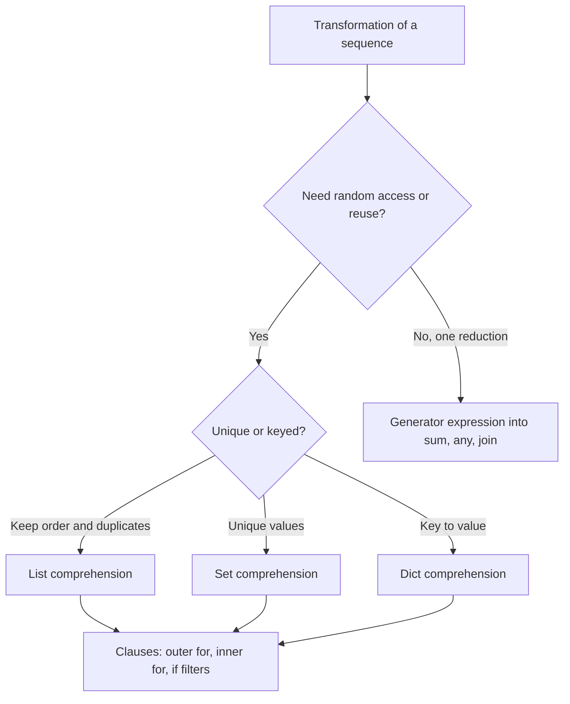

## Why this matters

Comprehensions are the idiomatic way to map and filter in Python. Interviewers read them as a signal that you think in transformations instead of manual index management. They also read a triple-nested comprehension as a signal that you optimized for cleverness. The job is to know the translation to loops so you can defend the cost, and to know when a comprehension allocates a whole list you will throw away.

A generator expression looks similar and behaves differently. It produces values on demand. `sum` of a generator does not hold every term. That distinction shows up the moment the input is a multi-million-row export and someone wrote square brackets out of habit.

## Intuition

A comprehension is a loop that collects. The clauses are written in the same order as the nested loops they replace: outer loop first, then inner loops, then the `if` filters that belong to the loop they follow. The expression at the front is what you append, add, or store.

Square brackets build a list now. A set comprehension builds a set now, so duplicates disappear and order is not the point. A dict comprehension builds a dict now, and a repeated key keeps the last value. Parentheses around a generator expression build an iterator that does the work when you pull it, not when you write it.

## Core concept in depth

### List comprehensions

```python
squares = [n * n for n in range(5) if n % 2 == 0]
```

This is exactly:

```python
squares = []
for n in range(5):
    if n % 2 == 0:
        squares.append(n * n)
```

The translation is the whole semantics. Filters sit where the `if` would sit in the loop. You may have several `if` clauses; they all must pass. You may have several `for` clauses; the leftmost `for` is the outer loop.

```python
pairs = [(x, y) for x in range(2) for y in range(3)]
```

`x` changes slowest. `y` runs through `0, 1, 2` for each `x`. People read this backwards because English puts the inner detail first. Trust the loop order, not English.

The expression can unpack, call a function, or build a tuple. Keep it free of side effects. A comprehension that appends to some other list and also prints is a loop in disguise and should be a loop, where side effects are expected.

### Set and dict comprehensions

A set comprehension uses the same clauses and stores results in a set. Use it to collect unique normalized values in one pass: lowercased tags, distinct error codes. Membership in the result is average constant time afterward, and the construction itself is linear in the input plus hashing.

A dict comprehension maps a key expression to a value expression. If two iterations produce the same key, the later one overwrites. That is the same rule as assignment. Inverting a dict with a comprehension is safe only when values are unique and hashable. If values repeat, you silently drop all but one key. Invert into a dict of lists if you need every key.

Keys must be hashable. A list as a key raises `TypeError`. Convert to a tuple of hashable items first when the logical key is a sequence.

### Generator expressions

Parentheses create a generator expression: `(n * n for n in nums)`. It is an iterator. Nothing runs until you iterate. You can pass it to `sum`, `max`, `any`, `all`, or `join` without a temporary list. It is single-use. A second pass sees it already exhausted and yields nothing. If you need two passes, build a list or recreate the generator.

If the generator expression is the only argument to a call, you may omit the extra parentheses: `sum(n * n for n in nums)`. That is a syntax convenience, not a tuple.

Generator expressions do not give random access and do not have a length. They are the right tool for a pipeline that reduces. They are the wrong tool for a result you will index or return to a caller who expects a list. Return a list when the contract is a sequence the caller can reuse.

### Scope

A comprehension has its own scope for the loop variables, unlike a classic `for` loop. After `[n for n in range(3)]`, the name `n` in the surrounding function is not set by that comprehension. This changed from early Python 3 behavior people still quote. Do not depend on a comprehension to assign an outer name. Do not be afraid that it leaks one either. The loop variable in a `for` statement does leak into the function scope. That difference matters for closures and for "what is `n` after this block?"

### Walrus, sparingly

A named expression (`:=`) can capture a value inside a filter so you do not compute it twice: keep items whose parsed form is not `None`. It is useful and dense. If a reviewer has to squint, compute the parsed form in a generator function with a normal loop. Cleverness is not a requirement.

### When to write the loop instead

Write the loop when you are debugging, when an arm needs `try` with a specific log line, when you update two structures, or when the body has more than one statement of real work. You can prototype as a loop and compress to a comprehension once the logic is stable. The reverse, expanding a comprehension a teammate cannot step through, is also a good edit.

## Diagram / flowchart



### Dry-run: nested clauses and a dict overwrite

`[(x, y) for x in range(2) for y in range(2) if x != y]`

| x | y | filter | collected |
| --- | --- | --- | --- |
| 0 | 0 | equal, skip | |
| 0 | 1 | keep | (0, 1) |
| 1 | 0 | keep | (1, 0) |
| 1 | 1 | equal, skip | |

Dict comprehension from pairs `(("a", 1), ("b", 2), ("a", 9))` mapping key to value ends as `a -> 9`, `b -> 2`. The first `a` is gone. If the spec was "first wins," a comprehension is the wrong tool unless you guard with a seen set in a loop.

## Code

```python
def normalize_tags(raw: list[str]) -> list[str]:
    seen: set[str] = set()
    ordered: list[str] = []
    for tag in raw:
        cleaned = tag.strip().lower()
        if not cleaned or cleaned in seen:
            continue
        seen.add(cleaned)
        ordered.append(cleaned)
    return ordered


def word_lengths(words: list[str]) -> dict[str, int]:
    return {word: len(word) for word in words}


def total_even_squares(nums: list[int]) -> int:
    return sum(n * n for n in nums if n % 2 == 0)


def flatten(rows: list[list[int]]) -> list[int]:
    return [value for row in rows for value in row]


if __name__ == "__main__":
    print(normalize_tags([" Py ", "py", "", "Go"]))
    print(word_lengths(["to", "be", "to"]))
    print(total_even_squares([1, 2, 3, 4]))
    print(flatten([[1, 2], [3]]))
```

`normalize_tags` stays a loop because it updates two collections and preserves first-seen order. A set comprehension would be shorter and would drop order. Name that requirement before you pick the form. `word_lengths` overwrites duplicate words with the same length, so a dict comprehension is honest. `total_even_squares` never needs the list of squares, so a generator expression is the one that matches the cost.

## Complexity analysis

| Form | Time | Extra memory |
| --- | --- | --- |
| List comprehension over n items | Θ(n) | Θ(n) for the result |
| Set or dict comprehension | Θ(n) average | Θ(number of unique keys) |
| Generator expression reduced by `sum` | Θ(n) | Θ(1) besides the input |
| Nested comprehension over n by m | Θ(n·m) | Θ(n·m) if it builds a list |
| List built only to iterate once | Θ(n) time and memory | Wasteful versus a generator |

The nested case is the one that blows up a service: a comprehension over every user times every permission builds a list you could have streamed. If the consumer is `any` or a write to a socket per item, do not materialize.

## Tricks, tips and patterns

- Read clauses left to right as nested loops, outer first.
- Use a generator expression as the argument to `sum`, `max`, `min`, `any`, `all`, and `str.join`.
- Preserve first-seen order with a loop, a seen set, and a result list. A set alone does not promise order you can rely on for users.
- Dict comprehensions: last key wins. State that if the input can repeat.
- Flatten one level with a double `for`, not with `sum(rows, [])`, which is quadratic.
- Return a list from a public function when callers will reuse it. Document a generator if you return one, because it is single-use.
- Expand to a loop the moment you need a try/except per item with logging.

## Common mistakes and edge cases

- Swapping the order of `for` clauses and transposing the result.
- A dict comprehension that silently drops duplicate keys.
- Expecting a set comprehension to keep input order. Do not promise order from a set.
- Building a giant list for `sum` or `any`. Use a generator expression.
- Consuming a generator twice and debugging an empty second pass.
- Side effects inside the expression. Print and append belong in a loop.
- Using a list as a dict key. Tuples of hashables are the fix.
- Assuming the comprehension loop variable leaks into the function the way a `for` variable does. It does not.
- `sum(rows, [])` to flatten. Each addition copies the growing list.

## Interview notes

When you write a comprehension on a whiteboard, say the loop it stands for and the memory. "This builds an output list of size n, linear time. If I only need the total I will use a generator expression so the squares are not stored." That sentence is worth more than the syntax.

Follow-ups:

- **Can you filter and map together?** Yes. The `if` clause is the filter. The front expression is the map.
- **What happens on duplicate dict keys?** The last write wins.
- **List versus generator?** List is reusable and indexable and costs memory. Generator is single-pass and lazy.
- **How do you unique while keeping order?** A seen set plus an output list, not a set comprehension.

If the interviewer asks you to rewrite it as a loop, do it mechanically from the clause order. Hesitation there looks like you memorized a bracket style.

## Practice problems

1. **Even Squares** (easy) — sum squares of even numbers without a temporary list. [Practice: python-ex-even-squares]
2. **Flatten Once** (easy) — flatten a list of lists one level. [Practice: python-ex-flatten-once]
3. **Word Lengths** (easy) — dict from word to length, last duplicate wins. [Practice: python-ex-word-lengths]
4. **Unique Tags** (medium) — normalize and dedupe while preserving first-seen order. [Practice: python-ex-unique-tags]
5. **Invert Unique** (medium) — invert a mapping, and raise if two keys share a value. [Practice: python-ex-invert-unique]
6. **Pairs** (easy) — cartesian product of two small lists as pairs, outer first. [Practice: python-ex-pairs]

## Summary / cheat sheet

- A comprehension is a collecting loop. Clauses read as nested loops from outer to inner, with `if` filters beside them.
- Square brackets build a list. Set and dict forms build those collections now. Parentheses build a lazy generator.
- Dict keys: last write wins. Set values: uniqueness, not order. First-seen order needs a seen set and a list.
- Generator expressions are single-use and Θ(1) extra memory when reduced immediately.
- No side effects in the expression. Switch to a loop for logging, error handling, or two accumulators.
- Comprehension variables do not leak into the enclosing function the way `for` targets do.

## Further reading

- [List comprehensions](https://docs.python.org/3/tutorial/datastructures.html#list-comprehensions)
- [PEP 202 — List Comprehensions](https://peps.python.org/pep-0202/)
- [Displays for lists, sets, and dicts](https://docs.python.org/3/reference/expressions.html#displays-for-lists-sets-and-dictionaries)
- [Generator expressions](https://docs.python.org/3/reference/expressions.html#generator-expressions)
- [PEP 572 — Assignment Expressions](https://peps.python.org/pep-0572/)
