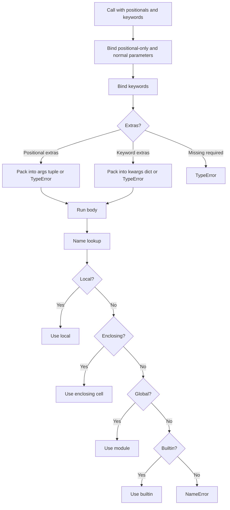

## Why this matters

Functions are the unit reviewers and interviewers both grade. A signature is a contract: which arguments are required, which have defaults, which must be passed by name so a boolean flag is not confused with a timeout. Scope is the other contract: which assignment creates a local, which name is looked up in an enclosing function, and why a loop variable is shared by every closure you build inside it.

The famous defects are mechanical. A mutable default list remembers earlier calls. An assignment anywhere in a function makes that name local for the whole function, so a read before the assignment raises `UnboundLocalError`. `*args` and `**kwargs` hide a real parameter list until a caller passes a typo and it vanishes into a catch-all. At the 15–20 LPA bar you are expected to design the signature on purpose and to explain LEGB without hand-waving.

## Intuition

A function is a recipe with labeled docks for ingredients. Calling the function fills those docks from the left with positional arguments, then by name with keywords. Extra positional ingredients can be packed into a tuple if the recipe says `*args`. Extra named ingredients can be packed into a dict if it says `**kwargs`. Two fences change the rules: `/` means "everything to my left is positional-only," and a bare `*` means "everything to my right is keyword-only."

Names inside the recipe are resolved by walking outward: the function's own locals, then any enclosing function, then the module, then the builtins. Assignment is what creates a local. Reading a name does not. That single fact explains `UnboundLocalError`.

## Core concept in depth

### Parameters versus arguments

Parameters are the names in the `def` line. Arguments are the objects supplied at the call. You can pass a parameter by position or by keyword unless a fence forbids one of those. Defaults are evaluated once, when the `def` statement runs, not on each call. That is why a default of `[]` or `dict()` is one shared object for every caller who omits the argument.

```python
def append_item(item, bucket=None):
    if bucket is None:
        bucket = []
    bucket.append(item)
    return bucket
```

The `None` sentinel is created once and is immutable, so sharing it is safe. The list is created inside the call, so each omitted argument gets a fresh list. If the caller passes a list, you mutate that list. Document that. If the caller must keep their list, copy it at the start of the function.

### How a call binds arguments

The binding order is fixed:

1. Positional arguments fill parameters from the left, skipping those already bound.
2. Keyword arguments bind by name. A name already bound is a `TypeError`.
3. Extra positionals go to `*args` as a tuple, or raise if there is no `*args`.
4. Extra keywords go to `**kwargs` as a dict, or raise if there is no `**kwargs`.
5. Missing parameters with no default raise `TypeError`.

`*` in the call unpacks a sequence into positional arguments. `**` in the call unpacks a mapping into keywords. The same stars in the definition pack. Mixing them up is a common reading error: definition packs, call unpacks.

### Positional-only and keyword-only

```python
def connect(host, port=443, /, *, timeout=30, retries=3):
    return (host, port, timeout, retries)
```

`host` and `port` must be positional. Callers cannot pass `host=` because the parameter names are not part of the public keyword API, so you can rename them later. `timeout` and `retries` must be keywords, so `connect("db", 5432, 5)` is illegal rather than a silent mix-up of timeout and retries. This is the style of `range` and many builtins, and it is the style you should copy for any boolean flag. `def send(body, *, dry_run=False)` makes `send(payload, True)` a type error instead of a guessed meaning.

### *args and **kwargs

Use `*args` when the function genuinely accepts a variable number of peers: `min`-style comparisons, a tag builder, a test helper. Use `**kwargs` when you are forwarding to another function and you do not want to repeat its whole signature. Do not use `**kwargs` on a public service function to avoid designing parameters. Typos become silent ignored keys. If you must accept options, take a typed object or explicit names.

Forwarding looks like `return other(*args, **kwargs)`. If you also have your own parameter, bind it first and forward the rest. A wrapper that forgets to forward `kwargs` drops the caller's options. A wrapper that puts `*args` after keyword-only parameters is a syntax error; `*args` introduces the keyword-only section if a bare `*` is not already there.

### Return values

No `return`, or a bare `return`, yields `None`. Returning several expressions returns one tuple. Callers can unpack that tuple. Prefer a named tuple or a small dataclass when the tuple has more than two fields or the positions are easy to swap. That topic returns with dataclasses; for now, do not return a tuple of five anonymous values from a public function.

### LEGB

Look up a name in this order:

1. **Local** — names assigned anywhere in this function, plus parameters and imports in the function.
2. **Enclosing** — locals of functions that physically contain this function, nearest first. This is how closures see outer variables.
3. **Global** — the module dictionary.
4. **Built-in** — `len`, `range`, `print`, and the rest of the builtins module.

If none contain the name, the lookup raises `NameError`. Assignment marks a name local for the **entire** function, even the lines before the assignment. That is why this fails:

```python
count = 0

def bump():
    print(count)  # UnboundLocalError
    count = count + 1
```

The compiler sees `count =` and treats `count` as local. The `print` reads the local before it is bound. The fix is `global count` if you truly mean the module name, which you rarely should. Module-level counters are shared mutable state. Return the new count, or keep it on an object.

`global` declares that assignments rebind the module name. `nonlocal` declares that assignments rebind a name in the nearest enclosing function. `nonlocal` cannot reach the module, and `global` cannot reach an enclosing function. Loops, `if`, and `try` do not create scopes. Only modules, classes, functions, and comprehensions do. A name assigned in a loop is a local of the whole function.

Class bodies are their own scope, but methods do not look up names in the class body the way nested functions look up enclosing locals. Methods look at `self`, then globals. That surprise belongs with OOP; do not expect LEGB to see class attributes as an "enclosing" scope.

## Diagram / flowchart



### Dry-run: mutable default versus None sentinel

Definition `bad(item, bucket=[])` evaluated once, then two calls. Parallel column uses the sentinel pattern.

| Call | Shared default list | Fresh list via None |
| --- | --- | --- |
| First call with `"a"` and no bucket | The one default list becomes a | A new list becomes a |
| Second call with `"b"` and no bucket | The same list becomes a, b | A different new list becomes b |
| Third call passing an explicit empty list | That caller's list, not the default | That caller's list |

The first column is one object living on the function, visible as `bad.__defaults__`. Tests that call the function twice leak data. The second column allocates inside the call.

LEGB dry-run for a nested function that reads `n` and does not assign it: lookup misses local, hits the enclosing function's `n`, done. If the nested function assigns `n = n + 1` without `nonlocal`, the inner `n` is a new local and the right-hand `n` raises `UnboundLocalError`.

## Code

```python
def tag(name: str, /, *children: str, **attrs: str) -> str:
    parts = [f"{key}={value}" for key, value in attrs.items()]
    extra = (" " + " ".join(parts)) if parts else ""
    body = "".join(children)
    return f"<{name}{extra}>{body}</{name}>"


def make_multiplier(factor: int):
    def multiply(value: int) -> int:
        return value * factor
    return multiply


CALLS = 0


def note_call() -> int:
    global CALLS
    CALLS += 1
    return CALLS


if __name__ == "__main__":
    print(tag("a", "Docs", href="/docs"))
    twice = make_multiplier(2)
    print(twice(21))
    print(note_call(), note_call())
```

`tag` forces the element name to be positional, packs child strings, and packs attributes as keywords. `make_multiplier` is a closure: `multiply` reads `factor` from the enclosing scope. `note_call` is the rare honest use of `global`, and even here a class or an iterator would be better. It exists so you can see the declaration that makes the assignment legal.

## Complexity analysis

| Concern | Cost |
| --- | --- |
| Call overhead | A small constant per call. Irrelevant until a profiler says a tiny function is hot |
| Binding k keyword arguments | O(k) |
| Packing `*args` of size k | O(k) to build the tuple |
| LEGB lookup that hits local | O(1) slot load |
| LEGB lookup that misses through to global | A dict lookup per evaluation, which is why hot loops bind globals to locals |
| Mutable default bug | Unbounded correctness cost, not CPU |

Do not micro-optimize call overhead in a web handler. Do not hide a quadratic algorithm inside a helper and blame function calls. The signature design costs nothing at runtime and everything in review.

## Tricks, tips and patterns

- Put a `*` in front of every boolean and mode flag so it must be passed by name.
- Default mutable parameters to `None` and create the container inside the function.
- Prefer explicit parameters over `**kwargs` on functions other modules call.
- Use `*args` and `**kwargs` to forward, and test that an unknown keyword still reaches the inner function.
- Return early for guards. Keep the main behavior at the left edge of the function.
- If you need `global`, you probably want an object attribute instead. Use `global` when you are intentionally touching module state.
- Annotate public functions. Annotations document the contract and do not enforce it at runtime by themselves.
- `def f(a, b, /)` is how you copy builtin style when names should not be part of the API.

## Common mistakes and edge cases

- Mutable defaults: one list or dict shared by every caller who omits the argument.
- Assigning a name and then reading it earlier in the same function. `UnboundLocalError`, not a global fallback.
- Shadowing a builtin with a parameter or a local called `list`, `id`, `type`, or `sum`. The local wins for the whole function.
- Assuming `if` or `for` creates a scope. An assignment inside a branch still marks the name local on the other branch.
- `**kwargs` swallowing a typo. The function runs with a default and the caller thinks the option worked.
- Passing a keyword to a positional-only parameter, or a positional to a keyword-only parameter. Both are `TypeError`, which is the fence doing its job.
- Forgetting `return` and testing against a computed value that is actually `None`.
- Using `global` when `nonlocal` was required inside a nested function, or the reverse. The error messages differ; read them.
- Defaults that call `datetime.now()` once at definition, so every call sees the import-time timestamp. Pass `None` and read the clock inside the function.

## Interview notes

Be ready to rewrite a mutable default on a whiteboard and to point at `function.__defaults__` as the proof that the object was created at definition. Then walk LEGB on a nested function: "inner reads `factor`, does not assign it, so the name is enclosing, not global."

Follow-ups:

- **What does `*args` contain?** A tuple of the extra positionals, not a list. It can be empty.
- **Why keyword-only for flags?** So a positional `True` cannot be mistaken for another parameter.
- **When is a name local?** If the function assigns it anywhere, imports it, or it is a parameter. The decision is made at compile time.
- **global versus nonlocal?** `global` rebinds the module. `nonlocal` rebinds an enclosing function local. Neither is needed to read.

A strong answer mentions that closures and decorators are the next layer on the same rule: a decorator is a function that receives a function, and a closure is how it remembers state. You will study both in the following lessons. Do not pretend `**kwargs` is a design.

## Practice problems

1. **Safe Append** (easy) — append to a caller list or to a fresh list when the argument is `None`. [Practice: python-ex-safe-append]
2. **Keyword Flags** (easy) — a function that rejects positional booleans by its signature shape, simulated with an explicit mapping of bound values. [Practice: python-ex-bind-call]
3. **Forward Options** (medium) — merge base options with overrides, where overrides win and unknown keys are kept. [Practice: python-ex-merge-options]
4. **Unbound Local** (medium) — given a trace of assignments, decide whether a read sees the local, the global, or an error. [Practice: python-ex-scope-read]
5. **Multi Return** (easy) — return the min and max of a non-empty list as a pair, and reject an empty list. [Practice: python-ex-min-max]
6. **Once Default** (medium) — show why a timestamp default is stale by comparing a captured default with a freshly read value. [Practice: python-ex-fresh-default]

## Summary / cheat sheet

- Parameters bind positionally, then by keyword. Extra values pack into `*args` and `**kwargs` only if you asked.
- `/` marks positional-only parameters. A bare `*` marks keyword-only parameters after it. Put flags behind `*`.
- Defaults are evaluated once at `def` time. Never default a parameter to a fresh list or dict you meant to create per call. Use `None`.
- A name assigned anywhere in a function is local everywhere in that function. `global` and `nonlocal` opt into outer assignment.
- Lookup order is local, enclosing, global, builtin. Loops and branches are not scopes.
- `*args` at the call unpacks. `*args` in the definition packs. Forward both stars when you wrap a function.
- No `return` means `None`. Several returned expressions are one tuple.

## Further reading

- [Defining functions](https://docs.python.org/3/tutorial/controlflow.html#defining-functions)
- [Why are default values shared between objects?](https://docs.python.org/3/faq/programming.html#why-are-default-values-shared-between-objects)
- [PEP 3102 — Keyword-Only Arguments](https://peps.python.org/pep-3102/)
- [PEP 570 — Positional-Only Parameters](https://peps.python.org/pep-0570/)
- [Naming and binding](https://docs.python.org/3/reference/executionmodel.html#naming-and-binding)
