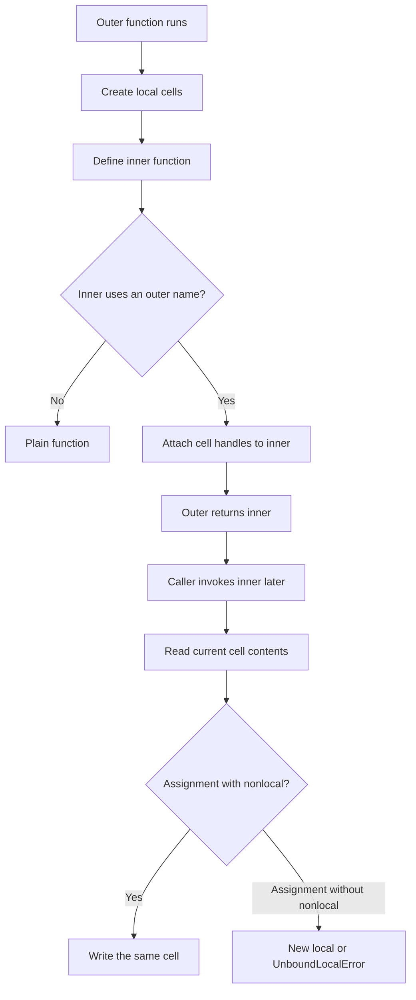

## Why this matters

Closures are how Python remembers state without a class: a factory returns a function that still sees the factory's locals. Decorators, callbacks, partial application, and many test helpers are closures. Interviewers ask two things. First, explain why a list of lambdas created in a loop all return the last index. Second, show how `nonlocal` updates a counter that lives outside the inner function but not at module level.

If you only say "it captures the variable," you will miss the bug. The closure stores a reference to the variable cell, not a copy of the value at definition time. The cell's current contents are read when the inner function runs. That sentence is the whole lesson.

## Intuition

An enclosing function owns a drawer for each local that a nested function uses. The nested function does not get its own copy of the drawer. It gets a handle. When the outer function returns, the drawer stays alive because the nested function still holds the handle. That is why the returned function can see `factor` after `make_multiplier` has finished.

If several nested functions were built in a loop and they all name the same loop variable, they all hold the same drawer. After the loop, the drawer contains the last value. Every function reads that. The fix is a new drawer per iteration: pass the current value into a fresh function parameter, which creates a new local cell.

## Core concept in depth

### What is captured

A nested function becomes a closure when its body uses a name from an enclosing function. CPython represents that name as a cell. You can see the cells on `fn.__closure__`, a tuple of cell objects, and the current value with `cell.cell_contents`. You do not need this for daily code. You need it when a callback "sees the wrong value" and you want proof that two functions share a cell.

Names that are looked up in the module are not closure cells. They are globals, resolved on each call through the function's `__globals__`. A closure is specifically about enclosing function locals. Rebinding a global is visible to every function that reads that global, which is a different and usually worse sharing story.

### Reading versus rebinding

An inner function may read an enclosing name with no declaration. The lookup walks LEGB and finds the cell. An inner function that assigns the name without `nonlocal` creates a new local and does not touch the outer cell. The right-hand side of `count = count + 1` then reads the unbound local and raises `UnboundLocalError`.

`nonlocal count` tells the compiler that assignments go to the enclosing cell. The name must already exist in an enclosing function. `nonlocal` cannot create a module global and cannot jump over an intermediate function to a further one if an intermediate also uses the name; it binds to the nearest enclosing scope that has the name.

This is the right tool for a small factory that returns `increment` and `reset`. It is the wrong tool for state that has more than one or two variables, needs methods, or should be inspected in a debugger as a real object. At that point write a class. A closure is not a moral victory over a class. It is a lighter object when the behavior is "one function plus a little memory."

### The loop trap

```python
callbacks = []
for i in range(3):
    callbacks.append(lambda: i)
print([fn() for fn in callbacks])
```

`range(3)` leaves `i` equal to `2`, so the list is `2, 2, 2`. All three lambdas read the same `i` after the loop. Default arguments are evaluated at definition time, so this binds a snapshot:

```python
callbacks.append(lambda i=i: i)
```

The parameter `i` is a new local for each lambda, and the default is the value of the loop variable at the moment that lambda was created. Another clean fix is a factory:

```python
def make(n):
    return lambda: n

callbacks.append(make(i))
```

`make`'s parameter is a fresh cell per call. Use the factory in interviews. It shows you understand cells better than a default-argument trick, though you should know the trick because you will see it in code review.

Comprehensions have their own scope, so a comprehension loop variable is not the trap in the same way. A `for` loop in a function is the trap, because the loop variable is one local of that function.

### Lifetimes and leaks

A closure keeps every cell it references alive, and those objects keep their referents alive. A nested function that captures a large frame-local buffer will retain that buffer until the nested function itself is gone. Returning a callback from a request handler can pin the whole request payload. Capture the small piece you need (an id, a number) rather than the whole context object, or use a class that stores only those fields.

Do not use a closure as a sneaky global. If every call shares one factory result stored at module level, you built a singleton with extra steps. That may be fine for a cache. It is not fine when tests need isolation. Tests should construct a new closure per test so counters start at zero.

## Diagram / flowchart



### Dry-run: three lambdas and one cell

| Step | State of the single loop cell `i` | What a later call would return |
| --- | --- | --- |
| After creating callback at i=0 | 0 | 0 if called now |
| After creating callback at i=1 | 1 | 1 if any of them is called now |
| After the loop, i=2 | 2 | Every callback returns 2 |
| Factory version, three cells | 0, 1, and 2 in three drawers | Calls return 0, 1, and 2 |

The first version has one drawer. The factory version has three. Call timing decides the result only in the first version.

## Code

```python
def make_counter(start: int = 0):
    count = start

    def inc(step: int = 1) -> int:
        nonlocal count
        count += step
        return count

    def reset() -> int:
        nonlocal count
        count = start
        return count

    return inc, reset


def multipliers(n: int) -> list:
    def make(factor: int):
        return lambda value: value * factor

    return [make(i) for i in range(n)]


if __name__ == "__main__":
    inc, reset = make_counter(10)
    print(inc(), inc(4), reset(), inc())
    fns = multipliers(3)
    print([fn(10) for fn in fns])
```

`make_counter` returns two functions that share the same `count` cell. Calling `inc` changes what `reset` sees, which is the point of `nonlocal`. `multipliers` uses a factory so each lambda closes over its own `factor`. Factors `0, 1, 2` applied to `10` produce `0, 10, 20`. Say that prediction before you run it.

## Complexity analysis

| Operation | Cost |
| --- | --- |
| Creating a closure | O(1) plus the cost of the cells it references |
| Calling a closure | Same as a normal call, plus a cell load instead of a local slot |
| A loop that builds n closures sharing one cell | O(n) to build, wrong answers later |
| A factory that builds n independent cells | O(n) to build, correct snapshots |
| Retaining a large object via a cell | Memory lives as long as the closure does |

Closures are not a performance tool. They are a lifetime tool. The bug to estimate is retained memory, not call overhead.

## Tricks, tips and patterns

- Read enclosing state freely. Declare `nonlocal` only when you assign.
- Build callbacks in a loop through a factory function with an explicit parameter.
- The default-argument snapshot `lambda i=i: i` is the compact fix. Know it, and prefer the factory when the body is more than an expression.
- Inspect `fn.__closure__[0].cell_contents` when you are debugging the wrong captured value.
- Capture small values. Do not close over a request body, a file handle, or a database session unless the callback's lifetime is the same as that resource.
- If you need several named operations and a few fields, write a class. The class is easier to test and to print.
- Return the inner function, or a tuple of them, rather than storing them on a global.

## Common mistakes and edge cases

- Late binding in a loop: every function sees the final value of one variable.
- Assigning without `nonlocal` and catching `UnboundLocalError`, then "fixing" it with `global` and mutating module state.
- Assuming the value is copied at definition time. It is not, unless you bind a new parameter or default.
- A closure that holds `self` and a big cache on `self` longer than the request. The closure is a reference.
- Tests sharing one counter created at import. Construct it inside the test.
- Using a closure to dodge a class in a public API, then being unable to add a second method without breaking callers. Start with the class if you expect growth.
- Mutating a list captured from the outer scope without `nonlocal`. Mutation does not need `nonlocal` because you are not rebinding the name. `items.append(1)` changes the object. `items = []` rebinds and needs `nonlocal`. That split surprises people who just learned the keyword.

## Interview notes

Draw one box per cell. For the loop bug, draw one box and three arrows. For the factory, draw three boxes. Then say when the read happens: at call time, not at definition time.

Follow-ups:

- **Does append need nonlocal?** No. Rebinding the name needs `nonlocal`. Mutating the object does not.
- **Why not global?** `global` is the module. A counter factory should not leak across every caller. Each call to `make_counter` should have its own cell.
- **How would you test this?** Call the factory in the test, invoke the returned function, and assert the sequence of ints. Do not inspect `__closure__` in a unit test unless you are testing the language.
- **How does this relate to decorators?** A decorator often returns a nested function that closes over the original function and over the decorator's arguments. Next lesson.

If you mention the default-argument snapshot and the factory, you have both the idiom and the model.

## Practice problems

1. **Counter** (easy) — implement a closure counter that increments and resets. [Practice: python-ex-counter]
2. **Loop Snapshot** (medium) — build n functions that return 0..n-1, not the last index repeated. [Practice: python-ex-loop-snapshot]
3. **Adder** (easy) — return a function that adds a captured offset, including zero. [Practice: python-ex-adder]
4. **Shared Cell** (medium) — two returned functions, increment and value, share state. [Practice: python-ex-shared-cell]
5. **Capture Id** (medium) — from a list of records, build predicates that match each id, and show they do not all match the last id. [Practice: python-ex-capture-id]

## Summary / cheat sheet

- A closure is a nested function that reads or writes an enclosing function's locals through cells.
- Cells hold current values. Reads happen at call time. Loops share one cell unless you create a new parameter per iteration.
- `nonlocal` is required to rebind an enclosing name. It is not required to mutate an object that name already points at.
- Assignment without `nonlocal` makes a local and can raise `UnboundLocalError`.
- A factory function is the clear way to snapshot loop values. Default arguments are the compact way.
- Closures keep captured objects alive. Capture small data, and do not use a closure as a process-wide singleton by accident.
- Prefer a class when the state grows beyond a couple of variables or needs several public operations.

## Further reading

- [Scopes and namespaces](https://docs.python.org/3/tutorial/classes.html#python-scopes-and-namespaces)
- [Naming and binding — nonlocal](https://docs.python.org/3/reference/executionmodel.html#naming-and-binding)
- [PEP 3104 — Access to Names in Outer Scopes](https://peps.python.org/pep-3104/)
- [The Python tutorial on nested function definitions](https://docs.python.org/3/tutorial/controlflow.html#defining-functions)
