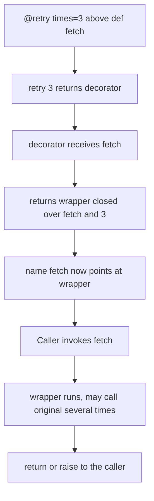

## Why this matters

Decorators show up in every Python backend: route registration, authentication checks, retry, timing, caching, and permission gates. The syntax `@decorator` is sugar. The mechanism is a function that takes a function and returns a function. Interviews ask you to implement `retry` or `timer`, then ask why the wrapped function's name became `wrapper` and broke your logs. That second question is `functools.wraps`.

A decorator that swallows exceptions, retries non-idempotent POSTs, or stores secrets in closure state will pass a syntax quiz and fail a design review. This lesson covers the mechanism and the judgment.

## Intuition

Picture a sticker you put on a tool. The sticker is the decorator. The tool is the original function. Callers think they are holding the tool; they are holding the sticker, which uses the tool inside. If the sticker does not copy the tool's name and docstring, every debugger shows the sticker's name.

A parameterized decorator is a sticker factory. `@retry(times=3)` must return a decorator, and that decorator must return a wrapper. Three layers, because the factory receives `times`, the decorator receives the function, and the wrapper receives the call's arguments. People collapse the layers and the error is immediate: the function runs at decoration time, or the wrapper receives the wrong object.

## Core concept in depth

### The sugar and the call

```python
def deco(fn):
    def wrapper(*args, **kwargs):
        return fn(*args, **kwargs)
    return wrapper

@deco
def add(a, b):
    return a + b
```

This is the same as `add = deco(add)` after the function is created. The name `add` now refers to `wrapper`. The original function object is alive only because `wrapper` closes over it. If `deco` does not return a callable, the next call to `add` fails, often with `TypeError: 'NoneType' is not callable`, which means you forgot the `return wrapper`.

Decoration runs at definition time, which is usually import time. The wrapper runs at call time. Any work you do in `deco` itself happens once, when the module is imported. Database calls, network checks, and reading argv do not belong there. A decorator that registers a route in a global table at import time is a deliberate side effect; keep it to a list append, not a connection.

### Preserving identity

Without help, `wrapper.__name__` is `"wrapper"` and `help(add)` shows the wrapper's docstring. Stack traces inside the wrapper still show the line inside `wrapper`, which is good, but logs that print `fn.__name__` lie. `functools.wraps(fn)` copies `__name__`, `__doc__`, `__module__`, and the annotation data, and it sets `__wrapped__` so you can reach the original.

Always put `@functools.wraps(fn)` on the wrapper in library and application code. Tests that assert on `__name__` will thank you. Introspection-based frameworks use the name to build operation ids. A missing `wraps` becomes a production API called `wrapper` on the next deploy.

`wraps` does not copy your custom attributes unless you assign them. It does not change the fact that the object callers see is the wrapper. `isinstance` checks against a function type still pass. Equality of the function object with the original fails. If you need the original, follow `__wrapped__`, possibly more than once when decorators stack.

### Stacking order

```python
@a
@b
def f():
    ...
```

This is `f = a(b(f))`. `b` wraps first. `a` wraps the result. A call enters `a`'s wrapper, then `b`'s wrapper, then `f`. Read decorators bottom-up for "who touches the function first" and top-down for "who runs first on a call." Authentication should be outside business timing if you do not want to time rejected requests, or inside if you do. Pick the order on purpose and do not sort decorators alphabetically.

### Parameterized decorators

`@retry(3)` means `retry(3)` returns the real decorator. The real decorator accepts the function. The wrapper accepts the call arguments and closes over both the function and the number `3`.

```python
import functools

def retry(times: int):
    if times < 1:
        raise ValueError("times must be >= 1")

    def decorator(fn):
        @functools.wraps(fn)
        def wrapper(*args, **kwargs):
            last = None
            for _ in range(times):
                try:
                    return fn(*args, **kwargs)
                except Exception as exc:
                    last = exc
            raise last
        return wrapper
    return decorator
```

Validate `times` in the factory, at decoration time, so a bad constant fails at import rather than on the first request. The wrapper should not catch `Exception` in production without a narrower type. Retrying `ValueError` from a bug hides the bug. Retry the errors that are transient: timeouts, connection resets. Do not retry operations that are not idempotent unless the caller opted in.

The factory pattern has a cousin that accepts either arguments or a bare `@decorator`. Implementing that overload makes the decorator harder to read. Prefer an explicit call `@retry(times=3)` even when the default would let you write `@retry`. Consistency beats a clever signature.

### What decorators must not do

They must forward `*args` and `**kwargs` unless they intentionally change the signature, and if they change it they must document the new contract. They must not swallow the return value. A missing `return` turns every decorated function into a function that returns `None`. They must not hold a lock across the wrapped call unless that is the point of the decorator, because you will deadlock the moment the function calls back into the same lock.

Class decorators and decorators on methods are the same mechanism plus `self`. A wrapper on a method is a function that receives `self` as the first positional argument through `*args`. You do not need special syntax. If you replace the function on the class, descriptor binding still passes the instance. If you wrap and forget `wraps`, the method's name in logs is `wrapper` and `self` is still passed correctly, so the bug looks like a logging bug rather than a binding bug.

`@staticmethod` and `@classmethod` are decorators that return descriptors. Order matters: they are usually the outermost decorator so the object stored on the class is the static or class method descriptor. You will see the descriptor protocol in the OOP module. For now, put `@staticmethod` above your own decorator unless you have measured a reason not to, and test a call.

## Diagram / flowchart



### Dry-run: decoration time versus call time

| Moment | What runs | What must not run |
| --- | --- | --- |
| Import, `def` finishes | `retry(3)` then `decorator(fetch)` | The HTTP call inside `fetch` |
| Import | `wraps` copies the name `fetch` | A retry loop |
| Later call `fetch("/health")` | `wrapper` tries the call up to 3 times | Re-binding the global name |
| Failure on all attempts | The last exception propagates | A swallowed error that returns `None` |

If the HTTP call happens at import, you decorated wrong: you called `fetch` inside `decorator` instead of inside `wrapper`.

## Code

```python
import functools
import time


def timed(fn):
    @functools.wraps(fn)
    def wrapper(*args, **kwargs):
        start = time.perf_counter()
        try:
            return fn(*args, **kwargs)
        finally:
            elapsed = time.perf_counter() - start
            wrapper.last_ms = round(elapsed * 1000, 3)
    return wrapper


def repeat(times: int):
    if times < 1:
        raise ValueError("times must be >= 1")

    def decorator(fn):
        @functools.wraps(fn)
        def wrapper(*args, **kwargs):
            result = None
            for _ in range(times):
                result = fn(*args, **kwargs)
            return result
        return wrapper
    return decorator


@timed
@repeat(2)
def greet(name: str) -> str:
    return f"hello {name}"


if __name__ == "__main__":
    print(greet("Ada"), greet.__name__)
```

Read the stack bottom-up. `repeat` wraps `greet` first, so one call to the final function enters `timed`, then `repeat`'s wrapper, which calls the original twice. `greet.__name__` stays `"greet"` only because both wrappers used `wraps`. Drop either `wraps` and the name becomes `"wrapper"`. `timed` records elapsed time on the wrapper even when the body raises, because the clock stops in `finally`.

## Complexity analysis

| Concern | Cost |
| --- | --- |
| Decoration | Once per function at import, O(1) unless you do I/O |
| Extra call through a wrapper | One Python call per layer. Negligible next to I/O |
| Stack of k decorators | k extra calls per invocation |
| Retrying a failed request t times | t times the inner cost, plus backoff if you add it |
| Logging arguments on every call | Can dominate if arguments are huge objects you stringify |

The expensive decorator bugs are semantic: retrying a payment, logging a password that arrived in `kwargs`, or taking a lock around a slow call. The call overhead is not why you remove a decorator. Measure before you inline one for speed.

## Tricks, tips and patterns

- Always apply `functools.wraps` to the wrapper you return.
- Validate decorator arguments in the outer factory so bad constants fail at import.
- Forward `*args` and `**kwargs`, and return the inner result.
- Use `finally` for timing and lock release so exceptions still clean up.
- Narrow the exception type you retry. Let `TypeError` and `ValueError` crash.
- Stack order is call order from the outside in. Write the outermost behavior closest to the `@` that should run first... actually the top decorator runs first on the call. Put `@authorize` above `@timed` if authorization should happen before you start the timer, because the top wrapper is the outer one.
- Store cross-cutting policy in the decorator and business rules in the function. Do not query five tables inside a decorator "for convenience."

## Common mistakes and edge cases

- Forgetting `return wrapper`, so the decorated name becomes `None`.
- Forgetting `return fn(...)` inside the wrapper, so the caller gets `None`.
- Applying a parameterized decorator without calling it: `@retry` passes the function as `times` and fails in a confusing way, or worse, succeeds as the wrong layer.
- Catching `Exception` and retrying bugs, or not re-raising after the last attempt.
- Dropping `wraps`, then generating OpenAPI operation ids named `wrapper`.
- Doing I/O at decoration time because the call was accidentally in the decorator body.
- Mutable default state stored on the wrapper that tests share across cases. Reset it in the test or store state in a local inside the wrapper if it should be per call.
- Decorating a function used as a method and writing the wrapper to expect no `self`. `*args` avoids that mistake.
- Double-wrapping and being surprised `__wrapped__` is only one level deep per decorator. Walk the chain.

## Interview notes

Implement `timed` or `retry` on the board in three layers if parameters are involved, two if not. Say "definition time versus call time" before you write the body. Add `wraps` without being asked, and say why: logs, help, and frameworks use `__name__`.

Follow-ups:

- **What is `@deco` equivalent to?** `fn = deco(fn)` after the def.
- **Order of two decorators?** The bottom one wraps first. The top one's wrapper runs first on a call.
- **How do you pass arguments to a decorator?** A factory that returns the decorator.
- **How do you retry safely?** Only idempotent operations, only transient exception types, bounded attempts, and preferably backoff with jitter. Backoff belongs in the concurrency and resilience discussion; the decorator is just where it lives.

Mention that `functools.lru_cache` is a decorator you should use rather than write, with the caveat that it keeps results forever unless you set `maxsize`, and it is unsafe if the function is not pure. That caveat is an interview separator.

## Practice problems

1. **Call Count** (medium) — a decorator that stores how many times the wrapper was entered. [Practice: python-ex-call-count]
2. **Repeat Last** (medium) — call the function n times and return the last result, preserving the name. [Practice: python-ex-repeat-last]
3. **Require Positive** (medium) — a parameterized decorator that rejects non-positive integer arguments before the call. [Practice: python-ex-require-positive]
4. **Wraps Chain** (easy) — given a stack of names, return the order wrappers run on a call. [Practice: python-ex-decorator-order]
5. **Retry Transient** (medium) — retry only a named error tag, up to n attempts, and return the first success. [Practice: python-ex-retry-tags]

## Summary / cheat sheet

- `@deco` means `fn = deco(fn)`. Decoration is definition time. The wrapper body is call time.
- Return the wrapper from the decorator and return the original function's result from the wrapper.
- `@functools.wraps(fn)` keeps the name, docstring, and a `__wrapped__` link.
- `@factory(arg)` is three layers: factory, decorator, wrapper. Validate `arg` in the factory.
- Stacked decorators apply bottom-up and run top-down on a call.
- Forward `*args` and `**kwargs`. Narrow the errors you catch. Do not retry non-idempotent work by default.
- Do not perform I/O while decorating unless the decorator's job is registration and the work is a cheap append.

## Further reading

- [functools.wraps](https://docs.python.org/3/library/functools.html#functools.wraps)
- [PEP 318 — Decorators for Functions and Methods](https://peps.python.org/pep-0318/)
- [Compound statements — function definitions](https://docs.python.org/3/reference/compound_stmts.html#function-definitions)
- [functools.lru_cache](https://docs.python.org/3/library/functools.html#functools.lru_cache)
