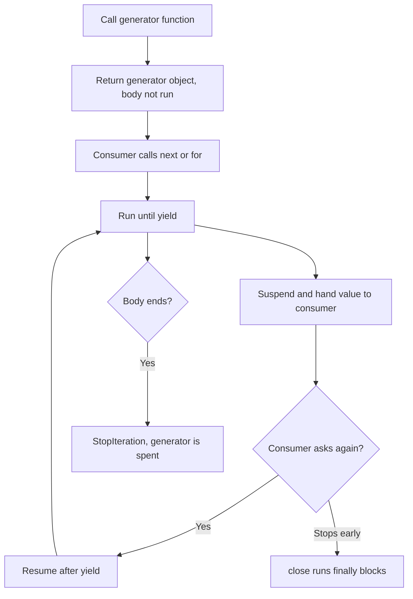

## Why this matters

Backend work is full of streams: log lines, database cursors, CSV exports, paginated API responses. A function that returns a list holds the entire stream in memory before the caller sees the first row. A generator yields one row at a time and lets the caller stop early. That is the difference between a script that dies on a 2 GB export and a script that writes the export to disk with a constant memory ceiling.

Interviews ask you to generate a sequence without storing it, to explain why a second loop over the same generator is empty, and to implement `yield from` when flattening. They also ask why a generator is a poor return type for a public API that callers will index. You should be able to choose.

## Intuition

A normal function runs until it returns, then its locals disappear. A generator function returns a generator object immediately, without running the body. Each `next` call runs the body until the next `yield`, pauses, and hands that value out. Locals stay in the frame, frozen between yields. When the body ends or executes `return`, the generator raises `StopIteration` and is finished forever.

Think of `yield` as "produce this value and wait to be asked again," not as "append to a hidden list." There is no hidden list unless you built one yourself.

## Core concept in depth

### Generator functions and generator objects

If a function contains `yield`, calling it does not run the body. It returns a generator. The body starts on the first `next`, or on the first step of a `for` loop, which calls `next` for you. `yield expr` produces `expr` and suspends. Execution resumes on the line after `yield`.

```python
def countdown(n: int):
    while n > 0:
        yield n
        n -= 1
```

`countdown(3)` is a generator. The first `next` yields `3` and pauses before `n -= 1`. The next resumes, decrements, loops, and yields `2`. After `1`, the loop ends and `StopIteration` propagates. A `for` loop swallows that exception. A manual `next` does not, unless you pass a default: `next(gen, None)`.

`return value` inside a generator ends it. The value is attached to the `StopIteration` exception and is not another yielded item. Callers using `for` never see it. It exists for `yield from` and for `StopIteration.value`. Do not use `return` to yield a final item. `yield` it, then return.

### Single pass

Generators do not rewind. After exhaustion, further `next` calls raise `StopIteration` immediately. If two consumers need the data, convert to a list once, or call the generator function again to start a new independent generator. Sharing one generator between two loops is a bug: the second loop steals the rest of the stream, or sees nothing if the first loop finished.

`list(gen)` pulls everything into memory. That is correct when you need random access and the data fits. It throws away the reason you used a generator when the data does not fit.

### yield from

`yield from sub` yields every item from a sub-iterator and, when the sub-generator returns a value, that value becomes the value of the `yield from` expression. Use it to flatten one level of nested generators without a manual loop. It also forwards `send`, `throw`, and `close` to the sub-generator. For ordinary pipelines you only need the flattening behavior.

```python
def flatten(rows):
    for row in rows:
        yield from row
```

This does not recurse into deeper nesting unless `row` itself flattens. One level is usually what a CSV or a list of lists needs.

### Closing and cleanup

Generators support `close()`, which throws `GeneratorExit` at the yield point. A `with` statement or a `try/finally` around the body still runs, so you can close a file when the consumer stops early. This is the pattern for a generator that opens a resource: the caller must close the generator, either by finishing the loop, calling `close`, or using `contextlib.closing`. If they abandon the generator without closing it, cleanup waits for garbage collection, which is too late for a file descriptor limit.

Prefer a generator that receives an already-open file over one that opens the file itself, so the caller's `with` block owns the lifetime. That design is easier to test.

### send, and why you can skip it

`gen.send(value)` resumes and makes that value the result of the `yield` expression. It is how coroutines were written before `async`. You will not use `send` in modern application code. Async I/O is a later module. Mention `send` if asked, and say that `yield` as a statement result is a coroutine style you should not invent for data pipelines. Data pipelines only yield outward.

### Generator expressions

`(n * n for n in nums)` is a generator expression. It is the comprehension form of a generator function. Same single-pass rules. Same laziness. A function is better when the body needs statements, logging, or `try`. An expression is better when the pipeline is one filter and one map.

### Infinite generators

`yield` inside `while True` is legal and useful for a stream of timestamps or a retry ticker, as long as the consumer stops. Never pass an infinite generator to `list`. Bound it with `itertools.islice`, which you will study with itertools. A bug that builds `list(infinite)` hangs until the machine runs out of memory.

## Diagram / flowchart



### Dry-run: countdown(3)

| next call | Runs | Yields | n after pause |
| --- | --- | --- | --- |
| 1 | Enter, n is 3, yield | 3 | 3, paused before decrement |
| 2 | Decrement to 2, loop, yield | 2 | 2 |
| 3 | Decrement to 1, loop, yield | 1 | 1 |
| 4 | Decrement to 0, loop ends | StopIteration | finished |
| 5 | Does not resume the body | StopIteration immediately | still finished |

A second `for` over the same object prints nothing. Calling `countdown(3)` again is a new object and repeats the table.

## Code

```python
from collections.abc import Iterator


def countdown(n: int) -> Iterator[int]:
    while n > 0:
        yield n
        n -= 1


def unique_in_order(items: list[str]) -> Iterator[str]:
    seen: set[str] = set()
    for item in items:
        if item in seen:
            continue
        seen.add(item)
        yield item


def flatten(rows: list[list[int]]) -> Iterator[int]:
    for row in rows:
        yield from row


def first_above(nums: list[int], limit: int) -> int | None:
    gen = (n for n in nums if n > limit)
    return next(gen, None)


if __name__ == "__main__":
    print(list(countdown(3)))
    print(list(unique_in_order(["a", "b", "a", "c"])))
    print(list(flatten([[1], [2, 3]])))
    print(first_above([1, 4, 9], 5))
```

`first_above` stops as soon as `next` receives one value. The rest of `nums` is not filtered. That early exit is the operational reason to prefer a generator over a list comprehension when the match is usually near the front of a long file.

## Complexity analysis

| Approach | Time until first value | Memory |
| --- | --- | --- |
| Build a list, then iterate | Θ(n) before any consumer work | Θ(n) |
| Generator, consume all | Θ(n) overall, first value after the work before the first yield | Θ(1) besides the source and what you yield |
| Generator, stop after k items | Θ(k) plus setup | Θ(1) |
| `list(generator)` | Θ(n) | Θ(n), laziness was wasted |
| Nested `yield from` over n rows of length m | Θ(n·m) if fully consumed | Θ(1) extra if rows are streamed |

The setup caveat matters: if you read the whole file into a string before the first `yield`, the generator did not save you. Push the `yield` inside the read loop.

## Tricks, tips and patterns

- Put `yield` inside the loop that reads, not after a list is complete.
- Use `next(gen, default)` when "no items" is a normal case.
- Call the generator function again for a second pass. Do not reuse the object.
- `yield from` flattens one iterable. Do not recursive-yield on untrusted depth without a bound; a malicious nest can blow the stack. For files, one level is enough.
- Type the return as `Iterator[T]` so callers do not think they received a list.
- If the caller needs a list, let the caller write `list(...)`. Do not hide the materialization inside an API named `iter_*`.
- Close generators that own resources. Better, do not let them own resources.

## Common mistakes and edge cases

- Expecting the body to run at the call that creates the generator. Bugs in the body appear on the first `next`, which may be far from the call site.
- Iterating the same generator twice and debugging an empty second loop.
- `return x` thought to yield `x`. It does not.
- Passing a generator to code that tries `len` or indexing. Convert knowingly or change the producer.
- An infinite generator consumed by `list` or by a test that forgot a bound.
- Holding the only reference and abandoning it without `close`, leaking a socket until GC.
- Mutating a list while a generator is suspended midway through iterating it. The iterator is still live across yields. The mutation bug does not go away because you added `yield`.
- Catching `StopIteration` inside the generator body. That interacts badly with the generator protocol. Let the runtime raise it by returning.

## Interview notes

Say "calling it returns a generator; the body runs on next." Then write a small `yield` loop and a consumer that stops early, and state the memory is O(1) extra. Mention single-pass before the interviewer does.

Follow-ups:

- **How is this different from a list comprehension?** The list exists entirely. The generator computes on demand and forgets values the consumer does not keep.
- **How do you flatten?** `yield from` per inner iterable.
- **Can you restart?** Not the same object. Call the function again.
- **What about async?** Async generators use `async def` and `yield` together and are consumed with `async for`. Different protocol, same laziness idea. Do not mix them into a sync answer unless asked.

A strong extra is the resource note: the producer should yield lines from a file the caller opened, so lifetime stays in a `with` block.

## Practice problems

1. **Countdown** (easy) — yield n down to 1, and return an empty iterator for n less than 1. [Practice: python-ex-countdown]
2. **Unique Yield** (medium) — yield first-seen items in order without building the output list in the producer. [Practice: python-ex-unique-yield]
3. **Flatten Yield** (easy) — yield from each inner sequence once. [Practice: python-ex-flatten-yield]
4. **First Above** (easy) — first value strictly above a limit, or a sentinel if none. [Practice: python-ex-first-above]
5. **Window** (medium) — yield overlapping windows of size k from a sequence. [Practice: python-ex-windows]
6. **Pipeline** (medium) — normalize strings then drop blanks, as two generators composed by the caller. [Practice: python-ex-pipeline]

## Summary / cheat sheet

- A function with `yield` returns a generator object and does not run until iterated.
- `yield` pauses and produces a value. Locals survive until the next `next`.
- When the body ends, the generator raises `StopIteration` and stays finished. A second loop sees nothing.
- `return` inside a generator is not a yielded value. `yield` the last item if the consumer should see it.
- `yield from` delegates to an inner iterable. One level unless you deliberately recurse.
- Generators are Θ(1) extra memory only if you yield inside the producing loop and the consumer does not store everything.
- Close generators that own files, or do not let them own files. Infinite generators need a consumer that stops.

## Further reading

- [Generators](https://docs.python.org/3/tutorial/classes.html#generators)
- [yield expressions](https://docs.python.org/3/reference/expressions.html#yield-expressions)
- [PEP 380 — Syntax for Delegating to a Subgenerator](https://peps.python.org/pep-0380/)
- [Iterator types](https://docs.python.org/3/library/stdtypes.html#iterator-types)
- [contextlib.closing](https://docs.python.org/3/library/contextlib.html#contextlib.closing)
