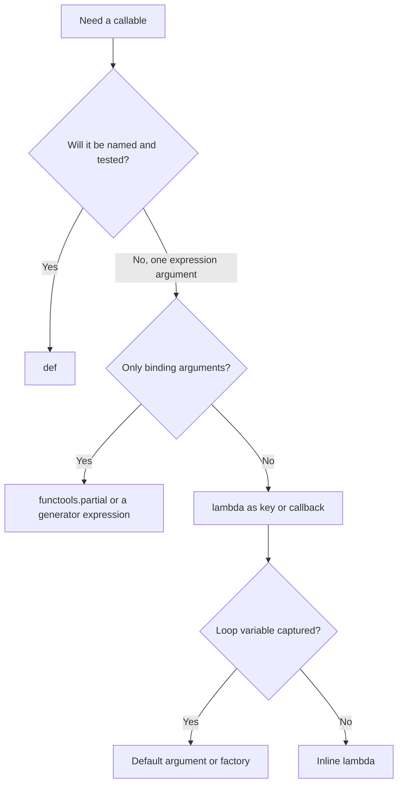

## Why this matters

`lambda` is an expression that creates a function. It exists so `sorted`, `min`, `max`, and higher-order tools can take a tiny function without a `def` sitting ten lines away. Interviews use it in one place more than any other: the `key` argument. "Sort these intervals by end time." "Sort these strings by length, then alphabetically." The candidate who writes a tuple key in one expression looks fluent. The candidate who nests three lambdas with side effects looks like they are hiding from `def`.

This lesson is about judgment. You will write lambdas, and you will delete them.

## Intuition

A `def` statement binds a name in the current scope and may contain any statements. A `lambda` is an expression. It has no name unless you assign it, it contains exactly one expression, and the value of that expression is what the function returns. There is no `return` keyword, no assignment, no `try`, no `while`. If you need those, you needed `def`.

The function object a lambda creates is an ordinary function. It has a closure if it uses enclosing names, the same late-binding rules, and the same call overhead. The keyword does not make it faster. It makes it anonymous and limited.

## Core concept in depth

### Syntax and limits

`lambda params: expression` evaluates to a function. Parameters follow the same rules as `def`, including defaults, but you will almost never put `*args` on a lambda in application code because the line is already too dense. The expression is the return value. `lambda x: x if x > 0 else 0` is legal because the conditional expression is an expression. `lambda x: if x > 0: return x` is a syntax error.

Assigning a lambda to a name (`square = lambda x: x * x`) fights the tool. You lose a useful `__name__` (`<lambda>` in tracebacks) and you gain nothing over `def square(x): return x * x`. Linters flag named lambdas for this reason. Use lambda where a function is an argument, not where a function needs a name.

### The key= pattern

`sorted(items, key=fn)` decorates each item with `fn(item)`, sorts by those keys, and returns items in the new order. The original items are what come back, not the keys. `list.sort` is the in-place version and returns `None`. That return value is a classic bug: `rows = rows.sort(...)` sets `rows` to `None`.

Python's sort is stable. Items with equal keys keep their original relative order. You can sort by a secondary key first and a primary key second, and the stability preserves the secondary order. You can also pass a tuple key and do it in one pass. Tuple comparison is lexicographic, so `key=lambda w: (len(w), w)` sorts by length, then by the string itself for equal lengths. Prefer the tuple. It is one sort, it is obvious, and it does not depend on the reader remembering stability.

`reverse=True` reverses the comparison. It does not reverse each key. To sort one field ascending and another descending, do not reach for a hack on strings unless you can explain it. A reliable approach is to sort with a tuple that stores a negation for numeric fields you want descending: `(-score, name)`. Negation works for numbers, not for strings. For strings, use `reverse` on a stable sort in two passes, primary last, or store an explicit rank.

`min(items, key=fn)` and `max(items, key=fn)` return the item, not the key. On ties, they return the first item that produced the winning key. An empty iterable raises `ValueError` unless you supply `default` (available on `min` and `max`, not as a sort concept).

### map and filter

`map(fn, iterable)` and `filter(pred, iterable)` return iterators, not lists. They are lazy, single-pass, and usually less clear than a generator expression. `map(lambda x: x * 2, nums)` is worse than `(x * 2 for x in nums)` because the lambda adds a scope for no reason. Use `map` when you already have a named function and the reader benefits from the name: `map(str.strip, lines)`. Use `filter(None, items)` only if you truly want to drop every falsy value, and say that, because `0` will disappear.

`functools.partial` often replaces a lambda that only binds the first arguments. `partial(int, base=16)` is clearer than `lambda s: int(s, 16)` when you pass it around. Partial is covered again with functools. You can use it now.

### Callbacks

A GUI or a router sometimes wants a zero-argument callback that closes over state. A lambda is acceptable when the body is a single call. The loop-capture bug still applies: `lambda: i` inside a `for` sees the final `i`. Bind a default or use a factory, exactly as in the closures lesson. A lambda does not get a special snapshot.

Do not put business logic in a lambda to avoid writing a test. If the behavior can fail, give it a name and a test. Lambdas are awkward to assert on because they have no name and no docstring. The function they call can be tested instead: keep the lambda as `lambda row: score(row)`, and test `score`.

### What people pretend lambda can do

It cannot contain statements. It cannot be a multi-line block. Parentheses do not unlock statements. It is not a performance hint. CPython compiles it like any small function. It is not required for "functional style." Python's functional tools accept any callable, and a `def` is a callable.

## Diagram / flowchart



### Dry-run: tuple key sort

Words: `["bb", "a", "ccc", "b"]`. Key is `(len(word), word)`.

| Word | Key | Order after sort |
| --- | --- | --- |
| bb | (2, bb) | |
| a | (1, a) | first, shortest |
| ccc | (3, ccc) | last, longest |
| b | (1, b) | after a, same length, b greater than a |

Result: `a`, `b`, `bb`, `ccc`. Stability is not even required here because the tuple breaks every tie. If two words shared a full key, stability would keep the earlier one first. `words.sort()` returns `None` and sorts in place. `sorted(words, key=...)` returns a new list and leaves `words` alone.

## Code

```python
def by_length_then_text(words: list[str]) -> list[str]:
    return sorted(words, key=lambda word: (len(word), word))


def top_student(rows: list[tuple[str, int]]) -> tuple[str, int]:
    if not rows:
        raise ValueError("rows must be non-empty")
    return max(rows, key=lambda row: (row[1], row[0]))


def clamp_factory(low: int, high: int):
    return lambda value: min(high, max(low, value))


if __name__ == "__main__":
    print(by_length_then_text(["bb", "a", "ccc", "b"]))
    print(top_student([("Bea", 90), ("Ada", 90), ("Cy", 80)]))
    clamp = clamp_factory(0, 10)
    print(clamp(-3), clamp(4), clamp(20))
```

`top_student` uses a tuple so a higher score wins, and equal scores break ties by name ascending. If the spec wanted the earliest row in the input on a tie, the key would be only the score, because `max` keeps the first maximum. The tuple changes that spec. Say which spec you are implementing. The clamp lambda is a closure over `low` and `high`. It is short enough to stay a lambda. The moment clamp needs a log line, it becomes a nested `def`.

## Complexity analysis

| Operation | Cost |
| --- | --- |
| `sorted` with a key | Θ(n log n) comparisons, each key computed once per item in CPython's decorate-sort-undecorate |
| Key function work | Added to the cost above. A key that scans a string is not free |
| Two stable sorts versus one tuple key | Two Θ(n log n) passes versus one. Prefer one tuple when you can express the order |
| `min` / `max` with a key | Θ(n) key evaluations |
| Lambda versus def call | The same order of overhead. Not a reason to choose |

Timsort is stable and adaptive. You do not reimplement it in an interview unless asked for merge sort as an algorithm exercise. You do state O(n log n) time and O(n) extra memory for `sorted`, because it builds a new list. `list.sort` is O(n log n) time and O(n) temporary memory as well during the sort, and O(1) extra after it returns, with the list mutated.

## Tricks, tips and patterns

- Sort with a tuple key for multi-field order. Put the primary field first.
- Negate numeric fields you want in descending order inside an otherwise ascending tuple.
- Remember `list.sort` returns `None`. Assign `sorted(...)` when you need a new list.
- Use a named function when the key needs a comment. The name is the comment.
- Prefer a generator expression over `map` plus `lambda`.
- Use `partial` when you are only filling arguments.
- Bind loop variables in the lambda default if you must create lambdas in a loop.
- `operator.itemgetter` and `operator.attrgetter` are faster and clearer than `lambda row: row[1]` in hot sorts. They are worth knowing by name.

## Common mistakes and edge cases

- `rows = rows.sort(key=...)` and then iterating `None`.
- A lambda that tries to contain statements, then a backtick-escaped mess to fake multiple lines. Write a function.
- Sorting strings descending by negating them. Negation is for numbers.
- `max` on an empty list without `default`.
- Changing tie behavior by adding a second tuple field you did not mean as a tie-break.
- Late-binding lambdas in a loop.
- `filter(None, scores)` dropping legitimate zeros.
- Thinking a lambda is private or invisible to tracebacks. The traceback says `<lambda>` and a line number, which is harder to read, not invisible.
- Using lambda to mutate a closed-over list as a key function. Keys must be pure. A key with side effects makes the sort's results depend on how many times the implementation calls it.

## Interview notes

When asked to sort custom records, write the key first in words: "by end time ascending, then by start time ascending." Then translate to a tuple. Mention stability only if you rely on it. Mention that you will not mutate the input if the caller needs the original order, so you use `sorted`.

Follow-ups:

- **Can lambda contain statements?** No. One expression.
- **Does sorted call the key every comparison?** CPython computes each key once and sorts the decorated pairs. Do not depend on a key being called a specific number of times, and do not put side effects in it.
- **How do you sort descending by score and ascending by name?** `key=lambda r: (-r.score, r.name)`.
- **Why not map and filter?** Generator expressions read more naturally in Python. `map` is fine with an existing named function.

If they ask for a comparator like Java's `compare(a, b)`, say Python sorts with keys, not comparators, since `cmp` was removed. `functools.cmp_to_key` exists for awkward ports and is slower and harder to read. Prefer a key.

## Practice problems

1. **Sort Key** (easy) — sort strings by length, then lexicographically. [Practice: python-ex-sort-key]
2. **Top Score** (medium) — choose the row with the highest score, breaking ties by name. [Practice: python-ex-top-score]
3. **Clamp** (easy) — a factory that returns a clamp function closed over bounds. [Practice: python-ex-clamp-factory]
4. **Stable Names** (medium) — sort by department ascending and keep original order within a department. [Practice: python-ex-stable-dept]
5. **Negate Score** (medium) — sort by score descending and name ascending using one tuple key. [Practice: python-ex-score-name]

## Summary / cheat sheet

- `lambda` creates a function from one expression. No statements, no useful name unless you assign it, which you should not.
- Use it as a `key` or a tiny callback. Use `def` for anything you would test or debug as a unit.
- `sorted` returns a new list. `list.sort` returns `None` and mutates.
- Tuple keys encode priority left to right. Sort is stable if you truly need a two-pass approach.
- Negate numbers to flip one field inside an ascending tuple. Do not negate strings.
- `min` and `max` return the item. Empty input raises unless you pass `default`.
- Keys should be pure. Loop variables are late-bound unless you snapshot them.
- Generator expressions beat `map` plus `lambda`. `partial` beats a lambda that only binds arguments.

## Further reading

- [lambda expressions](https://docs.python.org/3/tutorial/controlflow.html#lambda-expressions)
- [Sorting HOW TO](https://docs.python.org/3/howto/sorting.html)
- [sorted](https://docs.python.org/3/library/functions.html#sorted)
- [operator.itemgetter](https://docs.python.org/3/library/operator.html#operator.itemgetter)
- [functools.cmp_to_key](https://docs.python.org/3/library/functools.html#functools.cmp_to_key)
